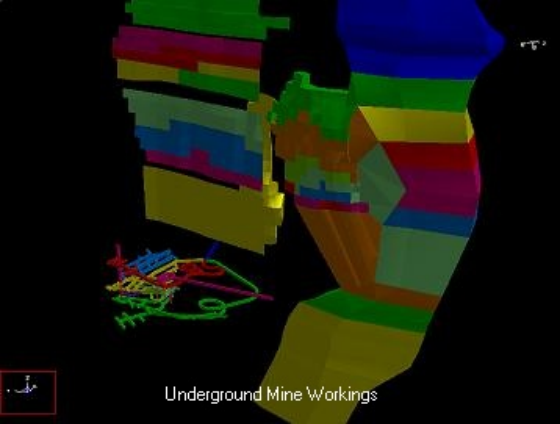
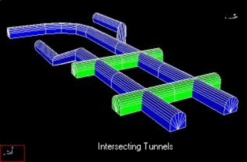
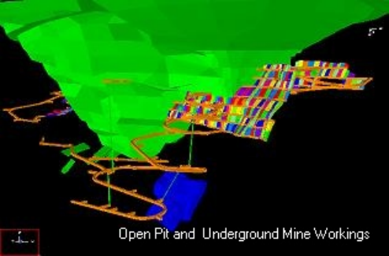
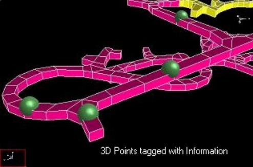
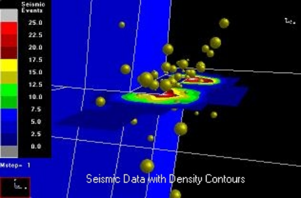

**Map3D Modeller** - CAD 3D et base de données visuelle SIG.

Ce module sert à construire et à visualiser des modèles 3D. Ce logiciel est utilisé pour des projets civils, géologiques et miniers.

Le système CAD 3D facile à utiliser (basé sur OpenGL) permet le dessin à main levée, la numérisation ou la sélection d'objets pour construire et modifier 5 types d'entités de base :

- Blocs 3D. Ces entités servent à construire des chantiers, des zones de minerai, des dykes et des tunnels. La construction s'aborde le plus facilement en définissant une série de coupes transversales ou de plans de niveau

(chacun peut avoir une forme différente et un nombre de points différent). Map3D peut simplifier ces contours si vous le souhaitez, puis interpoler entre les boucles pour former des formes 3D complexes.

- Entités 2D. Ces entités servent à construire des failles, l'exploitation tabulaire, la topographie du terrain et des fractures. Ces entités n'ont pas besoin d'être planes. Les fractures et les failles courbes et décalées sont entièrement prises en charge.

- Plans de grille. Vous pouvez définir des coupes transversales pour tracer des contours ou simplement trancher le modèle.

- · Lignes de grille. Elles sont particulièrement utiles pour représenter l'emplacement des trous de forage et du soutènement. L'emplacement et l'orientation des instruments se repèrent facilement.

- Lignes de construction. Les données d'arpentage simples, comme les axes de galerie, se représentent le plus facilement à l'aide de lignes de construction. Cela permet une importation et une exportation faciles vers d'autres logiciels CAD (prise en charge complète des formats dxf et pnt) et offre un moyen rapide d'afficher des données linéaires.

- Modèles ombrés par source lumineuse. L'ombrage par source lumineuse OpenGL est pris en charge pour améliorer la représentation du modèle.

Inclut une suite complète de fonctions de modification, dont copier, déplacer, étirer, aplatir, mettre à l'échelle, faire pivoter et plus encore. Cela permet de manipuler facilement et graphiquement les entités ci-dessus.

La base de données visuelle SIG permet de stocker, d'analyser et d'afficher une base de données de toute information souhaitée, y compris des données sismiques et des informations géologiques comme la teneur, la qualité du massif rocheux, etc.

Les points 3D peuvent être associés à une série de :

- valeurs numériques (p. ex. couleur, magnitude, orientation, temps, etc.),

- mots-clés (pour le filtrage),

- messages texte,

- noms de fichiers (p. ex. fichiers graphiques, documents, tableurs, dessins, etc.).

L'affichage de ces éléments peut être filtré de diverses façons. L'emplacement de chaque point peut être affiché sous forme de sphères ombrées en couleur, dont la taille et la couleur varient selon diverses combinaisons de paramètres. La densité de magnitude des points peut être tracée en contours sur un plan selon des fonctions de densité définies par l'utilisateur. Les plans de contour peuvent être définis par l'utilisateur ou ajustés par régression linéaire automatisée.

Map3D Results Viewer
