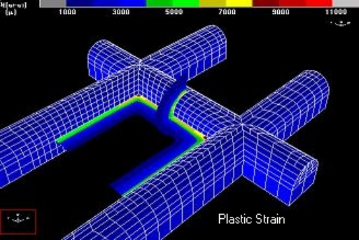
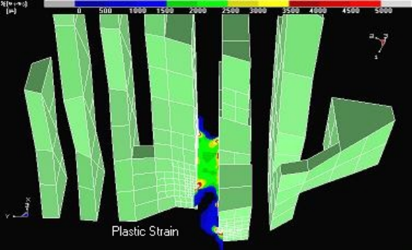
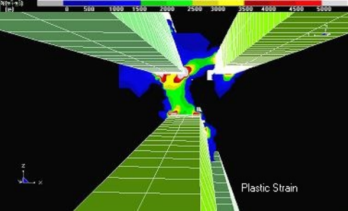
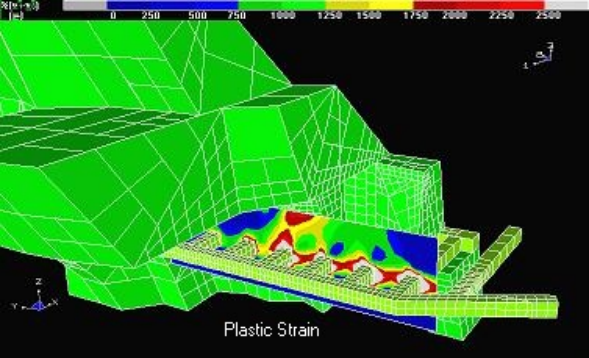

**Map3D Non-Linear** - réponse non linéaire du massif rocheux.

Inclut toutes les fonctionnalités de Map3D Fault-Slip et ajoute la capacité du massif rocheux 3D à céder sous des charges qui dépassent la résistance de la roche et à se déformer de façon non linéaire pour dissiper les contraintes excédentaires. Cette fonctionnalité est utile pour simuler les couches épaisses, les piliers surcontraints, les culées, les remblais et la réponse au fluage. Cette formulation résout le problème non linéaire à la surface des éléments de frontière et interpole ces effets entre ces frontières. Elle constitue une première approximation de la modélisation inélastique, qui offre l'avantage de permettre de grands modèles et une exécution très rapide.

Map3D Visco-Plastic
