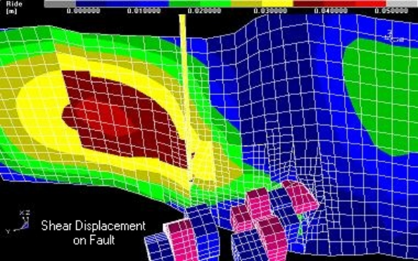
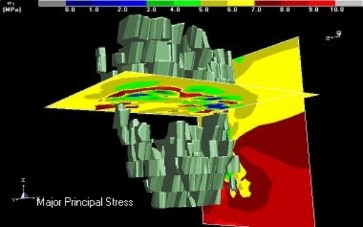
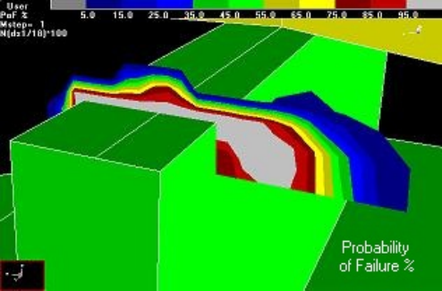
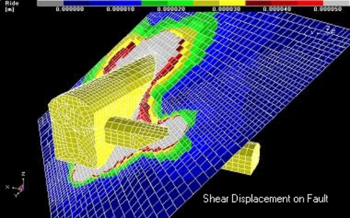
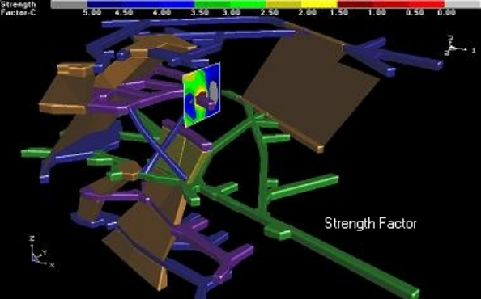

**Map3D Results Viewer** - visualisation et analyse des résultats d'analyse des contraintes.

Inclut la base de données visuelle SIG, mais pas le système CAD.

- affiche les résultats d'analyse des contraintes générés par les codes d'analyse des contraintes de Map3D

- affiche des contours sur des plans de coupe, le long de lignes et en des points précis

- fonctions de contour définies par l'utilisateur

- exportation directe vers Excel pour tracer des graphiques x-y

- affichage de trajectoires 3D

- affichage de tous les paramètres de contrainte, de déformation, de déplacement et de résistance, y compris les composantes principales et les valeurs résultantes, sur des plans et des lignes définis par l'utilisateur

- exportation aux formats dxf et pnt pour la compatibilité avec d'autres systèmes CAD et d'affichage

- contours de probabilité de rupture

- contours de coefficient de sécurité

- modèles ombrés par source lumineuse

- contours topographiques

**Map3D Fault-Slip**
