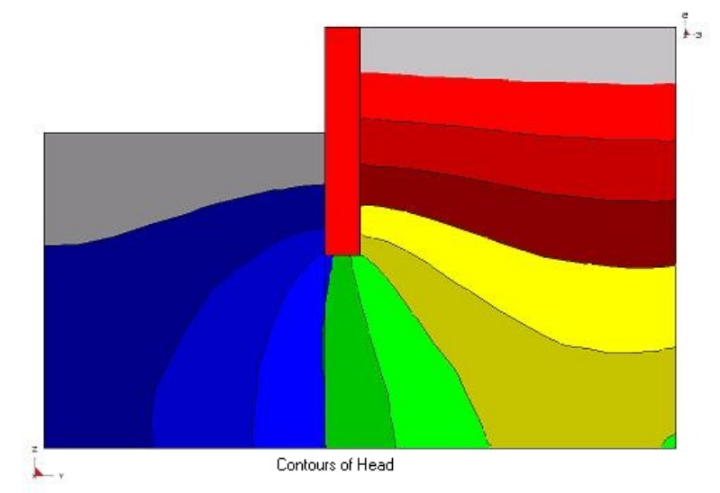
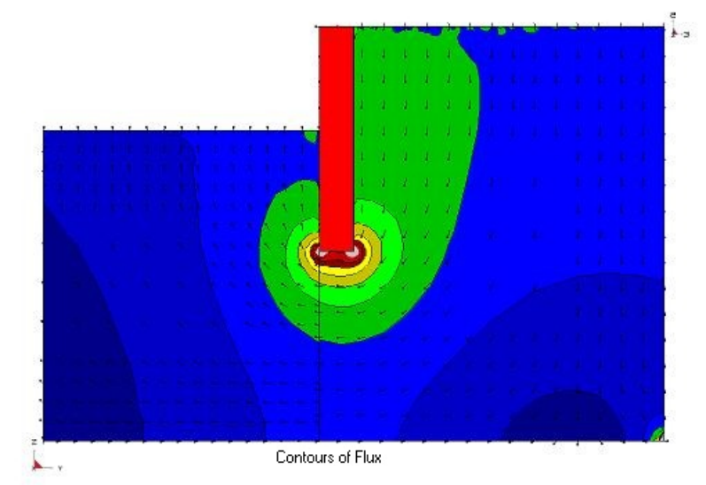

**Map3D Thermal-Fluid Flow** - analyse des contraintes thermiques et de l'écoulement de fluide.

Inclut toutes les fonctionnalités de Map3D Fault-Slip et ajoute la résolution simultanée des contraintes thermiques et de l'écoulement de fluide en régime permanent. Le programme est configuré de sorte que vous n'avez qu'à spécifier les conditions aux limites de température et de charge hydraulique ; le problème des contraintes thermiques est ensuite résolu simultanément. Cette fonctionnalité est utile pour simuler les effets de chauffage et de refroidissement ainsi que la réponse drainée et non drainée.

Map3D Non-Linear
