**Map3D Visco-Plastic** - réponse élasto-visco-plastique 3D du massif rocheux (encore en développement - non disponible commercialement pour le moment).

Inclut toutes les fonctionnalités de Map3D Fault-Slip et ajoute la capacité du massif rocheux 3D à se comporter de façon élasto-visco-plastique. Ce modèle offre une résolution complète des équations de plasticité incrémentale non associée et ajoute la capacité du massif rocheux 3D à céder sous des charges qui dépassent la résistance de la roche et à se déformer de façon non linéaire pour dissiper les contraintes excédentaires. Cette capacité de simulation fournit les grands déplacements nécessaires pour simuler les études d'interaction entre le soutènement et le remblai. Cette fonctionnalité est utile pour simuler les couches épaisses, les piliers surcontraints, les culées, les remblais et la réponse au fluage. Cette formulation résout le problème non linéaire dans les zones spécifiées du massif rocheux.

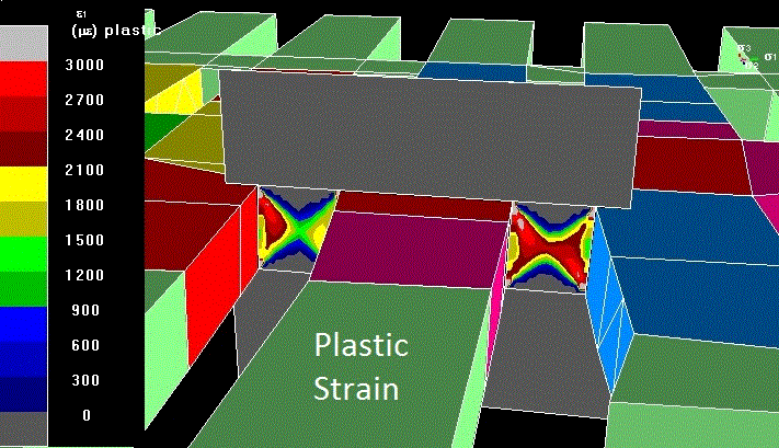

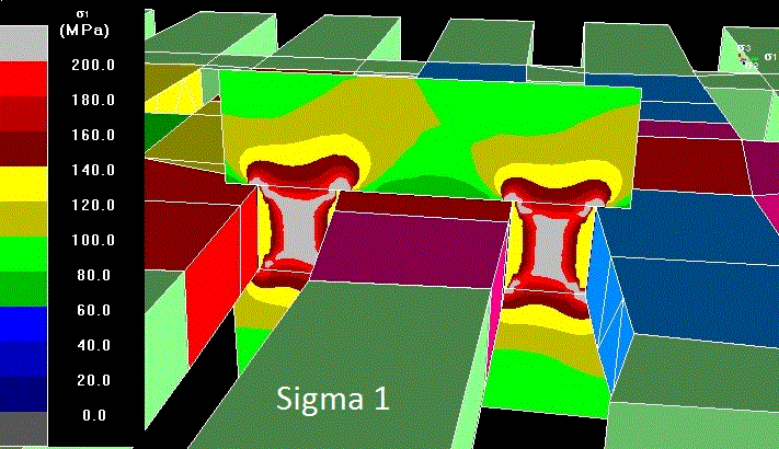

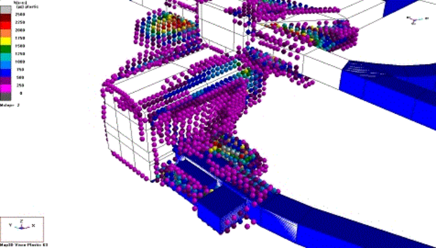

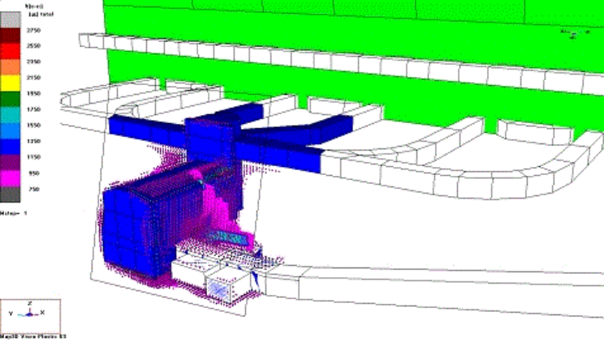

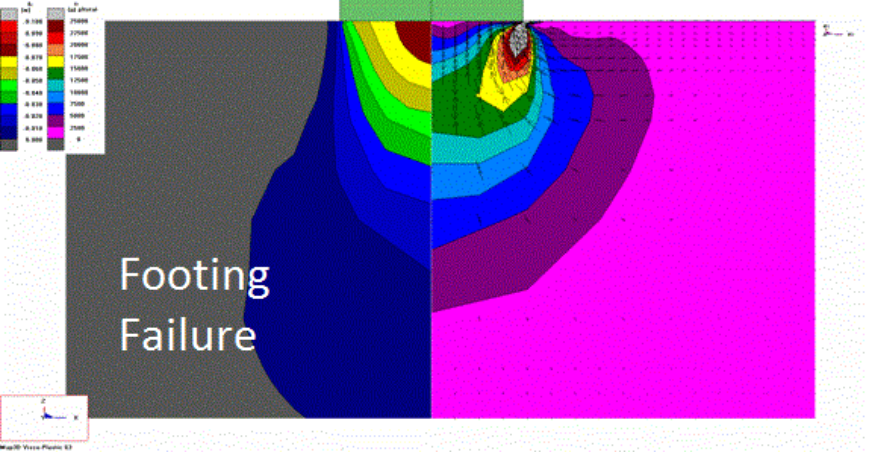

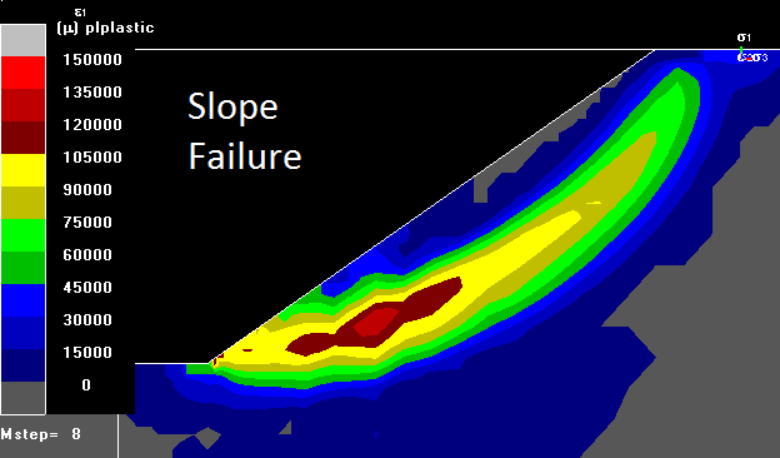

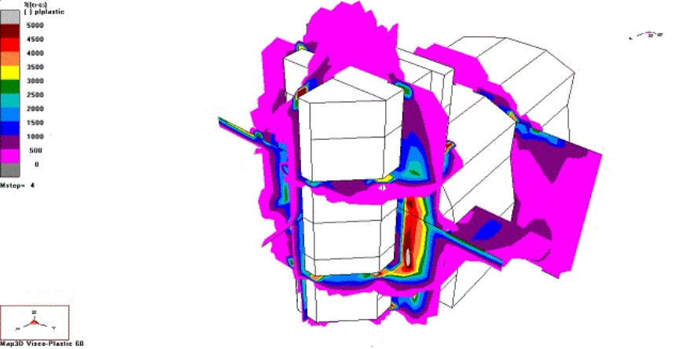

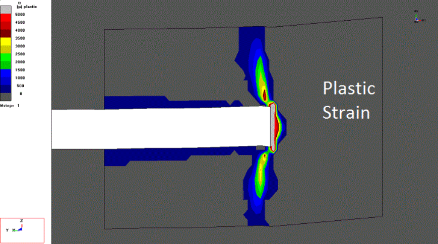

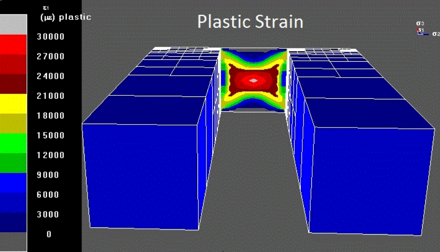

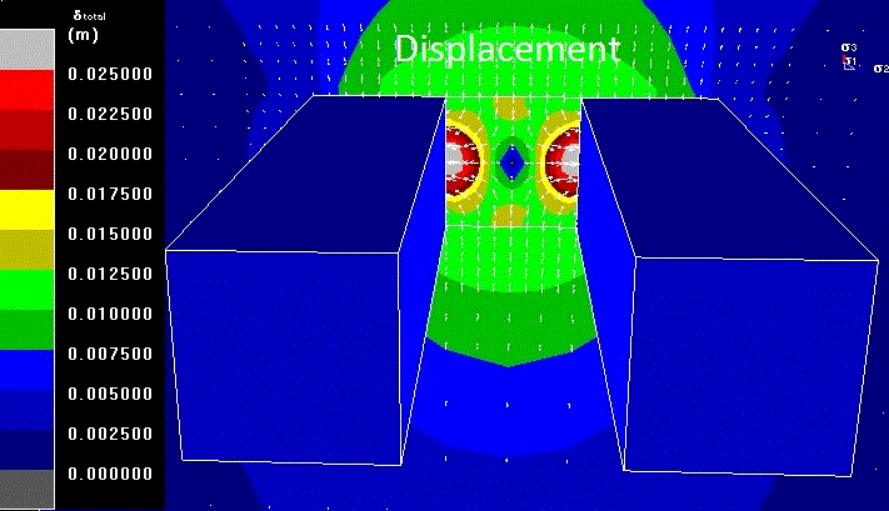

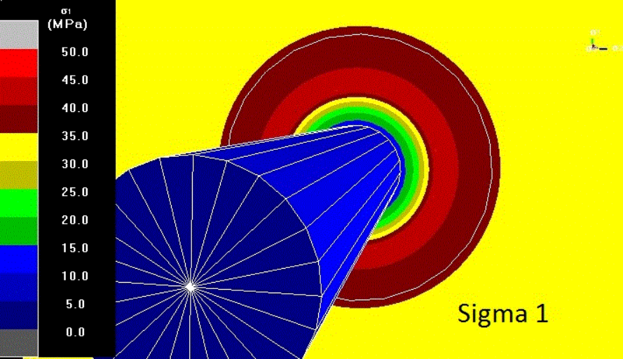

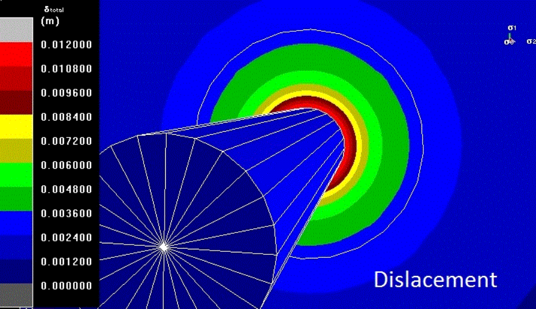

Map3D Overview
