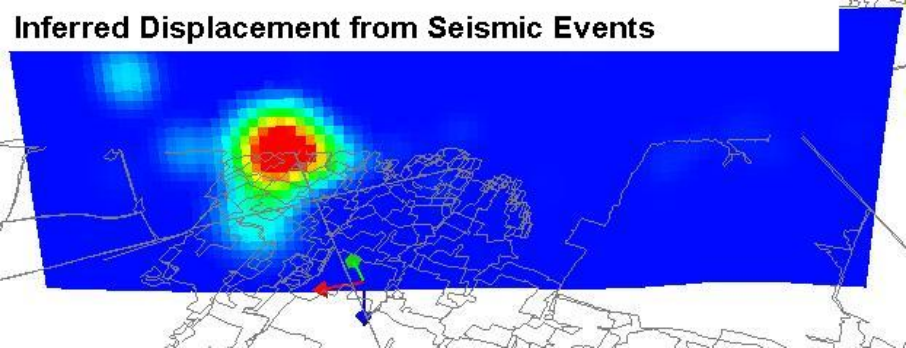
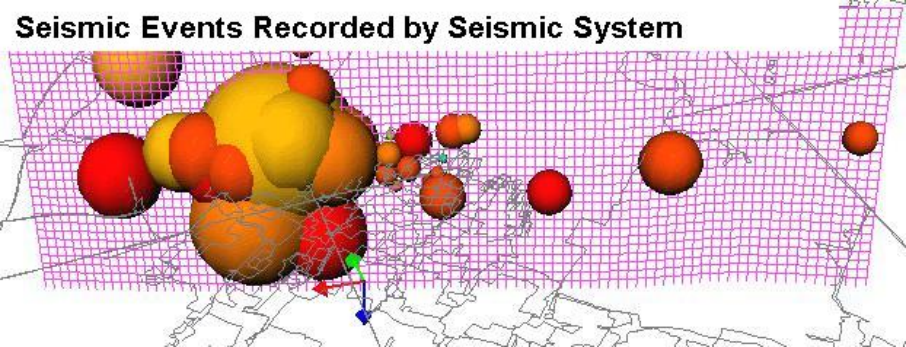
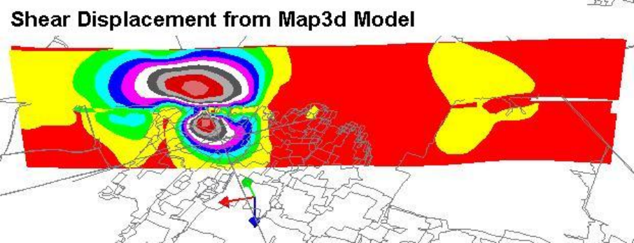

**Map3Di Integrated Seismicity** - superposition d'effets de chargement de champ externes à l'analyse des contraintes.

Inclut toutes les fonctionnalités de Map3D Fault-Slip et ajoute les effets de chargement de champ. Ces effets peuvent être importés depuis n'importe quelle base de données de chauffage thermique, de pression de fluide, de comportement non linéaire et de déformations indiquées par la sismicité. Ils permettent de caractériser des entités géologiques 2D et 3D, de tenir compte des changements de lithologie et d'intégrer les effets du chargement sismique à l'analyse des contraintes.

La modélisation numérique permet de prédire la réponse du massif rocheux à l'avancement des excavations minières. Si l'effet d'entités géologiques comme les failles ou les changements de lithologie peut facilement être intégré au modèle, l'emplacement, l'orientation et les propriétés de comportement de ces entités sont souvent incertains. Cela peut donner des résultats de modélisation peu fiables, donc d'une utilité limitée pour les exploitants de la mine. Map3Di permet de superposer des effets de chargement de champ externes au modèle Map3D. Le chargement de champ peut provenir du chauffage thermique, de la pression de fluide, du comportement non linéaire, etc. De plus, il peut être déterminé à partir de nombreuses formes de surveillance in situ, par exemple les pressions de fluide (p. ex. rabattement de puits, barrages, fracturation hydraulique), le chauffage (p. ex. échauffement naturel, stockage de déchets nucléaires) et les déformations (p. ex. mesurées avec des extensomètres).

Une autre source importante d'information sur le chargement de champ in situ est l'activité sismique. Par définition, la présence de sismicité indique que le massif rocheux cède sous la charge et se déforme donc d'une façon ou d'une autre. La sismicité peut indiquer un cisaillement sur un plan de faille ou une non-linéarité 3D du matériau, possiblement causée par une entité lithologique faible. Map3Di vous permet de superposer les déformations indiquées par la sismicité à votre modèle de mine Map3D. Par exemple, si votre sismicité indique un cisaillement à un endroit donné, vous pouvez l'imposer dans le modèle, ce qui redistribue les contraintes pour tenir compte de cet effet.

Le concept de Map3Di consiste à superposer un chargement de champ connu aux fonctionnalités de modélisation habituelles (contrainte pré-exploitation, géométrie du modèle, dykes, failles, etc.) afin d'obtenir une prédiction composite des contraintes, des déformations et des déplacements dans l'ensemble du massif rocheux. L'intégration de la modélisation numérique à la surveillance sismique par la méthode des éléments de frontière de Map3Di permet de superposer à votre modèle numérique les déformations indiquées par la sismicité. Cela caractérise efficacement les entités géologiques et tient compte de leur effet sur la réponse du massif rocheux.

L'information sur le chargement de champ se résume à la spécification du rejet et de la dilatation sur un segment d'un plan de glissement, et/ou de la déformation d'une zone 3D. Mais d'où proviennent ces informations :

- Supposons que vous mesuriez la distribution de température dans toute votre mine et que vous vouliez appliquer ce chargement de champ à un modèle Map3Di. Vous le feriez en subdivisant l'ensemble du massif rocheux en petites zones 3D, puis en spécifiant la température dans chaque zone. Vous devriez ensuite calculer la « dilatation thermique libre » de chaque zone. Il suffit alors d'indiquer à Map3Di d'utiliser ce chargement de champ. Map3Di effectue les calculs nécessaires pour déterminer la contribution en contraintes du chargement de champ intégré.

- Supposons que vous injectiez un coulis dense dans une fracture, puis que, après sa prise, vous forez des trous pour déterminer l'ampleur de la dilatation que vous avez provoquée dans la fracture, et que vous vouliez appliquer ce chargement de champ à un modèle Map3Di. Vous le feriez en subdivisant la fracture en petites zones planes, puis en spécifiant la dilatation dans chaque zone. Il suffit alors d'indiquer à Map3Di d'utiliser ce chargement de champ. Map3Di effectue les calculs nécessaires pour déterminer la contribution en contraintes du chargement de champ intégré.

- Supposons que votre sismicité vous indique que certaines parties de votre massif rocheux se déforment et que d'autres non. Vous l'appliqueriez en subdivisant l'ensemble du massif rocheux en petites zones 3D, puis en calculant la déformation dans chaque zone. Il suffit alors d'indiquer à Map3Di d'utiliser ce chargement de champ. Map3Di effectue les calculs nécessaires pour déterminer la contribution en contraintes du chargement de champ intégré.

Notez que le modèle Map3Di peut contenir toutes les fonctionnalités habituelles, y compris les excavations, les dykes rigides, les failles, etc. Les effets du chargement de champ et de toutes ces autres fonctionnalités seront superposés pour fournir une prédiction composite finale des contraintes, des déformations et des déplacements dans l'ensemble du massif rocheux.

Comment Map3Di nous aide-t-il à surmonter les lacunes de l'application de l'approche observationnelle de conception de Terzaghi ? L'adoption de cette approche offre de nombreux avantages possibles :

- Reconnaissons d'abord que nous avons l'intention d'appliquer des conditions de chargement de champ connues, mesurées à partir de données de terrain (sismicité, température, pressions de fluide ou déformations). On peut en soi y voir un exercice de calage ou d'ajustement fin, plutôt qu'une prédiction. Nous ajoutons littéralement de l'information à notre modèle.

- La richesse de l'information issue de la surveillance sismique est énorme. La surveillance sismique fournit le volume et la distribution spatiale d'information sur la réponse du massif rocheux, qu'il est impossible d'obtenir autrement à un coût raisonnable. Map3Di fournit un mécanisme pour utiliser directement cette information afin de caler le modèle. En raison de la nature en temps réel de la sismicité, il devient réaliste de parcourir la boucle exploitation/surveillance/reconception à chaque incrément d'exploitation. Ainsi, au lieu de passer des années à faire des observations visuelles pour constituer un historique de la réponse du massif rocheux, il est possible de caler votre modèle beaucoup plus rapidement.

- Le point le plus important est peut-être qu'il permet de s'adapter en temps réel à l'évolution des conditions du massif rocheux. Vous pouvez ainsi reconnaître et vous adapter à des conditions locales qui changent rapidement, comme la lithologie ou la fracturation. Vous pouvez mettre à jour le calage de votre modèle à mesure que les conditions changent. Cela peut améliorer considérablement la fiabilité des prédictions.

- Enfin, en intégrant par exemple un glissement de faille indiqué par la sismicité, vous avez en fait caractérisé l'effet de ce glissement et l'avez intégré à votre modèle. Par exemple, si votre sismicité indique un cisaillement à un endroit donné, vous pouvez l'imposer dans le modèle, ce qui redistribue les contraintes pour tenir compte de cet effet précis.

Map3D Thermal-Fluid Flow
