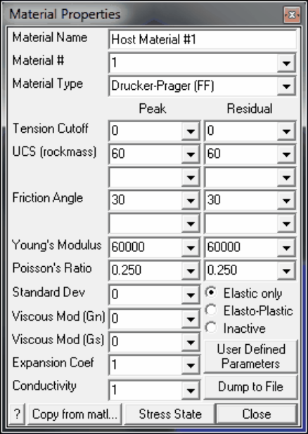
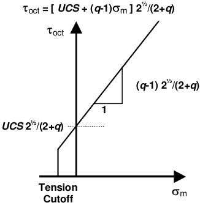

Le matériau Hoek-Brown ne peut servir de critère de rupture que pour les analyses élastiques dans Map3D Fault-Slip.

Material Name - spécifie un nom descriptif pour le matériau.

Material # - spécifie le numéro du matériau.

- Le matériau n° 1 est réservé au matériau hôte.

- Les autres numéros de matériau servent à définir des zones de matériaux alternatifs, comme le minerai, la gouge de faille, le remblai, etc.

Material Type - spécifie le type de matériau (Mohr-Coulomb, Hoek-Brown, Drucker-Prager, Fault-Gouge, Hyperbolic-Backfill, Quadratic-Backfill, Equilibrated-Gouge, Yielding-Pillar ou aucun).

- Drucker-Prager - définit l'enveloppe de rupture comme une droite.

- Pour les blocs FF 3D, le critère de Drucker-Prager définit la résistance en fonction des contraintes principales comme suit :

**Drucker-Prager dans les blocs FF 3D**

où

toct  = ¹/3 [( s1 - s2 )² + ( s2 - s3 )² +( s3 - s1 )²]½

sm = ¹/3 ( s1 + s2 + s3 )

_q_ = tan²(45+½ j)

- Notez que les paramètres de résistance ont été choisis de sorte que le critère se simplifie en critère de MohrCoulomb lorsque s2 est égal à s3.

- Tension cutoff et _UCS_ - sont spécifiés en unités de contrainte (MPa ou psi).

- L'angle de frottement et l'angle de dilatation sont spécifiés en degrés.

- La cohésion n'est pas utilisée pour les blocs FF 3D.

- Seules les valeurs de pic sont utilisées.

Young's Modulus et Poisson's Ratio - spécifient le module de Young (à l'échelle du massif rocheux - déformation) en unités de contrainte (MPa ou psi).

- Seules les valeurs de pic sont utilisées.

Standard Deviation - spécifie l'écart type en unités de contrainte (MPa ou psi).

- Ce paramètre décrit l'incertitude que vous avez sur les paramètres de résistance.

- Ce paramètre sert uniquement à tracer la probabilité de rupture en cisaillement Plot > Strength Factors > Rockmass Probability N-distribution.

Viscous Modulus ( _Gn_ et _Gs_ ) - Ces paramètres ne sont pas utilisés pour le matériau Drucker-Prager.

Expansion Coefficient et Conductivity sont utilisés uniquement dans Map3D Thermal-Fluid Flow. Map3D Thermal- Fluid Flow permet de résoudre simultanément l'écoulement de chaleur ou de fluide en régime permanent couplé à l'analyse des contraintes.

Elastic only - lorsque cette option est cochée, ce matériau répond de façon élastique seulement, c.-à-d. que les paramètres de résistance ne sont pas utilisés.

- Cela permet de définir des zones avec des propriétés élastiques et/ou des états de contraintes initiaux différents. Il peut s'agir, par exemple, de dykes rigides, de zones de minerai tendre, de remblai ou d'éléments de soutènement.

Elasto-Plastic - lorsque cette option est cochée, ce matériau répond de façon élasto-visco-plastique, c.-à-d. que les paramètres de résistance sont utilisés comme loi d'écoulement.

- Cela permet de définir des zones avec à la fois des propriétés élastiques et des paramètres de résistance différents.

- Notez que dans Map3D Fault-Slip, seuls les éléments DD (c.-à-d. la gouge de faille) peuvent répondre de façon non linéaire.

- Dans Map3D Non-Linear, le massif rocheux 3D peut aussi se plastifier.

- La plastification des matériaux Drucker-Prager n'est pas prise en charge pour le moment.

Inactive - lorsque cette option est cochée, ce matériau n'est pas utilisé dans l'analyse des contraintes et n'affecte donc pas les contraintes, les déformations ou les déplacements prédits.

- Cela permet de définir des zones avec des paramètres de résistance différents à utiliser pour générer des contours de coefficients de résistance.

User Defined - permet de spécifier des paramètres définis par l'utilisateur à utiliser pour tracer des contours.

- Des paramètres différents sont définis pour chaque numéro de matériau.

      - Plot > Stress > User

   - Ces paramètres sont utilisés avec

- Cela permet de définir des zones avec des paramètres de résistance différents à utiliser pour générer des contours de coefficients de résistance.

Dump to File - permet d'exporter toutes les données de propriétés des matériaux vers un fichier à consulter dans le Bloc-notes ou dans Excel.

Copy from material - permet de copier les propriétés d'un numéro de matériau vers un autre.

- Toutes les propriétés, y compris l'état de contraintes, sont copiées.

Stress State - spécifie l'état de contraintes initial (champ lointain) du matériau.

- La plupart des matériaux sont insérés dans des blocs ayant le même état de contraintes (champ lointain).

- Les matériaux comme les étais ou le remblai sont placés à des contraintes initiales proches de zéro.

Rubriques connexes :

Mohr_Coulomb in 3D FF blocks

Hoek-Brown in 3D FF blocks
