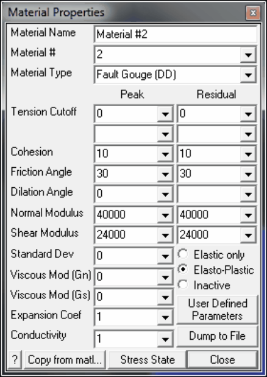
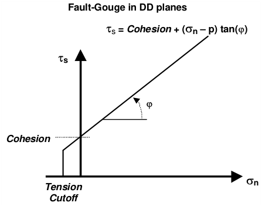
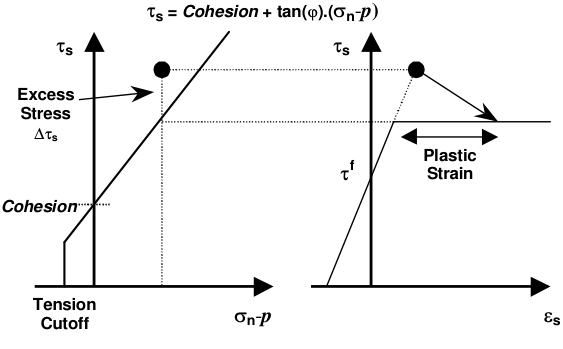
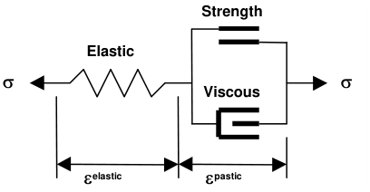

Le matériau Fault-Gouge peut servir à décrire la réponse non linéaire dans les plans DD dans toutes les versions de Map3D. Ce modèle de matériau prend entièrement en charge la plastification et l'analyse en contraintes effectives en fonction de la pression d'eau spécifiée.

- Material Name - spécifie un nom descriptif pour le matériau.

- Material # - spécifie le numéro du matériau.

   - Le matériau n° 1 est réservé au matériau hôte.

   - Les autres numéros de matériau servent à définir des zones de matériaux alternatifs, comme le minerai, la gouge de faille, le remblai, etc.

Material Type - spécifie le type de matériau (Mohr-Coulomb, Hoek-Brown, Drucker-Prager, Fault-Gouge, Hyperbolic-Backfill, Quadratic-Backfill, Equilibrated-Gouge, Yielding-Pillar ou aucun).

- Fault-Gouge - définit l'enveloppe de rupture comme une droite, de la même façon que Mohr-Coulomb dans les plans DD, mais sans _UCS_ .

- La résistance est définie en fonction du cisaillement dans le plan, des contraintes normales et de la pression d'eau comme suit :

- Tension Cutoff et Cohesion sont spécifiés en unités de contrainte (MPa ou psi).

- L'angle de frottement et l'angle de dilatation sont spécifiés en degrés.

- La cohésion et l'angle de frottement définissent la réponse en cisaillement.

- La coupure de traction définit la réponse dans la direction normale au plan de cisaillement.

- Les valeurs de pic de ces paramètres sont utilisées jusqu'à la rupture.

- Après la plastification, les valeurs résiduelles sont utilisées pour produire une réponse d'adoucissement par déformation.

- Les valeurs résiduelles sont ignorées dans les analyses élastiques.

- Si la pression de fluide est spécifiée dans le cadre de l'état de contraintes, la contrainte normale effective (sn-p) est utilisée (ici, p est la pression de fluide).

Normal and Shear Modulus - spécifient les modules en unités de contrainte (MPa ou psi).

- Dans les plans DD, les contraintes de cisaillement et normales agissant sur les surfaces de l'élément sont liées à la partie élastique du déplacement de cisaillement (rejet, ride) et du déplacement normal (fermeture, closure) par les modules de cisaillement et normal.

- Les valeurs de pic de ces paramètres sont utilisées jusqu'à la rupture.

- Après la plastification, les valeurs résiduelles sont utilisées.

Standard Deviation - spécifie l'écart type en unités de contrainte (MPa ou psi).

- Ce paramètre décrit l'incertitude que vous avez sur les paramètres de résistance.

- Ce paramètre sert uniquement à tracer la probabilité de rupture en cisaillement Plot > Strength Factors > InPlane Probability N-distribution.

Viscous Modulus ( _Gn_ et _Gs_ ) - Ces paramètres sont utilisés uniquement dans les analyses non linéaires (blocs FF 3D

dans Map3D Non-Linear et plans DD dans Map3D Fault-Slip).

- Le module visqueux décrit la réponse au fluage, où la résistance au fluage est déterminée comme le coefficient de fluage _C_ multiplié par la vitesse de déformation plastique.

- Notez que vous devez choisir à la fois le coefficient de fluage _C_ et la taille du pas de temps D _t_ , puis spécifier leur quotient comme module visqueux _G_ .

- Spécifiez le module visqueux en unités de contrainte (MPa ou psi).

Expansion Coefficient et Conductivity sont utilisés uniquement dans Map3D Thermal-Fluid Flow.

- Map3D Thermal-Fluid Flow permet de résoudre simultanément l'écoulement de chaleur ou de fluide en régime permanent couplé à l'analyse des contraintes.

Elastic only - lorsque cette option est cochée, ce matériau répond de façon élastique seulement, c.-à-d. que les paramètres de résistance ne sont pas utilisés.

- Cela permet de définir des zones avec des propriétés élastiques et/ou des états de contraintes initiaux différents. Il peut s'agir, par exemple, de dykes rigides, de zones de minerai tendre, de remblai ou d'éléments de soutènement.

Elasto-Plastic - lorsque cette option est cochée, ce matériau répond de façon élasto-visco-plastique, c.-à-d. que les paramètres de résistance sont utilisés comme loi d'écoulement.

- Cela permet de définir des zones avec à la fois des propriétés élastiques et des paramètres de résistance différents.

- Notez que dans Map3D Fault-Slip, seuls les éléments DD (c.-à-d. la gouge de faille) peuvent répondre de façon non linéaire.

- Dans Map3D Non-Linear, le massif rocheux 3D peut aussi se plastifier.

Inactive - lorsque cette option est cochée, ce matériau n'est pas utilisé dans l'analyse des contraintes et n'affecte donc pas les contraintes, les déformations ou les déplacements prédits.

- Cela permet de définir des zones avec des paramètres de résistance différents à utiliser pour générer des contours de coefficients de résistance.

User Defined - permet de spécifier des paramètres définis par l'utilisateur à utiliser pour tracer des contours.

- Des paramètres différents sont définis pour chaque numéro de matériau.

      - Plot > Stress > User

   - Ces paramètres sont utilisés avec

- Cela permet de définir des zones avec des paramètres de résistance différents à utiliser pour générer des contours de coefficients de résistance.

Dump to File - permet d'exporter toutes les données de propriétés des matériaux vers un fichier à consulter dans le Bloc-notes ou dans Excel.

Copy from material permet de copier les propriétés d'un numéro de matériau vers un autre. Toutes les propriétés, y compris l'état de contraintes, sont copiées.

Stress State - spécifie l'état de contraintes initial (champ lointain) du matériau.

- La plupart des matériaux sont insérés dans des blocs ayant le même état de contraintes (champ lointain).

- Les matériaux comme les étais ou le remblai sont placés à des contraintes initiales proches de zéro.

- Une partie de la spécification de l'état de contraintes est la pression d'eau, qui peut servir aux calculs de contraintes et de résistance effectives.

Dans une analyse élastique, les contraintes de cisaillement et normales dans le plan de faiblesse (sur une faille, un système de diaclases ou un plan de stratification) sont normalement utilisées avec le critère de résistance de Mohr-Coulomb pour estimer l'ampleur de l'endommagement dû à la surcontrainte. On peut s'attendre à ce qu'une contrainte excédentaire plus élevée dans une analyse élastique soit en général corrélée à une déformation plastique (glissement) plus importante dans une analyse non linéaire. Comme ces paramètres dépendent de l'orientation, ce critère est représentatif de la stabilité d'un massif rocheux anisotrope.

**Fault-Gouge dans les plans DD**

La surcontrainte peut être présentée de plusieurs façons, notamment :

Plot > Strength Factors > dTip In-Plane excess shear stress

Plot > Strength Factors > dTub Ubiquitous-plane excess shear stress

Plot > Strength Factors > SF-ip Strength/Stress

Plot > Strength Factors > SF-ub Strength/Stress

À l'inverse, dans une analyse non linéaire, les contraintes ne peuvent jamais dépasser la résistance, sauf si du fluage est utilisé (dans ce dernier cas, le fluage visqueux peut permettre des états de contraintes supérieurs au critère de rupture, ce qui indique un manque d'équilibre statique). Par conséquent, pour une analyse non linéaire, on considère normalement directement la déformation plastique ou la vitesse de déformation plastique prédite par le modèle comme indicateur d'endommagement.

Dans les plans DD, les déformations élastiques sont déterminées à partir des contraintes par

ts = tf + _Shear Modulus_ eselastic

sn = sf + _Normal Modulus_ enelastic

où _Shear Modulus_ et _Normal Modulus_ représentent respectivement les modules élastiques du matériau de gouge dans les directions de cisaillement et normale, et tf et sf représentent l'état de contraintes initial dans les directions de cisaillement et normale, et

eselastic =  dselastic / _Thickness_

enelastic =  dnelastic / _Thickness_

où dselastic et dnelastic représentent respectivement la composante élastique du déplacement de cisaillement (rejet, ride) et du déplacement normal (fermeture, closure) et _Thickness_ représente l'épaisseur du plan DD (c.-à-d. la gouge de faille, la largeur de la couche, la largeur d'exploitation ou la hauteur du pilier). L'épaisseur du plan DD est définie à l'aide de

CAD > Build > DDLoop

et peut être modifiée à l'aide de

#### CAD > Edit > Entity Properties

Dans les éléments DD, si la contrainte de cisaillement dépasse la résistance, la déformation plastique peut être déterminée en limitant la contrainte

ts - ts° - _C_ Desplastic /D _t_ = _Cohesion_ + tan(j) ( sn - sn° - _C_ Denplastic /D _t_ )

où

ts° = _Shear Modulus_ esplastic

sn° = _Normal Modulus_ enplastic

La déformation plastique cumulée eplastic est déterminée comme la somme des incréments de fluage plastique Deplastic pour toutes les étapes de fluage.

Si la contrainte normale passe sous la coupure de traction, la déformation plastique peut être déterminée en limitant la contrainte

sn - sn° - _C_ Denplastic /D _t_ = _To_

En cas de rupture en cisaillement, la déformation normale plastique peut aussi comporter une composante de dilatation

enplastic = tan( _dilation angle_ ) esplastic

La déformation totale est égale à la somme des parties élastique et plastique.

La réponse au fluage est simulée à l'aide d'un modèle de fluage linéaire (de Bingham).

À chaque étape de fluage, l'état de contraintes de tous les éléments en plastification (éléments où la contrainte dépasse la résistance) est calculé comme la résistance plus la résistance au fluage

_Strength_ + _C_ Denplastic /D _t_

_C_ = _G_ D _t_

où la résistance au fluage est déterminée comme le coefficient de fluage _C_ multiplié par la vitesse de déformation plastique. Notez que vous devez choisir à la fois le coefficient de fluage _C_ et la taille du pas de temps D _t_ , puis spécifier leur quotient comme module visqueux _G_ . La résistance au fluage peut servir simplement de technique d'amortissement des déformations non linéaires ou à la simulation réelle du fluage dépendant du temps

#### Analysis > Options > Creep

Les déformations, le déplacement de cisaillement (rejet, ride) et le déplacement normal (fermeture, closure) peuvent être présentés de plusieurs façons, notamment :

Plot > Surface > Value > Elastic Plot > Surface > Value > Plastic Plot > Surface > Value > Total Plot > Strain > E1 - Major principal strain

Plot > Surface > Es Shear Strain

Plot > Surface > En Normal Strain

Plot > Surface > ds Shear Displacement (Ride)

Plot > Surface > dn Normal Displacement (Closure)

Il est également intéressant de considérer l'incrément de fluage plastique Deplastic, la contribution de l'élément visqueux à la résistance au cisaillement

Dts   = _C_ Desplastic /D _t_

Plot > Surface > dEs Incremental Shear Strain

Plot > Surface > dTs Excess Shear Stress

Rubriques connexes :

Mohr-Coulomb in DD planes

Backfill-Hyperbolic in DD planes
