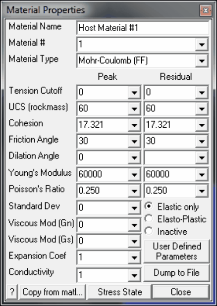
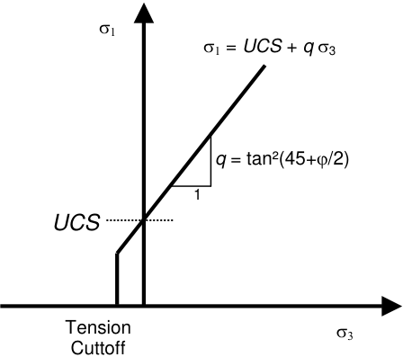
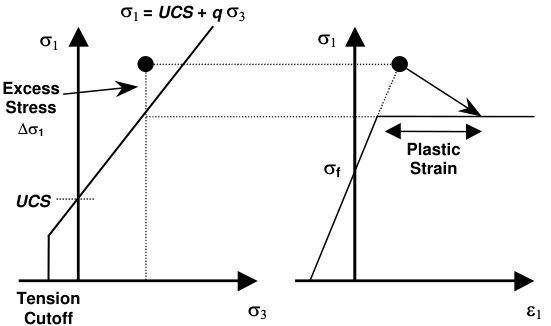
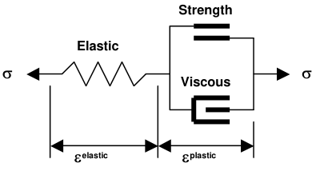

Le matériau Mohr-Coulomb peut servir à décrire la réponse non linéaire dans les blocs FF 3D de Map3D NonLinear. Il peut aussi servir de critère de rupture pour les analyses élastiques dans Map3D Fault-Slip.

Material Name - spécifie un nom descriptif pour le matériau.

Material # - spécifie le numéro du matériau.

- Le matériau n° 1 est réservé au matériau hôte.

- Les autres numéros de matériau servent à définir des zones de matériaux alternatifs, comme le minerai, la gouge de faille, le remblai, les matériaux adoucis, etc.

Material Type - spécifie le type de matériau (Mohr-Coulomb, Hoek-Brown, Drucker-Prager, Fault-Gouge, Equilibrated-Gouge, Yielding-Pillar, Hyperbolic-Backfill, Quadratic-Backfill, Softened-Material ou aucun).

- Mohr-Coulomb - définit l'enveloppe de rupture comme une droite.

- Pour les blocs FF 3D, le critère de Mohr-Coulomb définit la résistance en fonction des contraintes principales comme suit :

#### Mohr-Coulomb dans les blocs FF 3D

- Tension cutoff et _UCS_ - sont spécifiés en unités de contrainte (MPa ou psi).

- L'angle de frottement et l'angle de dilatation sont spécifiés en degrés.

- La cohésion est liée à _UCS_ et à l'angle de frottement par la relation _UCS_ =2 _Coh_ tan(45+j/2). Si vous spécifiez la cohésion, _UCS_ est déterminé à partir de cette relation.

- Les valeurs de pic de ces paramètres sont utilisées jusqu'à la rupture. Après la plastification, les valeurs résiduelles sont utilisées pour produire une réponse d'adoucissement.

- Les valeurs résiduelles sont ignorées dans les analyses élastiques.

Young's Modulus et Poisson's Ratio - spécifient le module de Young (à l'échelle du massif rocheux - déformation) en unités de contrainte (MPa ou psi).

- Les valeurs de pic de ces paramètres sont utilisées jusqu'à la rupture.

- Après la plastification, les valeurs résiduelles sont utilisées. Les valeurs résiduelles sont ignorées dans les analyses élastiques.

Standard Deviation - spécifie l'écart type en unités de contrainte (MPa ou psi).

- Ce paramètre décrit l'incertitude que vous avez sur les paramètres de résistance.

- Ce paramètre sert uniquement à tracer la probabilité de rupture en cisaillement Plot > Strength Factors > Rockmass Probability N-distribution.

Viscous Modulus ( _Gn_ et _Gs_ ) - Ces paramètres sont utilisés uniquement dans les analyses non linéaires (blocs FF 3D dans Map3D Non-Linear et plans DD dans Map3D Fault-Slip). Pour les blocs FF 3D, seul _Gs_ est utilisé.

- Le module visqueux décrit la réponse au fluage, où la résistance au fluage est déterminée comme le coefficient de fluage _C_ multiplié par la vitesse de déformation plastique. Notez que vous devez choisir à la fois le coefficient de fluage _C_ et la taille du pas de temps D _t_ , puis spécifier leur quotient comme module visqueux _G_ .

- Spécifiez le module visqueux en unités de contrainte (MPa ou psi).

Expansion Coefficient et Conductivity sont utilisés uniquement dans Map3D Thermal-Fluid Flow.

- Map3D Thermal-Fluid Flow permet de résoudre simultanément l'écoulement de chaleur ou de fluide en régime permanent couplé à l'analyse des contraintes.

Elastic only - lorsque cette option est cochée, ce matériau répond de façon élastique seulement, c.-à-d. que les paramètres de résistance ne sont pas utilisés.

- Cela permet de définir des zones avec des propriétés élastiques et/ou des états de contraintes initiaux différents. Il peut s'agir, par exemple, de dykes rigides, de zones de minerai tendre, de remblai ou d'éléments de soutènement.

Elasto-Plastic - lorsque cette option est cochée, ce matériau répond de façon élasto-visco-plastique, c.-à-d. que les paramètres de résistance sont utilisés comme loi d'écoulement.

- Cela permet de définir des zones avec à la fois des propriétés élastiques et des paramètres de résistance différents.

- Notez que dans Map3D Fault-Slip, seuls les éléments DD (c.-à-d. la gouge de faille) peuvent répondre de façon non linéaire.

- Dans Map3D Non-Linear, le massif rocheux 3D peut aussi se plastifier.

Inactive - lorsque cette option est cochée, ce matériau n'est pas utilisé dans l'analyse des contraintes et n'affecte donc pas les contraintes, les déformations ou les déplacements prédits.

- Cela permet de définir des zones avec des paramètres de résistance différents à utiliser pour générer des contours de coefficients de résistance.

User Defined - permet de spécifier des paramètres définis par l'utilisateur à utiliser pour tracer des contours.

- Des paramètres différents sont définis pour chaque numéro de matériau.

   - Plot > Stress > User

- Ces paramètres sont utilisés avec

- Cela permet de définir des zones avec des paramètres de résistance différents à utiliser pour générer des contours de coefficients de résistance.

Dump to File - permet d'exporter toutes les données de propriétés des matériaux vers un fichier à consulter dans le Bloc-notes ou dans Excel.

Copy from material - permet de copier les propriétés d'un numéro de matériau vers un autre. Toutes les propriétés, y compris l'état de contraintes, sont copiées.

Stress State - spécifie l'état de contraintes initial (champ lointain) du matériau.

- La plupart des matériaux sont insérés dans des blocs ayant le même état de contraintes (champ lointain).

- Les matériaux comme les étais ou le remblai sont placés à des contraintes initiales proches de zéro.

Dans une analyse élastique, les contraintes principales sont normalement utilisées avec le critère de résistance de Mohr-Coulomb ou de Hoek-Brown pour estimer l'ampleur de l'endommagement dû à la surcontrainte. On peut s'attendre à ce qu'une contrainte excédentaire plus élevée dans une analyse élastique soit en général corrélée à une déformation plastique plus importante dans une analyse non linéaire. Comme aucun des paramètres n'est sensible à l'orientation, ce critère est représentatif de la stabilité d'un massif rocheux homogène.

#### Mohr-Coulomb dans les blocs FF 3D

La surcontrainte peut être présentée de plusieurs façons, notamment :

Plot > Strength Factors > dS1 - Excess Stress

Plot > Strength Factors > dTmax - Excess Stress

Plot > Strength Factor > SF-A - Strength/Stress Plot > Strength Factor > SF-B - Strength/Stress

Plot > Strength Factors > SF-C - Strength/Stress

À l'inverse, dans une analyse non linéaire, les contraintes ne peuvent jamais dépasser la résistance, sauf si du fluage est utilisé (dans ce dernier cas, le fluage visqueux peut permettre des états de contraintes supérieurs au critère de rupture, ce qui indique un manque d'équilibre statique). Par conséquent, pour une analyse non linéaire, on considère normalement directement la déformation plastique ou la vitesse de déformation plastique prédite par le modèle comme indicateur d'endommagement.

Dans les blocs FF 3D, les déformations élastiques sont déterminées à partir des contraintes par

sxx   = sxxf  + [ (1-n) exxelastic + n ( eyyelastic + ezzelastic ) ] _E_ / [ (1+n) (1-2n) ] syy  = syyf + [ (1-n) eyyelastic + n ( ezzelastic + exxelastic  ) ] _E_ / [ (1+n) (1-2n) ] szz   = szzf  + [ (1-n) ezzelastic  + n ( exxelastic + eyyelastic ) ] _E_ / [ (1+n) (1-2n) ] txy  = txyf +  exyelastic _E_ / (1+n) tyz  = tyzf  +  eyzelastic _E_ / (1+n) txz  = txzf  +  exzelastic _E_ / (1+n)

où _E_ et n représentent respectivement le module de Young (à l'échelle du massif rocheux - déformation) et le coefficient de Poisson, et sf et tf représentent l'état de contraintes initial (pré-exploitation)

Dans Map3D Non-Linear, si la contrainte dépasse la résistance, la déformation plastique peut être déterminée en limitant la contrainte

où

s1 - s1° - _C_ De1plastic /D _t_ = _UCS_ + _q_ ( s3 - s3° - _C_ De3plastic /D _t_ ) s1°  = [ (1-n) e1plastic + n ( e2plastic + e3plastic ) ] _E_ / [ (1+n) (1-2n) ] s2°  = [ (1-n) e2plastic + n ( e3plastic + e1plastic ) ] _E_ / [ (1+n) (1-2n) ] s3°  = [ (1-n) e3plastic + n ( e1plastic + e2plastic ) ] _E_ / [ (1+n) (1-2n) ]

La déformation plastique cumulée eplastic est déterminée comme la somme des incréments de fluage plastique Deplastic pour toutes les étapes de fluage.

Si la contrainte passe sous la coupure de traction, la déformation plastique peut être déterminée en limitant la contrainte

s3 - s3° - _C_ De3plastic /D _t_ = _To_

La déformation volumétrique plastique peut aussi comporter une composante de dilatation

evolume = ( e1plastic + e2plastic + e3plastic ) = tan( _dilation angle_ ) e1plastic

La déformation totale est égale à la somme des parties élastique et plastique.

La réponse au fluage est simulée à l'aide d'un modèle de fluage linéaire (de Bingham).

À chaque étape de fluage, l'état de contraintes de tous les éléments en plastification (éléments où la contrainte dépasse la résistance) est calculé comme la résistance plus la résistance au fluage

s = _Strength_ + _C_ Deplastic /D _t_

_C_ = _G_ D _t_

où la résistance au fluage est déterminée comme le coefficient de fluage _C_ multiplié par la vitesse de déformation plastique. Notez que vous devez choisir à la fois le coefficient de fluage _C_ et la taille du pas de temps D _t_ , puis spécifier leur quotient comme module visqueux _G_ . La résistance au fluage peut servir simplement de technique d'amortissement des déformations non linéaires ou à la simulation réelle du fluage dépendant du temps

#### Analysis > Options > Creep

Les déformations peuvent être présentées de plusieurs façons, notamment :

Plot > Strain > Value > Elastic

Plot > Strain > Value > Plastic Plot > Strain > Value > Total

Plot > Strain > E1 - Major principal strain Plot > Strain > E2 - Intermediate principal strain

Plot > Strain > E3 - Minor principal strain

Plot > Strain > Emax - Maximum shear strain

Plot > Strain > Evolume - Volumetric shear strain

Rubriques connexes :

Hoek-Brown in 3D FF blocks

Drucker-Prager in 3D FF blocks
