Les matériaux adoucis peuvent servir à simuler la plastification du terrain et les effets de redistribution des contraintes qui en résultent. Bien que la modélisation de la plasticité soit sans aucun doute la meilleure méthode pour cela, l'adoucissement des matériaux peut aussi servir à simuler la plastification du terrain, la redistribution des contraintes et, par conséquent, l'impact possible sur les zones environnantes. L'avantage de cette approche est qu'elle permet à l'ingénieur d'étudier le comportement non linéaire rapidement et facilement.

La théorie de l'adoucissement est expliquée en détail dans **Elastic softening to simulate plastic yielding.pdf** . Voici un bref résumé.

En modélisation numérique, la détente d'un massif rocheux élastique s'obtient en permettant des déformations plastiques. Ces déformations servent à dissiper la contrainte excédentaire indiquée par la réponse élastique. Une autre méthode pour induire des déformations plastiques est illustrée dans la figure ci-dessous. Ici, le module contrainte-déformation est réduit progressivement. On observe que, bien que cela réduise techniquement la rigidité de la réponse contrainte-déformation élastique, cela peut être interprété comme équivalent à des incréments (Dep ) de déformation plastique.

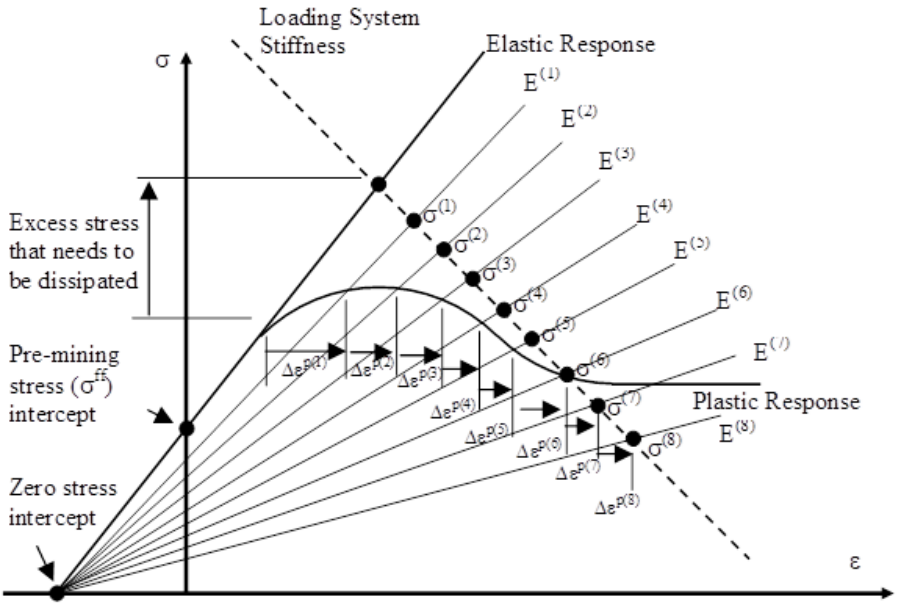

On comprend généralement que la rupture de la roche résulte d'une rupture en cisaillement et qu'elle peut être simulée par une réduction du module de cisaillement : alors que les variations de volume sont associées à la dilatation ou à la compaction selon les conditions de contrainte et la nature de la roche elle-même. La réduction du module de cisaillement peut servir à réduire le différentiel de contrainte (s1-s3), et la réduction du module de compressibilité peut servir à contrôler la déformation volumétrique

(evolume=e1+e2+e3). Cela permet de contrôler indépendamment le processus de rupture en cisaillement et la réponse de dilatation. Que l'adoucissement soit automatisé ou effectué manuellement, il faut évidemment veiller à détendre d'une quantité réaliste afin que l'état de contraintes final dans les piliers touchés satisfasse un critère de résistance bien calibré.

Le module de compressibilité non adouci **_B_** et le module de cisaillement **_G_** peuvent être déterminés à partir du module de Young **_E_** et du coefficient de Poisson comme suit :

**_B = E/3/(1-2_** n **_) G = E/2/(1+_** n **_)_**

Le module de compressibilité adouci **_Bs_** et le module de cisaillement adouci **_Gs_** sont déterminés à l'aide du paramètre d'adoucissement en volume **_b_** et du paramètre d'adoucissement en cisaillement **_g_** , dans le tableau ci-dessous, de sorte que

**_Bs = B×b Gs = G×g_**

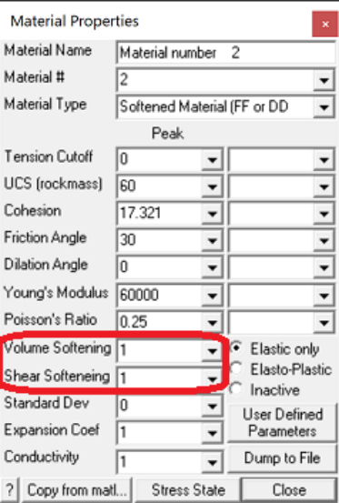

Par exemple, un adoucissement en cisaillement avec **_g=1_** représente l'absence d'adoucissement, tandis qu'un adoucissement en cisaillement avec **_g=0.5_** représente une réduction de 50 % du module de cisaillement...

Pour démontrer la simplicité de la procédure d'adoucissement, voici un exemple de tunnel surcontraint dont les parois latérales se plastifient. Notez que l'objectif de cet exemple n'est pas de reproduire les résultats de la modélisation plastique, et l'on ne doit pas s'attendre à pouvoir le faire. Il illustre toutefois l'adoucissement des parois latérales, la détente, le transfert de contraintes et la plastification. Ici, on souhaite démontrer qu'avec l'adoucissement :

- les contraintes peuvent être dissipées vers les culées environnantes,

- des déformations et des déplacements plus importants, associés à la plasticité, peuvent être générés.

#### Résultats du modèle plastique

Considérez un tunnel circulaire de 1 m de rayon avec des contraintes pré-exploitation homogènes de 30 MPa. Un critère de rupture de MohrCoulomb a été utilisé partout, avec un UCS de 11.9 MPa, un angle de frottement de 30°, un module de Young de 6780 MPa et un coefficient de Poisson de 0.21. Ce modèle a été analysé avec Map3D Visco-Plastic. Un comportement élastique/parfaitement plastique a été utilisé, avec un taux de dilatation fixé à zéro. Ci-dessous, la contrainte principale majeure est illustrée à gauche et le déplacement à droite.

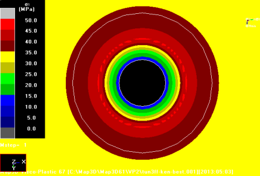

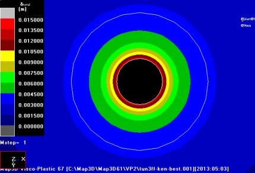

Ces résultats du modèle Map3D Visco-Plastic correspondent étroitement à la solution analytique fermée pour les contraintes et le déplacement plastiques. À titre de référence, la solution analytique élastique est également illustrée.

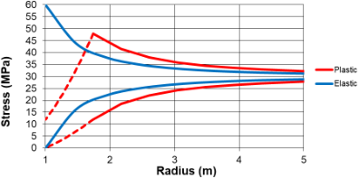

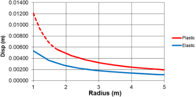

#### Résultats du modèle adouci

Pour modéliser ce qui précède avec l'adoucissement, une zone autour des parois latérales du tunnel a été adoucie, comme illustré ci-dessous, où la galerie est en bleu et la zone adoucie en violet. Cette zone adoucie a été choisie de la même taille que la zone plastique déterminée ci-dessus (rayon de 1.74 m).

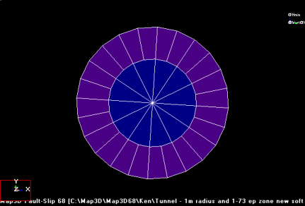

Dans ce cas, on souhaite démontrer que la convergence plastique peut être émulée avec un modèle adouci simple.

Ici, le module de cisaillement élastique a été adouci d'un facteur **_g=0.2_** , tandis que le module de compressibilité a été maintenu constant. Ci-dessous, la contrainte principale majeure est illustrée à gauche et le déplacement à droite.

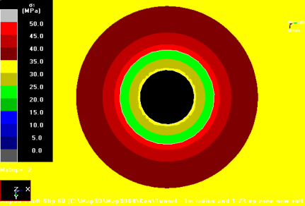

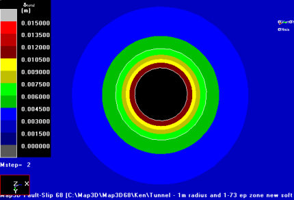

Les résultats adoucis concordent excellemment avec la contrainte principale mineure et le déplacement plastiques. Notez que, bien que les valeurs réelles de la contrainte principale majeure adoucie ne correspondent pas en détail aux résultats plastiques dans la zone de plastification, elles sont en moyenne d'une magnitude correcte. De plus, la contrainte a été redistribuée vers la « culée » élastique de façon très précise, avec une concentration de contraintes presque exactement égale à celle attendue.

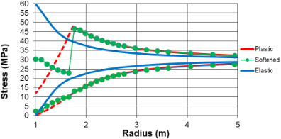

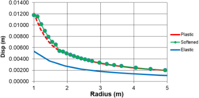

Bien que les résultats de l'adoucissement ne correspondent pas parfaitement aux résultats de l'analyse plastique, ils ont manifestement simulé la plastification du matériau des parois latérales et rapproché nettement les résultats élastiques de ceux du modèle plastique. Il semble que l'adoucissement des matériaux puisse servir à simuler la plastification du terrain, la redistribution des contraintes et, par conséquent, l'impact possible sur les zones environnantes. L'avantage de cette approche est qu'elle permet à l'ingénieur d'étudier le comportement non linéaire rapidement et facilement, par rapport à la modélisation plastique. Les modèles adoucis nécessitent très peu de temps d'analyse supplémentaire par rapport aux simples modèles élastiques.

Une description plus détaillée et des exemples sont fournis dans **Elastic softening to simulate plastic yielding.pdf** .
