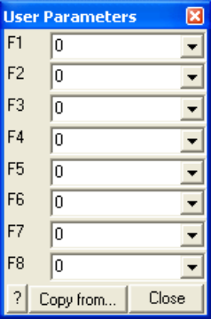

Permet de spécifier des paramètres définis par l'utilisateur à utiliser pour tracer des contours.

#### Plot > Stress > User

Ces paramètres sont utilisés avec

Des paramètres différents sont définis pour chaque numéro de matériau. Ainsi, les résultats d'analyse calculés dans différentes zones de matériaux alternatifs utilisent les paramètres définis par l'utilisateur propres à chaque zone.
