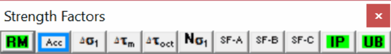
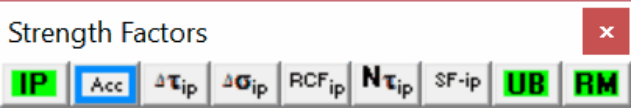
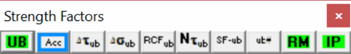

Active la barre d'outils des coefficients de résistance – après l'analyse BEM de Map3D.

Cette barre d'outils donne un accès rapide aux tracés des modes de rupture.

#### Résistance du massif rocheux

Plot > Strength Factors > Strength Parameters parameters. modifie les paramètres de résistance 3D de Mohr-Coulomb, de Hoek-Brown et de Drucker-Prager

Plot > Strength Factors > SF-A trace les contours du rapport résistance/contrainte selon la méthode A Plot > Strength Factors > SF-B trace les contours du rapport résistance/contrainte selon la méthode B Plot > Strength Factors > SF-C trace les contours du rapport résistance/contrainte selon la méthode C

Plot > Strength Factors > SF/A trace les contours du rapport contrainte/résistance selon la méthode A Plot > Strength Factors > SF/B trace les contours du rapport contrainte/résistance selon la méthode B Plot > Strength Factors > SF/C trace les contours du rapport contrainte/résistance selon la méthode C

Plot > Strength Factors > dS1 trace les contours de la contrainte principale majeure excédentaire Ds1

Plot > Strength Factors > dTmax trace les contours de la contrainte de cisaillement maximale excédentaire Dtmax = D½ ( s1 - s3 )

Plot > Strength Factors > dToct trace les contours de la contrainte de cisaillement octaédrique excédentaire Dtoct = D1/3 [(s1 - s2)² + (s2 - s3)² +(s3 - s1)²]½

Plot > Strength Factors > Ns1 trace les contours de la probabilité de rupture calculée comme N(Ds1/s), où s est l'écart type.

Plot > Strength Factors > Acc trace les contours de l'endommagement cumulé.

#### Résistance dans le plan

Plot > Strength Factors > In-plane parameters modifie les paramètres de résistance de Mohr-Coulomb dans le plan

Plot > Strength Factors > SF-ip trace les contours du rapport résistance/contrainte à partir des contraintes dans le plan Plot > Strength Factors > SF/ip trace les contours du rapport contrainte/résistance à partir des contraintes dans le plan

Plot > Strength Factors > dTip trace les contours de la contrainte de cisaillement excédentaire dans le plan Dtip

Plot > Strength Factors > NTip trace les contours de la probabilité de rupture calculée comme N(Dtip/s), où s est l'écart type.

Plot > Strength Factors > Acc trace les contours de l'endommagement cumulé.

#### Résistance dans le plan ubiquiste

Plot > Strength Factors > Ubiquitous Parameters modifie les paramètres de résistance de Mohr-Coulomb du plan ubiquiste

Plot > Strength Factors > SF-ub trace les contours du rapport résistance/contrainte à partir des contraintes du plan ubiquiste

Plot > Strength Factors > SF/ub trace les contours du rapport contrainte/résistance à partir des contraintes du plan ubiquiste

Plot > Strength Factors > dTub trace les contours de la contrainte de cisaillement excédentaire du plan ubiquiste Dtub

Plot > Strength Factors > NTub trace les contours de la probabilité de rupture calculée comme N(Dtip/s), où s est l'écart type.

Plot > Strength Factors > Acc trace les contours de l'endommagement cumulé.

#### Remarques :

Vous ne pouvez activer la barre d'outils des coefficients de résistance qu'après l'étape de construction du modèle - CAD

#### Étapes d'analyse de Map3D

Vous pouvez ajouter n'importe laquelle de ces composantes à la barre d'outils des contours si vous le souhaitez

Tools > Configure Contouring Toolbar
