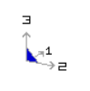
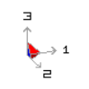

L'orientation de l'état de contraintes principales en champ lointain est indiquée par l'icône d'orientation des contraintes située dans le coin supérieur droit de l'affichage.

Dans la vue ci-dessus, l'axe s1 pointe surtout vers l'intérieur de l'écran et un peu vers la droite, l'axe s2 pointe surtout vers la droite et un peu vers l'extérieur de l'écran, et l'axe s3 pointe directement vers le haut. Notez que l'arrière de l'icône est ombré en bleu.

Dans la vue ci-dessus, l'axe s1 pointe surtout vers la droite et un peu vers l'intérieur de l'écran, l'axe s2 pointe surtout vers l'extérieur de l'écran et un peu vers la droite, et l'axe s3 pointe directement vers le haut. Notez que l'intérieur de l'icône est ombré en rouge.

Notez que la longueur des axes est proportionnelle à la magnitude des composantes de la contrainte principale.

Les composantes de la contrainte principale pré-exploitation sont spécifiées avec « CAD > Properties > Material Properties > Stress State ».
