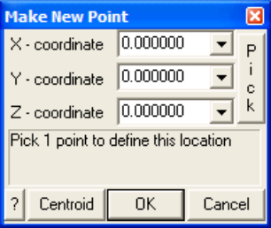

Crée un nouveau point de visualisation. Consultez Visualization pour une description des routines de visualisation disponibles dans Map3D.

Les points de visualisation peuvent être affichés sous forme de sphères ombrées par source lumineuse dont le diamètre et/ou la couleur varient selon la magnitude, et tracés en contours sur un plan pour afficher la densité, etc.

Chaque point peut être associé à une série de :

- valeurs numériques (p. ex. couleur, magnitude, orientation, etc.)

- messages texte

- noms de fichiers (p. ex. fichiers graphiques, documents, tableurs, etc.)

Lorsque vous cliquez avec le bouton gauche sur un point, l'emplacement, la magnitude et le message texte s'affichent dans la barre d'état.

Un clic droit sur un point active la base de données visuelle. Cette fonctionnalité permet d'afficher une base de données d'informations géologiques utiles comme la teneur, la qualité du massif rocheux, etc.

Lorsque vous activez la fonctionnalité, vous êtes invité à fournir les coordonnées du nouveau point de visualisation.

Notez que si un fichier de visualisation est déjà actif, ce nouveau point y sera ajouté. S'il n'y a aucun fichier de visualisation actif, vous êtes invité à en ouvrir un, et ce nouveau point y sera ajouté.

X, Y and Z coordinate - spécifie les coordonnées du point de visualisation.

Pick - active le réticule du curseur pour permettre la sélection interactive des coordonnées à partir du modèle.

Pour faciliter la sélection visuelle de points dans le modèle, toutes les fonctions d'accrochage sont disponibles.

#### CAD > Snap

Une fois sélectionnées, les coordonnées du point de visualisation s'affichent dans la boîte de dialogue.

Centroid - active le curseur pour que vous puissiez sélectionner une entité du modèle. Les coordonnées sont calculées au centre de l'entité sélectionnée.

OK - termine la modification des coordonnées, puis crée et affiche le point de visualisation.

Une fois le point de visualisation créé, vous pouvez cliquer dessus avec le bouton droit pour ajouter des messages texte et/ou des noms de fichiers.

- Le message texte et le nom de fichier s'affichent dans la barre d'état au bas de l'écran lorsque vous sélectionnez un événement avec le bouton gauche de la souris.

- Vous pouvez aussi les modifier en sélectionnant un événement avec le bouton droit de la souris.

- Sélectionner avec le bouton droit de la souris permet aussi d'afficher le fichier si son nom est associé à une application (consultez la documentation de Windows pour savoir comment « associer un fichier à un programme »).
