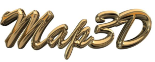

Map3D est développé et pris en charge par le Dr Terry Wiles (support@map3d.com), de Map3D International Ltd. Le développement de Map3D a commencé à la fin des années 1970 et a connu depuis de nombreuses révisions majeures. Le logiciel est commercialisé depuis 1990. Il est en développement constant et soutenu par des professionnels dévoués, actifs dans le domaine de la mécanique des roches et de la modélisation numérique depuis plus de 50 ans.

Le programme est utilisé par des centaines d'entreprises minières, de génie civil et de géotechnique, de bureaux d'études, de centres de recherche et d'universités dans le monde entier (notamment en Argentine, Arménie, Australie, Autriche, Belgique, Bolivie, Botswana, Brésil, Bulgarie, Burkina Faso, Canada, Chine, Colombie, République démocratique du Congo, République dominicaine, Équateur, Égypte, Salvador, Érythrée, Finlande, Ghana, Grèce, Guatemala, Honduras, Inde, Indonésie, Irlande, Italie, Japon, Kazakhstan, Corée, Mali, Mexique, Maroc, Mongolie, Namibie, Nicaragua, Papouasie-Nouvelle-Guinée, Pérou, Philippines, Portugal, Russie, Arabie saoudite, Afrique du Sud, Espagne, Suède, Suisse, Tanzanie, Turquie, Royaume-Uni, États-Unis, Zambie et Zimbabwe). La maîtrise de Map3D est souvent exigée dans les offres d'emploi. La version de démonstration (demo_version) est utilisée dans le monde entier pour enseigner aux étudiants les bases de la modélisation numérique et de la CAO 3D.

Il a été utilisé dans de nombreux projets : conception de mines souterraines et à ciel ouvert, évaluation de la stabilité minière, conception de centres de stockage de déchets nucléaires, simulations de propagation de fractures, problèmes de glissement de failles, rétro-analyse des contraintes in situ, conception de carrières, stabilité des parois de fosse, propagation de fractures hydrauliques, ruptures de talus en sol, etc. La recherche et le développement actuels portent sur les procédures de conception quantitatives, la modélisation plastique 3D, la simulation du soutènement, l'évaluation du potentiel de coups de terrain, la simulation du discage et l'intégration de la modélisation et de la surveillance sismique.

**Méthode des éléments de frontière** : Map3D repose sur la méthode indirecte des éléments de frontière, très efficace, et utilise simultanément des éléments à force fictive (FF), à discontinuité de déplacement (DD) et des éléments de frontière spéciaux et exclusifs intégrés aux versions d'analyse thermique, non linéaire et viscoplastique (versions de Map3D).

Cinquante années de recherche et de développement ont permis de surmonter bon nombre des limites supposées de la méthode des éléments de frontière. Le programme prend en charge des séquences d'exploitation en plusieurs étapes, plusieurs zones de matériaux aux propriétés et aux états de contrainte différents, ainsi qu'une réponse discontinue de la roche avec un nombre limité de structures discrètes. Les zones 3D comme les zones DD peuvent avoir un comportement non linéaire et/ou plastique. Plusieurs plans de faille sécants peuvent glisser et s'ouvrir selon la résistance au cisaillement définie par l'utilisateur. L'analyse couplée des contraintes thermiques/fluides en régime permanent peut être simulée. Les problèmes de fluage et de relaxation en temps réel peuvent être traités par pas de temps explicites.

**Modélisation élastique ou plastique** : les partisans de la modélisation plastique lui attribuent souvent des capacités exclusives par rapport à la modélisation élastique, par exemple :

- La capacité de prédire l'ampleur, l'emplacement, le moment et l'orientation des dommages.

- La capacité de simuler la redistribution des contraintes due à la plastification.

- La capacité de suivre l'endommagement cumulé au fil de l'exploitation.

Bien que Map3D puisse analyser la plasticité 3D complète du massif rocheux, il peut aussi traiter toutes ces capacités prétendument propres à la modélisation plastique au moyen d'une modélisation élastique.

C'est possible grâce à de nouveaux outils d'analyse intégrés au programme :

- Les modèles élastiques de Map3D sont pleinement capables de prédire l'ampleur, l'emplacement, le moment et l'orientation des dommages par le calcul de l'excès de contrainte.

- Trois modes de rupture principaux peuvent être évalués :

   - Rupture du massif rocheux.

   - Rupture de type faille dans le plan.

Faiblesse d'orientation structurale sur plans ubiquistes (UB) (avec jusqu'à 3 familles de joints).

- La redistribution des contraintes peut être simulée en intégrant des zones adoucies.

- Une nouvelle fonctionnalité permet de suivre l'endommagement cumulé (excès de contrainte) dans les modèles élastiques : l'endommagement est suivi au fil de l'exploitation.

   - La valeur maximale de l'excès de contrainte atteinte au cours de l'exploitation est enregistrée et peut être tracée au fil des étapes d'exploitation.

La première étape de plastification et les étapes de plastification maximale sont enregistrées et peuvent être affichées sous forme de numéros de trajectoire.

Les nouvelles capacités de MAP3D permettent de traiter de nombreux comportements auparavant accessibles uniquement par la modélisation non linéaire et plastique.

Ce résultat est obtenu tout en conservant la facilité d'utilisation et les avantages en performances de calcul de la modélisation élastique.

Ces capacités annulent en grande partie les avantages qu'offre la modélisation plastique.

Si une simulation plastique est nécessaire :

- Map3D Visco-Plastic permet de simuler entièrement la plastification du massif rocheux à partir des mêmes fichiers d'entrée du modèle.

- Map3D Fault-Slip permet de simuler entièrement la plastification par glissement de faille à partir des mêmes fichiers d'entrée du modèle.

**Précision du programme** : la précision de la solution est contrôlée par une procédure de discrétisation automatisée. Les éléments peuvent être concentrés automatiquement dans les zones d'intérêt selon des paramètres définis par l'utilisateur. Vous êtes ainsi dispensé de la tâche fastidieuse de discrétiser manuellement votre modèle, tout en améliorant la précision et en réduisant la taille du problème.

**Taille du problème** : Map3D peut traiter plus de 24 millions de degrés de liberté sur un PC disposant de quelques Go d'espace disque. Si les petits problèmes se résolvent en quelques minutes, les plus grands peuvent demander une nuit ou quelques jours. Cette efficacité remarquable est obtenue grâce au regroupement matriciel. Vous pouvez ainsi définir en détail la géométrie minière existante de toute la mine et ajouter de nouvelles exploitations au besoin. L'effort nécessaire pour préparer et exécuter les analyses s'en trouve fortement réduit, et la mine entière peut être prise en compte si nécessaire.

**Multitraitement et multidisque** : Map3D prend entièrement en charge le traitement parallèle, de sorte que les temps de calcul diminuent linéairement avec le nombre de processeurs (un processeur à 6 cœurs résout les problèmes 6 fois plus vite qu'un processeur à un seul cœur). Le programme intègre en outre une fonction de disques en chevauchement qui fait croître linéairement les débits de lecture et d'écriture avec le nombre de disques (avec 4 disques, la lecture et l'écriture sont 4 fois plus rapides qu'avec un seul).

**Prétraitement** : Map3D intègre un logiciel de CAO complet doté de nombreuses fonctions d'échange de données avec d'autres logiciels de CAO. De nombreuses fonctions, dont le traçage et l'extrusion automatisés, permettent de construire facilement des modèles complexes. Des routines complètes de vérification des erreurs et de correction automatique permettent d'utiliser presque n'importe quelle géométrie de modèle. Les routines d'intersection booléenne corrigent les connexions de blocs qui se chevauchent ou ne correspondent pas, sans intervention de l'utilisateur. L'importation et l'exportation de fichiers de géométrie au format DXF ou PNT (ASCII) sont entièrement prises en charge.

**Post-traitement** : un module d'affichage complet est inclus, avec des centaines de fonctions de tracé et d'exportation de données. Les tracés définis par l'utilisateur et les exportations de données sélectionnées visuellement facilitent l'interprétation et la rédaction de rapports. Les données peuvent être exportées directement vers Excel et tracées automatiquement.

#### Pourquoi utiliser Map3D

Map3D a été conçu dès l'origine spécifiquement pour les applications minières. Le programme vous permet d'obtenir rapidement des réponses très précises et de vous consacrer à l'ingénierie plutôt qu'à la modélisation. Vous pouvez construire facilement des problèmes vastes et complexes avec l'interface de CAO de Map3D, ou en dehors du programme avant de les importer dans divers formats. Aucun autre programme ne peut réaliser les analyses de Map3D dans le même délai (temps de calcul, de prétraitement et de post-traitement), au même coût (bien moins cher) et avec la même facilité (Map3D peut être utilisé sur site pour des analyses courantes). Voici quelques avantages de Map3D :

- Évolution aisée entre les analyses élastique, de glissement de faille, thermique/d'écoulement de fluides, non linéaire et viscoplastique (versions de Map3D) avec la même interface

- Programme de formation complet portant à la fois sur les fonctionnalités du programme et sur l'interprétation détaillée des résultats d'ingénierie (voir Formation Map3D)

- Puissante interface de CAO intégrée : aucun logiciel tiers n'est nécessaire

- Construction facile de formes 3D simples ou complexes.

- Résolution facile de très grands problèmes sur un ordinateur de bureau (24 000 000 degrés de liberté)

- Fonction automatisée de génération de graphiques Excel à partir de données de contours

- Tracés de probabilité de rupture

- La fonction automatisée d'intersection des blocs vous évite le travail de construction manuel

- Prise en charge de la mise en place de remblai

- Séquences d'exploitation en plusieurs étapes

- Éléments de haute précision (deux fois moins d'éléments nécessaires pour atteindre la même précision que la plupart des programmes)

- Grâce à des procédures de regroupement avancées, les temps de calcul sont très courts par rapport aux autres programmes

- Jusqu'à 100 zones de matériaux différentes

- Simulations viscoplastiques du glissement des failles

- Exploitation tabulaire avec piliers plastifiants

- La discrétisation automatisée garantit un niveau de précision cohérent et facile à contrôler

- Puissante visionneuse de résultats intégrée

- Manipulation aisée des résultats pour interpréter la rupture du massif rocheux, le glissement sur les plans de faille, les résultats le long de forages orientés et le glissement ubiquiste sur les plans de stratification ou les familles de joints.

- La base de données de visualisation interactive intégrée permet d'afficher les données sismiques et d'en tracer les contours

- Tracé de contours de fonctions définies par l'utilisateur

- Support du programme inclus

- Développement et améliorations continus depuis plus de 26 ans

- Utilisation d'éléments à force fictive et à discontinuité de déplacement (ainsi que d'éléments spéciaux pour l'écoulement thermique/fluide et la plasticité 3D).

- Éléments d'ordre supérieur pour les problèmes de flexion

- Grilles planes, grilles linéaires et grilles de points pour visualiser les résultats

- Critères de rupture isotropes et anisotropes

- Tracés RCF (Rock wall Condition Factor, facteur d'état des parois rocheuses)

- Solveurs intégrés accélérés, préconditionnés et à gradient conjugué, qui fonctionnent ensemble pour des solutions rapides, fiables et précises

- Fonction d'import/export des données d'entrée vers d'autres programmes de CAO

- Fonction d'import/export des résultats d'analyse vers d'autres programmes

- Pas de frais d'acquisition élevés : Map3D est concédé sous licence annuelle

- Interface directe avec Deswik permettant de créer des géométries Map3D, y compris les noms de blocs, les couleurs et la séquence d'exploitation Map3D.

- Export direct vers Excel, 3D-PDF, VRML et bien plus encore.

**Quelques utilisateurs** : parmi les utilisateurs actuels et passés de Map3D figurent : University of Toronto (Canada), Vale (formerly CRVD INCO Ontario) (Creighton Mine, Stobie Mine, Frood Mine, South Mine, Garson Mine, Levack Mine, Mines Research, Mines Technology - Methods & Design), INCO Manitoba (Canada), Noranda (Canada), CNG Softeck Co. (Korea), Anglo Gold (South Africa), Golder Associates (Canada and Australia), Placer Dome Western Area Joint Venture (South Africa), Mount Isa Mines (Australia), Brunswick Mining and Smelting (Canada), Goldcorp (Canada), Mincad Systems (Australia), Kanowna Belle Gold Mines (Australia), U. of British Columbia (Canada), U. of Western Australia, U. of New South Wales (Australia), Laval U. (Canada), McGill U. (Canada), Rock Mechanics Technology (England), Endeavor Mine (Australia), Australian Mining Consultants, Aur Resources (Canada), CSIR Division of Mining Technology (South Africa), Snowden Mining Industry Consultants (South Africa and Australia), Tara Mines (Ireland), Georock Inc. (Canada), Romec n.v. (Belgium), Agnico Eagle - Division Laronde (Canada), Queensland University (Australia), Geomechanics Research Centre Laurentian U. (Canada), Agnew Gold (Australia), Western Mining Corp. (Australia), Tao Lekoa Mine (South Africa), AngloGold Ashanti (South Africa and Australia), Kalgoorlie Consolidated Gold Mines (Australia), INWE Rock Engineering, Lourence Geotechnical (Australia), Western Deep Levels (South Mine, West Mine, Regional Office), Zinkgruvan Mining AB (Sweden), Elandsrand Gold Mine (South Africa), TWP Consulting (South Africa), Tshepong Mine (South Africa), CAMBIOR Inc. (Canada), Natural Resources Canada, Avmin Target Mine (South Africa), SRK Consulting (South Africa, Australia, Sweden), U. of Waterloo (Canada), St Ives Gold (Australia), Mine Geant Dormant (Canada), Normandy Jundee Operation (Australia), KULeuven - Unit Mining (Belgium), Leinster Nickel Operation (Australia), Doyon Mine (Canada), ISS International (South Africa), ISS Pacific (Australia), Musselwhite Mine (Canada), Finsch Diamond Mine (South Africa), Queen's University (Canada), Plutonic Gold Mine (Australia), Campbell Mine (Canada), JCI Travistock Colliery (South Africa), Strata Control Technology (Australia), Cayeli Bakir Isletmeleri A. S. (Turkey), Asker - Thabazimbi ISCOR (South Africa), Douglas Partners (Australia), U. of Queensland (Australia), Bambanani Mine (South Africa), Palabora Mining Company Ltd. (South Africa), Newcrest Mining Ltd. (Australia), Delft U. of Technology (The Netherlands), ANGLOVAAL (South Africa), Impala Platinum (South Africa), Battle Mountain Canada, Black Mountain (South Africa), Tsumeb - Otjihase Mine (Namibia), Kloof, Division of Kloof G.M. Co. Ltd. (South Africa), Rustenburg Platinum Mines Ltd. (South Africa), Savuka Mine (South Africa), BCL Botswana (Botswana), Terra Sancta (Australia), Mines Aurizon - Casa Berardi (Canada), Rockland Ltd. (Canada), Darlot Gold Mine (Australia), Forrestania Gold NL (Australia), WA Department of Minerals and Energy (Australia), Great Central Mines - Wiluna Gold (Australia), Central Mines Engineering Group - Inco Ltd (Canada), Kundana Gold (Australia), Henty Gold Mine - Goldfields Ltd. (Australia), Elura Mine (Australia), Western Australia School of Mines, Cannington - BHP World Minerals (Australia), WMC Olympic Dam Operations (Australia), BFP Consultants Pty Ltd (Australia), Julius Kruttschnitt Mineral Research Centre (Australia), Mountan U. of Leoben (Austria), CNR-C.S. Problemi Minerari (Italy), Japan Nuclear Development Institute (Japan), Lassonde Mineral Engineering (Canada), Coffey Geosciences Pty Ltd (Australia), Pajingo Joint Venture (Australia), TauTona Mine (South Africa), Bronzewing - McClure Gold Operations (Australia), Normandy Golden Grove Operation (Australia), McArther River Mining Pty Ltd (Australia), Boulby Mine - Cleveland Potash Limited (United Kingdom), AngloGold Ashanti Mineracao: Cuiaba (Brasil), Harmony Gold Mining Company Limited (Australia), Mirarco Mining Innovation (Canada), Northam Platinum Limited Zondereinde Division (South Africa), Open House Management Solutions (South Africa), Great Noligwa Mine (South Africa), Konkola Copper Mines (Zambia), Osborne Mines (Australia), Politecnico di Torino (Italy), Atomic Energy Canada, Ekati Diamond Mine (Canada), Musslewhite Mine (Canada), Cadia Holdings Ltd. (Australia), INGWE Rock Engineering (South Africa), Mountan University of Technology (Austria), Australian Centre for Geomechanics, Granites Gold Mine (Australia), Northparkes Mines (Australia), Basis Soft Inc. (Korea), Ritsumeikan University (Japan), Science & Technology Central South University (Changsha, Hunan China), Groundwork Consulting (Australia), LionOre Australia, MPI Mines (Australia), Lisheen Mine (Ireland), Northeastern University (Shengyang, Liaoning, P.R.China), Beck Arndt Engineering (Australia), La Mine Niobec (Canada), Second Avenue Subway (New York USA), Anglo Platinum (South Africa), Ressources MSV Inc. (Canada), Selwyn Operations (Australia), Newmont Australia Technical Services (Australia), Kigam - Geotechnical Engineering Division (Korea), Dempers and Seymour P/L (Australia), Cobar Management Pty Ltd (Australia), Big Bell Mining Operations (Australia), Auriongold Kalgoorlie Operations (Australia), Peak Gold Mines (Australia), Driefontein Consolidated (Pty) Ltd (South Africa), Newmont - Pajingo Joint Venture (Australia), AurionGold - Paddington Gold Pty Limited (Australia), Mincor Operations (Australia), Falconbridge Ltd. (Canada), Sons of Gwalia - Southern Cross Operations (Australia), E-Mining Technology S.A. (Chile), Beaconsfield Gold (Australia), MMG Rosebery Mine (Australia), Instituto Innovacion en Mineria y Metalurgia (Chile), IRSM of Chinese Academy of Sciences (China), Brently, Lucas & Associates (South Africa), Kirkland Lake Gold Inc.(Canada), Chelopech Mining AD (Bulgaria), Northwind Enterprises (Australia), Cameco Corporation (Canada), Barrick Goldstrike Mines (USA), Barrick Gold -Lawlers Gold Mine (Australia), RMIT - Faculty of Engineering (Australia), Perilya Broken Hill Ltd (Australia), Placer (PNG) - Porgera Joint Venture (Papua New Guinea), Codelco Chile - Division Andina (Chile), Codelco Chile - Division El Teniente (Chile), Codelco Chile - Division Norte (Chile), IM2 S.A. - Filial Codelco (Chile), Codelco Chile - Division Salvador, Geo-Engineering Technology Limitada (Chile), Xstrata Copper (Australia), Xstrata Nickel (Australia), Mining Geotechnical Solutions (Australia), Freeport McMoRan Copper & Gold (USA), Kopanang Gold Mine (South Africa), Seoul National University (Korea), Lawlers Gold Mine (Australia), Bendigo Mining Limited (Australia), Codelco, Gerencia Corporativa (Chile), Stawell Gold Mines (Australia), Samancor - Western Chrome Mines (South Africa), Mponeng Mine (South Africa), KMCL - Bulyanhulu Site (Tanzania), Ballarat Goldfields (Australia), Goldfields Mine Management (Australia), Dynatec Corporation (Canada), P.T. Freeport Indonesia, EKJV Management (Australia), BHPB Nickel West - Leinster Nickel Operation (Australia), Birla - Mt. Gordon (Australia), Ridgeway Project - Cadia Holdings (Australia), U. of South Australia, Sunrise Dam Gold Mine (Australia), Oxiana Golden Grove (Australia), Moab Khotsong Mine (South Africa), MIDD & MIDDindi Consulting (South Africa), Redco Ltda (Chile), Mining One Pty Ltd (Australia), Birla Nifty - Nifty Copper (Australia), Cracow Gold Mine (Australia), Beta-Hunt Mine (Australia), Universidad de Chile - Facultad de Ciencias Fisicas y Mathematicas, Geotechnical Consulting Pty Ltd (Australia), NVI Mining Ltd. Myra Falls (Australia), East Bolder Mine - Stillwater Mining (USA), Cambior - La Mine Geant-Dormant (Canada), University of Quebec Chicoutimia (Canada), New Gold Afton Project (Australia), A Karzulovic & Associates (Chile), Strata Engineering (Australia), Peter O'Bryan & Associates (Australia), Barrick Granny Smith (Australia), Xstrata Nickel - Raglan Mine (Canada), Genivar (Canada), President Steyn Gold Mine (South Africa), GFL Mining Services Limited (South Africa), Mopani Copper Mine (Zambia), Tau Lekoa Mine (South Africa), Stanford University Department of Geophysics (USA), Simon Fraser University - Department of Earth Sciences (Canada), Resolution Copper Company (Canada), North American Tungsten Corporation (Canada), Gold Fields Technical Services (South Africa), Maggie Hays - Lake Johnston Operations (Australia), Nickel West Cliffs Project - BHP Billiton (Australia), Ditton Geotechnical Services (Australia), GeoMech Services (Australia), Outokumpu Torino Works (Finland), Wardell Armstrong International Ltd (UK), Cosmos Nickel Project - Jubilee Mines NL (Australia), Long Nickel Project - Lighting Nickel Pty (Australia), RESPEC (USA), Xstrata Nickel - Craig Mine (Canada), Northern 3500 Orebody - Xstrata Copper (Australia), Xstrata Zinc - Mount Isa Mines (Australia), Goldfields - Beatrix 4 Shaft (South Africa), Omya Central Europe (Austria), Pyhasalmi Mine Oy (Finland), Outokumpu Torino Works (Finland), Mining One Pty Ltd (Australia), P.T. Newmont Tenggara (Indonesia), Peak Gold Mines (Australia), Argyle Diamond Mine (Australia), Bullant Gold Mine (Australia), Geosinergia Ingenieria y Medio Ambiente Ltd (Chile), Lonmin Platinum (South Africa), DERK Ingenieria y Geologia Ltda (Chile), Montana Exploradora de Guatemala S.A.(Guatemala), St. Barbara Limited (Australia), Boliden Mineral AB (Sweden), Vattenfall Power Consultant (Sweden), Lulea University of Technology (Sweden), LKAB Mining Technology (Sweden), Associacao Instituto Technologio Vale - ITV (Brasil), Mina San Rafael, S.A. - Mina El Escobal (Guatemala), Hecla - Lucky Friday Mine (USA), Kittila Mine - Agnico-Eagle Finland Oy (Finland), Central Institute of Mining and Fuel Research (India), Sibanye Gold (South Africa), Global Mine Design (UK), Eagle Mine LLC (USA), Newmont USA Limited - Leeville Operation (USA), Agnico Eagle Mines Limited (Mexico), NIOSH OMSHR Pittsburg Mining Research Division (USA), ARANZ Geo Limited (New Zealand), Thiess Pty Ltd (Australia), Glencore - Ernest Henry - Copper (Australia), Syama Mine, Society des Mines de Syama (Mali), Glencore Mount Isa Mines Ltd (Australia), La Mancha Resources - Frogs Leg Mine (Australia), Northern Star Resources Limited (Australia), Dundee Precious Metals - Kapan (Armenia), Minera Cuzcatlan (Mexico), Minera Candelaria (Chile), SVS Ingenieros (Chile), ENAMI CHILE (Chile), Kibali Gold Mine - Randgold Resources Ltd. (Democratic Republic of Congo), Unki Mines (Pvt) Ltd (Zimbabwe), Lady Loretta - Zinc Assets Australia (Australia), Salt Lake Mining Pty Ltd (Australia), Mt Carlton and Pajingo - Evolution Mining (Australia), NIOSH OMSHR Spokane Research Lab (USA), Rubicon Minerals Corporation (Canada), Les Mines Opinaca Ltee, Projet Eleonore (Canada), Lac des Iles Mine - North American Palladium (Canada), Pakalnis and Associates (Canada), Nyrstar - Langlois Mine (Canada), Mufulira Mine - Mopani Copper Mines Plc (Zambia), Black Mountain (South Africa), Bindura Nickel Corporation, Trojan Nickel Mine (Zimbabwe), Fosterville Gold Mine Pty Ltd (Australia), Ranger 3 Deeps - E.R.A. (Australia), Kazzinc Ltd (Kazakhstan), Independence Group - Jabiru - Jaguar Limited (Australia), MMG - Dugald River Mine (Australia), AuRico Gold Inc (Canada), Nyrstar Myra Falls Ltd (Canada), Universidad de Chile (Chile), GMT Ltda (Chile), MINSUR S.A. (Peru), AMEC Chile (Chile), Compania Minera El Toqui (Chile), Devourge Industries Ltd (Zambia), Assmang Manganese - Black Rock Mine Operation (South Africa), School of Engineering and ICT, U. of Tasmania (Australia), Primero Gold Canada Inc (Canada), AMEC Earth and Environmental (Canada), Mine Westwood - IAMGOLD (Canada), Stantec Inc (Canada), Knight Piesold Ltd (Canada), Osisko Mining Corporation (Canada), Kinross Gold Corporation - Technical Services (Canada), Silver Lake Resources, Daisy Milano Mine Site (Australia), Minerals and Metals Group, Golden Grove (Australia), South32 Cannington Pty Ltd (Australia), Morobe Mining, Nine Mile, Awilunga Estate (Papua New Guinea), Copper Mines of Tasmania (Australia), AngloGold Ashanti Mineracao: Cuiaba (Brasil), Mineracao Serra Grande (Brasil), Xstrata Zinc, Mine Matagami (Canada), St. Andrew Goldfields Ltd., Holt-Holloway Mine (Canada), Hecla Quebec - Casa Berardi (Canada), Barrick Cortez (USA), Barrick Gold Corp. - Hemlo Operations (Canada), ASDR Industries (Canada), Centre for Excellence in Mining Innovation (Canada), Two Rivers Platinum (Pty) Ltd (South Africa), Chibuluma Copper South Mine PLC (Zambia), Loulo Mine, Randgold Resources Limited (Zambia), Santiago University (Chile), Tomas Fernando Villegas Barba (Mexico), ACE [Arab Consulting Engineers] (Egypt), Growth & Intl Projects, GoldFields Australasia (Australia), Tritton Resources Pty Limited (Australia), Compania Minera San Geronimo (Chile), Jacobina Mineracao - Yamana Gold Inc (Brasil), FF GeoMechanics (Chile), Minera Florida Ltda (Chile), Minera Triton S.A. (Nicaragua), Minera Sierra Gorda SCM (Chile), Sociedad Minera El Brocal S.A.A. (Peru), GFI Mining SA (Pty) Ltd, Kloof Division (South Africa), Anglogold Ashanti - Obuasi Mine (Ghana), ARMgold/Harmony Freegold JV (South Africa), BCG Engineering Inc (Canada), University of New South Wales (Australia), Agnico-Eagle - Division Goldex (Canada), McArthur River Mine - Cameco Corporation (Canada), Thinkrox Inc (Canada), New Gold Inc., New Afton (Canada), Snap Lake Mine, De Beers Canada Inc (Canada), Mine Design Engineering (Canada), DB Operating Corporation (Canada), BCD Resources (Operations) NL - Tasmania Mine (Australia), Minera El Toqui (Chile), Capstone Gold S.A. (Mexico), Universidad De La Serena (Chile), Segala Mining Co SA (SEMICO SA) (Mali), Bariq Mining Limited (Saudi Arabia), TREM Rock Engineering (South Africa), U. of Saskatchewan, Civil & Geological Eng. (Canada), Call & Nicholas Inc (USA), LVI Geotechnical (Australia), Camborne School of Mines, U. of Exeter (UK), PUCOBRE (Chile), Compania Minera Dona Ines de Collahuasi (Chile), Compania Minera Nevada SpA (Chile), Mining Plus Pty Ltd (Australia), Flying Fox Mine - Forrestania Nickel Project (Australia), Oceana Gold Didipio Operations (Philippines), Sandfire Resources NL (Australia), MineGeoTech Pty Ltd (Australia), 2M Engineering (Indonesia), MINERA MILPO S.A.A  (Peru), Siga Ingenieria Y Consultores S.A. (Chile), Bluestone Mines Tasmania Joint Venture (Australia), Barrick (Australia Pacific) Yilgarn (Australia), Apex Gold Pty Ltd (Australia), Jennmar Australia Pty Ltd (Australia), Tecnologia Y Geociencias Limitada (Chile), Kazakhmys Services Limited (Kazakhstan), Cairo University - Faculty of Engineering (Egypt), Isa Ashari Qudraturrahman (CV PRJ) (Australia), Ezulwini Mine - First Uranium Corporation (South Africa), University of Pretoria (South Africa), Eldorado Gold Corporation (China), Carpentaria Gold - Ravenswood Operations (Australia), Anglo Coal Australia Pty Ltd (Australia), Eastplats Ltd - Crocodile River Mine (South Africa), Great Noligwa Mine (South Africa), Randfontein Estates - Harmony Gold Mining Co (South Africa), PipeFlo (South Africa), Haldeman Mining Company S.A. (Chile), ARCADIS CHILE S.A (Chile), Geomechanicos Consultores Ltda (Chile), Otter Juan Mine - Goldfields Mine Management (Australia), Straits Resources Limited (Australia), Halcrow Group Limited (Australia), Mine-concept Engineering Services (Canada), Diavik Diamond Mines Inc (Canada), Green Geotechnical Pty Ltd (Australia), Custom GeoEng Solutions Inc (Canada), Ingenieria de Rocas Limitada (Chile), BHP Billiton Energy Coal South Africa Ltd (South Africa), Luanshya Copper Mines Plc (Zambia), Brentley, Lucas & Associates Pty Ltd (South Africa), Oz Minerals (Australia), Rio Tinto - Technology and Innovation (USA), InnovExplo Inc (Canada), AMEC Foster Wheeler Americas (Canada), Geohart Consultants Pty Ltd (Australia), ROCKLAND LTD (Canada), Sudbury Integrated Nickel Operations, Glencore (Canada), East Boulder Mine - Stillwater Mining (USA), Breakwater Resources Ltd (Canada), School of Resources & Safety Eng - Central SU (China), Manxmin Pty. Ltd (Australia).

Map3D est développé et pris en charge par :

Dr Terry D. Wiles Map3D International Ltd. E-mail : support@map3d.com Site web : [www.map3d.com](https://www.map3d.com)

Map3D est concédé sous licence, et non vendu. L'utilisation de Map3D s'effectue dans le cadre d'un contrat de licence, contrôlé par une clé de protection à durée limitée. Le programme est normalement concédé sous licence annuelle, mais des licences pluriannuelles peuvent être négociées à l'avance.

La vente et le support sont assurés par Map3D International Ltd et par un réseau d'agents dans le monde entier, en Australie, au Brésil, au Canada, au Chili, en Chine, en Inde, en Indonésie, au Kazakhstan et en Afrique du Sud (www.map3d.com/how_to_buy).
