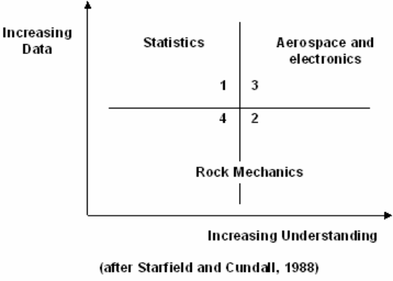
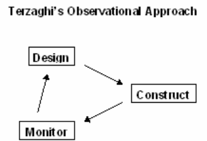
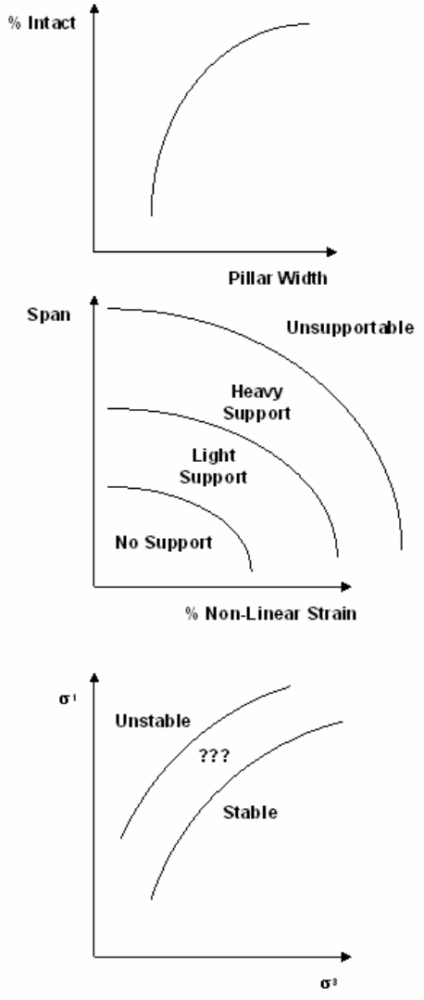
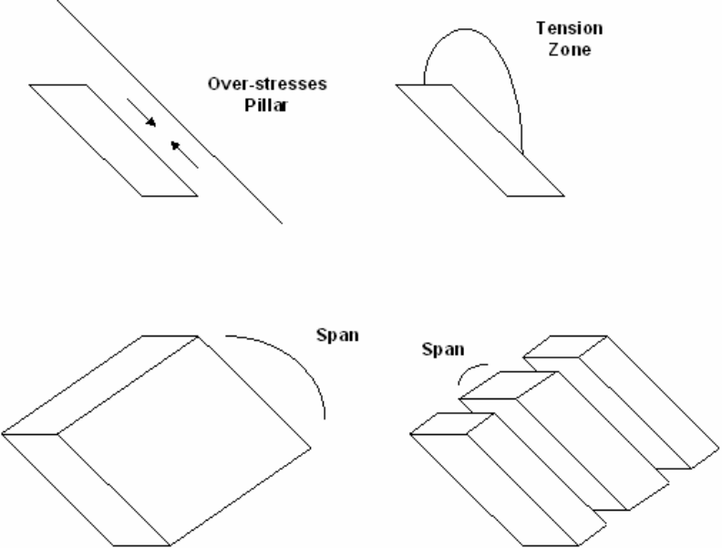
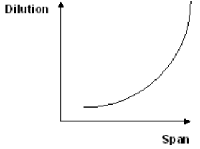
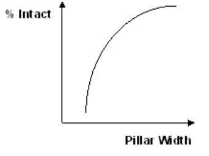
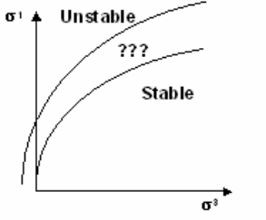
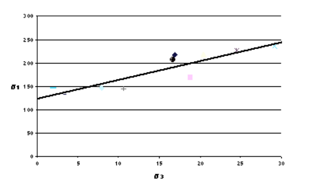

L'objectif de la modélisation numérique est simple : prédire (avec précision et fiabilité) la façon dont le massif rocheux réagira à l'exploitation. On définit les conditions de chargement et la géométrie (qui peut inclure des dykes, des failles, la stratification, etc.), on impose l'équilibre et la continuité, on suppose un comportement élastique et/ou non linéaire, puis on résout ces équations pour obtenir les contraintes, les déformations, les déplacements, etc. dans l'ensemble du massif rocheux.

L'examen des résultats de l'analyse des contraintes permet d'identifier, par exemple, les zones surcontraintes ou plastifiées. On peut déterminer quels endroits nécessitent un soutènement et quel type de soutènement convient, etc.

Le but ultime est de savoir quels problèmes attendre, ainsi que quand et où ils surviendront. Vous pouvez alors comparer d'autres agencements et séquences d'exploitation, et élaborer des stratégies pour faire face aux problèmes lorsqu'ils surviennent. Vous évitez ainsi les interruptions de production imprévues. Vous pouvez fixer des valeurs de conception précises pour les besoins de soutènement, la largeur des piliers, la hauteur admissible des chantiers, etc. En bref, la modélisation est un outil qui vous aide à concevoir votre mine. Si la modélisation numérique est relativement simple, l'interprétation des résultats est bien plus délicate. La modélisation numérique appliquée à la prédiction du comportement des massifs rocheux n'est pas une science exacte. Il y aura toujours des caractéristiques du massif rocheux qui n'auront pas été anticipées ou comprises.

La citation suivante de Starfield et Cundall (1988) en donne plusieurs raisons.

_Les modèles de mécanique des roches appartiennent à la catégorie des « problèmes à données limitées » : on en sait rarement assez sur les caractéristiques et le comportement du massif rocheux pour le modéliser sans ambiguïté. Il s'ensuit que l'on ne peut pas utiliser les modèles en mécanique des roches de manière conventionnelle (comme en génie électrique ou aérospatial) et qu'il est nécessaire d'adopter une méthodologie propre et adaptée à la modélisation en mécanique des roches._

Les problèmes sont souvent mal posés, ce qui rend l'interprétation des résultats difficile et laisse planer un doute persistant sur la pertinence du problème modélisé. La conception du modèle doit être guidée par les questions auxquelles il doit répondre plutôt que par les détails du système modélisé. Cela aide à simplifier et à maîtriser le modèle.

Un modèle est une simplification de la réalité et non une imitation de celle-ci. C'est un outil intellectuel qui doit être conçu ou choisi pour une tâche précise. Le problème fondamental est celui de la résolution. On craint de trop simplifier le problème.

Il est vain d'espérer disposer un jour de suffisamment de données pour modéliser les massifs rocheux de manière conventionnelle (comme en génie électrique ou aérospatial). À mesure que l'on ajoute des détails, on perd la maîtrise intellectuelle du modèle, qui devient moins efficace au lieu de l'être davantage.

#### Quelle est l'approche conventionnelle pour appliquer la modélisation numérique à la conception minière ?

Dans la plupart des autres disciplines de l'ingénierie (génie électrique ou aérospatial), la modélisation numérique consiste normalement à prédire la réponse à partir des propriétés des matériaux mesurées en laboratoire. Cela fonctionne généralement bien si les matériaux, la géométrie et les conditions de chargement sont bien connus.

À l'inverse, la méthode conventionnelle pour appliquer la modélisation numérique à la conception minière repose sur la « méthode observationnelle de conception de Terzaghi ».

Au départ (c'est-à-dire avant l'exploitation), vous pouvez réaliser des études paramétriques. Vous pouvez comparer différentes conceptions et identifier les facteurs importants qui influent sur la stabilité. Vous constaterez peut-être que certaines orientations sont plus favorables que d'autres, ou que certaines séquences sont préférables. Vous pouvez estimer globalement le rapport coût-bénéfice entre une production accrue et des besoins accrus en entretien et en soutènement.

Savoir quels types de problèmes attendre et quels endroits sont particulièrement sensibles est certainement une information utile, car elle vous permet d'élaborer des stratégies pour faire face aux problèmes s'ils surviennent. Mais si vous voulez utiliser la modélisation pour fixer des valeurs de conception précises pour les besoins de soutènement, la largeur des piliers, la hauteur admissible des chantiers et les coûts réels, vous devez avoir confiance dans la précision de vos prédictions.

Par exemple, il serait inutile de prescrire un pilier de 1,2 m de large sur la base d'une prédiction du modèle si vous n'aviez aucune idée de la fiabilité de cette prédiction. Vous n'autoriseriez jamais le personnel à passer sous un front sur la foi de résultats de modélisation indiquant qu'il est sûr, à moins d'être également convaincu de la fiabilité de ces prédictions.

Il est fondamentalement nécessaire de connaître la fiabilité d'une prédiction pour évaluer le risque et fonder les décisions coût-bénéfice.

Cette affirmation mérite qu'on s'y arrête un instant. Je ne connais aucun exemple où des prédictions de fiabilité inconnue aient la moindre valeur. Vous pouvez admettre que la fiabilité de votre prédiction est faible et que l'erreur pourrait atteindre ±100 %, ou au contraire disposer d'éléments démontrant que la fiabilité est très élevée et que l'erreur est inférieure à ±10 %. Tout décideur doit le savoir pour en tenir compte dans ses analyses coût-bénéfice.

Considérez ces deux questions :

Si vous aviez la preuve démontrable que les prédictions du modèle sont fiables à 99 % (erreur de ±1 %), pourquoi ne les utiliseriez-vous pas ?

Si vous aviez la preuve démontrable que les prédictions du modèle sont fiables à 1 % (erreur de ±99 %), pourquoi les utiliseriez-vous ?

Le cœur du problème, c'est vraiment la fiabilité ! Nous devons savoir à quel point nos prédictions sont fiables, sinon nous n'avons rien (Wiles 2006 et Wiles 2007).

Comment obtenir alors des conceptions fiables ? La solution est la même démarche de conception, éprouvée, qu'utilisent tous les ingénieurs. La procédure employée pour établir la fiabilité s'appelle la « méthode observationnelle de conception de Terzaghi » (Terzaghi et Peck, 1967) :

- Choisir un agencement minier initial : études paramétriques.

- Commencer l'exploitation.

- Surveiller la réponse du massif rocheux, généralement par observation visuelle.

- Reprendre la conception en fonction du comportement observé : calage du modèle.

Ce processus constitue le calage du modèle. Que l'on utilise la modélisation ou non, c'est fondamentalement la démarche que nous suivons tous pour concevoir nos mines.

_Une conception fondée sur les hypothèses les plus défavorables est inévitablement peu économique, mais aucune autre procédure ne garantit au concepteur, avant la construction, que l'ouvrage reposant sur le sol ne présentera pas de défauts imprévus. Toutefois, si le projet permet de modifier la conception pendant la construction, d'importantes économies peuvent être réalisées en concevant sur la base des possibilités les plus probables plutôt que les plus défavorables. Les lacunes des informations disponibles sont comblées en concevant pendant la construction, et la conception est modifiée en fonction des constatations. Cette base de conception peut être appelée procédure observationnelle._

_Pour utiliser la procédure observationnelle dans les travaux de terrassement, deux conditions doivent être remplies. Premièrement, la présence et les caractéristiques générales des zones de faiblesse doivent être révélées par la reconnaissance du sous-sol avant la construction. Deuxièmement, des dispositions particulières doivent être prises pour obtenir, pendant la construction, des informations quantitatives sur les caractéristiques indésirables de ces zones avant qu'il ne soit trop tard pour modifier la conception en fonction des constatations. Ces conditions n'ont pu être remplies qu'une fois les mécanismes d'interaction entre le sol et l'eau clairement compris et des moyens d'observation adéquats mis au point. Selon la nature du projet, les données nécessaires à la mise en œuvre de la procédure observationnelle sont obtenues en mesurant les pressions interstitielles et les niveaux piézométriques ; les charges et les contraintes ; les déplacements horizontaux, verticaux et angulaires ; et les débits d'infiltration._

Bien que ce texte soit ancien, les idées restent valables. Leur application à la prédiction de la réponse du massif rocheux par modélisation numérique conduit aux recommandations suivantes :

1) Avant de commencer, assurez-vous de bien savoir pourquoi vous construisez un modèle et à quelles questions vous cherchez à répondre. Formulez des hypothèses sur les résultats possibles et sur les décisions qui en découleront. Si vous ne pouvez pas prendre ces décisions avant de modéliser, vous ne pourrez probablement pas les prendre après. Voici quelques exemples de cette démarche :

   - La largeur du pilier sera choisie pour limiter la plastification à 50 % au maximum de sa section transversale.

   - Le remblayage doit être terminé avant qu'une dilution de 10 % ne soit prédite.

   - Un reconditionnement du terrain sera nécessaire lorsque les déformations non linéaires dépasseront 1 %.

   - Une instabilité à long terme du terrain se produira lorsque la surcontrainte élastique dépassera 1,6 fois la résistance.

- 2) Utilisez le modèle le plus tôt possible dans le projet pour produire à la fois des données et de la compréhension. Les modèles peuvent souvent vous aider à comprendre ce qui se passe.

3) Recherchez les mécanismes qui gouvernent le problème. Essayez d'identifier les mécanismes importants, les modes de déformation et les modes de rupture probables. Utilisez le modèle pour réaliser des « expériences numériques » afin de départager des idées contradictoires sur ce qui se passe sur le terrain. Voici quelques exemples de mécanismes déterminants :

- La plastification en compression du pilier d'éponte supérieure, formé entre les chantiers et la faille de l'éponte supérieure, est la cause de la dilution.

- Le manque de confinement de l'éponte supérieure est la cause de la dilution.

- Une portée excessive est la cause de la dilution.

4) Utilisez le modèle le plus simple possible qui permette aux mécanismes importants de se produire (2D, 3D, élastique, plastique, failles, eau, chaleur, dynamique, etc.). Mettez ce modèle en œuvre et vérifiez qu'il concorde avec vos attentes ; sinon, identifiez la faiblesse (du modèle ou de vos attentes) et corrigez-la.

- Bien qu'une analyse bidimensionnelle puisse convenir au début de l'exploitation, pour des taux de défruitement très faibles, et à la fin de l'exploitation, pour des taux très élevés, une analyse tridimensionnelle est généralement nécessaire.

- Le glissement sur une faille de faible résistance peut dominer la redistribution des contraintes, ce qui impose des simulations de glissement de faille.

- La plastification des piliers peut entraîner une redistribution importante des contraintes, ce qui impose une analyse non linéaire.

5) Une fois que vous avez tiré tous les enseignements possibles des modèles simples, vous pouvez exécuter des modèles plus complexes et plus détaillés pour affiner la précision et explorer les aspects de la géologie et de la réponse du massif rocheux négligés dans les modèles simples.

6) Dégagez des tendances simples à partir des résultats pour les besoins de la conception. Évaluez la sensibilité de ces tendances aux différents paramètres supposés dans le modèle. Les statistiques peuvent être utiles pour définir la fiabilité des prédictions. Voici quelques tendances utiles qui pourraient être présentées :

- Volume de dilution en fonction de la portée.

- Pourcentage de pilier intact en fonction de la largeur du pilier.

· Stabilité du terrain en fonction de l'état de contrainte prédit.

7) Surveillez la réponse du massif rocheux à mesure que l'excavation progresse. Vérifiez que la réponse observée concorde suffisamment avec les résultats prédits. Refaites la modélisation si nécessaire, à mesure que de nouvelles informations sont disponibles et que la compréhension des mécanismes progresse. Dans quelle mesure cette approche fonctionne-t-elle ?

L'intérêt de cette approche est qu'au fil de l'exploitation, vous apprenez à quel point votre modèle est fiable (ou non). Notez que, traditionnellement, la réponse du massif rocheux est observée visuellement, souvent complétée par quelques instruments dispersés. En observant la réponse du massif rocheux, vous voyez littéralement, au fil du temps, quand le modèle fonctionne et quand il ne fonctionne pas. Vous apprenez quelles caractéristiques doivent être intégrées au modèle (plans de faille, lithologie, conditions de chargement, etc.). Vous apprenez non seulement à utiliser le modèle pour prédire la réponse du massif rocheux, mais vous gagnez aussi confiance dans les prédictions et savez reconnaître les situations où elles sont douteuses.

En bref, vous apprenez à quel point vos prédictions sont fiables (ou non).

Une fois la fiabilité établie, vous êtes en mesure d'affiner votre conception. Un modèle bien calé vous donne un aperçu de l'avenir : il vous permet de prédire comment le massif rocheux réagira.

Bien appliquée, cette procédure est extrêmement précieuse. Vous pouvez réduire les piliers et modifier la conception en toute confiance, en ne laissant du minerai que là où c'est nécessaire. Vous évitez les interruptions de production imprévues. Vous pouvez exploiter en toute confiance.

Pour illustrer ce concept, prenons un exemple réel : plusieurs ruptures violentes de piliers survenues au cours de plusieurs années d'exploitation. Pour chaque rupture, un modèle numérique a été exécuté afin de déterminer l'état de contrainte au moment et à l'endroit de la rupture. Si l'on reporte toutes ces prédictions de contrainte sur un graphique s1 en fonction de s3, on obtient ce qui suit :

Cette figure montre une forte corrélation entre l'état de contrainte au moment de chaque rupture et un critère de résistance linéaire. Le coefficient de corrélation de ces données est de 0,90. Formulons-le autrement. Si vous calculez l'écart entre l'état de contrainte de chaque pilier et la droite d'ajustement, puis la moyenne de ces écarts, vous constatez que l'erreur moyenne de prédiction de s1 est d'environ 17 MPa. Cela correspond à un coefficient de variation de seulement ±9 %.

Il est évident que, dans cet exemple, cette approche peut très bien fonctionner : l'état de contrainte prédit par la modélisation numérique est un indicateur très fiable du moment et de l'endroit des ruptures de piliers. On ne s'attendrait certainement pas à ce que des piliers dont l'état de contrainte se situe bien en dessous de la droite d'ajustement (de plus de 17 MPa) se rompent. De même, on s'attendrait à ce que les piliers situés bien au-dessus (de plus de 17 MPa) de la droite d'ajustement se soient rompus lors d'une étape d'exploitation antérieure.

Il est légitime de se demander s'il s'agit vraiment d'une application de la méthode observationnelle de conception de Terzaghi. C'est effectivement le cas. Au cours des années de cette étude, les exploitants de la mine ont essayé de nombreuses modifications de l'agencement. Ces modifications ont été guidées par le type de réponse observé au fond. Ils ont d'abord constaté que, s'ils ne pouvaient pas éviter les ruptures de piliers, ils pouvaient en grande partie contrôler le moment de la séquence d'exploitation où elles se produisaient. Ils ont finalement découvert qu'en appliquant un conditionnement du terrain, ils pouvaient déclencher les ruptures de piliers aux moments qui leur convenaient le mieux.

Intégration de la modélisation dans le processus de conception minière

#### Quelles sont les limites de cette approche ?

Cette approche présente quelques limites importantes. Tout d'abord, il faut de nombreux passages dans la boucle exploitation/surveillance/reconception pour connaître la fiabilité des prédictions du modèle. Cela demande du temps, du personnel et un engagement soutenu (de nombreuses descentes au fond). Surveiller la réponse du massif rocheux n'est pas une mince affaire. Il peut falloir plusieurs années avant d'établir la fiabilité avec un certain degré de confiance. Vous seul pouvez décider si l'effort se justifie, c'est-à-dire s'il vaut la peine d'aller jusqu'au bout.

Il existe d'autres limites moins évidentes. Certaines structures géologiques peuvent ne pas être caractérisables de façon adéquate pour la modélisation. Par exemple, la position, la forme, l'étendue et l'état des différentes failles sont souvent trop mal connus pour être intégrés avec précision à un modèle numérique. L'omission de ces structures peut invalider les résultats du modèle. En appliquant correctement la méthode observationnelle de Terzaghi, vous pouvez établir que les prédictions du modèle ne sont pas fiables et vous retrouver face à une situation imprévisible (du moins avec votre modèle actuel). « Ce que la géologie donne, la géologie le rend. »

Enfin, si les conditions locales, comme les contraintes initiales, la lithologie ou la fracturation, varient rapidement d'un endroit à l'autre, il peut être difficile de surveiller avec une résolution suffisante pour identifier les effets de ces variations. Il existe des exemples de modélisation qui ont pris en compte ces conditions variables. Les analyses de contraintes obtenues ont produit des prédictions remarquablement concordantes avec les déformations observées. Dans ces cas au moins, cela démontre que la variabilité des résultats est due à l'évolution des conditions locales et non à une erreur du modèle.

Ce type de variation n'est généralement pas pris en compte et se traduit par une forte dispersion des prédictions, ce qui en réduit la fiabilité.

Si la méthode observationnelle de Terzaghi est solide, elle peut ne servir qu'à démontrer le manque réel de fiabilité de vos prédictions.

Il est clair que nous aimerions trouver un moyen de contourner ces problèmes :

- Nous aimerions raccourcir la boucle de calage.

- Nous aimerions aussi pouvoir caractériser les structures géologiques suffisamment bien pour les intégrer à la modélisation numérique.

- Enfin, nous aimerions réduire la dispersion et élaborer un modèle très fiable.

Comment allons-nous remédier à ces limites ? Une piste de recherche prometteuse est l'intégration de la modélisation numérique et de la surveillance sismique : Map3Di.
