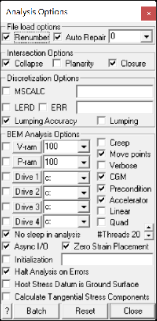

Définit des options qui contrôlent diverses opérations du programme.

#### File Load Options:

Analysis > Options > Renumber Renumérote les surfaces pour que le volume soit positif (pendant le chargement du fichier). Analysis > Options > Auto Repair Tente de réparer le modèle en comblant les vides, en supprimant les doublons, etc. (pendant le chargement du fichier).

#### Intersection Options:

Analysis > Options > Collapse Fusionne les surfaces adjacentes (pendant l'analyse des intersections).

Analysis > Options > Planarity Subdivise les quadrilatères non plans en triangles (pendant l'analyse des intersections).

Analysis > Options > Closure Effectue la vérification de fermeture et de chevauchement, et résout les intersections booléennes (pendant l'analyse des intersections).

#### Discretization Options:

Analysis > Options > MSCALC Calcule les résultats en des points définis par l'utilisateur (pendant l'analyse BEM de Map3D).

Analysis > Options > LERD Calcule le taux de libération d'énergie et la rigidité du système de chargement (pendant l'analyse BEM de Map3D).

Analysis > Options > ERR Calcule le taux de libération d'énergie et la rigidité du système de chargement (pendant l'analyse BEM de Map3D).

Analysis > Options > Lumping Accuracy

Analysis > Options > Lumping Précalcule la taille de la matrice des coefficients (pendant l'analyse de discrétisation).

#### Map3D BEM Analysis Options:

Analysis > Options > V-ram Stocke une partie de la matrice des coefficients en RAM virtuelle (pendant l'analyse BEM de Map3D).

Analysis > Options > P-ram Stocke une partie de la matrice des coefficients en RAM physique (pendant l'analyse BEM de Map3D). Analysis > Options > Drive 1 Spécifie les lecteurs temporaires principaux pour la matrice des coefficients (pendant l'analyse BEM de Map3D).

Analysis > Options > Drive 2 Spécifie le lecteur temporaire secondaire pour la matrice des coefficients (pendant l'analyse BEM de Map3D).

Analysis > Options > Drive 3 Spécifie le troisième lecteur temporaire pour la matrice des coefficients (pendant l'analyse BEM de Map3D).

Analysis > Options > Drive 4 Spécifie le quatrième lecteur temporaire pour la matrice des coefficients (pendant l'analyse BEM de Map3D).

Analysis > Options > Creep Effectue une analyse de fluage élasto-visco-plastique.

Analysis > Options > Move Points Déplace les points de champ très proches des surfaces frontières (pendant l'analyse BEM de Map3D).

Analysis > Options > Verbose Écrit tous les vecteurs solution et tous les résultats des points de champ dans le fichier journal (pendant l'analyse BEM de Map3D).

Analysis > Options > CGM Utilise le solveur à gradient conjugué (pendant l'analyse BEM de Map3D).

Analysis > Options > Precondition Préconditionne la matrice (pendant l'analyse BEM de Map3D). Analysis > Options > Accelerate Utilise l'accélérateur de matrice (pendant l'analyse BEM de Map3D). Analysis > Options > Linear Utilise des éléments de frontière d'ordre supérieur (pendant l'analyse BEM de Map3D).

Analysis > Options > Quad Utilise des éléments de frontière d'ordre supérieur (pendant l'analyse BEM de Map3D).

Analysis > Options > Threads = 8  indique le nombre de threads actuellement actifs.

Analysis > Options > Nosleep in analysis Utilise les routines d'E/S asynchrones de Windows (pendant l'analyse BEM de Map3D).

Analysis > Options > Async I/O Utilise les routines d'E/S asynchrones de Windows (pendant l'analyse BEM de Map3D).

Analysis > Options > Zero Strain Placement Lorsqu'un nouveau matériau est affecté à un bloc avec CAD > Edit > Entity Properties, ces matériaux sont initialisés à l'état de contraintes spécifié dans CAD > Properties > Material Properties.

Analysis > Options > Initialization Initialise le modèle de sorte que l'analyse se poursuive là où une analyse précédente s'était terminée.

Analysis > Options > Halt on Errors Initialise le modèle de sorte que l'analyse se poursuive là où une analyse précédente s'était terminée.

Analysis > Options > Host Stress Datum is Ground Surface Traite le datum comme la surface du sol, de sorte que toute surface située au-dessus du datum reçoit un état de contraintes nul.

Analysis > Options > Calculate Tangential Stress Components Dans les analyses élastiques, les contraintes tangentielles ne sont pas calculées sauf demande explicite. En effet, elles ne sont pas nécessaires au processus de résolution et demandent un temps d'analyse supplémentaire. Ces valeurs sont calculées par défaut lors d'une analyse plastique.

#### Miscellaneous Options:

Analysis > Options > Batch Configure la file d'attente des lots d'analyse.

Analysis > Options > Reset
