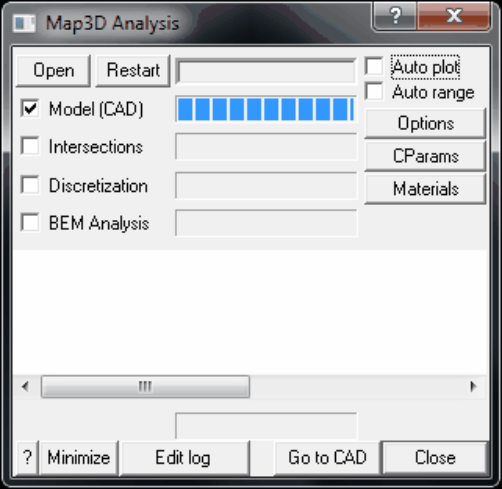

Ouvre la boîte de dialogue Map3D Analysis, qui contrôle toutes les fonctions d'analyse des contraintes.

Analysis > Open Charge un modèle depuis un fichier.

Analysis > Restart Redémarre une analyse interrompue ou arrêtée par une panne de courant ou un plantage du système d'exploitation.

Analysis > Model (CAD) Charge un modèle depuis un fichier.

Analysis > Intersections Effectue l'analyse des contacts et des intersections.

Analysis > Discretization Discrétisation des blocs et des grilles.

Analysis > BEM Analysis Analyse BEM de Map3D.

Analysis > Auto Plot Trace automatiquement les composantes de surface sélectionnées au fur et à mesure de l'analyse BEM de Map3D.

Analysis > Auto Range Modifie automatiquement la plage de contours au fur et à mesure de l'analyse BEM de Map3D.

Analysis > Options Définit des options qui contrôlent diverses opérations du programme.

Analysis > Cparams Modifie les paramètres de contrôle de l'analyse pendant l'analyse.

Analysis > Materials Modifie les propriétés des matériaux pendant l'analyse.

Analysis > Minimize Réduit l'affichage graphique pendant l'analyse.

Analysis > Edit log Modifie le fichier journal. Le fichier journal enregistre tous les messages écrits dans la fenêtre des messages.

Analysis > Go to CAD Passe à l'étape de construction et de modification du modèle.

Analysis > Close Ferme la boîte de dialogue.

Analysis > Spawn Results Lance une autre instance de Map3D et charge les résultats de la première étape d'exploitation. C'est utile pour consulter les résultats des étapes déjà terminées pendant que les étapes suivantes sont analysées.

Analysis > Suspend Suspend ou met en pause l'analyse en cours.

Analysis > Resume Reprend l'analyse suspendue.
