## 5.5.1.1 Bloc

Construit un bloc de type FF (Fictitious Force) entièrement tridimensionnel. Ces blocs servent pour les excavations 3D, les zones de matériau alterné (zones minéralisées ou dykes) et les zones remblayées. Les surfaces du bloc seront subdivisées en éléments de frontière à une étape ultérieure du programme. Dans Map3D Non-Linear, ces zones peuvent se plastifier et se comporter de façon non linéaire.

Plusieurs blocs peuvent être combinés pour créer des formes 3D complexes. La routine FFLoop ( CAD > Build > FF Loop) permet d'extruder une série de blocs FF 3D à partir d'un plan de plancher ou d'une coupe, et d'interpoler entre plusieurs plans de plancher ou coupes.

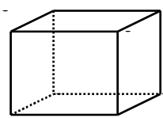

Lorsque la routine est lancée, vous êtes invité à sélectionner les 4 premiers coins qui définissent une face (p. ex. la base) d'un bloc à 6 faces. Une fois ceux-ci saisis, vous êtes invité à saisir 4 coins supplémentaires (coins 5, 6, 7 et 8) qui définissent la face opposée du bloc (p. ex. le toit).

Les coins peuvent être ordonnés dans le sens horaire ou antihoraire, à condition que la base et le toit soient saisis dans le même ordre, les coins de la face supérieure 5, 6, 7 et 8 se trouvant directement au-dessus des coins de la face inférieure 1, 2, 3 et 4.

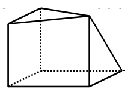

N'importe lequel des coins peut être répété pour définir des formes à 3 côtés et des coins (wedges).

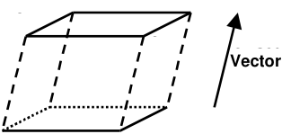

Une fois la base définie (coins 1, 2, 3 et 4), les coins restants (5, 6, 7 et 8) peuvent être générés par décalage ou extrusion

#### CAD > Build > Offset Remaining

Les coordonnées des coins peuvent être saisies au clavier

#### CAD > Build > Enter Point

sélectionnées par dessin à main levée, relevées sur d'autres entités (autres blocs ou lignes de construction) ou numérisées

#### CAD > Digitizer Setup > Activate

Une grande variété d'outils de dessin permet de sélectionner visuellement des points sur le modèle

#### CAD > Snap

Les coins peuvent être désélectionnés avec

#### CAD > Build > Undo Point

Les coins peuvent être resélectionnés avec

#### CAD > Build > Redo Point

Le bloc est considéré comme terminé lorsque le huitième coin est saisi ou lorsque l'utilisateur sélectionne

Une fois la construction du bloc terminée, vous êtes invité à saisir les propriétés du bloc. Cela permet de spécifier divers paramètres, notamment la couleur du bloc et la séquence d'exploitation.

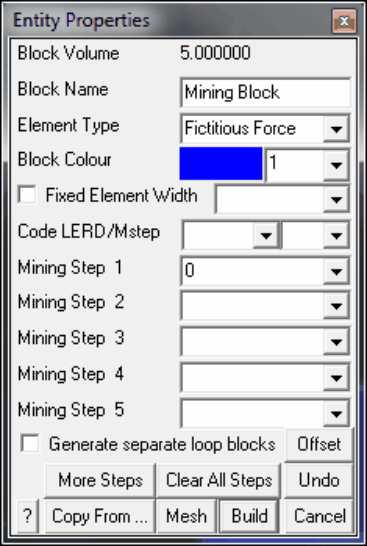

Block Volume - affiche le volume du bloc.

Block Name - spécifie un nom descriptif pour le bloc.

Element Type - spécifie le type d'élément de frontière qui sera utilisé pour le bloc.

- Fictitious Force - les éléments FF doivent être utilisés pour les éléments tridimensionnels tels que les excavations, les zones de matériau alterné, les chantiers remblayés, etc.

- Displacement Discontinuity - les éléments DD doivent être utilisés pour les excavations tabulaires, les fractures et les plans de faille.

- Les éléments inactifs peuvent servir à afficher des éléments inclus uniquement à des fins de visualisation et qui ne seront pas utilisés dans l'analyse des contraintes proprement dite.

Block Colour - spécifie le numéro de couleur qui sera utilisé pour afficher le bloc.

Spécifie le numéro de couleur qui sera affecté à chaque bouton. Un total de 10 couleurs sont disponibles pour l'affichage. Elles sont numérotées respectivement

de 1 à 10, de 11 à 20, de 21 à 30, etc.,

de sorte que la même couleur est affichée pour les numéros

1, 11, 21..., 2, 22, 32..., 3, 23, 33..., etc.

Fixed Element Width - spécifie la largeur d'élément définie par l'utilisateur.

Ce paramètre peut servir à imposer une discrétisation uniforme sur les entités sélectionnées. Soyez extrêmement prudent en spécifiant cette valeur, car une petite valeur peut facilement conduire à une taille de problème énorme.

En général, cette option ne doit pas être utilisée (décochée) et la discrétisation doit être laissée aux paramètres _AL_ et _AG_ . Ces derniers ne concentrent les éléments que là où des résultats d'analyse sont demandés, ce qui optimise l'utilisation des éléments et réduit la taille du problème. Pour une discussion plus détaillée, voir

#### CAD > Properties Control Parameters

Ce paramètre peut aussi servir à éviter de créer, pendant l'analyse des intersections, des surfaces dont les côtés dépassent cette valeur. Aucune surface dont la longueur de côté dépasse cette dimension ne sera réduite (collapse)

#### Analysis > Options > Collapse

Pendant le processus de discrétisation, toute surface dont la longueur de côté dépasse cette dimension sera subdivisée afin d'éviter des surfaces dont les côtés seraient plus grands.

Pour un exemple d'utilisation de ce paramètre, voir Tabular Mining Example

Matl_Code LERD/MStep - spécifie le code de matériau qui sera substitué dans le bloc pour le calcul LERD/LSS.

La première case sert au code de matériau.

La seconde case sert à spécifier le numéro de l'étape d'exploitation à laquelle le calcul doit être effectué. Si cette case est laissée vide, le calcul LERD sera effectué pour toutes les étapes.

#### Analysis > Options > LERD/LSS.

- Mining Step n - spécifie le code de matériau qui sera utilisé pour ce bloc à l'étape d'exploitation n. Dans l'exemple ci-dessus, le bloc n'existe pas à l'étape 1, contient le matériau n° 2 (minerai) à l'étape 2, est excavé à l'étape 3 (le code de matériau 0 signifie excaver) et, enfin, à l'étape 4 le matériau n° 5 (remblai) y est inséré. Lorsque vous utilisez un numéro de matériau positif, le matériau est placé dans le bloc avec l'état de contraintes initial spécifié, puis peut se déformer selon les propriétés élastiques/plastiques que vous avez définies pour ce numéro de matériau. Lorsque vous utilisez un numéro de matériau négatif, le matériau est placé dans le bloc avec l'état de contraintes initial spécifié, mais l'état de contraintes est maintenu à ces valeurs quelles que soient les déformations, ce qui fournit une condition aux limites en contraintes.

More Steps - permet de spécifier des étapes d'exploitation supplémentaires.

Clear All Steps - efface toutes les étapes d'exploitation (1-100).

Undo - désélectionne le dernier point saisi et revient à la routine de construction du bloc

#### CAD > Build > Undo Point

Copy From… - permet de sélectionner un autre bloc dont copier les propriétés d'entité.

Mesh - construit le bloc avec des surfaces subdivisées en parties plus petites selon l'espacement de grille de bloc spécifié.

Build - termine la construction du bloc et l'enregistre dans la base de données du modèle.

Une fois cette opération terminée, vous disposez d'une dernière chance de l'annuler et de retirer ce bloc de la base de données du modèle en sélectionnant

#### CAD > Build > Undo Build

Cancel abandonne la construction du bloc.

Notez qu'il est possible de créer des blocs de volume nul, par exemple en spécifiant un vecteur de décalage de longueur nulle. Cela permet aux utilisateurs de construire des surfaces FF individuelles s'ils le souhaitent. Bien que cela soit permis, ce n'est pas recommandé, car cela peut conduire à des volumes non fermés.

Les blocs FF peuvent être réduits en plans DD à tout moment en changeant simplement le type d'élément

#### CAD > Edit > Entity Properties

Dans ce cas, la base du bloc (le côté défini par les coins 1, 2, 3 et 4) devient le plan DD et les autres côtés du bloc sont supprimés.

Notes:

Il convient d'utiliser des numéros de couleur différents pour représenter des regroupements logiques de blocs (p. ex. pour différents niveaux, coupes ou unités d'exploitation logiques telles que les travaux de développement, les chantiers, etc.). Ces couleurs sont définissables par l'utilisateur

#### Tools > Custom Colours

Tous les blocs ayant le même numéro de couleur seront automatiquement combinés par Map3D en formes complexes uniques.

Comme il est facile d'activer et de désactiver l'affichage de numéros de couleur de bloc spécifiques

#### View > Hide Block Colours

cela offre une méthode efficace pour travailler avec des données de modèle complexes.

Pour une discussion sur les aspects de la construction de modèles, voir :

#### Model Building and Editing

Pour des tutoriels sur la construction de modèles, voir :

#### Model Building Tutorials

Appuyer sur la barre d'espace active automatiquement la dernière fonction de construction utilisée.

## 5.5.1.2 FF Loop

Construit des blocs de type FF (Fictitious Force) entièrement tridimensionnels. Ces blocs servent pour les excavations 3D, les zones de matériau alterné (zones minéralisées ou dykes) et les zones remblayées. Les surfaces du bloc seront subdivisées en éléments de frontière à une étape ultérieure du programme. Dans Map3D Non-Linear, ces zones peuvent se plastifier et se comporter de façon non linéaire.

Quelques exemples illustrant cette routine se trouvent dans Model Building Tutorials. Voir en particulier

- Video demo of FFLoop model building with multiple loops

- Video demo of FFLoop model simplification using slicing

- FFLoop Drift Example

- FFLoop Stope Example

- Bulk Mining Example

#### FFLoops

Lorsque la routine est lancée, vous êtes invité à sélectionner les coins qui définissent le périmètre d'une série de plans de plancher ou de coupes. Le sens de parcours de chaque boucle n'a pas d'importance. Autant de boucles que souhaité peuvent être définies simultanément. Le nombre de points ne doit pas nécessairement être le même sur chaque boucle. Les points de départ et d'arrivée de chaque boucle (p. ex. les points 1 et 11 sur la première boucle, et les points 12 et 22 sur la seconde) doivent se trouver au même emplacement pour définir une série de boucles fermées.

#### Snap > Trace

Des points individuels peuvent être sélectionnés un par un, ou tous les points le long d'un segment de ligne de construction peuvent être sélectionnés avec la fonction d'accrochage CAD > Snap > Trace CLoop.

#### Snap > Win

Des points individuels peuvent être sélectionnés un par un, ou tous les points le long de plusieurs lignes de construction peuvent être sélectionnés avec la fonction d'accrochage CAD > Snap > Window.

#### Close

La routine FFLoop est considérée comme terminée lorsque l'une des deux conditions suivantes est remplie :

- l'utilisateur sélectionne une troisième fois le dernier point de la boucle (c'est-à-dire le point n° 22)

- CAD > Build > FFLoop

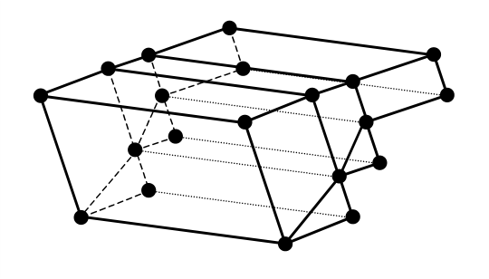

Les boucles seront alors subdivisées en une série d'éléments FF à 3 ou 4 côtés. Ces surfaces seront subdivisées en éléments de frontière à une étape ultérieure du programme. La routine qui effectue cette subdivision recherche les coins proches les uns des autres ; l'utilisateur doit donc veiller à définir la boucle de façon que les connexions soient simples. Dans l'exemple ci-dessus, il est recommandé de sélectionner ou de générer les points 4 et 5.

#### Guide Lines

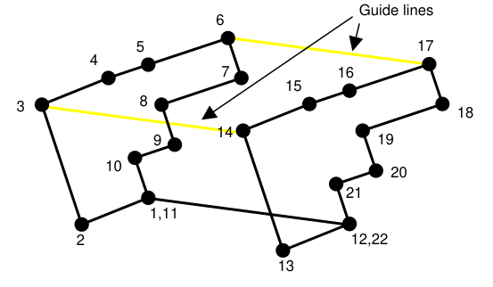

Pour les formes plus complexes, des lignes guides (affichées en jaune) peuvent être définies, qui forcent la subdivision des côtés le long de ces lignes. Elles se définissent simplement comme des lignes de construction. Pour un exemple, voir [https://www.map3d.com/ffloop.htm](https://www.map3d.com/ffloop.htm). Les lignes guides ne doivent ni se couper ni se croiser.

#### Extrusion using Offset

Une fois la première boucle fermée saisie, les points restants peuvent être générés en décalant les points restants avec CAD > Build > Offset Remaining

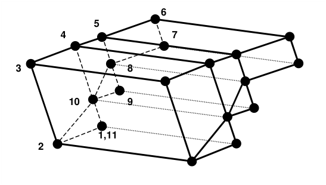

#### Miscellaneous

Les coordonnées des coins peuvent être saisies au clavier

#### CAD > Build > Enter Point

sélectionnées par dessin à main levée, relevées sur d'autres entités (autres blocs ou lignes de construction) ou numérisées

#### CAD > Digitizer Setup > Activate

Une grande variété d'outils de dessin permet de sélectionner visuellement des points sur le modèle

#### CAD > Snap

Les coins peuvent être désélectionnés avec

#### CAD > Build > Undo Point

Les coins peuvent être resélectionnés avec

#### CAD > Build > Redo Point

Une fois la construction du bloc terminée, vous êtes invité à saisir les propriétés du bloc. Cela permet de spécifier divers paramètres, notamment la couleur du bloc et la séquence d'exploitation.

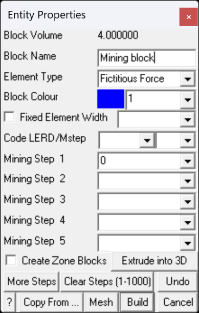

Block Volume - affiche le volume du bloc.

Block Name - spécifie un nom descriptif pour le bloc.

Element Type - spécifie le type d'élément de frontière qui sera utilisé pour le bloc.

- Fictitious Force - les éléments FF doivent être utilisés pour les éléments tridimensionnels tels que les excavations, les zones de matériau alterné, les chantiers remblayés, etc.

- Displacement Discontinuity - les éléments DD doivent être utilisés pour les excavations tabulaires, les fractures et les plans de faille.

- Les éléments inactifs peuvent servir à afficher des éléments inclus uniquement à des fins de visualisation et qui ne seront pas utilisés dans l'analyse des contraintes proprement dite.

Block Colour - spécifie le numéro de couleur qui sera utilisé pour afficher le bloc.

Spécifie le numéro de couleur qui sera affecté à chaque bouton. Un total de 10 couleurs sont disponibles pour l'affichage. Elles sont numérotées respectivement

de 1 à 10, de 11 à 20, de 21 à 30, etc.,

de sorte que la même couleur est affichée pour les numéros

1, 11, 21..., 2, 22, 32..., 3, 23, 33..., etc.

Fixed Element Width - spécifie la largeur d'élément définie par l'utilisateur.

Ce paramètre peut servir à imposer une discrétisation uniforme sur les entités sélectionnées. Soyez extrêmement prudent en spécifiant cette valeur, car une petite valeur peut facilement conduire à une taille de problème énorme.

En général, cette option ne doit pas être utilisée (décochée) et la discrétisation doit être laissée aux paramètres _AL_ et _AG_ . Ces derniers ne concentrent les éléments que là où des résultats d'analyse sont demandés, ce qui optimise l'utilisation des éléments et réduit la taille du problème. Pour une discussion plus détaillée, voir

#### CAD > Properties Control Parameters

Ce paramètre peut aussi servir à éviter de créer, pendant l'analyse des intersections, des surfaces dont les côtés dépassent cette valeur. Aucune surface dont la longueur de côté dépasse cette dimension ne sera réduite (collapse)

#### Analysis > Options > Collapse

Pendant le processus de discrétisation, toute surface dont la longueur de côté dépasse cette dimension sera subdivisée afin d'éviter des surfaces dont les côtés seraient plus grands.

Pour un exemple d'utilisation de ce paramètre, voir Tabular Mining Example

Matl_Code LERD/MStep - spécifie le code de matériau qui sera substitué dans le bloc pour le calcul LERD/LSS.

La première case sert au code de matériau.

La seconde case sert à spécifier le numéro de l'étape d'exploitation à laquelle le calcul doit être effectué. Si cette case est laissée vide, le calcul LERD sera effectué pour toutes les étapes.

#### Analysis > Options > LERD/LSS.

- Mining Step n - spécifie le code de matériau qui sera utilisé pour ce bloc à l'étape d'exploitation n. Dans l'exemple ci-dessus, le bloc n'existe pas à l'étape 1, contient le matériau n° 2 (minerai) à l'étape 2, est excavé à l'étape 3 (le code de matériau 0 signifie excaver) et, enfin, à l'étape 4 le matériau n° 5 (remblai) y est inséré. Lorsque vous utilisez un numéro de matériau positif, le matériau est placé dans le bloc avec l'état de contraintes initial spécifié, puis peut se déformer selon les propriétés élastiques/plastiques que vous avez définies pour ce numéro de matériau. Lorsque vous utilisez un numéro de matériau négatif, le matériau est placé dans le bloc avec l'état de contraintes initial spécifié, mais l'état de contraintes est maintenu à ces valeurs quelles que soient les déformations, ce qui fournit une condition aux limites en contraintes.

Create Zone Blocks - si vous construisez des blocs à boucles multiples, vous pouvez indiquer si des interfaces seront créées ou non entre chaque bloc, afin que chacun puisse être traité comme une unité d'exploitation distincte. Un numéro de couleur différent sera affecté à chacune de ces sous-sections pour faciliter leur masquage/affichage avec Hide Block Colours. Si vous n'activez pas cette option, un seul grand bloc sera créé.

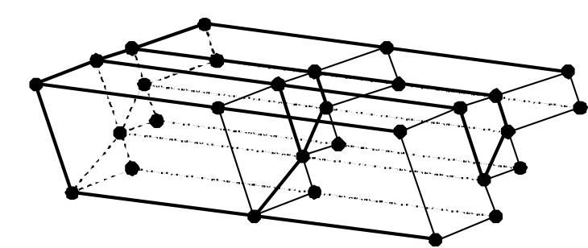

Extrude into 3D - permet de décaler une boucle plane pour extruder le bloc en une forme 3D. Cette opération peut aussi s'effectuer avec Extrude/Offset Remaining.

More Steps - permet de spécifier des étapes d'exploitation supplémentaires.

Clear All Steps - efface toutes les étapes d'exploitation (1-1000).

Undo - désélectionne le dernier point saisi et revient à la routine de construction du bloc

#### CAD > Build > Undo Point

Copy From… - permet de sélectionner un autre bloc dont copier les propriétés d'entité.

Mesh - construit le bloc avec des surfaces subdivisées en parties plus petites selon l'espacement de grille de bloc spécifié.

Build - termine la construction du bloc et l'enregistre dans la base de données du modèle.

Une fois cette opération terminée, vous disposez d'une dernière chance de l'annuler et de retirer ce bloc de la base de données du modèle en sélectionnant

#### CAD > Build > Undo Build

Cancel abandonne la construction du bloc.

Notez qu'il est possible de créer des blocs de volume nul, par exemple en spécifiant un vecteur de décalage de longueur nulle. Cela permet aux utilisateurs de construire des surfaces FF individuelles s'ils le souhaitent. Bien que cela soit permis, ce n'est pas recommandé, car cela peut conduire à des volumes non fermés.

Les blocs FF peuvent être réduits en plans DD à tout moment en changeant simplement le type d'élément

#### CAD > Edit > Entity Properties

Dans ce cas, la base du bloc (le côté défini par les coins 1, 2, 3 et 4) devient le plan DD et les autres côtés du bloc sont supprimés.

Notes:

Il convient d'utiliser des numéros de couleur différents pour représenter des regroupements logiques de blocs (p. ex. pour différents niveaux, coupes ou unités d'exploitation logiques telles que les travaux de développement, les chantiers, etc.). Ces couleurs sont définissables par l'utilisateur

#### Tools > Custom Colours

Tous les blocs ayant le même numéro de couleur seront automatiquement combinés par Map3D en formes complexes uniques.

Comme il est facile d'activer et de désactiver l'affichage de numéros de couleur de bloc spécifiques

#### View > Hide Block Colours

cela offre une méthode efficace pour travailler avec des données de modèle complexes.

Pour une discussion sur les aspects de la construction de modèles, voir :

#### Model Building and Editing

Pour des tutoriels sur la construction de modèles, voir :

#### Model Building Tutorials

Appuyer sur la barre d'espace active automatiquement la dernière fonction de construction utilisée.

## 5.5.1.3 DD Loop

Construit des blocs de type DD (Displacement Discontinuity). Ces blocs servent pour l'exploitation tabulaire, les couches minces ou les plans de faille. Dans toutes les versions de Map3D, ces zones peuvent se plastifier et se comporter de façon non linéaire. Plusieurs DD peuvent être combinés pour créer des formes complexes décalées et ondulées.

Quelques exemples illustrant cette routine se trouvent dans Model Building Tutorials. Voir en particulier

- Video demo of DDLoop model building with sub-parallel lines

- Video demo of DDLoop model building with interior loops

- DDLoop Pillar Example

- Tabular Mining Example

#### DDLoop

Lorsque la routine est lancée, vous êtes invité à sélectionner une série de boucles qui définissent le périmètre des zones souhaitées. Le sens de parcours de chaque boucle n'a pas d'importance. Les points de départ et d'arrivée de chaque boucle (p. ex. les points 1 et 11, ou 12 et 22) doivent se trouver au même emplacement pour définir des boucles fermées.

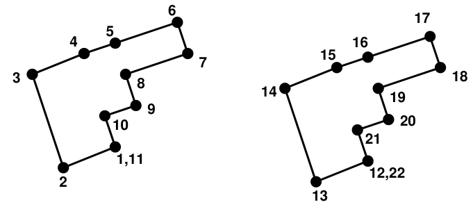

#### Snap > Trace

Des points individuels peuvent être sélectionnés un par un, ou tous les points le long d'un segment de ligne de construction peuvent être sélectionnés avec la fonction d'accrochage CAD > Snap > Trace CLoop.

#### Snap > Win

Des points individuels peuvent être sélectionnés un par un, ou tous les points le long de plusieurs lignes de construction peuvent être sélectionnés avec la fonction d'accrochage CAD > Snap > Window.

#### Close

La routine DDLoop est considérée comme terminée lorsque l'une des deux conditions suivantes est remplie :

- l'utilisateur sélectionne une troisième fois le dernier point de la boucle (c'est-à-dire le point n° 12,22)

- CAD > Build > DDLoop

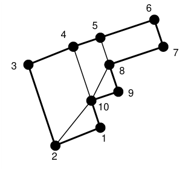

Les boucles seront alors subdivisées en une série d'éléments DD à 3 ou 4 côtés. Ces surfaces seront subdivisées en éléments de frontière à une étape ultérieure du programme. La routine qui effectue cette subdivision recherche les coins proches les uns des autres ; l'utilisateur doit donc veiller à définir la boucle de façon que les connexions soient simples. Dans l'exemple ci-dessus, il est recommandé de sélectionner ou de générer les points 4 et 5.

La fonction de construction Mesh (voir ci-dessous) permet de construire le bloc avec des surfaces subdivisées en parties plus petites selon l'espacement de grille de bloc spécifié. Cette routine génère les points intérieurs nécessaires pour conserver des éléments de bonne forme.

#### Guide Lines

Plusieurs zones intérieures peuvent être tracées simultanément en définissant des lignes guides (affichées en jaune).

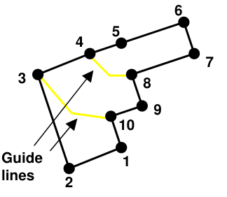

Elles se définissent simplement comme des lignes de construction. Pour un exemple, voir [https://www.map3d.com/t.htm](https://www.map3d.com/t.htm). Les lignes guides doivent traverser la boucle périmétrique d'un bord à l'autre. Plusieurs lignes guides qui se coupent peuvent être définies, délimitant ainsi plusieurs zones.

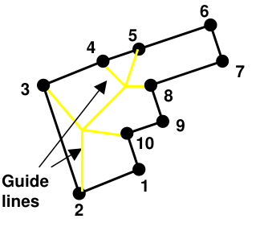

#### Interior Zones

Plusieurs zones intérieures (p. ex. des piliers) peuvent être définies en traçant leur périphérie, comme illustré ci-dessous. Le sens de parcours de la zone intérieure n'a pas d'importance. Autant de zones intérieures que souhaité peuvent être définies de cette façon.

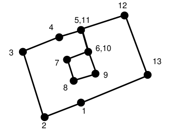

Autrement, ces zones intérieures peuvent être construites commodément en traçant le périmètre extérieur ( CAD > Snap > Trace CLoop) et en utilisant des lignes guides pour définir les formes intérieures souhaitées.

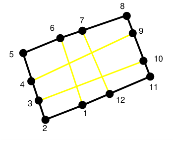

Create Zone Blocks - si vous construisez des plans DD à boucles multiples, vous pouvez indiquer si des interfaces seront créées ou non entre chaque sous-section, afin que chacune puisse être traitée comme un groupe distinct de DDPlanes. Un numéro de couleur différent sera affecté à chacune de ces sous-sections pour faciliter leur masquage/affichage avec Hide Block Colours. Si vous n'activez pas cette option, un seul grand groupe de DDPlanes sera créé.

#### Extrusion using Offset

Une fois au moins deux points saisis, les points restants peuvent être générés en décalant les points restants avec CAD > Build > Offset Remaining

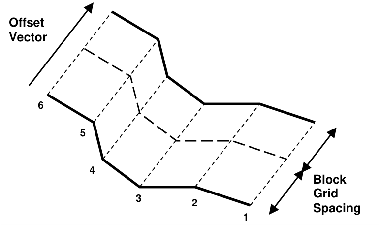

Notez aussi que les éléments DD peuvent être extrudés en zones FF simplement en changeant le type d'élément de DD en FF.

#### Miscellaneous

Les coordonnées des coins peuvent être saisies au clavier

#### CAD > Build > Enter Point

sélectionnées par dessin à main levée, relevées sur d'autres entités (autres blocs ou lignes de construction) ou numérisées

#### CAD > Digitizer Setup > Activate

Une grande variété d'outils de dessin permet de sélectionner visuellement des points sur le modèle

#### CAD > Snap

Les coins peuvent être désélectionnés avec

#### CAD > Build > Undo Point

Les coins peuvent être resélectionnés avec

#### CAD > Build > Redo Point

Une fois la construction du bloc terminée, vous êtes invité à saisir les propriétés du bloc. Cela permet de spécifier divers paramètres, notamment la couleur du bloc et la séquence d'exploitation.

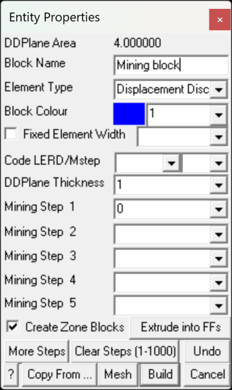

DDPlane Area - affiche l'aire combinée de tous les DDPlanes inclus dans le DDLoop.

Block Name - spécifie un nom descriptif pour le bloc.

Element Type - spécifie le type d'élément de frontière qui sera utilisé pour le bloc.

- Displacement Discontinuity - les éléments de type DD doivent être utilisés pour les excavations tabulaires, les fractures et les plans de faille.

- Fictitious Force - les éléments de type FF doivent être utilisés pour les éléments tridimensionnels tels que les excavations, les zones de matériau alterné, les chantiers remblayés, etc.

- Les éléments inactifs peuvent servir à afficher des éléments inclus uniquement à des fins de visualisation et qui ne seront pas utilisés dans l'analyse des contraintes proprement dite.

Block Colour - spécifie le numéro de couleur qui sera utilisé pour afficher le bloc.

Spécifie le numéro de couleur qui sera affecté à chaque bouton. Un total de 10 couleurs sont disponibles pour l'affichage. Elles sont numérotées respectivement

de 1 à 10, de 11 à 20, de 21 à 30, etc.,

de sorte que la même couleur est affichée pour les numéros

1, 11, 21..., 2, 22, 32..., 3, 23, 33..., etc.

Fixed Element Width - spécifie la largeur d'élément définie par l'utilisateur.

Ce paramètre peut servir à imposer une discrétisation uniforme sur les entités sélectionnées. Soyez extrêmement prudent en spécifiant cette valeur, car une petite valeur peut facilement conduire à une taille de problème énorme.

En général, cette option ne doit pas être utilisée (décochée) et la discrétisation doit être laissée aux paramètres _AL_ et _AG_ . Ces derniers ne concentrent les éléments que là où des résultats d'analyse sont demandés, ce qui optimise l'utilisation des éléments et réduit la taille du problème. Pour une discussion plus détaillée, voir

#### CAD > Properties Control Parameters

Ce paramètre peut aussi servir à éviter de créer, pendant l'analyse des intersections, des surfaces dont les côtés dépassent cette valeur. Aucune surface dont la longueur de côté dépasse cette dimension ne sera réduite (collapse)

#### Analysis > Options > Collapse

Pendant le processus de discrétisation, toute surface dont la longueur de côté dépasse cette dimension sera subdivisée afin d'éviter des surfaces dont les côtés seraient plus grands.

Pour un exemple d'utilisation de ce paramètre, voir Tabular Mining Example

Matl_Code LERD/MStep - spécifie le code de matériau qui sera substitué dans le bloc pour le calcul LERD/LSS.

La première case sert au code de matériau.

La seconde case sert à spécifier le numéro de l'étape d'exploitation à laquelle le calcul doit être effectué. Si cette case est laissée vide, le calcul LERD sera effectué pour toutes les étapes.

#### Analysis > Options > LERD/LSS.

#### Analysis > Options > LERD/LSS

DDPlane Thickness - spécifie l'épaisseur du matériau inséré dans l'élément DD (c'est-à-dire gouge de faille, épaisseur de couche, largeur d'exploitation ou hauteur de pilier).

La convergence (déplacement normal) de la structure lorsqu'elle est remplie sera limitée à cette épaisseur. De plus, le déplacement normal (convergence) et le déplacement de cisaillement (ride) sont divisés par l'épaisseur pour déterminer la déformation qui se produit dans le matériau de remplissage

Fault-Gouge in DD planes

Backfill-Hyperbolic in DD planes Equilibrated-Gouge in DD planes

Mohr-Coulomb in DD planes

Ce paramètre doit être spécifié dans les mêmes unités que celles utilisées pour les coordonnées (p. ex. mètres ou pieds).

- Mining Step n - spécifie le code de matériau qui sera utilisé pour ce bloc à l'étape d'exploitation n. Dans l'exemple ci-dessus, le bloc n'existe pas à l'étape 1, contient le matériau n° 2 (minerai) à l'étape 2, est excavé à l'étape 3 (le code de matériau 0 signifie excaver) et, enfin, à l'étape 4 le matériau n° 5 (remblai) y est inséré. Lorsque vous utilisez un numéro de matériau positif, le matériau est placé dans le bloc avec l'état de contraintes initial spécifié, puis peut se déformer selon les propriétés élastiques/plastiques que vous avez définies pour ce numéro de matériau. Lorsque vous utilisez un numéro de matériau négatif, le matériau est placé dans le bloc avec l'état de contraintes initial spécifié, mais l'état de contraintes est maintenu à ces valeurs quelles que soient les déformations, ce qui fournit une condition aux limites en contraintes.

Extrude into FFs - permet d'extruder un plan DD en un bloc FF. Le vecteur d'extrusion vous sera demandé

More Steps - permet de spécifier des étapes d'exploitation supplémentaires.

Clear All Steps - efface toutes les étapes d'exploitation (1-1000).

Undo - désélectionne le dernier point saisi et revient à la routine de construction du bloc

#### CAD > Build > Undo Point

Copy From… - permet de sélectionner un autre bloc dont copier les propriétés d'entité.

Mesh - construit le bloc avec des surfaces subdivisées en parties plus petites selon l'espacement de grille de bloc spécifié. Cette routine génère les points intérieurs nécessaires pour conserver des éléments de bonne forme.

Build - termine la construction du bloc et l'enregistre dans la base de données du modèle.

Une fois cette opération terminée, vous disposez d'une dernière chance de l'annuler et de retirer ce bloc de la base de données du modèle en sélectionnant

#### CAD > Build > Undo Build

Cancel abandonne la construction du bloc.

Notez qu'il est possible de créer des blocs de volume nul, par exemple en spécifiant un vecteur de décalage de longueur nulle. Cela permet aux utilisateurs de construire des surfaces FF individuelles s'ils le souhaitent. Bien que cela soit permis, ce n'est pas recommandé, car cela peut conduire à des volumes non fermés.

Les blocs DD peuvent être extrudés en blocs FF 3D à tout moment en changeant simplement le type d'élément

#### CAD > Edit > Entity Properties

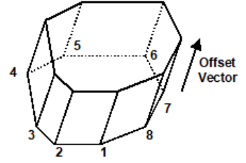

Dans ce cas, les coins 1 à 8 définissent la base du bloc. Le toit et les côtés sont générés automatiquement pendant le processus d'extrusion.

Notez qu'il est possible de créer des blocs de volume nul, par exemple en spécifiant un vecteur de décalage de longueur nulle. Cela permet aux utilisateurs de construire des surfaces FF individuelles s'ils le souhaitent. Bien que cela soit permis, ce n'est pas recommandé, car cela peut conduire à des volumes non fermés.

Notes:

Il convient d'utiliser des numéros de couleur différents pour représenter des regroupements logiques de blocs (p. ex. pour différents niveaux, coupes ou unités d'exploitation logiques telles que les travaux de développement, les chantiers, etc.). Ces couleurs sont définissables par l'utilisateur

#### Tools > Custom Colours

Tous les blocs ayant le même numéro de couleur seront automatiquement combinés par Map3D en formes complexes uniques.

Comme il est facile d'activer et de désactiver l'affichage de numéros de couleur de bloc spécifiques

#### View > Hide Block Colours

cela offre une méthode efficace pour travailler avec des données de modèle complexes.

Pour une discussion sur les aspects de la construction de modèles, voir :

#### Model Building and Editing

Pour des tutoriels sur la construction de modèles, voir :

#### Model Building Tutorials

Appuyer sur la barre d'espace active automatiquement la dernière fonction de construction utilisée.

## 5.5.1.4 Tunnel

Construit un tunnel (bloc de type FF - Fictitious Force). Cette fonction sert à construire un tunnel 3D en extrudant une section transversale le long du tracé du tunnel. Les surfaces du tunnel seront subdivisées en éléments de frontière à une étape ultérieure du programme.

#### Tunnel

La construction du tunnel se déroule en trois étapes :

- 1) Sélectionner le profil du tunnel ;

- 2) Sélectionner le point de référence du tunnel ;

- 3) Sélectionner le tracé/l'implantation du tunnel.

**Stage 1 - Tunnel Profile**

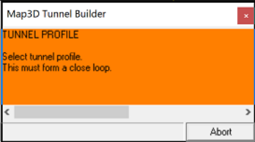

Lorsque la routine est lancée, vous êtes invité à sélectionner un profil de tunnel :

- celui-ci doit former une boucle fermée

- il peut être construit selon n'importe quelle orientation souhaitée (x-y, y-z, x-z ou toute orientation définie par l'utilisateur) `o` notez que si le profil est construit dans le plan x-y, la direction y sera utilisée comme vers le haut `o` sinon, si le profil est construit dans le plan y-z ou x-z, la direction z sera utilisée comme vers le haut

- lors de sa sélection, gardez à l'esprit que ce profil de tunnel sera extrudé en s'éloignant de votre point de vue (comme indiqué par les flèches rouges ci-dessous)

- il peut être sélectionné sous forme d'une série de points, de façon similaire à la sélection des lignes de construction CAD > Build > Construction Lines

- autrement, une forme prédéfinie avec des lignes de construction peut être sélectionnée en utilisant par exemple CAD > Snap > Trace CLoop

- toutes les fonctions d'accrochage et de construction peuvent être utilisées pendant la sélection du profil, y compris CAD > Build > Offset Remaining

Ici, un profil de tunnel est affiché en vert. Les flèches rouges indiquent la direction dans laquelle le tunnel sera extrudé pendant l'étape 3 - tracé/implantation du tunnel.

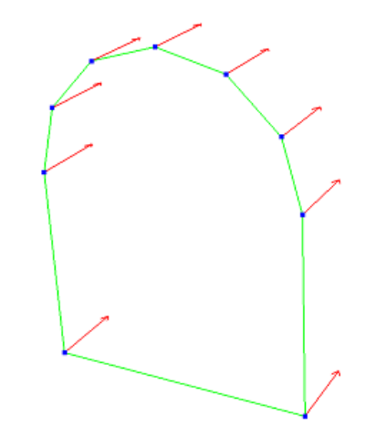

Map3D détectera un profil de tunnel terminé lorsque la boucle est fermée. Vous serez alors dirigé vers l'étape 2 - point de référence du tunnel.

**Stage 2 - Tunnel Reference Point**

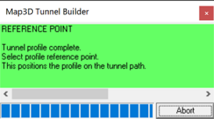

Le point de référence du tunnel représente l'emplacement sur le profil du tunnel qui servira à positionner le profil sur le tracé/l'implantation du tunnel.

Ci-dessous, le coin inférieur droit a été sélectionné comme point de référence.

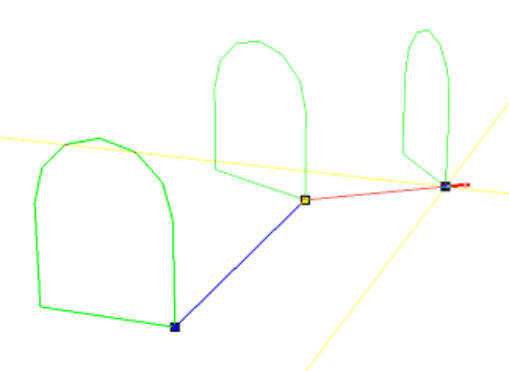

Une fois le point de référence sélectionné, vous serez dirigé vers l'étape 3 - tracé/implantation du tunnel.

Notez que si un mauvais point de référence est sélectionné, annulez simplement la sélection avec CAD > Build > Undo Build ou en appuyant sur la touche Échap.

**Stage 3 - Tunnel Path/Layout**

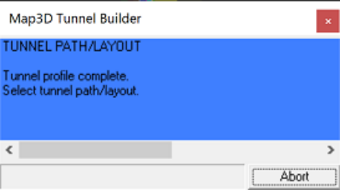

Le tracé/l'implantation du tunnel peut maintenant être sélectionné :

- le profil sélectionné ci-dessus sera extrudé le long du tracé/de l'implantation

- le tracé/l'implantation peut être sélectionné de façon similaire à la sélection des lignes de construction CAD > Build > Construction Lines

- autrement, le tracé/l'implantation peut être sélectionné le long d'un ensemble de lignes de construction prédéfinies

- les boucles de tunnel fermées sont acceptables

- les tracés de tunnel inclinés sont acceptables

- toutes les fonctions d'accrochage et de construction peuvent être utilisées pendant la sélection du profil, y compris CAD > Build > Offset Remaining

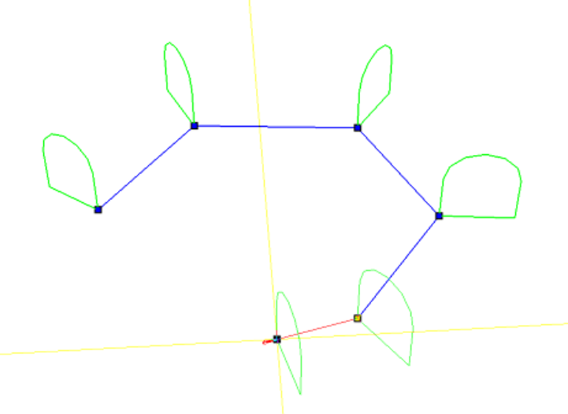

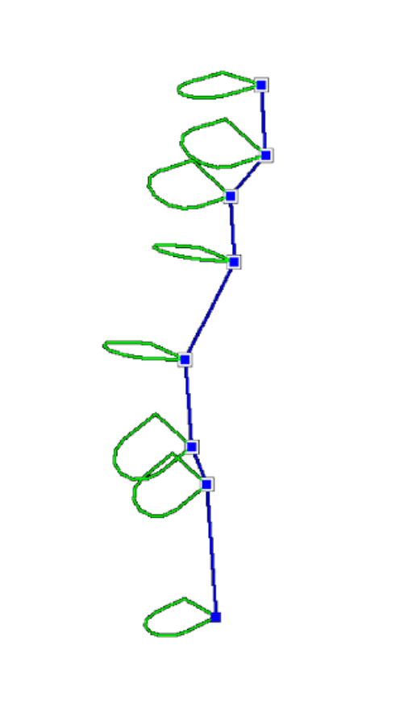

Ci-dessus, à gauche, les deux premiers points du tracé ont été choisis dans le plan horizontal (montant ou descendant de moins de 45°) ; le tunnel est donc extrudé comme une galerie horizontale avec la section orientée verticalement, comme illustré. À droite, les deux premiers points du tracé sont choisis dans le plan vertical (montant ou descendant de plus de 45°) ; le tunnel est donc extrudé comme un puits vertical avec la section orientée presque horizontalement, comme illustré.

Le tracé/l'implantation du tunnel est considéré comme terminé lorsque l'une des deux conditions suivantes est remplie :

- l'utilisateur sélectionne une seconde fois le dernier point

- CAD > Build > Tunnel

Une fois terminé, le tunnel sera construit comme illustré ci-dessous.

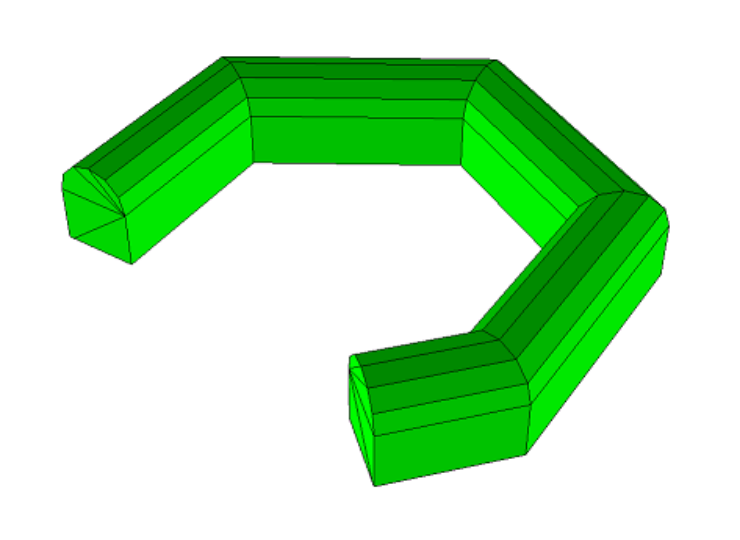

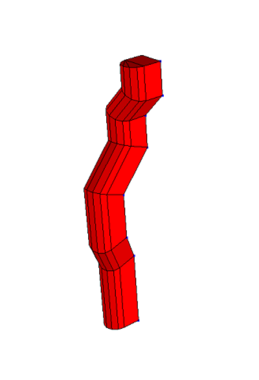

#### Miscellaneous

Les coordonnées des coins peuvent être saisies au clavier

#### CAD > Build > Enter Point

sélectionnées par dessin à main levée, relevées sur d'autres entités (autres blocs ou lignes de construction) ou numérisées

#### CAD > Digitizer Setup > Activate

Une grande variété d'outils de dessin permet de sélectionner visuellement des points sur le modèle

#### CAD > Snap

Les coins peuvent être désélectionnés avec

#### CAD > Build > Undo Point

Les coins peuvent être resélectionnés avec

#### CAD > Build > Redo Point

Une fois la construction du bloc terminée, vous êtes invité à saisir les propriétés du bloc. Cela permet de spécifier divers paramètres, notamment la couleur du bloc et la séquence d'exploitation.

Block Volume - affiche le volume du bloc.

Block Name - spécifie un nom descriptif pour le bloc.

Element Type - spécifie le type d'élément de frontière qui sera utilisé pour le bloc.

- Fictitious Force - les éléments FF doivent être utilisés pour les éléments tridimensionnels tels que les excavations, les zones de matériau alterné, les chantiers remblayés, etc.

- Les éléments inactifs peuvent servir à afficher des éléments inclus uniquement à des fins de visualisation et qui ne seront pas utilisés dans l'analyse des contraintes proprement dite.

Block Colour - spécifie le numéro de couleur qui sera utilisé pour afficher le bloc.

Spécifie le numéro de couleur qui sera affecté à chaque bouton. Un total de 10 couleurs sont disponibles pour l'affichage. Elles sont numérotées respectivement

de 1 à 10, de 11 à 20, de 21 à 30, etc.,

de sorte que la même couleur est affichée pour les numéros

1, 11, 21..., 2, 22, 32..., 3, 23, 33..., etc.

Fixed Element Width - spécifie la largeur d'élément définie par l'utilisateur.

Ce paramètre peut servir à imposer une discrétisation uniforme sur les entités sélectionnées. Soyez extrêmement prudent en spécifiant cette valeur, car une petite valeur peut facilement conduire à une taille de problème énorme.

En général, cette option ne doit pas être utilisée (décochée) et la discrétisation doit être laissée aux paramètres _AL_ et _AG_ . Ces derniers ne concentrent les éléments que là où des résultats d'analyse sont demandés, ce qui optimise l'utilisation des éléments et réduit la taille du problème. Pour une discussion plus détaillée, voir

#### CAD > Properties Control Parameters

Ce paramètre peut aussi servir à éviter de créer, pendant l'analyse des intersections, des surfaces dont les côtés dépassent cette valeur. Aucune surface dont la longueur de côté dépasse cette dimension ne sera réduite (collapse)

#### Analysis > Options > Collapse

Pendant le processus de discrétisation, toute surface dont la longueur de côté dépasse cette dimension sera subdivisée afin d'éviter des surfaces dont les côtés seraient plus grands.

Pour un exemple d'utilisation de ce paramètre, voir Tabular Mining Example

Matl_Code LERD/MStep - spécifie le code de matériau qui sera substitué dans le bloc pour le calcul LERD/LSS.

La première case sert au code de matériau.

La seconde case sert à spécifier le numéro de l'étape d'exploitation à laquelle le calcul doit être effectué. Si cette case est laissée vide, le calcul LERD sera effectué pour toutes les étapes.

#### Analysis > Options > LERD/LSS.

- Mining Step n - spécifie le code de matériau qui sera utilisé pour ce bloc à l'étape d'exploitation n. Dans l'exemple ci-dessus, le bloc n'existe pas à l'étape 1, contient le matériau n° 2 (minerai) à l'étape 2, est excavé à l'étape 3 (le code de matériau 0 signifie excaver) et, enfin, à l'étape 4 le matériau n° 5 (remblai) y est inséré. Lorsque vous utilisez un numéro de matériau positif, le matériau est placé dans le bloc avec l'état de contraintes initial spécifié, puis peut se déformer selon les propriétés élastiques/plastiques que vous avez définies pour ce numéro de matériau. Lorsque vous utilisez un numéro de matériau négatif, le matériau est placé dans le bloc avec l'état de contraintes initial spécifié, mais l'état de contraintes est maintenu à ces valeurs quelles que soient les déformations, ce qui fournit une condition aux limites en contraintes.

Generate Separate Loop Blocks - vous pouvez indiquer si des interfaces seront créées ou non entre chaque bloc, afin que chacun puisse être traité comme une unité d'exploitation distincte (comme illustré ci-dessous). Si vous n'activez pas cette option, un seul grand bloc sera créé.

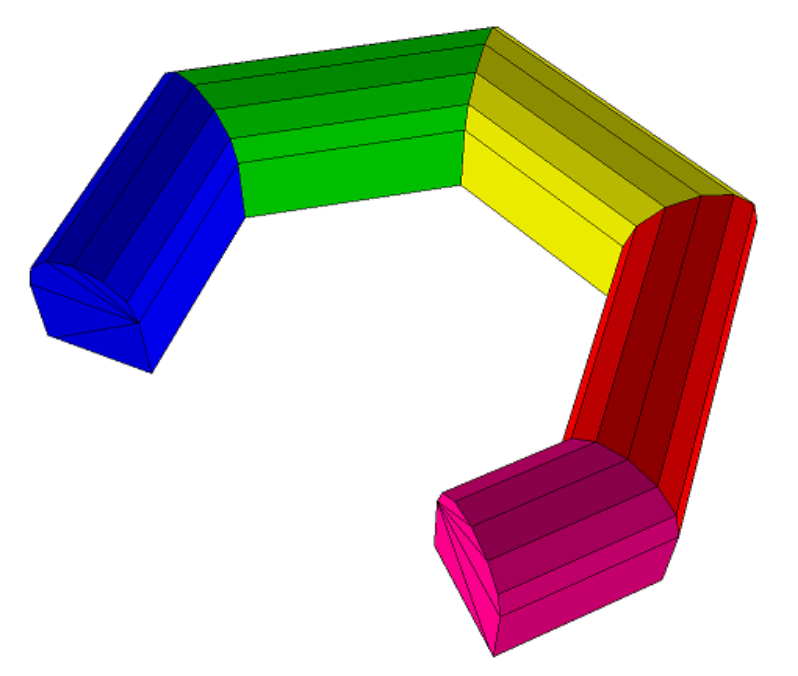

More Steps - permet de spécifier des étapes d'exploitation supplémentaires.

Clear All Steps - efface toutes les étapes d'exploitation (1-100).

Undo - désélectionne le dernier point saisi et revient à la routine de construction du tunnel

#### CAD > Build > Undo Point

Copy From… - permet de sélectionner un autre bloc dont copier les propriétés d'entité.

Mesh - construit le bloc avec des surfaces subdivisées en parties plus petites selon l'espacement de grille de bloc spécifié.

Build - termine la construction du bloc et l'enregistre dans la base de données du modèle.

Une fois cette opération terminée, vous disposez d'une dernière chance de l'annuler et de retirer ce bloc de la base de données du modèle en sélectionnant

#### CAD > Build > Undo Build

Cancel abandonne la construction du bloc.

Notes:

Il convient d'utiliser des numéros de couleur différents pour représenter des regroupements logiques de blocs (p. ex. pour différents niveaux, coupes ou unités d'exploitation logiques telles que les travaux de développement, les chantiers, etc.). Ces couleurs sont définissables par l'utilisateur

#### Tools > Custom Colours

Tous les blocs ayant le même numéro de couleur seront automatiquement combinés par Map3D en formes complexes uniques.

Comme il est facile d'activer et de désactiver l'affichage de numéros de couleur de bloc spécifiques

#### View > Hide Block Colours

cela offre une méthode efficace pour travailler avec des données de modèle complexes.

Pour une discussion sur les aspects de la construction de modèles, voir :

#### Model Building and Editing

Pour des tutoriels sur la construction de modèles, voir :

#### Model Building Tutorials

Appuyer sur la barre d'espace active automatiquement la dernière fonction de construction utilisée.

## 5.5.1.5 Grid Plane

Construit un plan de grille. Les résultats d'analyse (contraintes, déformations et déplacements) sont calculés sur ces plans de grille. Chaque plan de grille sera subdivisé à une étape ultérieure du programme.

Cette fonction utilise les mêmes fonctionnalités de construction que CAD > Build > DDLoop

Notez que les grilles linéaires peuvent être créées avec

CAD > Build > Grid Line.

Lorsque la routine est lancée, vous êtes invité à sélectionner une boucle fermée de coins qui définissent le périmètre du plan de grille. Le plan de grille est considéré comme terminé lorsque le dernier coin sélectionné coïncide avec le premier ou lorsque l'utilisateur sélectionne le bouton de la barre d'outils de construction de GPlane

CAD > Build > Grid Plane

**Snap > Trace**

Des points individuels peuvent être sélectionnés un par un, ou tous les points le long d'un segment de ligne de construction peuvent être sélectionnés avec la fonction d'accrochage CAD > Snap > Trace CLoop.

#### Snap > Win

Des points individuels peuvent être sélectionnés un par un, ou tous les points le long de plusieurs lignes de construction peuvent être sélectionnés avec la fonction d'accrochage CAD > Snap > Window.

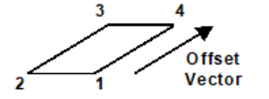

Une fois au moins deux points saisis, les points restants peuvent être générés par décalage

#### CAD > Build > Offset Remaining

Les coordonnées des coins peuvent être saisies au clavier

#### CAD > Build > Enter Point

sélectionnées par dessin à main levée, relevées sur d'autres entités (autres blocs ou lignes de construction) ou numérisées

#### CAD > Digitizer Setup > Activate

Une grande variété d'outils de dessin permet de sélectionner visuellement des points sur le modèle

#### CAD > Snap

Les coins peuvent être désélectionnés avec

#### CAD > Build > Undo Point

Les coins peuvent être resélectionnés avec

#### CAD > Build > Redo Point

Une fois la construction du plan de grille terminée, vous êtes invité à saisir les propriétés. Cela permet de spécifier un nom pour le plan de grille.

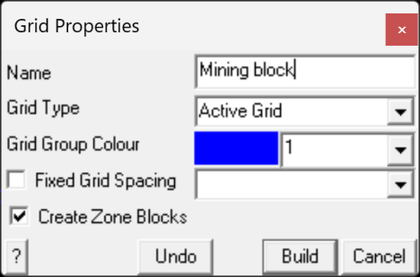

Name - spécifie un nom descriptif pour la grille.

Grid Type - indique si vous voulez que la grille soit active (utilisée dans l'analyse des contraintes) ou inactive (non utilisée dans l'analyse des contraintes).

Fixed Grid Spacing - spécifie l'espacement de grille défini par l'utilisateur.

Ce paramètre peut servir à imposer une discrétisation uniforme sur les grilles sélectionnées. Soyez extrêmement prudent en spécifiant cette valeur, car une petite valeur peut facilement conduire à une taille de problème énorme.

En général, cette option ne doit pas être utilisée (décochée) et la discrétisation doit être laissée au paramètre _AG_ . Ce dernier ne concentre les éléments que là où des résultats d'analyse sont demandés, ce qui optimise l'utilisation des éléments et réduit la taille du problème.

#### CAD > Properties Control Parameters

Create Zone Blocks - si vous construisez des plans de grille à boucles multiples, vous pouvez indiquer si des interfaces seront créées ou non entre chaque sous-section, afin que chacune puisse être traitée comme un groupe distinct de GPlanes. Un numéro de couleur différent sera affecté à chacune de ces sous-sections pour faciliter leur masquage/affichage avec Hide Grid Colours. Si vous n'activez pas cette option, un seul grand groupe de GPlanes sera créé.

Undo - désélectionne le dernier point saisi et revient à la routine de construction de la grille

#### CAD > Build > Undo Point

Build - termine la construction de la grille et l'enregistre dans la base de données du modèle.

Une fois cette opération terminée, vous disposez d'une dernière chance de l'annuler et de retirer cette grille de la base de données du modèle en sélectionnant

#### CAD > Build > Undo Build

Cancel - abandonne la construction de la grille.

Pour des exemples d'utilisation de plans de grille de points de champ, voir :

#### Model Building Tutorials

Appuyer sur la barre d'espace active automatiquement la dernière fonction de construction utilisée.

## 5.5.1.6 Grid Line

Construit une ligne de grille. Les résultats d'analyse (contraintes, déformations et déplacements) sont calculés sur ces lignes de grille. Chaque ligne de grille sera subdivisée à une étape ultérieure du programme.

#### CAD > Build > Construction Lines

Cette fonction utilise les mêmes fonctionnalités de construction que

#### CAD > Build > Grid Plane.

Notez que les plans de grille peuvent être créés avec

**2**

**1**

Lorsque la routine est lancée, vous êtes invité à sélectionner plusieurs coins qui définissent des points le long de la ligne de grille.

La ligne de grille est considérée comme terminée lorsque le dernier coin est sélectionné deux fois ou lorsque l'utilisateur sélectionne

CAD > Build > Grid Line

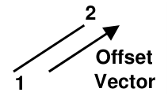

Une fois le premier point saisi, le point restant peut être généré par décalage

#### CAD > Build > Offset Remaining

Les coordonnées des coins peuvent être saisies au clavier

#### CAD > Build > Enter Point

sélectionnées par dessin à main levée, relevées sur d'autres entités (autres blocs ou lignes de construction) ou numérisées

#### CAD > Digitizer Setup > Activate

Une grande variété d'outils de dessin permet de sélectionner visuellement des points sur le modèle

#### CAD > Snap

Les coins peuvent être désélectionnés avec

#### CAD > Build > Undo Point

Les coins peuvent être resélectionnés avec

#### CAD > Build > Redo Point

Une fois la construction du plan de grille terminée, vous êtes invité à saisir les propriétés. Cela permet de spécifier un nom pour la ligne de grille.

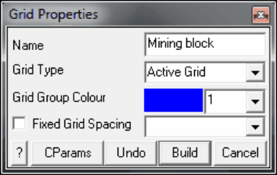

Name - spécifie un nom descriptif pour la grille.

Grid Type - indique si vous voulez que la grille soit active (utilisée dans l'analyse des contraintes) ou inactive (non utilisée dans l'analyse des contraintes).

Fixed Grid Spacing - spécifie l'espacement de grille défini par l'utilisateur.

Ce paramètre peut servir à imposer une discrétisation uniforme sur les grilles sélectionnées. Soyez extrêmement prudent en spécifiant cette valeur, car une petite valeur peut facilement conduire à une taille de problème énorme.

En général, cette option ne doit pas être utilisée (décochée) et la discrétisation doit être laissée au paramètre _AG_ . Ce dernier ne concentre les éléments que là où des résultats d'analyse sont demandés, ce qui optimise l'utilisation des éléments et réduit la taille du problème.

#### CAD > Properties Control Parameters

Undo - désélectionne le dernier point saisi et revient à la routine de construction de la grille

#### CAD > Build > Undo Point

Build - termine la construction de la grille et l'enregistre dans la base de données du modèle.

Une fois cette opération terminée, vous disposez d'une dernière chance de l'annuler et de retirer cette grille de la base de données du modèle en sélectionnant

#### CAD > Build > Undo Build

Cancel - abandonne la construction de la grille.

Pour des exemples d'utilisation de plans de grille de points de champ, voir :

#### Model Building Tutorials

Appuyer sur la barre d'espace active automatiquement la dernière fonction de construction utilisée.

## 5.5.1.7 Construction Lines

Construit des lignes de construction. Elles sont censées représenter les contours d'exploitation et servent d'aide à la construction de votre modèle. Les lignes de construction sont généralement numérisées à partir de plans ou importées depuis d'autres logiciels de CAO.

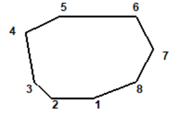

Lorsque la routine est lancée, vous êtes invité à sélectionner une série de coins qui définissent le périmètre de la zone souhaitée. La ligne de construction est considérée comme terminée lorsque le premier coin est répété ou lorsque l'utilisateur sélectionne

CAD > Build > Construction Lines

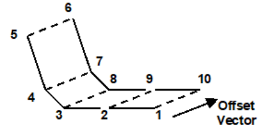

Une fois au moins deux points saisis, les points restants peuvent être générés par décalage

#### CAD > Build > Offset Remaining

Les coordonnées des coins peuvent être saisies au clavier

#### CAD > Build > Enter Point

sélectionnées par dessin à main levée, relevées sur d'autres entités (autres blocs ou lignes de construction) ou numérisées

#### CAD > Digitizer Setup > Activate

Une grande variété d'outils de dessin permet de sélectionner visuellement des points sur le modèle

#### CAD > Snap

Les coins peuvent être désélectionnés avec

#### CAD > Build > Undo Point

Les coins peuvent être resélectionnés avec

#### CAD > Build > Redo Point

Une fois la construction du bloc terminée, vous êtes invité à saisir les propriétés. Cela permet de spécifier la couleur de la ligne de construction.

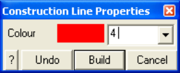

Colour - spécifie le numéro de couleur qui sera utilisé pour afficher la ligne de construction. Un total de 10 couleurs sont disponibles pour l'affichage. Elles sont numérotées respectivement

de 1 à 10, de 11 à 20, de 21 à 30, etc.,

de sorte que la même couleur est affichée pour les numéros

1, 11, 21..., 2, 22, 32..., 3, 23, 33..., etc.

Undo - désélectionne le dernier point saisi et revient à la routine de construction de la ligne de construction.

#### CAD > Build > Undo Point

Build - termine la construction de la grille et l'enregistre dans la base de données du modèle.

Une fois cette opération terminée, vous disposez d'une dernière chance de l'annuler et de retirer cette grille de la base de données du modèle en sélectionnant

#### CAD > Build > Undo Build

Cancel - abandonne la construction de la ligne.

Notes

Il convient d'utiliser des numéros de couleur différents pour représenter des regroupements logiques de lignes de construction (p. ex. pour différents niveaux, coupes ou unités d'exploitation logiques telles que les travaux de développement, les chantiers, etc.). Ces couleurs sont définissables par l'utilisateur

#### Tools > Custom Colours

Comme il est facile d'activer et de désactiver l'affichage de numéros de couleur de ligne de construction spécifiques

#### View > Hide Block Colours

cela offre une méthode efficace pour travailler avec des données de lignes de construction complexes.

Pour des exemples d'utilisation de lignes de construction dans la construction de modèles, voir :

#### Model Building Tutorials

Appuyer sur la barre d'espace active automatiquement la dernière fonction de construction utilisée.

## 5.5.1.8 Enter Point

Les coordonnées des coins peuvent être saisies au clavier pendant la construction des entités suivantes :

#### CAD > Build > Block

CAD > Build > FF Loop

CAD > Build > DD Loop

CAD > Build > Tunnel

CAD > Build > Grid Plane

#### CAD > Build > Grid Line

#### CAD > Build > Construction Lines

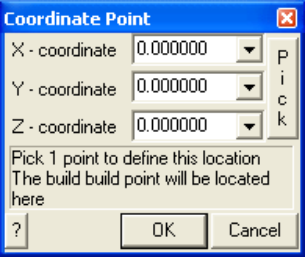

X, Y and Z – coordinate spécifient les coordonnées du point.

Pick - active le réticule du curseur pour sélectionner de façon interactive le point sur le modèle.

Pour faciliter la sélection visuelle de points sur le modèle, toutes les fonctions d'accrochage sont disponibles.

#### CAD > Snap

Une fois sélectionnées, les coordonnées du point s'affichent dans la boîte de dialogue.

## 5.5.1.9 Extrude/Offset Remaining

Extrude une entité partiellement construite pour aider à générer les points restants pendant la construction des entités suivantes :

#### CAD > Build > Block

CAD > Build > FF Loop

CAD > Build > DD Loop

CAD > Build > Tunnel

CAD > Build > Grid Plane

CAD > Build > Grid Line

#### CAD > Build > Construction Lines

X, Y and Z – offset spécifient les composantes du vecteur de décalage. Toutes les entités sélectionnées seront déplacées de cette valeur.

Pick - active le réticule du curseur pour sélectionner de façon interactive le vecteur de décalage sur le modèle. Cela exige de sélectionner deux points pour définir ce vecteur.

Length, Plunge and Direction - spécifient les composantes du vecteur de décalage. Toutes les entités sélectionnées seront déplacées de cette valeur.

Norm - active le curseur pour sélectionner de façon interactive une surface à laquelle rendre le vecteur de décalage normal. Cela exige de sélectionner deux points pour définir ce vecteur. Une fois sélectionnées, les composantes du vecteur de décalage s'affichent dans la boîte de dialogue.

Pour faciliter la sélection visuelle de points sur le modèle, toutes les fonctions d'accrochage sont disponibles.

#### CAD > Snap

Une fois sélectionnées, les composantes du vecteur de décalage s'affichent dans la boîte de dialogue.

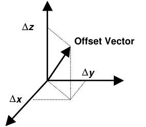

Par exemple, si vous avez construit la base d'un bloc 3D (points 1, 2, 3 et 4) et souhaitez générer les points restants (5, 6, 7 et 8) à un mètre d'élévation au-dessus de la base, il vous suffit de saisir le vecteur de décalage (0,0,1).

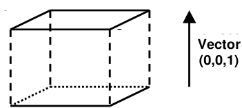

Notez qu'il est possible de créer des blocs de volume nul, par exemple en spécifiant un vecteur de décalage de longueur nulle. Cela permet aux utilisateurs de construire des surfaces FF individuelles s'ils le souhaitent. Bien que cela soit permis, ce n'est pas recommandé, car cela peut conduire à des volumes non fermés.

## 5.5.1.10 Undo Point

Pendant la construction d'un bloc, les points sont sélectionnés en séquence. Cela permet de désélectionner des points pendant la construction des entités suivantes :

CAD > Build > Block

CAD > Build > FF Loop

CAD > Build > DD Loop

CAD > Build > Tunnel

CAD > Build > Grid Plane

CAD > Build > Grid Line

CAD > Build > Construction Lines

Tout point désélectionné peut être resélectionné avec

#### CAD > Build > Redo Point

Une fois la construction du bloc terminée, vous pouvez l'annuler et retirer ce bloc de la base de données du modèle en sélectionnant (10 niveaux d'annulation/rétablissement sont pris en charge)

#### CAD > Build > Undo Build

Vous pouvez ensuite refaire la construction du bloc. Cela permet de répéter n'importe quelle opération de maillage d'essai.

CAD > Build > Undo Redo

## 5.5.1.11 Redo Point

Pendant la construction d'un bloc, les points sont sélectionnés en séquence. Cela permet de resélectionner tout point désélectionné pendant la construction des entités suivantes :

CAD > Build > Block

CAD > Build > FF Loop

CAD > Build > DD Loop

CAD > Build > Tunnel

CAD > Build > Grid Plane

CAD > Build > Grid Line

CAD > Build > Construction Lines

Les points peuvent être désélectionnés avec

#### CAD > Build > Undo Point

Une fois la construction du bloc terminée, vous pouvez l'annuler et retirer ce bloc de la base de données du modèle en sélectionnant (10 niveaux d'annulation/rétablissement sont pris en charge)

#### CAD > Build > Undo Build

Vous pouvez ensuite refaire la construction du bloc. Cela permet de répéter n'importe quelle opération de maillage d'essai.

CAD > Build > Undo Redo

## 5.5.1.12 Undo Build

Pendant la construction d'un bloc, les points sont sélectionnés en séquence. Cela permet de désélectionner des points pendant la construction des entités suivantes :

CAD > Build > Block

CAD > Build > FF Loop

CAD > Build > DD Loop

CAD > Build > Tunnel

CAD > Build > Grid Plane

CAD > Build > Grid Line

CAD > Build > Construction Lines

Tout point désélectionné peut être resélectionné avec

#### CAD > Build > Redo Point

Une fois la construction du bloc terminée, vous pouvez l'annuler et retirer ce bloc de la base de données du modèle en sélectionnant (10 niveaux d'annulation/rétablissement sont pris en charge)

#### CAD > Build > Undo Build

Vous pouvez ensuite refaire la construction du bloc. Cela permet de répéter n'importe quelle opération de maillage d'essai.

CAD > Build > Undo Redo

## 5.5.1.13 Redo Build

Pendant la construction d'un bloc, les points sont sélectionnés en séquence. Cela permet de resélectionner tout point désélectionné pendant la construction des entités suivantes :

CAD > Build > Block

CAD > Build > FF Loop

CAD > Build > DD Loop

CAD > Build > Tunnel

CAD > Build > Grid Plane

CAD > Build > Grid Line

CAD > Build > Construction Lines

Les points peuvent être désélectionnés avec

CAD > Build > Undo Point

Une fois la construction du bloc terminée, vous pouvez l'annuler et retirer ce bloc de la base de données du modèle en sélectionnant (10 niveaux d'annulation/rétablissement sont pris en charge)

#### CAD > Build > Undo Build

Vous pouvez ensuite refaire la construction du bloc. Cela permet de répéter n'importe quelle opération de maillage d'essai.

CAD > Build > Undo Redo
