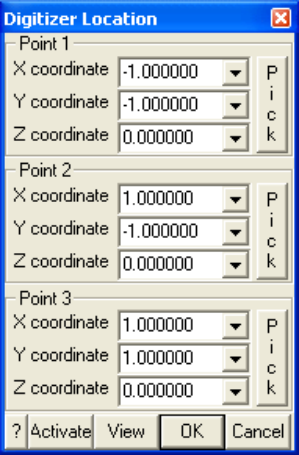

Configure le numériseur.

Le plan de numérisation est mis à l'échelle, positionné et orienté de manière unique en indiquant 3 points sur le dessin à numériser.

La procédure est la suivante :

1. sélectionnez 3 points sur le dessin,

2. saisissez les coordonnées de chaque point,

3. puis pointez ces points avec le curseur du numériseur.

4. Pick active le curseur du numériseur pour permettre la sélection de chaque point.

CAD > Digitizer > Activate active ou désactive le numériseur pour sélectionner des points sur un dessin. Ce bouton peut être placé dans la barre d'outils CAD avec Tools > CAD Toolbar > Configure.

View : repositionne la vue pour afficher le plan du numériseur superposé au modèle.

Tout numériseur pouvant être configuré pour piloter le curseur en mode absolu (c'est-à-dire avec une correspondance exacte entre le mouvement du numériseur et la position du curseur) est pris en charge. La plupart des numériseurs récents sont livrés avec leurs propres pilotes qui offrent cette prise en charge. Une autre solution consiste à utiliser le logiciel suivant, compatible avec la plupart des numériseurs :

Virtual Tablet Interface Digitizer Technology Company 16541 Redmond Way, Suite 195C Redmond, Washington USA 98052 Tel: 206 868 3246 Fax: 206 885 7704
