## 5.5.4.1 Propriétés des entités

Modifie le type de bloc, la couleur, la séquence d'exploitation, etc.

Cette routine peut être lancée en cliquant sur le bouton ou simplement en faisant un clic droit sur n'importe quelle entité. Au lancement de cette routine, vous serez d'abord invité à constituer une liste des entités que vous souhaitez modifier

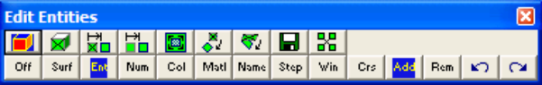

- Si Tools > Shift-key Selection est cochée, vous devez maintenir la touche Shift enfoncée pour effectuer des sélections multiples.

- Par défaut, les entités sélectionnées sont ajoutées à la liste ; toutefois, si la touche Ctrl est maintenue enfoncée, les entités sélectionnées sont retirées de la liste.

- Tout en maintenant la touche Shift ou Ctrl enfoncée, vous pouvez faire glisser pour ouvrir une fenêtre de sélection par intersection.

- L'utilisation de cette barre d'outils est détaillée dans Build A List of Entities for Editing

- Appuyer sur la barre d'espace active automatiquement la dernière fonction de modification utilisée.

- Maintenir la touche Alt enfoncée lors d'un clic droit répète automatiquement la dernière fonction de modification utilisée.

Une fois les entités souhaitées sélectionnées, vous pouvez choisir l'un des boutons de modification :

CAD > Edit > Entity Properties Edit block type, colour, mining sequence, CAD > Edit > Erase Entities Erase selected entities, CAD > Edit > Move Entities Move selected entities, CAD > Edit > Copy Entities Copy selected entities, CAD > Edit > Scale Entities Scale selected entities, CAD > Edit > Rotate Azimuth Rotate the azimuth of selected entities, CAD > Edit > Rotate Dip Rotate the dip of selected entities,

CAD > Edit > Dump to File Dump selected entities to a file,

CAD > Edit > Group Group selected entities into a single block,

- double-cliquer sur n'importe quel sommet pour exécuter la fonction en surbrillance,

- faire un clic droit pour afficher une liste d'options.

Si l'un des champs de la boîte de dialogue indique « Variable », c'est que certains des blocs sélectionnés ont des propriétés différentes pour ce champ. Si vous souhaitez laisser ces propriétés telles quelles (c'est-à-dire différentes pour chaque bloc), laissez le champ sur « Variable ». Si vous souhaitez modifier la valeur de ce champ pour tous les blocs sélectionnés, saisissez la valeur souhaitée.

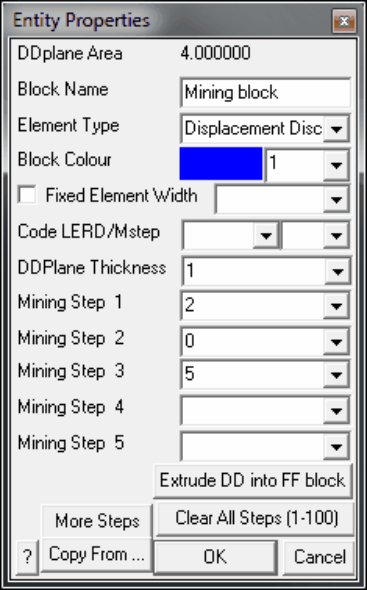

Block Volume - si vous avez sélectionné uniquement des blocs FF, le volume total combiné des blocs sera affiché. Si vous avez sélectionné uniquement des blocs FF, le volume total combiné des blocs sera affiché.

DDPlane Area - si vous avez sélectionné uniquement des blocs DD, affiche l'aire combinée de tous les DDPlanes inclus dans le DDLoop.

Block Name - spécifie un nom descriptif pour le bloc.

Element Type - spécifie le type d'élément de frontière qui sera utilisé pour le bloc.

- Displacement Discontinuity - les éléments de type DD doivent être utilisés pour les excavations tabulaires, les fractures et les plans de faille.

- Fictitious Force - les éléments de type FF doivent être utilisés pour les éléments tridimensionnels tels que les excavations, les zones de matériau alterné, les chantiers remblayés, etc.

- Les éléments inactifs peuvent servir à afficher des éléments inclus uniquement à des fins de visualisation et qui ne seront pas utilisés dans l'analyse des contraintes proprement dite.

- Notez que les éléments de type DD peuvent être convertis en GPlanes.

Block Colour - spécifie le numéro de couleur qui sera utilisé pour afficher le bloc.

- Spécifie le numéro de couleur qui sera affecté à chaque bouton. Un total de 10 couleurs sont disponibles pour l'affichage. Elles sont numérotées respectivement

- de 1 à 10,

de 11 à 20,

de 21 à 30, etc.,

- de sorte que la même couleur est affichée pour les numéros 1, 11, 21...,

- 2, 22, 32...,

- 3, 23, 33..., etc.

Fixed Element Width - spécifie la largeur d'élément définie par l'utilisateur.

- Ce paramètre peut servir à imposer une discrétisation uniforme sur les entités sélectionnées. Soyez extrêmement prudent en spécifiant cette valeur, car une petite valeur peut facilement conduire à une taille de problème énorme.

- En général, cette option ne doit pas être utilisée (décochée) et la discrétisation doit être laissée aux paramètres _AL_ et _AG_ . Ces derniers ne concentrent les éléments que là où des résultats d'analyse sont demandés, ce qui optimise l'utilisation des éléments et réduit la taille du problème. Pour une discussion plus détaillée, voir

CAD > Properties Control Parameters

- Ce paramètre peut aussi servir à éviter de créer, pendant l'analyse des intersections, des surfaces dont les côtés dépassent cette valeur. Aucune surface dont la longueur de côté dépasse cette dimension ne sera réduite (collapse)

#### Analysis > Options > Collapse

- Pendant le processus de discrétisation, toute surface dont la longueur de côté dépasse cette dimension sera subdivisée afin d'éviter des surfaces dont les côtés seraient plus grands.

- Pour un exemple d'utilisation de ce paramètre, voir Tabular Mining Example

Matl_Code LERD/MStep - spécifie le code de matériau qui sera substitué dans le bloc pour le calcul LERD/LSS.

La première case sert au code de matériau.

La seconde case sert à spécifier le numéro de l'étape d'exploitation à laquelle le calcul doit être effectué. Si cette case est laissée vide, le calcul LERD sera effectué pour toutes les étapes.

#### Analysis > Options > LERD/LSS.

DDPlane Thickness - spécifie l'épaisseur du matériau inséré dans l'élément DD (c'est-à-dire gouge de faille, épaisseur de couche, largeur d'exploitation ou hauteur de pilier).

- La convergence (déplacement normal) de la structure lorsqu'elle est remplie sera limitée à cette épaisseur. De plus, le déplacement normal (convergence) et le déplacement de cisaillement (ride) sont divisés par l'épaisseur pour déterminer la déformation qui se produit dans le matériau de remplissage

Mohr-Coulomb in DD planes

Fault-Gouge in DD planes Backfill-Hyperbolic in DD planes

- Ce paramètre doit être spécifié dans les mêmes unités que celles utilisées pour les coordonnées (p. ex. mètres ou pieds).

Mining Step n - spécifie le code de matériau qui sera utilisé pour ce bloc à l'étape d'exploitation n.

- Dans l'exemple ci-dessus, le bloc n'existe pas à l'étape 1, contient le matériau n° 2 (minerai) à l'étape 2, est excavé à l'étape 3 (le code de matériau 0 signifie excaver) et, enfin, à l'étape 4 le matériau n° 5 (remblai) y est inséré.

- Lorsque vous utilisez un numéro de matériau positif, le matériau est placé dans le bloc avec l'état de contraintes initial spécifié, puis peut se déformer selon les propriétés élastiques/plastiques que vous avez définies pour ce numéro de matériau.

- Lorsque vous utilisez un numéro de matériau négatif, le matériau est placé dans le bloc avec l'état de contraintes initial spécifié, mais l'état de contraintes est maintenu à ces valeurs quelles que soient les déformations, ce qui fournit une condition aux limites en contraintes.

Extrude DD into FF blocks - permet d'extruder un plan DD en un bloc FF. Le vecteur d'extrusion vous sera demandé

More Steps - permet de spécifier des étapes d'exploitation supplémentaires.

Clear All Steps - efface toutes les étapes d'exploitation (1-100).

Copy From… - permet de sélectionner un autre bloc dont copier les propriétés d'entité.

OK - termine la modification des blocs et applique les propriétés qui ont été changées.

Cancel - abandonne la modification des blocs.

Une fois toute opération de modification terminée, vous disposez d'une chance d'annuler les modifications en sélectionnant

#### Undo

Vous pouvez aussi restaurer le même jeu de sélection et modifier à nouveau le même ensemble d'entités en sélectionnant

#### Redo

Les blocs DD peuvent être extrudés en blocs FF 3D simplement en changeant le type d'élément de Displacement Discontinuity en Fictitious Force.

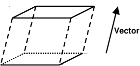

Dans ce cas, les coins 1 à 4 définissent la base du bloc. Le toit et les côtés sont générés automatiquement pendant le processus d'extrusion. Les blocs FF peuvent être réduits en plans DD en changeant le type d'élément de Fictitious Force en Displacement Discontinuity. Dans ce cas, la base du bloc (le côté défini par les coins 1, 2, 3 et 4) devient le plan DD et les autres côtés du bloc sont supprimés.

Notez qu'il est possible de créer des blocs de volume nul, par exemple en spécifiant un vecteur de décalage de longueur nulle. Cela permet aux utilisateurs de construire des surfaces FF individuelles s'ils le souhaitent. Bien que cela soit permis, ce n'est pas recommandé, car cela peut conduire à des volumes non fermés.

Remarques

Il convient d'utiliser des numéros de couleur différents pour représenter des regroupements logiques de blocs (p. ex. pour différents niveaux, coupes ou unités d'exploitation logiques telles que les travaux de développement, les chantiers, etc.). Ces couleurs sont définissables par l'utilisateur

#### Tools > Custom Colours

Tous les blocs ayant le même numéro de couleur seront automatiquement combinés par Map3D en formes complexes uniques.

Comme il est facile d'activer et de désactiver l'affichage de numéros de couleur de bloc spécifiques

#### View > Hide Block Colours

cela offre une méthode efficace pour travailler avec des données de modèle complexes.

Vous pouvez régler le délai du double-clic avec

#### Tools > Double Click Time

Pour une discussion sur les aspects de la construction de modèles, voir :

#### Model Building and Editing

Pour des tutoriels sur la construction de modèles, voir :

Model Building Tutorials

## 5.5.4.2 Effacer des entités

Efface les entités sélectionnées.

Cette routine peut être lancée en cliquant sur le bouton ou simplement en faisant un clic droit sur n'importe quelle entité. Au lancement de cette routine, vous serez d'abord invité à constituer une liste des entités que vous souhaitez modifier

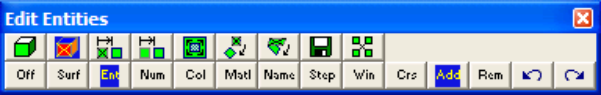

- Si Tools > Shift-key Selection est cochée, vous devez maintenir la touche Shift enfoncée pour effectuer des sélections multiples.

- Par défaut, les entités sélectionnées sont ajoutées à la liste ; toutefois, si la touche Ctrl est maintenue enfoncée, les entités sélectionnées sont retirées de la liste.

- Tout en maintenant la touche Shift ou Ctrl enfoncée, vous pouvez faire glisser pour ouvrir une fenêtre de sélection par intersection.

- L'utilisation de cette barre d'outils est détaillée dans Build A List of Entities for Editing

- Appuyer sur la barre d'espace active automatiquement la dernière fonction de modification utilisée.

- Maintenir la touche Alt enfoncée lors d'un clic droit répète automatiquement la dernière fonction de modification utilisée.

Une fois les entités souhaitées sélectionnées, vous pouvez choisir l'un des boutons de modification :

CAD > Edit > Entity Properties Edit block type, colour, mining sequence, CAD > Edit > Erase Entities Erase selected entities, CAD > Edit > Move Entities Move selected entities, CAD > Edit > Copy Entities Copy selected entities,

CAD > Edit > Scale Entities Scale selected entities,

CAD > Edit > Rotate Azimuth Rotate the azimuth of selected entities, CAD > Edit > Rotate Dip Rotate the dip of selected entities, CAD > Edit > Dump to File Dump selected entities to a file,

CAD > Edit > Group Group selected entities into a single block,

- double-cliquer sur n'importe quel sommet pour exécuter la fonction en surbrillance,

- faire un clic droit pour afficher une liste d'options.

Une fois toute opération de modification terminée, vous disposez d'une chance d'annuler les modifications en sélectionnant

#### Undo

Vous pouvez aussi restaurer le même jeu de sélection et modifier à nouveau le même ensemble d'entités en sélectionnant

#### Redo

Vous pouvez régler le délai du double-clic avec

Tools > Double Click Time

## 5.5.4.3 Déplacer des entités

Déplace les entités sélectionnées.

Cette routine peut être lancée en cliquant sur le bouton ou simplement en faisant un clic droit sur n'importe quelle entité. Au lancement de cette routine, vous serez d'abord invité à constituer une liste des entités que vous souhaitez modifier

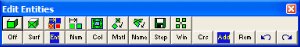

- Si Tools > Shift-key Selection est cochée, vous devez maintenir la touche Shift enfoncée pour effectuer des sélections multiples.

- Par défaut, les entités sélectionnées sont ajoutées à la liste ; toutefois, si la touche Ctrl est maintenue enfoncée, les entités sélectionnées sont retirées de la liste.

- Tout en maintenant la touche Shift ou Ctrl enfoncée, vous pouvez faire glisser pour ouvrir une fenêtre de sélection par intersection.

- L'utilisation de cette barre d'outils est détaillée dans Build A List of Entities for Editing

- Appuyer sur la barre d'espace active automatiquement la dernière fonction de modification utilisée.

- Maintenir la touche Alt enfoncée lors d'un clic droit répète automatiquement la dernière fonction de modification utilisée.

Une fois les entités souhaitées sélectionnées, vous pouvez choisir l'un des boutons de modification :

CAD > Edit > Entity Properties Edit block type, colour, mining sequence, CAD > Edit > Erase Entities Erase selected entities, CAD > Edit > Move Entities Move selected entities, CAD > Edit > Copy Entities Copy selected entities,

CAD > Edit > Scale Entities Scale selected entities, CAD > Edit > Rotate Azimuth Rotate the azimuth of selected entities, CAD > Edit > Rotate Dip Rotate the dip of selected entities, CAD > Edit > Dump to File Dump selected entities to a file, CAD > Edit > Group Group selected entities into a single block,

- double-cliquer sur n'importe quel sommet pour exécuter la fonction en surbrillance,

- faire un clic droit pour afficher une liste d'options.

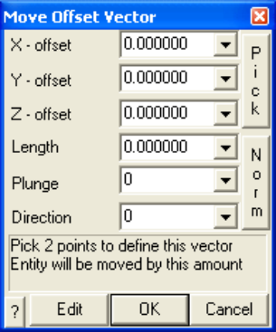

X, Y and Z – offset spécifient les composantes du vecteur de décalage. Toutes les entités sélectionnées seront déplacées de cette valeur.

Pick - active le réticule du curseur pour sélectionner de façon interactive le vecteur de décalage sur le modèle. Cela exige de sélectionner deux points pour définir ce vecteur.

Length, Plunge and Direction - spécifient les composantes du vecteur de décalage. Toutes les entités sélectionnées seront déplacées de cette valeur.

Norm - active le curseur pour sélectionner de façon interactive une surface à laquelle rendre le vecteur de décalage normal.

Pour faciliter la sélection visuelle de points sur le modèle, toutes les fonctions d'accrochage sont disponibles.

#### CAD > Snap

Une fois sélectionnées, les composantes du vecteur de décalage s'affichent dans la boîte de dialogue.

Edit - termine la modification et lance la modification des propriétés d'entité des blocs sélectionnés.

OK - termine la modification du vecteur de décalage et déplace les blocs sélectionnés.

Cancel - abandonne le déplacement des entités.

Une fois toute opération de modification terminée, vous disposez d'une chance d'annuler les modifications en sélectionnant

#### Undo

Vous pouvez aussi restaurer le même jeu de sélection et modifier à nouveau le même ensemble d'entités en sélectionnant

#### Redo

Vous pouvez régler le délai du double-clic avec

Tools > Double Click Time

## 5.5.4.4 Copier des entités

Copie les entités sélectionnées.

Cette routine peut être lancée en cliquant sur le bouton ou simplement en faisant un clic droit sur n'importe quelle entité. Au lancement de cette routine, vous serez d'abord invité à constituer une liste des entités que vous souhaitez modifier

- Si Tools > Shift-key Selection est cochée, vous devez maintenir la touche Shift enfoncée pour effectuer des sélections multiples.

- Par défaut, les entités sélectionnées sont ajoutées à la liste ; toutefois, si la touche Ctrl est maintenue enfoncée, les entités sélectionnées sont retirées de la liste.

- Tout en maintenant la touche Shift ou Ctrl enfoncée, vous pouvez faire glisser pour ouvrir une fenêtre de sélection par intersection.

- L'utilisation de cette barre d'outils est détaillée dans Build A List of Entities for Editing

- Appuyer sur la barre d'espace active automatiquement la dernière fonction de modification utilisée.

- Maintenir la touche Alt enfoncée lors d'un clic droit répète automatiquement la dernière fonction de modification utilisée.

Une fois les entités souhaitées sélectionnées, vous pouvez choisir l'un des boutons de modification :

CAD > Edit > Entity Properties Edit block type, colour, mining sequence, CAD > Edit > Erase Entities Erase selected entities, CAD > Edit > Move Entities Move selected entities, CAD > Edit > Copy Entities Copy selected entities, CAD > Edit > Scale Entities Scale selected entities, CAD > Edit > Rotate Azimuth Rotate the azimuth of selected entities, CAD > Edit > Rotate Dip Rotate the dip of selected entities, CAD > Edit > Dump to File Dump selected entities to a file, CAD > Edit > Group Group selected entities into a single block,

- double-cliquer sur n'importe quel sommet pour exécuter la fonction en surbrillance,

- faire un clic droit pour afficher une liste d'options.

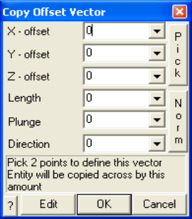

X, Y and Z – offset spécifient les composantes du vecteur de décalage. Toutes les entités sélectionnées seront copiées à l'emplacement indiqué par ce décalage.

Pick - active le réticule du curseur pour sélectionner de façon interactive le vecteur de décalage sur le modèle. Cela exige de sélectionner deux points pour définir ce vecteur.

Length, Plunge and Direction - spécifient les composantes du vecteur de décalage. Toutes les entités sélectionnées seront copiées à l'emplacement indiqué par ce décalage.

Norm - active le curseur pour sélectionner de façon interactive une surface à laquelle rendre le vecteur de décalage normal.

Pour faciliter la sélection visuelle de points sur le modèle, toutes les fonctions d'accrochage sont disponibles.

#### CAD > Snap

Une fois sélectionnées, les composantes du vecteur de décalage s'affichent dans la boîte de dialogue.

Edit - termine la modification et lance la modification des propriétés d'entité des blocs sélectionnés.

OK - termine la modification du vecteur de décalage et déplace les blocs sélectionnés.

Cancel - abandonne le déplacement des entités.

Une fois toute opération de modification terminée, vous disposez d'une chance d'annuler les modifications en sélectionnant

#### Undo

Vous pouvez aussi restaurer le même jeu de sélection et modifier à nouveau le même ensemble d'entités en sélectionnant

#### Redo

Vous pouvez régler le délai du double-clic avec

Tools > Double Click Time

## 5.5.4.5 Mettre à l'échelle des entités

Met à l'échelle les entités sélectionnées.

Cette routine peut être lancée en cliquant sur le bouton ou simplement en faisant un clic droit sur n'importe quelle entité. Au lancement de cette routine, vous serez d'abord invité à constituer une liste des entités que vous souhaitez modifier

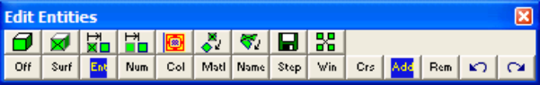

- Si Tools > Shift-key Selection est cochée, vous devez maintenir la touche Shift enfoncée pour effectuer des sélections multiples.

- Par défaut, les entités sélectionnées sont ajoutées à la liste ; toutefois, si la touche Ctrl est maintenue enfoncée, les entités sélectionnées sont retirées de la liste.

- Tout en maintenant la touche Shift ou Ctrl enfoncée, vous pouvez faire glisser pour ouvrir une fenêtre de sélection par intersection.

- L'utilisation de cette barre d'outils est détaillée dans Build A List of Entities for Editing

- Appuyer sur la barre d'espace active automatiquement la dernière fonction de modification utilisée.

- Maintenir la touche Alt enfoncée lors d'un clic droit répète automatiquement la dernière fonction de modification utilisée.

Une fois les entités souhaitées sélectionnées, vous pouvez choisir l'un des boutons de modification :

CAD > Edit > Entity Properties Edit block type, colour, mining sequence, CAD > Edit > Erase Entities Erase selected entities, CAD > Edit > Move Entities Move selected entities, CAD > Edit > Copy Entities Copy selected entities, CAD > Edit > Scale Entities Scale selected entities,

CAD > Edit > Rotate Azimuth Rotate the azimuth of selected entities, CAD > Edit > Rotate Dip Rotate the dip of selected entities, CAD > Edit > Dump to File Dump selected entities to a file, CAD > Edit > Group Group selected entities into a single block,

- double-cliquer sur n'importe quel sommet pour exécuter la fonction en surbrillance,

- faire un clic droit pour afficher une liste d'options.

X, Y and Z – coordinates spécifient les coordonnées du centre de mise à l'échelle. Pendant la mise à l'échelle, ce point reste fixe. Tous les autres points sont déplacés pour obtenir la mise à l'échelle souhaitée.

Pick - active le réticule du curseur pour sélectionner de façon interactive le centre de rotation sur le modèle.

Pour faciliter la sélection visuelle de points sur le modèle, toutes les fonctions d'accrochage sont disponibles.

CAD > Snap

Une fois sélectionnées, les composantes du centre de mise à l'échelle s'affichent dans la boîte de dialogue.

Centroid - calcule le centre de toutes les entités sélectionnées.

OK - termine la modification des coordonnées et vous demande les facteurs d'échelle.

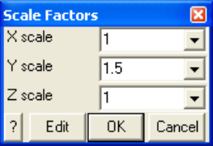

X, Y and Z - scale spécifie le facteur par lequel les entités doivent être mises à l'échelle. Ci-dessous, le bloc est mis à l'échelle 1,5 fois dans la direction y.

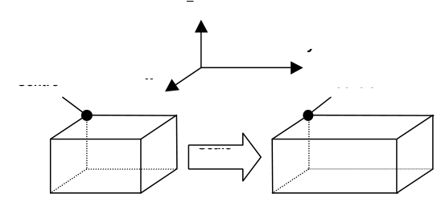

Edit - termine la modification et lance la modification des propriétés d'entité des blocs sélectionnés.

OK - termine la modification des facteurs d'échelle et met à l'échelle les entités sélectionnées.

Cancel - abandonne la mise à l'échelle des entités.

Une fois toute opération de modification terminée, vous disposez d'une chance d'annuler les modifications en sélectionnant

#### Undo

Vous pouvez aussi restaurer le même jeu de sélection et modifier à nouveau le même ensemble d'entités en sélectionnant

Redo

Vous pouvez régler le délai du double-clic avec

Tools > Double Click Time

## 5.5.4.6 Faire pivoter l'azimut

Fait pivoter l'azimut des entités sélectionnées.

Cette routine peut être lancée en cliquant sur le bouton ou simplement en faisant un clic droit sur n'importe quelle entité. Au lancement de cette routine, vous serez d'abord invité à constituer une liste des entités que vous souhaitez modifier

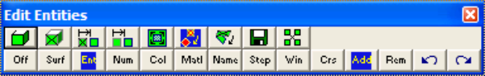

- Si Tools > Shift-key Selection est cochée, vous devez maintenir la touche Shift enfoncée pour effectuer des sélections multiples.

- Par défaut, les entités sélectionnées sont ajoutées à la liste ; toutefois, si la touche Ctrl est maintenue enfoncée, les entités sélectionnées sont retirées de la liste.

- Tout en maintenant la touche Shift ou Ctrl enfoncée, vous pouvez faire glisser pour ouvrir une fenêtre de sélection par intersection.

- L'utilisation de cette barre d'outils est détaillée dans Build A List of Entities for Editing

- Appuyer sur la barre d'espace active automatiquement la dernière fonction de modification utilisée.

- Maintenir la touche Alt enfoncée lors d'un clic droit répète automatiquement la dernière fonction de modification utilisée.

Une fois les entités souhaitées sélectionnées, vous pouvez choisir l'un des boutons de modification :

CAD > Edit > Entity Properties Edit block type, colour, mining sequence, CAD > Edit > Erase Entities Erase selected entities, CAD > Edit > Move Entities Move selected entities, CAD > Edit > Copy Entities Copy selected entities, CAD > Edit > Scale Entities Scale selected entities, CAD > Edit > Rotate Azimuth Rotate the azimuth of selected entities, CAD > Edit > Rotate Dip Rotate the dip of selected entities, CAD > Edit > Dump to File Dump selected entities to a file, CAD > Edit > Group Group selected entities into a single block,

- double-cliquer sur n'importe quel sommet pour exécuter la fonction en surbrillance,

- faire un clic droit pour afficher une liste d'options.

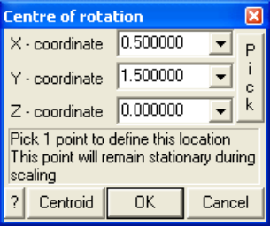

X, Y and Z – coordinates spécifient les coordonnées du centre de rotation.

Pick - active le réticule du curseur pour sélectionner de façon interactive le centre de rotation sur le modèle.

Pour faciliter la sélection visuelle de points sur le modèle, toutes les fonctions d'accrochage sont disponibles.

#### CAD > Snap

Une fois sélectionnées, les composantes du centre de mise à l'échelle s'affichent dans la boîte de dialogue.

Centroid - calcule le centre de toutes les entités sélectionnées.

OK - termine la modification des coordonnées et vous demande les facteurs d'échelle.

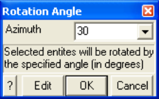

- Azimuth - spécifie l'angle (en degrés) de rotation souhaité pour les entités sélectionnées. · La rotation s'effectue dans le plan X-Y ; toutes les lignes verticales restent donc verticales.

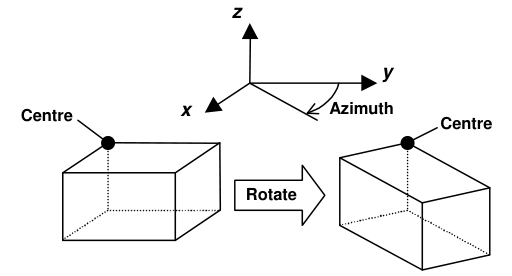

Edit - termine la modification et lance la modification des propriétés d'entité des blocs sélectionnés.

OK - termine la modification de l'azimut et fait pivoter les entités sélectionnées.

Cancel - abandonne la rotation des entités.

Une fois toute opération de modification terminée, vous disposez d'une chance d'annuler les modifications en sélectionnant

Undo

Vous pouvez aussi restaurer le même jeu de sélection et modifier à nouveau le même ensemble d'entités en sélectionnant

Redo

Vous pouvez régler le délai du double-clic avec

Tools > Double Click Time

## 5.5.4.7 Faire pivoter le pendage

Fait pivoter le pendage des entités sélectionnées.

Cette routine peut être lancée en cliquant sur le bouton ou simplement en faisant un clic droit sur n'importe quelle entité. Au lancement de cette routine, vous serez d'abord invité à constituer une liste des entités que vous souhaitez modifier

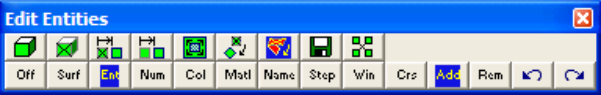

- Si Tools > Shift-key Selection est cochée, vous devez maintenir la touche Shift enfoncée pour effectuer des sélections multiples.

- Par défaut, les entités sélectionnées sont ajoutées à la liste ; toutefois, si la touche Ctrl est maintenue enfoncée, les entités sélectionnées sont retirées de la liste.

- Tout en maintenant la touche Shift ou Ctrl enfoncée, vous pouvez faire glisser pour ouvrir une fenêtre de sélection par intersection.

- L'utilisation de cette barre d'outils est détaillée dans Build A List of Entities for Editing

- Appuyer sur la barre d'espace active automatiquement la dernière fonction de modification utilisée.

- Maintenir la touche Alt enfoncée lors d'un clic droit répète automatiquement la dernière fonction de modification utilisée.

Une fois les entités souhaitées sélectionnées, vous pouvez choisir l'un des boutons de modification :

CAD > Edit > Entity Properties Edit block type, colour, mining sequence, CAD > Edit > Erase Entities Erase selected entities, CAD > Edit > Move Entities Move selected entities, CAD > Edit > Copy Entities Copy selected entities, CAD > Edit > Scale Entities Scale selected entities, CAD > Edit > Rotate Azimuth Rotate the azimuth of selected entities, CAD > Edit > Rotate Dip Rotate the dip of selected entities,

CAD > Edit > Slice Entities Slice selected entities,

CAD > Edit > Dump to File Dump selected entities to a file, CAD > Edit > Group Group selected entities into a single block,

- double-cliquer sur n'importe quel sommet pour exécuter la fonction en surbrillance,

- faire un clic droit pour afficher une liste d'options.

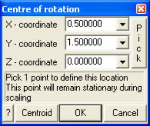

X, Y and Z – coordinates spécifient les coordonnées du centre de rotation.

Pick - active le réticule du curseur pour sélectionner de façon interactive le centre de rotation sur le modèle.

Pour faciliter la sélection visuelle de points sur le modèle, toutes les fonctions d'accrochage sont disponibles.

#### CAD > Snap

Une fois sélectionnées, les composantes du centre de mise à l'échelle s'affichent dans la boîte de dialogue.

Centroid - calcule le centre de toutes les entités sélectionnées.

OK - termine la modification des coordonnées et vous demande les facteurs d'échelle.

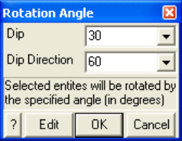

Dip - spécifie l'angle (en degrés) de rotation souhaité pour les entités sélectionnées.

Dip Direction - spécifie l'azimut (en degrés) selon lequel le pendage doit s'opérer. La direction de pendage est à 90° de la direction du plan de pendage.

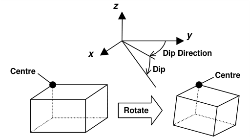

Edit - termine la modification et lance la modification des propriétés d'entité des blocs sélectionnés.

OK - termine la modification du pendage et de la direction de pendage et fait pivoter les entités sélectionnées.

Cancel - abandonne la rotation des entités.

Une fois toute opération de modification terminée, vous disposez d'une chance d'annuler les modifications en sélectionnant

#### Undo

Vous pouvez aussi restaurer le même jeu de sélection et modifier à nouveau le même ensemble d'entités en sélectionnant

#### Redo

Vous pouvez régler le délai du double-clic avec

#### Tools > Double Click Time

## 5.5.4.8 Couper des entités

Coupe des entités.

Toutes les entités peuvent être coupées, y compris les blocs FF, les plans DD, les plans de grille, les lignes de grille et les lignes de construction.

Video Demo of Model_Simplification_Using_Slicing

Cette routine peut être lancée en cliquant sur le bouton ou simplement en faisant un clic droit sur n'importe quelle entité. Au lancement de cette routine, vous serez d'abord invité à constituer une liste des entités que vous souhaitez modifier

- Si Tools > Shift-key Selection est cochée, vous devez maintenir la touche Shift enfoncée pour effectuer des sélections multiples.

- Par défaut, les entités sélectionnées sont ajoutées à la liste ; toutefois, si la touche Ctrl est maintenue enfoncée, les entités sélectionnées sont retirées de la liste.

- Tout en maintenant la touche Shift ou Ctrl enfoncée, vous pouvez faire glisser pour ouvrir une fenêtre de sélection par intersection.

- L'utilisation de cette barre d'outils est détaillée dans Build A List of Entities for Editing

- Appuyer sur la barre d'espace active automatiquement la dernière fonction de modification utilisée.

- Maintenir la touche Alt enfoncée lors d'un clic droit répète automatiquement la dernière fonction de modification utilisée.

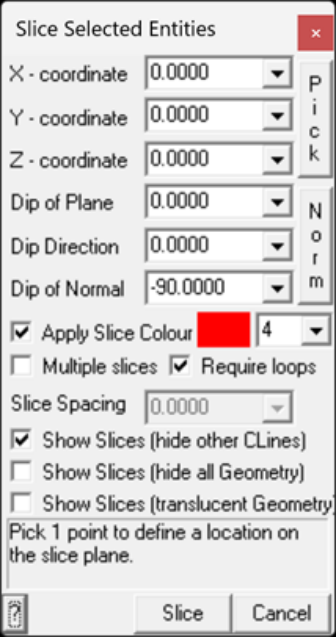

X, Y and Z – coordinate spécifient un point du plan de coupe.

Pick - active le réticule du curseur pour sélectionner le point de façon interactive.

Dip of Plane, Dip Direction and Normal - spécifient l'orientation du plan de coupe.

Norm - active le curseur pour sélectionner de façon interactive une surface à laquelle rendre le plan de coupe parallèle. Le pendage et la direction de pendage du plan seront réglés normalement à la surface sélectionnée.

Apply Slice Colour - lorsque cette option est cochée, spécifie le numéro de couleur à affecter aux CLines créées pendant la coupe ; sinon, la couleur de l'objet coupé est utilisée.

Multiple Slices - indique que plusieurs coupes doivent être créées à l'espacement de coupe spécifié.

Require Loops - les coupes peuvent être de simples lignes ou, en option, former des boucles fermées.

Slice Spacing - spécifie l'espacement facultatif pour plusieurs coupes.

Show Slices (hide other CLines) - masquera automatiquement toutes les CLines préexistantes et affichera les coupes de CLine nouvellement créées.

Slice Spacing (hide all Geometry) - masquera automatiquement toute la géométrie préexistante et affichera les coupes de CLine nouvellement créées.

Slice Spacing (translucent Geometry) - rendra automatiquement translucide toute la géométrie préexistante et affichera les coupes de CLine nouvellement créées.

- Plusieurs options « View > Hide » sont disponibles pour contrôler l'affichage des différentes entités, notamment :

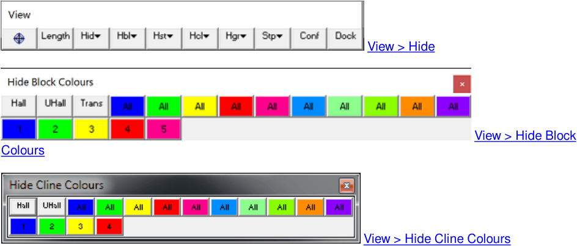

Pour faciliter la sélection visuelle de points sur le modèle, toutes les fonctions d'accrochage sont disponibles.

#### CAD > Snap

Une fois sélectionnées, les composantes du vecteur de décalage s'affichent dans la boîte de dialogue.

Slice - exécute l'opération de coupe pour les blocs sélectionnés.

Cancel - abandonne la coupe des entités.

Une fois toute opération de modification terminée, vous disposez d'une chance d'annuler les modifications en sélectionnant

Undo

Vous pouvez aussi restaurer le même jeu de sélection et modifier à nouveau le même ensemble d'entités en sélectionnant

Redo

Vous pouvez régler le délai du double-clic avec

Tools > Double Click Time

## 5.5.4.9 Exporter vers un fichier

Exporte les entités sélectionnées vers un fichier.

Cette routine peut être lancée en cliquant sur le bouton ou simplement en faisant un clic droit sur n'importe quelle entité. Au lancement de cette routine, vous serez d'abord invité à constituer une liste des entités que vous souhaitez exporter

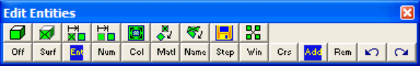

- Si Tools > Shift-key Selection est cochée, vous devez maintenir la touche Shift enfoncée pour effectuer des sélections multiples.

- Par défaut, les entités sélectionnées sont ajoutées à la liste ; toutefois, si la touche Ctrl est maintenue enfoncée, les entités sélectionnées sont retirées de la liste.

- Tout en maintenant la touche Shift ou Ctrl enfoncée, vous pouvez faire glisser pour ouvrir une fenêtre de sélection par intersection.

- L'utilisation de cette barre d'outils est détaillée dans Build A List of Entities for Editing

- Appuyer sur la barre d'espace active automatiquement la dernière fonction de modification utilisée.

- Maintenir la touche Alt enfoncée lors d'un clic droit répète automatiquement la dernière fonction de modification utilisée.

Une fois les entités souhaitées sélectionnées, vous pouvez choisir l'un des boutons de modification :

CAD > Edit > Entity Properties Edit block type, colour, mining sequence, CAD > Edit > Erase Entities Erase selected entities, CAD > Edit > Move Entities Move selected entities, CAD > Edit > Copy Entities Copy selected entities, CAD > Edit > Scale Entities Scale selected entities, CAD > Edit > Rotate Azimuth Rotate the azimuth of selected entities, CAD > Edit > Rotate Dip Rotate the dip of selected entities, CAD > Edit > Dump to File Dump selected entities to a file,

CAD > Edit > Group Group selected entities into a single block,

- double-cliquer sur n'importe quel sommet pour exécuter la fonction en surbrillance,

- faire un clic droit pour afficher une liste d'options.

Vous pouvez régler le délai du double-clic avec

Tools > Double Click Time

## 5.5.4.10 Regrouper des entités

Regroupe les entités sélectionnées en un seul bloc. Il s'agit d'une option avancée qui ne doit être utilisée que par des utilisateurs expérimentés.

Il peut arriver que vous deviez effacer ou construire des surfaces individuelles, puis les regrouper pour former un seul bloc. Cette fonction regroupe des entités pour former un bloc fermé continu à partir de surfaces individuelles. Notez qu'en utilisant cette opération, l'utilisateur doit s'assurer que les surfaces regroupées forment une enveloppe fermée et continue, sans surfaces internes. La présence de surfaces internes peut provoquer des erreurs.

La fonction de regroupement a été mise en œuvre pour permettre aux utilisateurs avancés d'effacer quelques éléments de surface et de les reconstruire. Elle est aussi utile pour assembler des surfaces importées depuis des logiciels de CAO. Notez que l'utilisateur doit s'assurer qu'il n'y a pas de surfaces internes et que les surfaces regroupées forment bien une enveloppe fermée et continue.

Cette routine peut être lancée en cliquant sur le bouton ou simplement en faisant un clic droit sur n'importe quelle entité. Au lancement de cette routine, vous serez d'abord invité à constituer une liste des entités que vous souhaitez regrouper

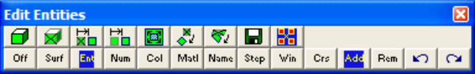

- Si Tools > Shift-key Selection est cochée, vous devez maintenir la touche Shift enfoncée pour effectuer des sélections multiples.

- Par défaut, les entités sélectionnées sont ajoutées à la liste ; toutefois, si la touche Ctrl est maintenue enfoncée, les entités sélectionnées sont retirées de la liste.

- Tout en maintenant la touche Shift ou Ctrl enfoncée, vous pouvez faire glisser pour ouvrir une fenêtre de sélection par intersection.

- L'utilisation de cette barre d'outils est détaillée dans Build A List of Entities for Editing

- Appuyer sur la barre d'espace active automatiquement la dernière fonction de modification utilisée.

- Maintenir la touche Alt enfoncée lors d'un clic droit répète automatiquement la dernière fonction de modification utilisée.

Une fois les entités souhaitées sélectionnées, vous pouvez choisir l'un des boutons de modification :

CAD > Edit > Entity Properties Edit block type, colour, mining sequence, CAD > Edit > Erase Entities Erase selected entities, CAD > Edit > Move Entities Move selected entities, CAD > Edit > Copy Entities Copy selected entities, CAD > Edit > Scale Entities Scale selected entities, CAD > Edit > Rotate Azimuth Rotate the azimuth of selected entities, CAD > Edit > Rotate Dip Rotate the dip of selected entities,

CAD > Edit > Dump to File Dump selected entities to a file,

CAD > Edit > Group Group selected entities into a single block,

- double-cliquer sur n'importe quel sommet pour exécuter la fonction en surbrillance,

- faire un clic droit pour afficher une liste d'options.

Si l'un des champs de la boîte de dialogue indique « Variable », c'est que certaines des surfaces sélectionnées ont des propriétés différentes pour ce champ. Pour regrouper les entités sélectionnées en un seul bloc, toutes les surfaces doivent avoir les mêmes réglages pour tous les champs. Utilisez CAD > Edit > Entity Properties pour cela.

Une fois toute opération de modification terminée, vous disposez d'une chance d'annuler les modifications en sélectionnant

#### Undo

Vous pouvez aussi restaurer le même jeu de sélection et modifier à nouveau le même ensemble d'entités en sélectionnant

#### Redo

Vous pouvez régler le délai du double-clic avec

#### Tools > Double Click Time

## 5.5.4.11 Étirer des sommets

Ajoute un décalage aux sommets sélectionnés.

Cette routine peut être lancée en cliquant sur le bouton ou simplement en faisant un clic droit sur n'importe quel sommet. Au lancement de cette routine, vous serez d'abord invité à constituer une liste des sommets que vous souhaitez étirer

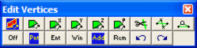

- Si Tools > Shift-key Selection est cochée, vous devez maintenir la touche Shift enfoncée pour effectuer des sélections multiples.

- Par défaut, les entités sélectionnées sont ajoutées à la liste ; toutefois, si la touche Ctrl est maintenue enfoncée, les entités sélectionnées sont retirées de la liste.

- Tout en maintenant la touche Shift ou Ctrl enfoncée, vous pouvez faire glisser pour ouvrir une fenêtre de sélection par intersection.

- L'utilisation de cette barre d'outils est détaillée dans Build A List of Vertices for Editing

- Appuyer sur la barre d'espace active automatiquement la dernière fonction de modification utilisée.

- Maintenir la touche Alt enfoncée lors d'un clic droit répète automatiquement la dernière fonction de modification utilisée.

Une fois les entités souhaitées sélectionnées, vous pouvez choisir l'un des boutons de modification :

CAD > Edit > Stretch Vertices CAD > Edit > Move Vertices to Point CAD > Edit > Move Vertices to X CAD > Edit > Move Vertices to Y CAD > Edit > Move Vertices to Z CAD > Edit > Move Vertices to Plane CAD > Edit > Subdivide Construction Lines CAD > Edit > Smooth Construction Lines CAD > Edit > Remove Construction Vertex

- double-cliquer sur n'importe quel sommet pour exécuter la fonction en surbrillance,

- faire un clic droit pour afficher une liste d'options.

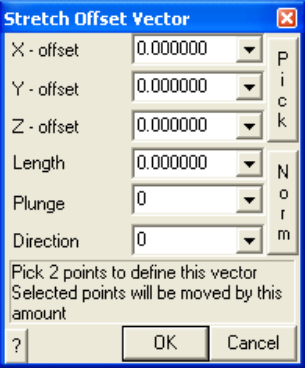

X, Y and Z – offset spécifient les composantes du vecteur d'étirement.

- Tous les sommets sélectionnés seront déplacés à l'emplacement indiqué par ce décalage.

- Cela exige de sélectionner deux points pour définir ce vecteur.

- Une fois sélectionnées, les composantes du vecteur de décalage s'affichent dans la boîte de dialogue.

Pick active le réticule du curseur pour sélectionner de façon interactive le vecteur de décalage sur le modèle. Cela exige de sélectionner deux points pour définir ce vecteur.

Length, Plunge and Direction - spécifient les composantes du vecteur de décalage. Tous les sommets sélectionnés seront déplacés de cette valeur.

Norm - active le curseur pour sélectionner de façon interactive une surface à laquelle rendre le vecteur de décalage normal.

Pour faciliter la sélection visuelle de points sur le modèle, toutes les fonctions d'accrochage sont disponibles.

#### CAD > Snap

Une fois sélectionnées, les composantes du vecteur de décalage s'affichent dans la boîte de dialogue.

OK - termine la modification du vecteur de décalage et étire les sommets sélectionnés.

Cancel - abandonne l'étirement des sommets.

Une fois toute opération de modification terminée, vous disposez d'une chance d'annuler les modifications en sélectionnant

#### Undo

Vous pouvez aussi restaurer le même jeu de sélection et modifier à nouveau le même ensemble d'entités en sélectionnant

#### Redo

Vous pouvez régler le délai du double-clic avec

#### Tools > Double Click Time

## 5.5.4.12 Déplacer des sommets vers un point

Déplace les sommets sélectionnés vers un point.

Cette routine peut être lancée en cliquant sur le bouton ou simplement en faisant un clic droit sur n'importe quel sommet. Au lancement de cette routine, vous serez d'abord invité à constituer une liste des sommets que vous souhaitez déplacer.

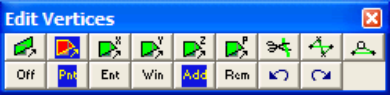

- Si Tools > Shift-key Selection est cochée, vous devez maintenir la touche Shift enfoncée pour effectuer des sélections multiples.

- Par défaut, les entités sélectionnées sont ajoutées à la liste ; toutefois, si la touche Ctrl est maintenue enfoncée, les entités sélectionnées sont retirées de la liste.

- Tout en maintenant la touche Shift ou Ctrl enfoncée, vous pouvez faire glisser pour ouvrir une fenêtre de sélection par intersection.

- L'utilisation de cette barre d'outils est détaillée dans Build A List of Vertices for Editing

- Appuyer sur la barre d'espace active automatiquement la dernière fonction de modification utilisée.

- Maintenir la touche Alt enfoncée lors d'un clic droit répète automatiquement la dernière fonction de modification utilisée.

Une fois les entités souhaitées sélectionnées, vous pouvez choisir l'un des boutons de modification :

CAD > Edit > Stretch Vertices CAD > Edit > Move Vertices to Point CAD > Edit > Move Vertices to X CAD > Edit > Move Vertices to Y CAD > Edit > Move Vertices to Z CAD > Edit > Move Vertices to Plane CAD > Edit > Subdivide Construction Lines CAD > Edit > Smooth Construction Lines CAD > Edit > Remove Construction Vertex

- double-cliquer sur n'importe quel sommet pour exécuter la fonction en surbrillance,

- faire un clic droit pour afficher une liste d'options.

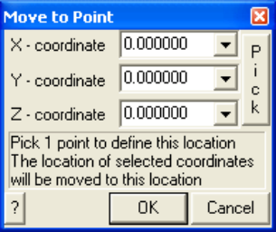

X, Y and Z – coordinate spécifient les coordonnées du point. Tous les sommets sélectionnés seront déplacés vers ce point.

Pick - active le réticule du curseur pour sélectionner de façon interactive le point sur le modèle.

Pour faciliter la sélection visuelle de points sur le modèle, toutes les fonctions d'accrochage sont disponibles.

#### CAD > Snap

Une fois sélectionnées, les composantes du vecteur de décalage s'affichent dans la boîte de dialogue.

OK - termine la modification du vecteur de décalage et étire les sommets sélectionnés.

Cancel - abandonne l'étirement des sommets.

Une fois toute opération de modification terminée, vous disposez d'une chance d'annuler les modifications en sélectionnant

#### Undo

Vous pouvez aussi restaurer le même jeu de sélection et modifier à nouveau le même ensemble d'entités en sélectionnant

Redo

Vous pouvez régler le délai du double-clic avec

#### Tools > Double Click Time

## 5.5.4.13 Déplacer des sommets vers X

Déplace la coordonnée X des sommets sélectionnés.

Cette routine peut être lancée en cliquant sur le bouton ou simplement en faisant un clic droit sur n'importe quel sommet. Au lancement de cette routine, vous serez d'abord invité à constituer une liste des sommets que vous souhaitez déplacer.

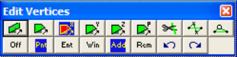

- Si Tools > Shift-key Selection est cochée, vous devez maintenir la touche Shift enfoncée pour effectuer des sélections multiples.

- Par défaut, les entités sélectionnées sont ajoutées à la liste ; toutefois, si la touche Ctrl est maintenue enfoncée, les entités sélectionnées sont retirées de la liste.

- Tout en maintenant la touche Shift ou Ctrl enfoncée, vous pouvez faire glisser pour ouvrir une fenêtre de sélection par intersection.

- L'utilisation de cette barre d'outils est détaillée dans Build A List of Vertices for Editing

- Appuyer sur la barre d'espace active automatiquement la dernière fonction de modification utilisée.

- Maintenir la touche Alt enfoncée lors d'un clic droit répète automatiquement la dernière fonction de modification utilisée.

Une fois les entités souhaitées sélectionnées, vous pouvez choisir l'un des boutons de modification :

CAD > Edit > Stretch Vertices CAD > Edit > Move Vertices to Point CAD > Edit > Move Vertices to X CAD > Edit > Move Vertices to Y CAD > Edit > Move Vertices to Z

CAD > Edit > Move Vertices to Plane

CAD > Edit > Subdivide Construction Lines CAD > Edit > Smooth Construction Lines

CAD > Edit > Remove Construction Vertex

- double-cliquer sur n'importe quel sommet pour exécuter la fonction en surbrillance,

- faire un clic droit pour afficher une liste d'options.

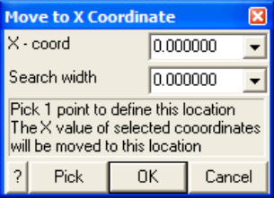

X – coordinate spécifie la coordonnée X du point. La coordonnée X de tous les sommets sélectionnés (c'est-à-dire les sommets de la liste) sera déplacée vers cette valeur.

Search width toutes les coordonnées situées à une distance égale à la largeur de recherche de la valeur de coordonnée x spécifiée seront déplacées, même si elles ne figurent pas dans la liste.

Pick active le réticule du curseur pour sélectionner de façon interactive le point sur le modèle. Pour faciliter la sélection visuelle de points sur le modèle, toutes les fonctions d'accrochage sont disponibles

Pour faciliter la sélection visuelle de points sur le modèle, toutes les fonctions d'accrochage sont disponibles.

#### CAD > Snap

Une fois sélectionnées, les composantes du vecteur de décalage s'affichent dans la boîte de dialogue.

OK - termine la modification du vecteur de décalage et étire les sommets sélectionnés.

Cancel - abandonne l'étirement des sommets.

Une fois toute opération de modification terminée, vous disposez d'une chance d'annuler les modifications en sélectionnant

#### Undo

Vous pouvez aussi restaurer le même jeu de sélection et modifier à nouveau le même ensemble d'entités en sélectionnant

#### Redo

Vous pouvez régler le délai du double-clic avec

#### Tools > Double Click Time

## 5.5.4.14 Déplacer des sommets vers Y

Déplace la coordonnée Y des sommets sélectionnés.

Cette routine peut être lancée en cliquant sur le bouton ou simplement en faisant un clic droit sur n'importe quel sommet. Au lancement de cette routine, vous serez d'abord invité à constituer une liste des sommets que vous souhaitez déplacer.

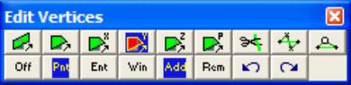

- Si Tools > Shift-key Selection est cochée, vous devez maintenir la touche Shift enfoncée pour effectuer des sélections multiples.

- Par défaut, les entités sélectionnées sont ajoutées à la liste ; toutefois, si la touche Ctrl est maintenue enfoncée, les entités sélectionnées sont retirées de la liste.

- Tout en maintenant la touche Shift ou Ctrl enfoncée, vous pouvez faire glisser pour ouvrir une fenêtre de sélection par intersection.

- L'utilisation de cette barre d'outils est détaillée dans Build A List of Vertices for Editing

- Appuyer sur la barre d'espace active automatiquement la dernière fonction de modification utilisée.

- Maintenir la touche Alt enfoncée lors d'un clic droit répète automatiquement la dernière fonction de modification utilisée.

Une fois les entités souhaitées sélectionnées, vous pouvez choisir l'un des boutons de modification :

CAD > Edit > Stretch Vertices CAD > Edit > Move Vertices to Point CAD > Edit > Move Vertices to X CAD > Edit > Move Vertices to Y CAD > Edit > Move Vertices to Z CAD > Edit > Move Vertices to Plane CAD > Edit > Subdivide Construction Lines CAD > Edit > Smooth Construction Lines CAD > Edit > Remove Construction Vertex

- double-cliquer sur n'importe quel sommet pour exécuter la fonction en surbrillance,

- faire un clic droit pour afficher une liste d'options.

Y – coordinate spécifie la coordonnée Y du point. La coordonnée Y de tous les sommets sélectionnés (c'est-à-dire les sommets de la liste) sera déplacée vers cette valeur.

Search width toutes les coordonnées situées à une distance égale à la largeur de recherche de la valeur de coordonnée y spécifiée seront déplacées, même si elles ne figurent pas dans la liste.

Pick active le réticule du curseur pour sélectionner de façon interactive le point sur le modèle. Pour faciliter la sélection visuelle de points sur le modèle, toutes les fonctions d'accrochage sont disponibles

Pour faciliter la sélection visuelle de points sur le modèle, toutes les fonctions d'accrochage sont disponibles.

#### CAD > Snap

Une fois sélectionnées, les composantes du vecteur de décalage s'affichent dans la boîte de dialogue.

OK - termine la modification du vecteur de décalage et étire les sommets sélectionnés.

Cancel - abandonne l'étirement des sommets.

Une fois toute opération de modification terminée, vous disposez d'une chance d'annuler les modifications en sélectionnant

#### Undo

Vous pouvez aussi restaurer le même jeu de sélection et modifier à nouveau le même ensemble d'entités en sélectionnant

Redo

Vous pouvez régler le délai du double-clic avec

Tools > Double Click Time

## 5.5.4.15 Déplacer des sommets vers Z

Déplace la coordonnée Z des sommets sélectionnés.

Cette routine peut être lancée en cliquant sur le bouton ou simplement en faisant un clic droit sur n'importe quel sommet. Au lancement de cette routine, vous serez d'abord invité à constituer une liste des sommets que vous souhaitez déplacer.

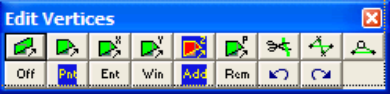

- Si Tools > Shift-key Selection est cochée, vous devez maintenir la touche Shift enfoncée pour effectuer des sélections multiples.

- Par défaut, les entités sélectionnées sont ajoutées à la liste ; toutefois, si la touche Ctrl est maintenue enfoncée, les entités sélectionnées sont retirées de la liste.

- Tout en maintenant la touche Shift ou Ctrl enfoncée, vous pouvez faire glisser pour ouvrir une fenêtre de sélection par intersection.

- L'utilisation de cette barre d'outils est détaillée dans Build A List of Vertices for Editing

- Appuyer sur la barre d'espace active automatiquement la dernière fonction de modification utilisée.

- Maintenir la touche Alt enfoncée lors d'un clic droit répète automatiquement la dernière fonction de modification utilisée.

Une fois les entités souhaitées sélectionnées, vous pouvez choisir l'un des boutons de modification :

CAD > Edit > Stretch Vertices CAD > Edit > Move Vertices to Point CAD > Edit > Move Vertices to X CAD > Edit > Move Vertices to Y

CAD > Edit > Move Vertices to Z

CAD > Edit > Move Vertices to Plane

CAD > Edit > Subdivide Construction Lines

CAD > Edit > Smooth Construction Lines

CAD > Edit > Remove Construction Vertex

- double-cliquer sur n'importe quel sommet pour exécuter la fonction en surbrillance,

- faire un clic droit pour afficher une liste d'options.

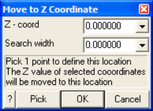

Z – coordinate spécifie la coordonnée Z du point. La coordonnée Z de tous les sommets sélectionnés (c'est-à-dire les sommets de la liste) sera déplacée vers cette valeur.

Search width toutes les coordonnées situées à une distance égale à la largeur de recherche de la valeur de coordonnée z spécifiée seront déplacées, même si elles ne figurent pas dans la liste.

Pick active le réticule du curseur pour sélectionner de façon interactive le point sur le modèle. Pour faciliter la sélection visuelle de points sur le modèle, toutes les fonctions d'accrochage sont disponibles

Pour faciliter la sélection visuelle de points sur le modèle, toutes les fonctions d'accrochage sont disponibles.

#### CAD > Snap

Une fois sélectionnées, les composantes du vecteur de décalage s'affichent dans la boîte de dialogue.

OK - termine la modification du vecteur de décalage et étire les sommets sélectionnés.

Cancel - abandonne l'étirement des sommets.

Une fois toute opération de modification terminée, vous disposez d'une chance d'annuler les modifications en sélectionnant

#### Undo

Vous pouvez aussi restaurer le même jeu de sélection et modifier à nouveau le même ensemble d'entités en sélectionnant

#### Redo

Vous pouvez régler le délai du double-clic avec

#### Tools > Double Click Time

## 5.5.4.16 Déplacer des sommets vers un plan

Déplace les sommets sélectionnés vers un plan. Les sommets sont déplacés dans la direction normale au plan (ou dans une direction spécifiée par l'utilisateur).

Cette routine peut être lancée en cliquant sur le bouton ou simplement en faisant un clic droit sur n'importe quel sommet. Au lancement de cette routine, vous serez d'abord invité à constituer une liste des sommets que vous souhaitez déplacer.

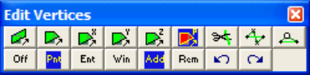

- Si Tools > Shift-key Selection est cochée, vous devez maintenir la touche Shift enfoncée pour effectuer des sélections multiples.

- Par défaut, les entités sélectionnées sont ajoutées à la liste ; toutefois, si la touche Ctrl est maintenue enfoncée, les entités sélectionnées sont retirées de la liste.

- Tout en maintenant la touche Shift ou Ctrl enfoncée, vous pouvez faire glisser pour ouvrir une fenêtre de sélection par intersection.

- L'utilisation de cette barre d'outils est détaillée dans Build A List of Vertices for Editing

- Appuyer sur la barre d'espace active automatiquement la dernière fonction de modification utilisée.

- Maintenir la touche Alt enfoncée lors d'un clic droit répète automatiquement la dernière fonction de modification utilisée.

Une fois les entités souhaitées sélectionnées, vous pouvez choisir l'un des boutons de modification :

CAD > Edit > Stretch Vertices CAD > Edit > Move Vertices to Point CAD > Edit > Move Vertices to X CAD > Edit > Move Vertices to Y CAD > Edit > Move Vertices to Z CAD > Edit > Move Vertices to Plane CAD > Edit > Subdivide Construction Lines CAD > Edit > Smooth Construction Lines CAD > Edit > Remove Construction Vertex

- double-cliquer sur n'importe quel sommet pour exécuter la fonction en surbrillance,

- faire un clic droit pour afficher une liste d'options.

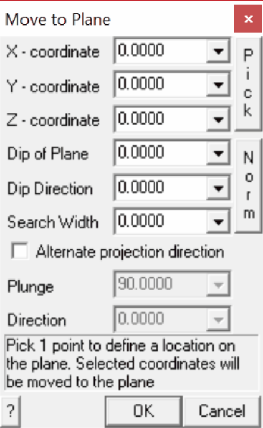

X Y Z – coordinate spécifient les coordonnées d'un point quelconque du plan.

Pick active le réticule du curseur pour sélectionner de façon interactive, sur le modèle, les coordonnées x y z du point du plan. Pour faciliter la sélection visuelle de points sur le modèle, toutes les fonctions d'accrochage sont disponibles

Dip of Plane spécifie le pendage du plan (positif vers le bas, en degrés).

Dip Direction spécifie l'azimut du vecteur de pendage (degrés).

Norm - active le curseur pour sélectionner de façon interactive une surface à laquelle rendre le plan parallèle. Le pendage et la direction de pendage du plan seront réglés normalement à la surface sélectionnée.

Search width toutes les coordonnées situées à une distance égale à la largeur de recherche du plan spécifié seront déplacées, même si elles ne figurent pas dans la liste.

Alternate projection direction - si cette option n'est pas cochée, tous les points seront projetés sur le plan sélectionné dans la direction normale au plan. Si elle est cochée, l'utilisateur peut spécifier la direction de projection de son choix.

Plunge - direction de projection spécifiée par l'utilisateur.

Direction - direction de projection spécifiée par l'utilisateur.

Pour faciliter la sélection visuelle de points sur le modèle, toutes les fonctions d'accrochage sont disponibles.

#### CAD > Snap

Une fois sélectionnées, les composantes du vecteur de décalage s'affichent dans la boîte de dialogue.

OK - termine la modification du vecteur de décalage et étire les sommets sélectionnés.

Cancel - abandonne l'étirement des sommets.

Une fois toute opération de modification terminée, vous disposez d'une chance d'annuler les modifications en sélectionnant

#### Undo

Vous pouvez aussi restaurer le même jeu de sélection et modifier à nouveau le même ensemble d'entités en sélectionnant

Redo

Vous pouvez régler le délai du double-clic avec

Tools > Double Click Time

## 5.5.4.17 Subdiviser des arêtes

#### CAD > Edit > Remove

Insère des sommets sur les arêtes de blocs ou de lignes de construction (voir aussi Construction Vertex).

Cette routine peut être lancée en cliquant sur le bouton ou simplement en faisant un clic droit sur n'importe quelle arête. Au lancement de cette routine, vous serez d'abord invité à constituer une liste des emplacements où vous souhaitez insérer des sommets.

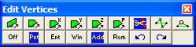

- Si Tools > Shift-key Selection est cochée, vous devez maintenir la touche Shift enfoncée pour effectuer des sélections multiples.

- Par défaut, les entités sélectionnées sont ajoutées à la liste ; toutefois, si la touche Ctrl est maintenue enfoncée, les entités sélectionnées sont retirées de la liste.

- Tout en maintenant la touche Shift ou Ctrl enfoncée, vous pouvez faire glisser pour ouvrir une fenêtre de sélection par intersection.

- L'utilisation de cette barre d'outils est détaillée dans Build A List of Vertices for Editing

- Appuyer sur la barre d'espace active automatiquement la dernière fonction de modification utilisée.

- Maintenir la touche Alt enfoncée lors d'un clic droit répète automatiquement la dernière fonction de modification utilisée.

Une fois les entités souhaitées sélectionnées, vous pouvez choisir l'un des boutons de modification :

CAD > Edit > Stretch Vertices CAD > Edit > Move Vertices to Point CAD > Edit > Move Vertices to X CAD > Edit > Move Vertices to Y

#### CAD > Edit > Move Vertices to Z

CAD > Edit > Move Vertices to Plane

CAD > Edit > Subdivide Construction Lines

CAD > Edit > Smooth Construction Lines

CAD > Edit > Remove Construction Vertex

- double-cliquer sur n'importe quel sommet pour exécuter la fonction en surbrillance,

- faire un clic droit pour afficher une liste d'options.

Une fois toute opération de modification terminée, vous disposez d'une chance d'annuler les modifications en sélectionnant

#### Undo

Vous pouvez aussi restaurer le même jeu de sélection et modifier à nouveau le même ensemble d'entités en sélectionnant

#### Redo

Vous pouvez régler le délai du double-clic avec

#### Tools > Double Click Time

Remarques :

- L'emplacement de tous les points le long des lignes de construction peut être visualisé en réglant le paramètre View > Render > Cline dot radius.

- Avant d'utiliser cette fonction de lissage de tracé, les lignes de construction doivent être nettoyées avec la fonction CAD > Pack and Renumber Clines.

- Vous pouvez régler le délai du double-clic avec Tools > Double Click Time.

## 5.5.4.18 Lisser les lignes de construction

Lisse les lignes de construction en éliminant des points d'angle (voir aussi Construction Vertex).

#### CAD > Edit > Remove

Cette routine peut être lancée en cliquant sur le bouton ou simplement en faisant un clic droit sur n'importe quel sommet. Au lancement de cette routine, vous serez d'abord invité à constituer une liste des sommets que vous souhaitez lisser.

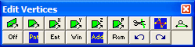

- Si Tools > Shift-key Selection est cochée, vous devez maintenir la touche Shift enfoncée pour effectuer des sélections multiples.

- Par défaut, les entités sélectionnées sont ajoutées à la liste ; toutefois, si la touche Ctrl est maintenue enfoncée, les entités sélectionnées sont retirées de la liste.

- Tout en maintenant la touche Shift ou Ctrl enfoncée, vous pouvez faire glisser pour ouvrir une fenêtre de sélection par intersection.

- L'utilisation de cette barre d'outils est détaillée dans Build A List of Vertices for Editing

- Appuyer sur la barre d'espace active automatiquement la dernière fonction de modification utilisée.

- Maintenir la touche Alt enfoncée lors d'un clic droit répète automatiquement la dernière fonction de modification utilisée.

Une fois les entités souhaitées sélectionnées, vous pouvez choisir l'un des boutons de modification :

CAD > Edit > Stretch Vertices

CAD > Edit > Move Vertices to Point CAD > Edit > Move Vertices to X CAD > Edit > Move Vertices to Y CAD > Edit > Move Vertices to Z CAD > Edit > Move Vertices to Plane CAD > Edit > Subdivide Construction Lines CAD > Edit > Smooth Construction Lines CAD > Edit > Remove Construction Vertex

- double-cliquer sur n'importe quel sommet pour exécuter la fonction en surbrillance,

- faire un clic droit pour afficher une liste d'options.

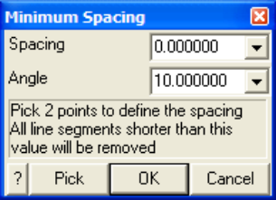

La valeur de Spacing limite l'espace minimal entre les points. Par exemple, si Spacing était spécifié à 2 m et que la longueur du tracé entre les points 4 et 5 de la figure suivante était de 1,5 m, le point 4 serait supprimé et remplacé par une ligne droite entre les points 3 et 5.

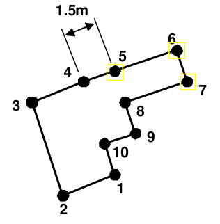

Une valeur nulle pour ce paramètre indique qu'il ne sera pas utilisé.

La valeur de Angle limite l'angle minimal entre des segments de ligne successifs. Par exemple, si Angle était spécifié à 10° et que la direction du segment de ligne 3-4 différait de 7° de celle du

segment de ligne 4-5 de la figure suivante, le point 4 serait supprimé et remplacé par une ligne droite entre les points 3 et 5.

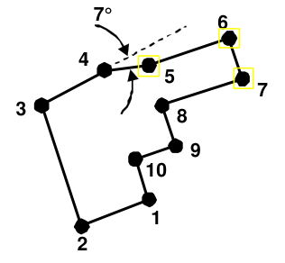

Une valeur nulle pour ce paramètre indique qu'il ne sera pas utilisé.

OK - termine la modification du vecteur de décalage et étire les sommets sélectionnés.

Cancel - abandonne l'étirement des sommets.

Une fois toute opération de modification terminée, vous disposez d'une chance d'annuler les modifications en sélectionnant

#### Undo

Vous pouvez aussi restaurer le même jeu de sélection et modifier à nouveau le même ensemble d'entités en sélectionnant

#### Redo

Vous pouvez régler le délai du double-clic avec

#### Tools > Double Click Time

Remarques :

- L'emplacement de tous les points le long des lignes de construction peut être visualisé en réglant le paramètre View > Render > Cline dot radius.

- Avant d'utiliser cette fonction de lissage de tracé, les lignes de construction doivent être nettoyées avec la fonction CAD > Pack and Renumber Clines.

- Vous pouvez régler le délai du double-clic avec Tools > Double Click Time.

## 5.5.4.19 Supprimer un sommet de ligne de construction

Lisse les lignes de construction en éliminant des points d'angle individuels (voir aussi Construction Lines).

#### CAD > Edit > Smooth

Cette routine peut être lancée en cliquant sur le bouton ou simplement en faisant un clic droit sur n'importe quel sommet. Au lancement de cette routine, vous serez d'abord invité à constituer une liste des sommets que vous souhaitez supprimer.

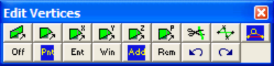

- Si Tools > Shift-key Selection est cochée, vous devez maintenir la touche Shift enfoncée pour effectuer des sélections multiples.

- Par défaut, les entités sélectionnées sont ajoutées à la liste ; toutefois, si la touche Ctrl est maintenue enfoncée, les entités sélectionnées sont retirées de la liste.

- Tout en maintenant la touche Shift ou Ctrl enfoncée, vous pouvez faire glisser pour ouvrir une fenêtre de sélection par intersection.

- L'utilisation de cette barre d'outils est détaillée dans Build A List of Vertices for Editing

- Appuyer sur la barre d'espace active automatiquement la dernière fonction de modification utilisée.

- Maintenir la touche Alt enfoncée lors d'un clic droit répète automatiquement la dernière fonction de modification utilisée.

Une fois les entités souhaitées sélectionnées, vous pouvez choisir l'un des boutons de modification :

CAD > Edit > Stretch Vertices CAD > Edit > Move Vertices to Point CAD > Edit > Move Vertices to X CAD > Edit > Move Vertices to Y CAD > Edit > Move Vertices to Z CAD > Edit > Move Vertices to Plane CAD > Edit > Subdivide Construction Lines CAD > Edit > Smooth Construction Lines CAD > Edit > Remove Construction Vertex

- double-cliquer sur n'importe quel sommet pour exécuter la fonction en surbrillance,

- faire un clic droit pour afficher une liste d'options.

Une fois toute opération de modification terminée, vous disposez d'une chance d'annuler les modifications en sélectionnant

#### Undo

Vous pouvez aussi restaurer le même jeu de sélection et modifier à nouveau le même ensemble d'entités en sélectionnant

#### Redo

Vous pouvez régler le délai du double-clic avec

#### Tools > Double Click Time

Remarques :

- L'emplacement de tous les points le long des lignes de construction peut être visualisé en réglant le paramètre View > Render > Cline dot radius.

- Avant d'utiliser cette fonction de lissage de tracé, les lignes de construction doivent être nettoyées avec la fonction CAD > Pack and Renumber Clines.

- Vous pouvez régler le délai du double-clic avec Tools > Double Click Time.
