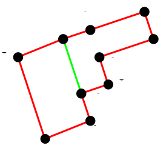

Compacte et renumérote toutes les lignes de construction.

Les points de coordonnées très proches les uns des autres sont fusionnés. Les sommets de lignes de construction qui partagent le même emplacement utiliseront le même numéro de point de coordonnées et se déplaceront donc ensemble lors de toute opération de modification des coordonnées (Cad > Edit). Cette fonction est utile pour éliminer les petits écarts et chevauchements entre lignes de construction adjacentes.

Tous les segments de lignes de construction de même couleur qui peuvent l'être seront reliés pour former des lignes continues entre les points d'intersection.

**6**

Dans cet exemple, 3 segments de ligne seront formés, constitués des groupes de points suivants

- Segment de ligne 1 :  10, 1, 2, 3, 4.

- Segment de ligne 2 :  4, 5, 6, 7, 8, 9, 10.

- Segment de ligne 3 :  4, 10.

Lorsque vous lancez cette fonction, vous êtes invité à spécifier un rayon de recherche pour le compactage

Radius : cette valeur sert à fusionner les points proches les uns des autres. Une valeur nulle pour ce paramètre indique qu'il ne sera pas utilisé ; Map3D fusionnera alors les points situés dans un rayon de recherche de 1/1000 de la longueur de l'arête par rapport à la ligne. Soyez extrêmement prudent si vous spécifiez une valeur non nulle pour ce paramètre, car de grandes valeurs peuvent causer plus de problèmes qu'elles n'en résolvent en fusionnant trop de points.

Les numéros de coordonnées inutilisés sont supprimés de la liste des coordonnées.

Cette fonction doit être utilisée avant la fonction CAD > Edit > Smooth Construction lines.

Cette fonction doit être utilisée avant la fonction CAD > Snap > Trace Cline Snap.

Les lignes de construction peuvent être décompactées avec la fonction CAD > Unpack Clines.
