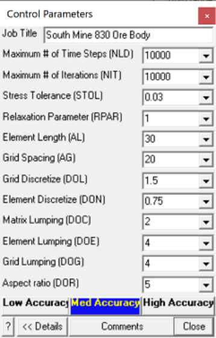
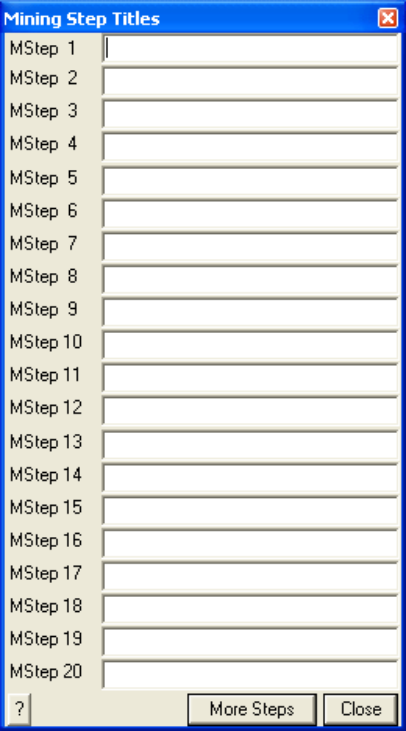

## 5.5.3.1 Paramètres de contrôle

Spécification des paramètres de contrôle de l'analyse.

**Job Title** - spécifie un titre descriptif du projet.

**Maximum # of Time Steps (** **_NLD_ )** - spécifie le nombre maximal d'étapes qui seront utilisées pendant l'analyse. Ce paramètre n'est pertinent que si vous effectuez une analyse de fluage non linéaire

#### Analysis > Options > Creep

où il limite le nombre réel de pas de temps.

Si ce paramètre est dépassé, le programme s'arrête et l'utilisateur est invité à indiquer comment poursuivre. Ce paramètre peut être modifié pendant la résolution.

Sauf raison particulière de limiter le nombre de pas de temps, ce paramètre doit être fixé à un nombre arbitrairement grand.

**Maximum # of Iterations (** **_NIT_ )** - spécifie le nombre maximal d'itérations qui seront utilisées pendant la résolution de la matrice.

Si ce paramètre est dépassé, le programme s'arrête et l'utilisateur est invité à indiquer comment poursuivre. Ce paramètre peut être modifié pendant la résolution.

Sauf raison particulière de limiter le nombre de pas de temps, ce paramètre doit être fixé à un nombre arbitrairement grand.

**Stress Tolerance (** **_STOL_ )** - spécifie la précision requise de la solution de la matrice.

Pendant la résolution de la matrice, la précision s'améliore progressivement à chaque itération. Lorsque l'erreur maximale de contrainte devient inférieure à cette valeur, la matrice peut être considérée comme résolue.

La valeur suggérée pour ce paramètre est 0,1 % de l'état de contraintes en champ lointain à la profondeur d'intérêt. _STOL_ doit être spécifié dans les mêmes unités que l'état de contraintes en champ lointain (p. ex. MPa ou psi).

**Relaxation Parameter (** **_RPAR_ )** - spécifie la valeur maximale de relaxation qui sera utilisée pendant la résolution de la matrice.

Pendant la résolution de la matrice, le programme modifie continuellement le paramètre de relaxation afin d'obtenir la convergence avec le moins d'itérations possible. Ce paramètre limite la valeur maximale qui sera utilisée.

La valeur 1,2 est recommandée pour les problèmes bien conditionnés. Pour les problèmes mal conditionnés, une valeur de 0,8 doit être utilisée.

**Element Length (** **_AL_ )** - spécifie la longueur minimale d'élément.

Pendant le processus de discrétisation, toutes les surfaces du modèle (surfaces des blocs FF et plans DD) sont subdivisées en éléments de frontière de longueur de côté

_Lelem = Delem/DON_

où _Delem_ est déterminé par Map3D comme la plus petite distance entre surfaces adjacentes du modèle. Comme la distance _Delem_ peut être nulle à certains endroits, la longueur minimale de côté d'élément _AL_ doit être spécifiée.

_AL_ doit être fixé à deux fois la largeur du plus petit pilier ou chantier. Il faut utiliser les mêmes unités que pour les coordonnées (p. ex. mètres ou pieds).

Une fois la discrétisation terminée, la distance _Delem_ peut être tracée avec

Plot > Miscellaneous > Delem distance to nearest element on surfaces.

Notez que, si on le souhaite, ce comportement peut être remplacé élément par élément en spécifiant la largeur maximale de chaque élément

#### CAD > Edit > Entity Properties > Maximum Width

Cela permet aux utilisateurs d'imposer une discrétisation fine et uniforme sur les surfaces situées dans des zones sans plans de grille.

**Grid Spacing (** **_AG_ )** - spécifie l'espacement minimal de grille.

Pendant le processus de discrétisation, toutes les grilles de points de champ et toutes les surfaces du modèle sont subdivisées en éléments de longueur de côté

_Lgrid = Dgrid/DOL_

où _Dgrid_ est déterminé par Map3D comme la plus petite distance entre les surfaces du modèle et les plans de grille. Comme la distance _Dgrid_ peut être nulle à certains endroits, l'espacement minimal de grille _AG_ doit être spécifié. Le même processus sert à discrétiser les surfaces du modèle (surfaces des blocs FF et plans DD) proches des grilles de points de champ.

_AG_ doit être fixé à la plus petite dimension d'intérêt. Par exemple, si l'utilisateur doit voir la distribution des contraintes à travers un pilier de 2 m de large, une valeur de _AG_ de 0,5 donnerait un nombre suffisant de points de champ pour un tracé de contours précis. Il faut utiliser les mêmes unités que pour les coordonnées (p. ex. mètres ou pieds).

Une fois la discrétisation terminée, la distance _Dgrid_ peut être tracée sur les surfaces du modèle avec

Plot > Surface Components > Dgird distance to nearest grid

ou sur les grilles avec

Plot > Miscellaneous > Delem distance to nearest element on grids.

Notez que, si on le souhaite, ce comportement peut être remplacé grille par grille en spécifiant l'espacement maximal de chaque grille

#### CAD > Edit > Entity Properties > Maximum Width

Cela permet aux utilisateurs d'imposer une discrétisation fine et uniforme sur les grilles.

**Grid Discretize (** **_DOL_ ) -** spécifie le rapport souhaité entre la distance et la longueur d'élément, utilisé pour déterminer l'espacement de grille à partir de

_Lgrid = Dgrid/DOL_

où _Dgrid_ est déterminé par Map3D comme la plus petite distance entre les surfaces du modèle et les plans de grille.

Une valeur de _DOL_ de 1,0 est généralement suffisante et peut donner des solutions avec 10-20 % d'erreur. Si une plus grande précision est requise, une valeur de _DOL_ de 2,0 devrait donner 5-10 % d'erreur. Utilisez une valeur de 4,0 pour moins de 5 % d'erreur. Bien que des valeurs plus élevées de _DOL_ génèrent davantage d'éléments de frontière et donc des temps de calcul plus longs, c'est nécessaire pour obtenir une plus grande précision.

Une fois la discrétisation terminée, le rapport _Dgrid/Lelem_ peut être tracé sur les surfaces du modèle avec

Plot > Miscellaneous > Dgrid/Lelem _DOL_ ratio on surfaces

ou le rapport _Dgrid/Lgrid_ sur les grilles avec

Plot > Miscellaneous > Dgrid/Lgrid _DOL_ ratio on grids.

**Element Discretize (** **_DON_ ) -** spécifie le rapport souhaité entre la distance et la longueur d'élément, utilisé pour déterminer la longueur de côté d'élément

_Lelem = Delem/DON_

où _Delem_ représente la distance à la surface du modèle la plus proche.

Une valeur de _DON_ de 0,5 est généralement suffisante pour tous les problèmes, sauf ceux comportant des excavations ou des piliers très étroits. Dans ce dernier cas, une valeur de _DON_ de 1,0 est recommandée. Bien que des valeurs plus élevées de _DON_ génèrent davantage d'éléments de frontière et donc des temps de calcul plus longs, c'est nécessaire pour obtenir un problème bien conditionné et résoluble dans le cas d'excavations ou de piliers très étroits.

Une fois la discrétisation terminée, le rapport _Delem/Lelem_ peut être tracé avec

Plot > Miscellaneous > Delem/Lelem _DON_ ratio on surfaces.

**Matrix Lumping (** **_DOC_ ) -** spécifie le rapport souhaité entre la distance et la longueur d'élément. Pendant l'assemblage de la matrice, tous les éléments qui tiennent dans la dimension

#### _Delem/DOC_

seront regroupés (lumping). _Delem_ représente la distance à la surface du modèle la plus proche.

Comme pour _DOL_ , une valeur de _DOC_ de 1,0 est généralement suffisante et peut donner des solutions avec 10-20 % d'erreur. Si une plus grande précision est requise, une valeur de _DOC_ de 2,0 devrait donner 5-10 % d'erreur. Utilisez une valeur de 4,0 pour moins de 5 % d'erreur. Bien que des valeurs plus élevées de _DOC_ produisent des matrices de coefficients plus grandes et donc des temps de calcul plus longs, c'est nécessaire pour obtenir une plus grande précision.

Une fois la discrétisation terminée, la distance _Delem_ peut être tracée avec

Plot > Miscellaneous > Delem distance to nearest element on surfaces.

**Element Lumping (** **_DOE_ ) -** spécifie le rapport souhaité entre la distance et la longueur d'élément. Pendant l'assemblage de la grille, tous les éléments qui tiennent dans la dimension

#### _Dgrid/DOE_

seront regroupés (lumping). _Dgrid_ représente la distance à la surface de grille de points de champ la plus proche.

Une valeur de _DOE_ de 2,0 est généralement suffisante et peut donner des solutions avec 10-20 % d'erreur. Si une plus grande précision est requise, une valeur de _DOE_ de 4,0 devrait donner 5-10 % d'erreur. Utilisez une valeur de 8,0 pour moins de 5 % d'erreur. Bien que des valeurs plus élevées de _DOE_ allongent les temps de calcul, c'est nécessaire pour obtenir une plus grande précision.

Une fois la discrétisation terminée, la distance _Dgrid_ peut être tracée sur les grilles avec

Plot > Miscellaneous > Delem distance to nearest element on grids.

**Grid Lumping (** **_DOG_ ) -** spécifie le rapport souhaité entre la distance et la longueur d'élément. Pendant l'assemblage de la grille, tous les points de grille qui tiennent dans la dimension

#### _Dgrid/DOG_

seront regroupés (lumping). _Dgrid_ représente la distance à la surface de grille de points de champ la plus proche.

Une valeur de _DOG_ de 2,0 est généralement suffisante et peut donner des solutions avec 10-20 % d'erreur. Si une plus grande précision est requise, une valeur de _DOG_ de 4,0 devrait donner 5-10 % d'erreur. Utilisez une valeur de 8,0 pour moins de 5 % d'erreur. Bien que des valeurs plus élevées de _DOG_ allongent les temps de calcul, c'est nécessaire pour obtenir une plus grande précision.

Une fois la discrétisation terminée, la distance _Dgrid_ peut être tracée sur les grilles avec

Plot > Miscellaneous > Delem distance to nearest element on grids.

**Aspect Ratio (** **_DOR_ ) -** spécifie le rapport d'aspect souhaité des éléments. Une valeur de _DOR_ de 5,0 est recommandée pour tous les problèmes, sauf si l'utilisateur souhaite subdiviser les éléments étroits en formes plus uniformes.

Règle _DON_ =0,5, _DOL=DOC_ =1, _DOE=DOG_ =2 pour 10-20 % d'erreur. Règle _DON_ =0,5, _DOL=DOC_ =2, _DOE=DOG_ =4 pour 5-10 % d'erreur. Règle _DON_ =1, _DOL=DOC_ =4, _DOE=DOG_ =8 pour &lt; 5 % d'erreur.

**Comments -** permet de spécifier des commentaires qui seront enregistrés avec le calcul.

#### Summary:

- _STOL_ doit être fixé à 0,1 % de l'état de contraintes en champ lointain à la profondeur d'intérêt. Utilisez les mêmes unités que l'état de contraintes en champ lointain (p. ex. MPa ou psi).

- _AL_ doit être fixé à deux fois la largeur du plus petit pilier ou chantier. Utilisez les mêmes unités que pour les coordonnées (p. ex. mètres ou pieds).

- _AG_ doit être fixé à la plus petite dimension d'intérêt. Utilisez les mêmes unités que pour les coordonnées (p. ex. mètres ou pieds).

- Les éléments sont discrétisés avec une longueur de côté égale à la plus petite des valeurs _Delem/DON_ et _Dgrid/DOL_ , de sorte qu'elle ne peut être inférieure à _AL_ ni supérieure à la largeur maximale.

- Les grilles sont discrétisées avec un espacement déterminé à partir de _Dgrid/DOL_ , de sorte qu'il ne peut être inférieur à _AG_ ni supérieur à l'espacement maximal.

- Pendant l'assemblage de la matrice, tous les éléments qui tiennent dans la dimension _Delem/DOC_ seront regroupés (lumping).

- Pendant l'assemblage de la grille, tous les éléments qui tiennent dans la dimension _Dgrid/DOE_ seront regroupés (lumping).

- Pendant l'assemblage de la grille, tous les points de grille qui tiennent dans la dimension _Dgrid/DOG_ seront regroupés (lumping).

#### Notes:

Pour une discussion plus détaillée sur la discrétisation et le regroupement (lumping), voir

- Discretization and Lumping.

## 5.5.3.2 Titres des étapes d'exploitation

Spécification d'un titre descriptif pour chaque étape d'exploitation.

## 5.5.3.3 Propriétés des matériaux

Spécification des propriétés des matériaux.

Plusieurs boîtes de dialogue différentes apparaîtront selon le type de matériau sélectionné : Mohr-Coulomb, Hoek-Brown, Drucker-Prager, Backfill Hyperbolic et None.

Mohr-Coulomb dans les blocs FF 3D peut servir de règle d'écoulement pour le comportement non linéaire des matériaux dans Map3D Non-Linear et Map3D Visco-Plastic. Il peut aussi servir de critère de rupture dans les blocs FF 3D ou dans le matériau encaissant (host) dans Map3D Fault-Slip.

Hoek-Brown dans les blocs FF 3D peut servir de critère de rupture dans les blocs FF 3D ou dans le matériau encaissant dans Map3D Fault-Slip.

Drucker-Prager dans les blocs FF 3D peut servir de critère de rupture dans les blocs FF 3D ou dans le matériau encaissant dans Map3D Fault-Slip.

Fault-Gouge dans les plans DD peut servir de règle d'écoulement dans les plans DD dans Map3D Fault-Slip, Map3D Non-Linear ou Map3D Visco-Plastic.

Equilibrated-Gouge dans les plans DD peut servir de règle d'écoulement dans les plans DD dans Map3D Fault-Slip, Map3D Non-Linear ou Map3D Visco-Plastic.

Yielding-Pillar dans les plans DD peut servir de règle d'écoulement dans les plans DD dans Map3D Fault-Slip, Map3D Non-Linear ou Map3D Visco-Plastic.

Hyperbolic-Backfill dans les plans DD peut servir de règle d'écoulement dans les plans DD dans Map3D Fault-Slip, Map3D Non-Linear ou Map3D Visco-Plastic.

Quadratic-Backfill dans les plans DD peut servir de règle d'écoulement dans les plans DD dans Map3D Fault-Slip, Map3D Non-Linear ou Map3D Visco-Plastic.

Softened Material dans les blocs FF 3D ou les plans DD peut servir à assouplir un matériau élastique pour simuler la plastification du terrain et les effets de redistribution des contraintes qui en résultent.

Stress State spécifie l'état de contraintes antérieur à l'exploitation.

Dans les analyses élastiques, le critère de rupture n'est utilisé que pour le calcul des facteurs de résistance et le tracé des contours, et n'affecte pas les résultats de l'analyse.

Dans les analyses non linéaires (blocs FF 3D dans Map3D Non-Linear, blocs FF 3D dans Map3D Visco-Plastic et plans DD dans Map3D Fault-Slip), le critère de rupture sert de règle d'écoulement pour contrôler la plastification et les déformations non linéaires.

## 5.5.3.4 Configuration de Map3Di

Configure l'analyse Map3Di.

Map3Di permet de superposer au modèle Map3D des effets de chargement de champ externe. Pour plus de détails sur cette fonction, voir Map3Di.

Lorsque vous vérifiez un fichier de chargement Map3Di en vue de son utilisation, vous êtes invité à rechercher un nom et un emplacement de fichier. Si la recherche aboutit, le fichier sera vérifié.

Le fichier de chargement Map3Di est spécifié au format de fichier de polylignes. Pour plus de détails sur la génération d'un fichier de chargement Map3Di, voir Contour Plane Options.

Les lignes de commentaire doivent commencer par un astérisque « * » dans la colonne 1.

Les plans 2D sont stockés sous forme d'une série de polylignes triangulaires ou quadrangulaires, comme suit :

x1 y1 z1 3 values1 x2 y2 z2 2 values2 x3 y3 z3 2 values3 x4 y4 z4 2 values4 ...

Les blocs 3D sont stockés sous forme d'une série de polylignes tétraédriques ou hexaédriques, comme suit :

x1 y1 z1 3 values1 x2 y2 z2 2 values2 x3 y3 z3 2 values3 x4 y4 z4 2 values4 x5 y5 z5 1 values5 x6 y6 z6 1 values6

x7 y7 z7 1 values7

x8 y8 z8 1 values8

où **xi yi zi** représentent les coordonnées de chaque point.

- 3 indique que ce point est le début d'une nouvelle polyligne.

- 2 indique que ce point fait partie de la base du bloc.

- 1 indique que ce point fait partie du sommet du bloc. Cet élément n'est utilisé que pour la définition de formes de blocs 3D.

Des polylignes supplémentaires sont spécifiées en répétant la séquence (c'est-à-dire en commençant une nouvelle polyligne par le nombre **3** ).

N'importe lequel des points peut être répété ou omis pour spécifier des côtés triangulaires ou des tétraèdres.

- valuesi spécifie la grandeur du chargement de champ au centre ou à chaque coin. Si seul values1 est spécifié (c'est-à-dire que values2 … sont laissés vides), cette valeur est appliquée uniformément sur toute l'entité.

- Si valuesi sont spécifiés pour tous les coins, le chargement de champ est appliqué selon une distribution polynomiale d'ordre supérieur.

Pour les triangles de surface 2D, une distribution linéaire est utilisée

_a_ + _b x_ + _c y_

Pour les quadrilatères 2D, la distribution suivante est utilisée

_a_ + _b x_ + _c y_ + _d x y_

Pour les formes de blocs 3D, autant de termes que possible de la distribution sont utilisés

_a_ + _b x_ + _c y_ + _d z_ + _e x y_ + _f y z_ + _g z x_ + _h x y z_

Les effets réels du chargement de champ peuvent être spécifiés de plusieurs façons.

#### 2D Planes

Les plans 2D définissent une discontinuité de déplacement avec un déplacement normal (convergence) dn et un déplacement de cisaillement (ride) ds spécifiés, de sorte que valuesi peut être spécifié soit comme

dn ds ou dn ds1 ds2

Si seuls dn ds sont spécifiés, le déplacement de cisaillement (ride) est appliqué parallèlement à la contrainte de cisaillement maximale dans le plan pour le plan 2D.

Si tous dn ds1 ds2 sont spécifiés, la composante du déplacement de cisaillement (ride) ds1 est appliquée parallèlement au premier côté (c'est-à-dire le côté défini par x1 y1 z1 – x2 y2 z2). ds2 est appliqué perpendiculairement à ds1 dans la direction du second côté (c'est-à-dire le côté défini par x2 y2 z2 - x3 y3 z3).

Le déplacement de cisaillement (ride) et le déplacement normal (convergence) sont spécifiés en unités de déplacement (c'est-à-dire les mêmes unités que celles de la géométrie (mètres)).

Le déplacement de cisaillement (ride) et le déplacement normal (convergence) peuvent être déterminés à partir de mesures in situ ou en laboratoire du cisaillement, de la convergence et/ou de l'ouverture de fissures, ou à partir d'un autre programme de modélisation numérique, comme un simulateur de réservoir ou de fracturation hydraulique. Ils peuvent aussi être estimés à partir de données de surveillance sismique.

#### 3D Blocks

Les blocs 3D définissent une zone avec une déformation e spécifiée, soit comme

e1 e2 e3 ou exx eyy ezz exy eyz ezx

Si seuls e1 e2 e3 sont spécifiés, ces déformations principales sont appliquées parallèlement aux contraintes principales. Les déformations servent à déterminer la contrainte initiale s° avec

s1° = [ ( _1-_ n) e1 + n ( e2 + e3 ) ] _E_ / [ ( _1+_ n) ( _1-2_ n) ] s2° = [ ( _1-_ n) e2 + n ( e3 + e1 ) ] _E_ / [ ( _1+_ n) ( _1-2_ n) ] s3° = [ ( _1-_ n) e3 + n ( e1 + e2 ) ] _E_ / [ ( _1+_ n) ( _1-2_ n) ]

Si tous exx eyy ezz exy eyz ezx sont spécifiés, ces déformations sont appliquées comme composantes cartésiennes. Les déformations servent à déterminer la contrainte initiale s° avec

sxx°  = [ ( _1-_ n) exx + n ( eyy + ezz ) ] _E_ / [ ( _1+_ n) ( _1-2_ n) ] syy° = [ ( _1-_ n) eyy + n ( ezz + exx ) ] _E_ / [ ( _1+_ n) ( _1-2_ n) ] szz°  = [ ( _1-_ n) ezz + n ( exx + eyy ) ] _E_ / [ ( _1+_ n) ( _1-2_ n) ] txy° = exy _E_ / ( _1+_ n) tyz° = eyz _E_ / ( _1+_ n) tzx° = ezx _E_ / ( _1+_ n)

Les déformations sont spécifiées en unités de déformation sans dimension (c'est-à-dire que 0,001 correspond à 1000 microdéformations).

_E_ et n représentent respectivement le module de Young (à l'échelle du massif rocheux, de déformation) et le coefficient de Poisson. Map3D détermine automatiquement dans quel matériau se trouve le coin du bloc 3D et utilise les propriétés du matériau correspondant.

Les déformations peuvent être déterminées à partir de mesures in situ ou en laboratoire de la température ou de la pression de fluide, ou à partir d'un autre programme de modélisation numérique, comme un code d'analyse thermique. Elles peuvent aussi être estimées à partir de données de surveillance sismique.

Les déformations à appliquer peuvent être déterminées à partir de la température au moyen d'un coefficient de dilatation _A_ , où la variation de température ou la variation de pression de fluide (par rapport à la valeur de fond) induit les contraintes initiales

s1° **=** s2° **=** s3° = _A_ D _T_

Pour les problèmes d'écoulement de fluide, le coefficient de dilatation _A_ doit être fixé à l'unité (un positif) pour les milieux saturés. Pour les problèmes thermiques, le coefficient de dilatation doit être spécifié comme une quantité négative donnée par

_A_ = a _E /(1-2_ n _)_

où a représente le coefficient de dilatation thermique (c'est-à-dire la dilatabilité linéaire).

#### Notes

Cette fonction doit être configurée avant d'effectuer l'analyse BEM de Map3D

Analysis > BEM Analysis.

CAD > Properties > Map3Di Setup > View permet de visualiser les données de Map3Di.

## 5.5.3.5 Informations sur le modèle

Affiche le décompte actuel des paramètres suivants du modèle :

- nombre de surfaces utilisées pour définir la géométrie,

- nombre de coordonnées utilisées pour définir les surfaces,

- nombre d'étapes d'exploitation.

Les paramètres suivants ne sont affichés qu'une fois l'analyse de discrétisation (Analysis > Discretization) terminée :

- nombre d'éléments de frontière,

- nombre de nœuds de frontière (uniquement utilisé pour les éléments d'ordre supérieur (Analysis > Options > Linear),

- nombre de points de champ sur les grilles définies par l'utilisateur.
