## 5.5.2.1 Aucun

Désactive l'accrochage. Aucune boîte de sélection n'est affichée à l'intersection du réticule du curseur.

Les points seront sélectionnés à l'emplacement indiqué par le réticule. Ce mode est utile pour le dessin à main levée ou la numérisation. En numérisation, les trois valeurs de coordonnées sont relevées à l'échelle du dessin. En revanche, en dessin à main levée, seules deux des coordonnées peuvent être localisées et la troisième doit provenir de la base d'accrochage

CAD > Snap > Cursor/Grid Base

C'est le réglage recommandé pendant la numérisation.

## 5.5.2.2 Arête la plus proche

S'accroche à l'arête la plus proche.

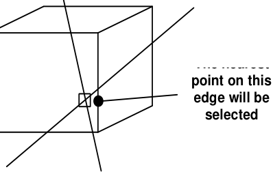

Si la boîte de sélection est située sur le coin d'une entité, ce coin sera sélectionné.

Sinon, le point le plus proche de l'arête la plus proche sera sélectionné.

La boîte de sélection doit être située sur une entité ou une ligne de construction.

## 5.5.2.3 Coin le plus proche

S'accroche au coin le plus proche.

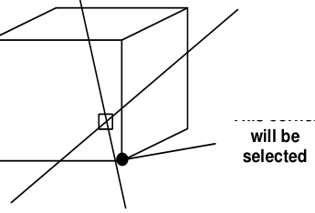

Le coin le plus proche de la boîte de sélection sera sélectionné.

La boîte de sélection doit être située sur une entité ou une ligne de construction.

## 5.5.2.4 Surface la plus proche

S'accroche sur la surface.

Si la boîte de sélection est située sur le coin d'une entité, ce coin sera sélectionné.

Si la boîte de sélection est située sur une arête, le point le plus proche de cette arête sera sélectionné.

Sinon, le point le plus proche de la surface sera sélectionné.

La boîte de sélection doit être située sur une entité ou une ligne de construction.

## 5.5.2.5 Milieu de ligne

S'accroche au milieu de l'arête sélectionnée.

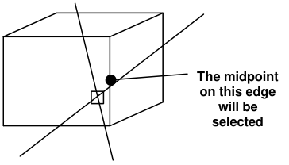

Si la boîte de sélection est située sur le coin d'une entité, ce coin sera sélectionné.

Sinon, le milieu de l'arête la plus proche sera sélectionné.

La boîte de sélection doit être située sur une entité ou une ligne de construction.

## 5.5.2.6 Accrochage tangent

Force le curseur à rester tangent à l'arête sélectionnée.

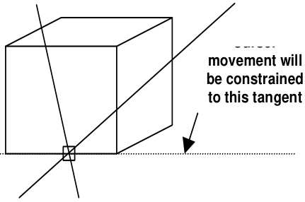

L'arête la plus proche de la boîte de sélection sera sélectionnée. La boîte de sélection doit être située sur une entité ou une ligne de construction.

Une fois l'arête sélectionnée, tout déplacement du curseur sera contraint à la tangente définie par l'arête sélectionnée. Des points peuvent alors être sélectionnés n'importe où le long de cette tangente.

Une fois un point sélectionné, l'accrochage tangent est automatiquement annulé. Il peut être annulé à tout moment en appuyant sur la touche Échap (Esc) ou en faisant un clic droit.

Pour sélectionner des points à intervalles réguliers le long de la ligne tangente, l'accrochage tangent peut être utilisé avec l'un des modes suivants :

CAD > Snap > Grid Snap S'accroche à une grille rectangulaire.

CAD > Snap > X-Gird Snap S'accroche à l'arête sélectionnée selon un espacement de grille régulier en X.

CAD > Snap > Y-Grid Snap S'accroche à l'arête sélectionnée selon un espacement de grille régulier en Y.

CAD > Snap > Z-Grid Snap S'accroche à l'arête sélectionnée selon un espacement de grille régulier en Z.

## 5.5.2.7 Accrochage à l'intersection

S'accroche à l'intersection de l'arête sélectionnée et d'une tangente.

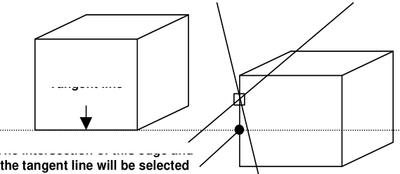

Cette fonction travaillant en 3D complète, la tangente peut passer au-dessus ou au-dessous de l'arête sélectionnée sans réellement la couper. Dans ce cas, le point de l'arête sélectionnée le plus proche de la ligne tangente sera choisi.

Cette convention doit être soulignée. Le point d'intersection ne sera pas sélectionné sur la ligne tangente : il sera sélectionné sur la ligne d'intersection.

L'utilisation de cette fonction se fait en deux étapes. Lorsque vous cliquez sur le bouton Intersect Snap, il vous est demandé :

1. De sélectionner d'abord une ligne tangente.

2. Puis de sélectionner l'arête avec laquelle vous voulez croiser la tangente. Le point sera sélectionné sur cette ligne.

L'arête la plus proche de la boîte de sélection sera sélectionnée.

La boîte de sélection doit être située sur une entité ou une ligne de construction.

Cette fonction peut servir à repérer des points à l'intersection de la tangente et du prolongement de l'arête sélectionnée.

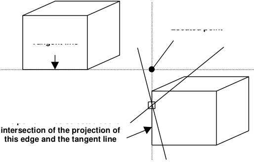

Une fois un point sélectionné, l'accrochage à l'intersection est automatiquement annulé. Il peut être annulé à tout moment en appuyant sur la touche Échap (Esc) ou en faisant un clic droit.

Pour un exemple d'utilisation de l'accrochage à l'intersection dans la construction de modèles, voir

Tabular Mining

## 5.5.2.8 Accrochage par suivi de ligne de construction

S'accroche à des coins sélectionnés le long d'un segment de ligne de construction. Ce mode d'accrochage peut servir de méthode rapide pour construire des DDLoops ( CAD > Build > DDLoop), des FFLoops ( CAD > Build >

FFLoop), des tunnels ( CAD > Build > Tunnel et CAD > Build > GPlanes).

Pour utiliser ce mode d'accrochage, il suffit de sélectionner les points de départ et d'arrivée le long du segment de ligne de construction voulu ; tous les points intermédiaires seront sélectionnés automatiquement. Par exemple, si vous sélectionnez les points 4 et 9, les points 5, 6, 7 et 8 seront sélectionnés automatiquement. Notez que si vous sélectionnez deux fois le même point, toute la boucle sera sélectionnée.

**6**

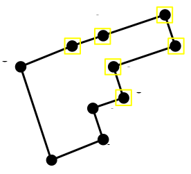

Remarques :

L'emplacement de tous les points le long des lignes de construction peut être visualisé en réglant le paramètre View > Render > Cline dot radius.

Avant d'utiliser ce mode d'accrochage par suivi, les lignes de construction doivent être nettoyées avec la fonction CAD > Pack and Renumber Clines.

La fonction CAD > Edit > Smooth Construction Lines peut aussi aider à nettoyer les lignes de construction.

## 5.5.2.9 Accrochage par suivi de boucle de construction

S'accroche à tous les coins le long d'un segment de ligne de construction. Ce mode d'accrochage peut servir de méthode rapide pour construire des DDLoops ( CAD > Build > DDLoop), des FFLoops ( CAD > Build > FFLoop), des tunnels ( CAD > Build > Tunnel et CAD > Build > GPlanes).

Pour utiliser ce mode d'accrochage, il suffit de sélectionner un seul point du segment de ligne de construction voulu ; tous les points de cette ligne seront sélectionnés automatiquement. Par exemple, si vous sélectionnez le point 4, les points 5, 6, 7, 8, 1, 2 et 3 seront sélectionnés automatiquement.

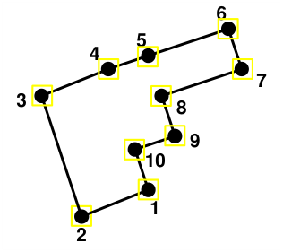

Remarques :

L'emplacement de tous les points le long des lignes de construction peut être visualisé en réglant le paramètre View > Render > Cline dot radius.

Avant d'utiliser ce mode d'accrochage par suivi, les lignes de construction doivent être nettoyées avec la fonction CAD > Pack and Renumber Clines.

La fonction CAD > Edit > Smooth Construction Lines peut aussi aider à nettoyer les lignes de construction.

## 5.5.2.10 Fenêtre de points

Sélectionne des coins à l'aide d'une fenêtre.

Ce mode d'accrochage peut servir de méthode rapide pour construire des DDLoops ( CAD > Build > DDLoop), des FFLoops ( CAD > Build > FFLoop), des tunnels ( CAD > Build > Tunnel), des CLines ( CAD >

Build > CLines) et des GLines ( CAD > Build > GLines).

Bien que ce mode d'accrochage soit le plus souvent utilisé pour sélectionner plusieurs points le long de CLines, les coins peuvent se situer sur tous les types d'éléments, y compris : éléments FF, éléments DD, GPlanes, GLines et CLines.

- Video Demo of FFLoop Model Building

- Video Demo of DDLoop model buiding

- Video Demo of Model_Simplification_Using_Slicing

Dans la figure ci-dessus, si vous sélectionnez un ou plusieurs points avant de sélectionner une fenêtre, les points de la fenêtre seront ajoutés aux points existants, en commençant par le point précédemment sélectionné le plus proche. Par exemple, si vous sélectionniez le point 3 avant de sélectionner une fenêtre, puis utilisiez une fenêtre incluant les points 4, 5 et 6, ces points seraient ajoutés dans cet ordre.

Par ailleurs, si vous sélectionniez le point 3 avant de sélectionner une fenêtre, puis utilisiez une fenêtre incluant les points 1, 2 et 10, ces points seraient ajoutés dans l'ordre 2, 1 puis 10.

Dans la figure ci-dessus, si vous ne sélectionnez aucun point avant de sélectionner une fenêtre, les points de la fenêtre seront sélectionnés en partant d'emplacements aussi éloignés que possible.

Par exemple, si vous sélectionniez une fenêtre englobant tous les points, comme les points 2 et 6 sont les plus éloignés, les points seraient sélectionnés dans l'ordre 2, 3, 4, 5, 6, 7, 8, 9, 10, 1, 2.

Comme cet exemple forme une boucle fermée, les points sont sélectionnés en conséquence.

CAD > Build > DDLoop).

Cela forme une boucle adaptée à la construction d'un DDLoop (

Dans la figure ci-dessus, si vous sélectionnez le point 1 avant de sélectionner une fenêtre, puis utilisez une fenêtre incluant tous les points, tous les points seront sélectionnés comme indiqué : 1, 2, 3, 4, 5, 6, 7, 8, 9, 10, 11, 1, 12, 13, 14, 15, 16, 17, 18, 19, 20, 21, 22, 12.

Cela forme deux boucles adaptées à la construction d'un FFLoop ( CAD > Build > FFLoop). Par ailleurs, si vous sélectionniez le point 3 avant de sélectionner une fenêtre, puis utilisiez une fenêtre incluant les points 1, 2 et 10, ces points seraient ajoutés dans l'ordre 2, 1 puis 10.

Remarques :

L'emplacement de tous les points le long des lignes de construction peut être visualisé en réglant le paramètre View > Render > Cline dot radius.

Avant d'utiliser ce mode d'accrochage par suivi, les lignes de construction doivent être nettoyées avec la fonction CAD > Pack and Renumber Clines.

La fonction CAD > Edit > Smooth Construction Lines peut aussi aider à nettoyer les lignes de construction.

## 5.5.2.11 Accrochage à la grille rectangulaire

S'accroche à une grille rectangulaire. Aucune boîte de sélection n'est affichée à l'intersection du réticule du curseur.

Tout déplacement du curseur sera contraint aux points de la grille.

La grille peut être orientée dans les plans X-Y, Y-Z ou X-Z, avec l'espacement et l'emplacement souhaités. Pour régler ces paramètres, utilisez

CAD > Snap > Cursor/Grid Setup règle l'espacement et l'orientation du curseur/de la grille.

Pour un exemple d'utilisation du mode d'accrochage à la grille dans la construction de modèles, voir

Freehand Sketching - Room and Pillar.

## 5.5.2.12 Accrochage à la grille circulaire

S'accroche à une grille cylindrique. Aucune boîte de sélection n'est affichée à l'intersection du réticule du curseur.

Tout déplacement du curseur sera contraint aux points de la grille.

La grille peut être orientée dans les plans X-Y, Y-Z ou X-Z, avec l'espacement et l'emplacement souhaités. Pour régler ces paramètres, utilisez

CAD > Snap > Cursor/Grid Setup règle l'espacement et l'orientation du curseur/de la grille.

## 5.5.2.13 Accrochage à la grille X

S'accroche à un espacement de grille en x.

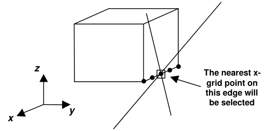

Si la boîte de sélection est située sur le coin d'une entité, ce coin sera sélectionné.

Sinon, le point le plus proche, à l'espacement de grille en x, de l'arête la plus proche sera sélectionné.

La boîte de sélection doit être située sur une entité ou une ligne de construction.

Les valeurs de la coordonnée x étant contraintes à l'espacement de grille X prescrit, les valeurs des coordonnées y et z sont calculées à partir de l'équation de la ligne sélectionnée.

L'espacement et l'emplacement de la grille se définissent en cliquant une seconde fois sur le bouton X-Grid Snap ou en utilisant

CAD > Snap > Cursor/Grid Setup règle l'espacement et l'orientation du curseur/de la grille.

L'accrochage à la grille X peut être utilisé avec l'un des modes suivants :

CAD > Snap > None Désactive l'accrochage.

CAD > Snap > Edge S'accroche à l'arête la plus proche.

CAD > Snap > Tangent Snap Force le curseur à rester tangent à l'arête sélectionnée.

## 5.5.2.14 Accrochage à la grille Y

S'accroche à un espacement de grille en y.

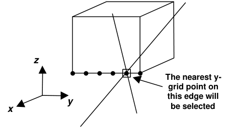

Si la boîte de sélection est située sur le coin d'une entité, ce coin sera sélectionné.

Sinon, le point le plus proche, à l'espacement de grille en y, de l'arête la plus proche sera sélectionné.

La boîte de sélection doit être située sur une entité ou une ligne de construction.

Les valeurs de la coordonnée y étant contraintes à l'espacement de grille en y prescrit, les valeurs des coordonnées x et z sont calculées à partir de l'équation de la ligne sélectionnée.

L'espacement et l'emplacement de la grille se définissent en cliquant une seconde fois sur le bouton Y-Grid Snap ou en utilisant

CAD > Snap > Cursor/Grid Setup règle l'espacement et l'orientation du curseur/de la grille.

L'accrochage à la grille Y peut être utilisé avec l'un des modes suivants :

CAD > Snap > None Désactive l'accrochage.

CAD > Snap > Edge S'accroche à l'arête la plus proche.

CAD > Snap > Tangent Snap Force le curseur à rester tangent à l'arête sélectionnée.

## 5.5.2.15 Accrochage à la grille Z

S'accroche à un espacement de grille en z.

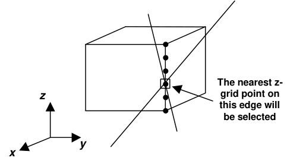

Si la boîte de sélection est située sur le coin d'une entité, ce coin sera sélectionné.

Sinon, le point le plus proche, à l'espacement de grille en y, de l'arête la plus proche sera sélectionné.

La boîte de sélection doit être située sur une entité ou une ligne de construction.

Les valeurs de la coordonnée z étant contraintes à l'espacement de grille Z prescrit, les valeurs des coordonnées x et y sont calculées à partir de l'équation de la ligne sélectionnée.

L'espacement et l'emplacement de la grille se définissent en cliquant une seconde fois sur le bouton Z-Grid Snap ou en utilisant

CAD > Snap > Cursor/Grid Setup règle l'espacement et l'orientation du curseur/de la grille.

L'accrochage à la grille Z peut être utilisé avec l'un des modes suivants :

CAD > Snap > None Désactive l'accrochage.

CAD > Snap > Edge S'accroche à l'arête la plus proche.

CAD > Snap > Tangent Snap Force le curseur à rester tangent à l'arête sélectionnée.

## 5.5.2.16 Configuration du curseur/de la grille

Règle l'emplacement, l'espacement et l'orientation du curseur/de la grille.

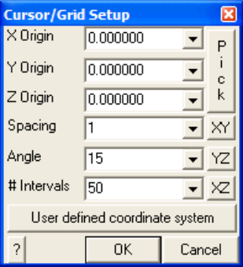

X, Y and Z Origin - spécifie les coordonnées du centre de la grille.

Pick - active le réticule du curseur pour sélectionner de façon interactive la base du curseur/de la grille à partir du

modèle.

Spacing - spécifie la distance entre les points de la grille.

Angle - spécifie l'angle (en degrés) entre les rayons de la grille cylindrique.

#### Intervals - spécifie le nombre de points de grille qui seront affichés.

CAD > Snap > XY Cursor - contraint le réticule du curseur et la grille d'accrochage au plan X-Y.

CAD > Snap > YZ Cursor - contraint le réticule du curseur et la grille d'accrochage au plan Y-Z.

CAD > Snap > XZ Cursor - contraint le réticule du curseur et la grille d'accrochage au plan X-Z.

CAD > Snap > User defined Cursor - contraint le réticule du curseur et la grille d'accrochage au plan défini par l'utilisateur.

Le système de coordonnées défini par l'utilisateur n'est actif qu'avec l'accrochage à la grille rectangulaire et circulaire ( CAD > Snap > Grid Snap et CAD > Snap > Cylinder Snap).

Le plan défini par l'utilisateur est spécifié par son pendage (j), sa direction de pendage (J) et son pitch (a), de sorte que :

- Pnt on X - L'axe x local ( _x'_ ) est défini le long de la direction du plan. Un point de cet axe peut être sélectionné avec cette fonction.

- Pnt on Y - L'axe y local ( _y'_ ) est défini selon la ligne de plus grande pente. Un point de cet axe peut être sélectionné avec cette fonction.

- L'axe z local est perpendiculaire au plan.

- Norm - active le curseur pour sélectionner de façon interactive une surface à laquelle rendre parallèle le plan UCS local. Le pendage et la direction de pendage du plan seront réglés normalement à la surface sélectionnée.

- Rake - permet la rotation de X' autour de l'axe z local.

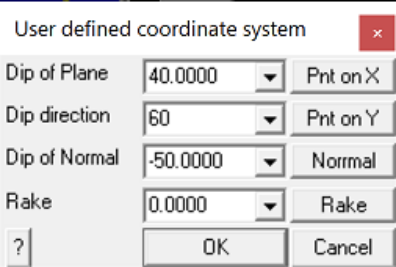

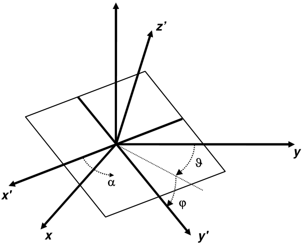

Pour un exemple d'utilisation du mode d'accrochage à la grille dans la construction de modèles, voir Freehand Sketching - Room and Pillar.
