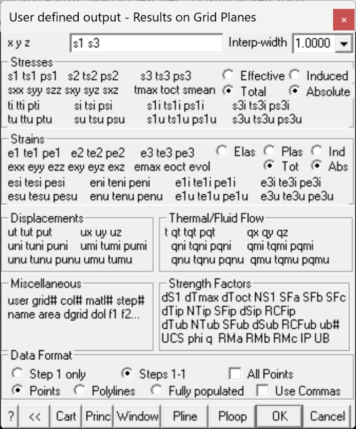
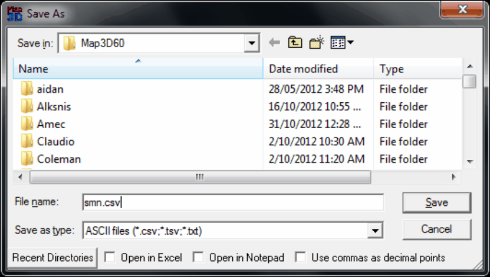
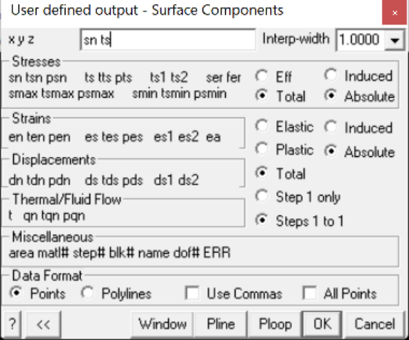
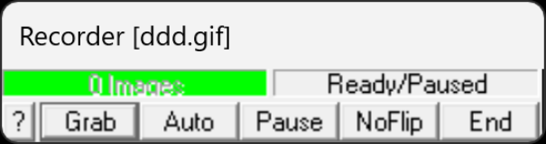

## 5.1.23.1 Copier l'écran dans le presse-papiers

Envoie une image bitmap de l'écran dans le presse-papiers de Windows. Cette image peut être collée dans d'autres applications.

Comme le fond d'écran est normalement noir et les contours des éléments blancs, vous pouvez souhaiter sélectionner

File > Output > Copy Screen (B&W flipped)

pour intervertir ces deux couleurs.

## 5.1.23.2 Copier l'écran (N&B inversé)

Envoie une image bitmap de l'écran vers un fichier PNG (Portable Network Graphics - *.PNG), GIF (Compuserve Graphics Interchange Format) ou BMP (bitmap indépendant du périphérique de Windows *.BMP), les couleurs du fond d'écran et des contours des éléments étant intervertis. Ce fichier peut être chargé dans d'autres logiciels pour la présentation et l'impression de rapports.

Pour plus de détails, voir

File > Output > PNG, GIF or BMP image

## 5.1.23.3 Image d'écran PNG, GIF, JPEG, BMP ou TIFF

Envoie une image bitmap de l'écran vers un fichier PNG (Portable Network Graphics - *.PNG), GIF (CompuServe Graphics Interchange Format), BMP (bitmap indépendant du périphérique de Windows *.BMP) ou TIFF (tagged image file format). Ce fichier peut être chargé dans d'autres logiciels pour la présentation et l'impression de rapports.

Comme le fond d'écran est normalement noir et les contours des éléments blancs, vous pouvez souhaiter sélectionner

File > Output > PNG, GIF, JPEG, BMP or TIFF (B&W flipped)

pour intervertir ces deux couleurs.

Ces fichiers peuvent être affichés avec File > Image Viewer

Le format BMP est un format de fichier graphique très répandu (la plupart des navigateurs web, traitements de texte et programmes de dessin). Son principal avantage est de prendre en charge toutes les couleurs affichées. Malheureusement, comme il n'y a pas de compression, ces fichiers peuvent être très volumineux (1 Mo ou plus chacun).

Le format PNG est un format de fichier graphique très répandu (la plupart des navigateurs web, traitements de texte et programmes de dessin). Ses principaux avantages sont une excellente compression sans perte (normalement 1 % de la taille d'un fichier BMP) et la prise en charge de toutes les couleurs affichées. Pour les détails sur l'animation, voir File > Output > Image Recorder.

Le format GIF est le format de fichier graphique le plus largement pris en charge. Ses principaux avantages sont une excellente compression sans perte (normalement 1 % de la taille d'un fichier BMP) et la capacité d'animation. Malheureusement, GIF ne prend en charge que 256 couleurs d'affichage. Selon ce qui est affiché, Map3D peut utiliser jusqu'à 512 couleurs ; le GIF peut donc ne pas reproduire les images d'écran dans toutes leurs couleurs

Le format GIF a été mis en œuvre selon la spécification Version 89a ©1987,1988,1989,1990 Copyright CompuServe Incorporated, Columbus, Ohio.

Ce logiciel utilise la bibliothèque d'images open source FreeImage. Voir [http://freeimage.sourceforge.net](http://freeimage.sourceforge.net) pour plus de détails. FreeImage est utilisée sous la licence (GNU GPL ou FIPL), version (version de la licence).

## 5.1.23.4 PNG, GIF, JPEG, BMP ou TIFF (N&B inversé)

Envoie une image bitmap de l'écran vers un fichier PNG (Portable Network Graphics - *.PNG), GIF (Compuserve Graphics Interchange Format) ou BMP (bitmap indépendant du périphérique de Windows *.BMP), les couleurs du fond d'écran et des contours des éléments étant intervertis. Ce fichier peut être chargé dans d'autres logiciels pour la présentation et l'impression de rapports.

Pour plus de détails, voir

File > Output > PNG, JPEG, GIF, BMP or TIFF image

## 5.1.23.5 Image d'écran DXF

Envoie une image d'écran vers un fichier (*.DXF) au format d'échange de dessins AutoCAD. C'est un format vectoriel qui peut être importé dans de nombreux logiciels pour un rendu ultérieur.

## 5.1.23.6 Image d'écran PNT

Envoie une image d'écran vers un fichier (*.PNT), fichier de données ASCII universel portant l'extension « .PNT ». Le format PNT est utile pour échanger des données brutes de modèle avec d'autres logiciels de CAO. C'est un format vectoriel qui peut être importé dans de nombreux logiciels pour un rendu ultérieur.

## 5.1.23.7 Image d'écran OBJ

Envoie une image d'écran vers un fichier (*.OBJ) au format Wavefront. C'est utile pour échanger des données de modèle avec d'autres logiciels de CAO et de modélisation en réalité virtuelle. C'est un format vectoriel qui peut être importé dans de nombreux logiciels pour un rendu ultérieur.

## 5.1.23.8 Image d'écran WRL

Envoie une image d'écran vers un fichier (*.WRL) au format VRML. Le VRML est utile pour échanger des données de modèle avec d'autres logiciels de CAO et de modélisation en réalité virtuelle. C'est un format vectoriel qui peut être importé dans de nombreux logiciels pour un rendu ultérieur.

## 5.1.23.9 Image d'écran 3D-PDF

Envoie une image d'écran vers un fichier au format PDF (3D). Un PDF 3D peut être consulté en 3D complète avec Adobe Reader.

## 5.1.23.10 Composantes de grille sélectionnées

Exporte les composantes de grille sélectionnées vers un fichier texte (*.txt) dans un format contrôlé par l'utilisateur.

Par défaut, tous les points de toutes les grilles sont exportés. Si vous souhaitez n'exporter qu'un ensemble sélectionné de points, utilisez la fonction de fenêtre définie ci-dessous.

Une fois les données souhaitées sélectionnées et OK pressé, un nom de fichier vous est demandé pour enregistrer les données. Vous pouvez choisir CSV (données séparées/délimitées par des virgules), TSV (données séparées/délimitées par des tabulations) ou TXT (données séparées/délimitées par des espaces). Vous pouvez aussi demander l'ouverture automatique du fichier dans Excel ou le Bloc-notes (Notepad). Notez qu'il ne faut pas utiliser de fichiers CSV avec des virgules comme séparateur décimal.

#### Stresses:

s1 ts1 ps1 contrainte principale majeure s1, sa direction et son plongement.

s2 ts2 ps2 contrainte principale intermédiaire s2, sa direction et son plongement.

s3 ts3 ps3 contrainte principale mineure s3, sa direction et son plongement. sxx syy szz sxy syz sxz composantes cartésiennes de la contrainte. tmax contrainte de cisaillement maximale tmax = ½ ( s1 - s3 ) toct contrainte de cisaillement octaédrique toct = ¹/3 [( s1 - s2 )² + ( s2 - s3 )² +( s3 - s1 )²]½ smean contrainte moyenne smean = ¹/3 ( s1 + s2 + s3 )

ti tti pti contrainte de cisaillement maximale dans le plan de la grille, sa direction et son plongement. si tsi psi contrainte normale dans le plan de la grille, sa direction et son plongement. s1i ts1i ps1i contrainte maximale tangente au plan de la grille, sa direction et son plongement. s3i ts3i ps3i contrainte minimale tangente au plan de la grille, sa direction et son plongement. tu ttu ptu contrainte de cisaillement maximale dans le plan ubiquiste, sa direction et son plongement. su tsu psu contrainte normale au plan ubiquiste, sa direction et son plongement. s1u ts1u ps1u contrainte maximale tangente au plan ubiquiste, sa direction et son plongement. s3u ts3u ps3u contrainte minimale tangente au plan ubiquiste, sa direction et son plongement. L'orientation du plan ubiquiste est spécifiée dans

Plot > Strength Factors > Ubiquitous Parameters

Effective/Total composantes de la contrainte effective ou de la contrainte totale. Ces options ne sont utilisées que dans Map3D Thermal-Fluid Flow, car ce code permet de calculer les distributions de pression interstitielle en régime permanent. Induced/Absolute La contrainte induite est la contrainte sans la contribution de la contrainte antérieure à l'exploitation. Elle représente la variation de contrainte depuis l'état antérieur à l'exploitation. La contrainte absolue est la contrainte incluant la contribution de la contrainte antérieure à l'exploitation.

#### Strains:

e1 te1 pe1 déformation principale majeure e1, sa direction et son plongement. e2 te2 pe2 déformation principale intermédiaire e2, sa direction et son plongement.

e3 te3 pe3 déformation principale mineure e3, sa direction et son plongement. exx eyy ezz exy eyz exz composantes cartésiennes de la déformation. emax déformation de cisaillement maximale emax = ½ ( e1 - e3 ) eoct déformation de cisaillement octaédrique eoct = ¹/3 [( e1 - e2 )² + ( e2 - e3 )² +( e3 - e1 )²]½ evol déformation volumique evol = ( e1 + e2 + e3 ) esi tesi pesi déformation de cisaillement maximale dans le plan de la grille, sa direction et son plongement. eni teni peni déformation normale dans le plan de la grille, sa direction et son plongement. e1i te1i pe1i déformation maximale tangente au plan de la grille, sa direction et son plongement. e3i te3i pe3i déformation minimale tangente au plan de la grille, sa direction et son plongement. esu tesu pesu déformation de cisaillement maximale dans le plan ubiquiste, sa direction et son plongement. enu tenu penu déformation normale au plan ubiquiste, sa direction et son plongement. e1u te1u pe1u déformation maximale tangente au plan ubiquiste, sa direction et son plongement. e3u te3u pe3u déformation minimale tangente au plan ubiquiste, sa direction et son plongement. Elastic/Plastic/Total composantes de la déformation élastique, plastique ou totale. Ces options ne sont utilisées que dans Map3D Non-Linear, car ce code permet de calculer les déformations non linéaires. Induced/Absolute La déformation induite est la déformation sans la contribution antérieure à l'exploitation. Elle représente la variation de déformation depuis l'état antérieur à l'exploitation. La déformation absolue est la déformation incluant la contribution de la déformation antérieure à l'exploitation.

#### Displacements:

ut tut put déplacement total, sa direction et son plongement. ux uy uz composantes cartésiennes du déplacement. uni tuni puni déplacement normal au plan de la grille, sa direction et son plongement. umi tumi pumi déplacement maximal tangent au plan de la grille, sa direction et son plongement. unu tunu punu déplacement normal au plan ubiquiste, sa direction et son plongement. umu tumu pumu déplacement maximal tangent au plan ubiquiste, sa direction et son plongement.

#### Flow:

t température/charge hydraulique.

qt tqt pqt flux total, sa direction et son plongement. qx qy qz composantes cartésiennes du flux. qni tqni pqni déplacement normal au plan de la grille, sa direction et son plongement. qmi tqmi pqmi déplacement maximal tangent au plan de la grille, sa direction et son plongement. qnu tqnu pqnu déplacement normal au plan ubiquiste, sa direction et son plongement. qmu tqmu pqmu déplacement maximal tangent au plan ubiquiste, sa direction et son plongement.

#### Strength:

- ds1 contrainte principale majeure excédentaire Ds1 = s1 - ( _UCS_ + _q_ s3 )

- dtmax contrainte de cisaillement maximale excédentaire Dtmax = ½(s1 - s3) - [ _UCS_ + ½(s1+s3) ( _q_ -1) ]/( _q_ +1) = [s1 - ( _UCS_ + _q_ s3) ]/( _q_ +1)

- dtoct contrainte de cisaillement octaédrique excédentaire Dtoct = toct - [ _UCS_ + ( _q_ –1) smean ] Ö(2) /( _q_ +2)

- NS1 probabilité selon la loi normale N(Ds1 /std)

- SFA Résistance/Contrainte peut être déterminé comme ( _UCS_ + _q_ s3 )/ s1

- SFB Résistance/Contrainte peut être déterminé comme ( _UCS_ + _q_ s3 - s3 )/(s1 - s3)

- SFC Résistance/Contrainte peut être déterminé comme [ _UCS_ + ½(s1+s3) ( _q_ -1) ]/[ ½(s1 - s3)( _q_ +1) ]

- dTip contrainte de cisaillement excédentaire dans le plan Dtip = tip - [ Cohesion + sip tan(j) ]

- NTip probabilité selon la loi normale N(Dtip /std)

- SFip Résistance/Contrainte peut être déterminé comme [ Cohesion + sip tan(j) ] / tip

- dSip contrainte excédentaire sur la paroi dans le plan Dsip = [ 3 s1i - s3i ] - UCS

- RCFip facteur d'état de la roche (Rock Condition Factor) pour la contrainte sur la paroi dans le plan RCFip = [ 3 s1i - s3i ]/UCS

- dTub contrainte de cisaillement excédentaire dans le plan ubiquiste Dtub

- NTub probabilité selon la loi normale N(Dtub /std)

- SFub Résistance/Contrainte peut être déterminé comme [ Cohesion + sub tan(j) ] / tub

- dSub contrainte excédentaire sur la paroi dans le plan ub Dsub = [ 3 s1ub - s3ub ] - UCS

- RCFub facteur d'état de la roche pour la contrainte sur la paroi dans le plan ub RCFip = [ 3 s1ub - s3ub ]/UCS

- UB# Trace le numéro du système UB (1, 2 ou 3) qui présente la plus grande valeur de Dtub

- _UCS phi q_ Paramètres de résistance de Mohr-Coulomb définis avec Plot > Strength Factors > Rockmass Strength Parameters ; notez que ces paramètres ne sont définis que si vous avez spécifié le critère de résistance de Mohr-Coulomb ou de Druker-Prager

- _sc_ Paramètre de résistance de Hoek-Brown défini avec Plot > Strength Factors > Rockmass Strength Parameters ; notez que ce paramètre n'est défini que si vous avez spécifié le critère de résistance de Hoek-Brown

#### Miscellaneous:

user Valeur définie par l'utilisateur.

grid# le numéro de la grille où se trouve le point. matl# le numéro du matériau dans lequel se trouve le point. Le matériau encaissant (host) est le matériau numéro 1. Dans les problèmes où plusieurs matériaux sont utilisés, les résultats peuvent être calculés dans une zone de matériau alterné.

step# le numéro de l'étape d'exploitation. name le nom de la grille. area l'aire de la maille de grille adjacente au point sélectionné. dgrid distance à la surface la plus proche depuis chaque point de grille. dol distance à la grille la plus proche _Dgrid_ divisée par l'espacement de grille _Lgrid_ . f1 f2... paramètres de matériau définis par l'utilisateur. Ils peuvent être définis avec Plot > Properties > Material Properties > User defined Parameters.

#### Data Format:

Les données de points seront écrites sous forme d'une série de points, avec un point par ligne :

- x1 y1 z1 values1 x2 y2 z2 values2 x3 y3 z3 values3 x4 y4 z4 values4

où xi yi zi représentent les coordonnées de chaque point,

valuesi représente les valeurs de la liste des composantes sélectionnées par l'utilisateur en chaque point. Les valeurs définies par l'utilisateur seront listées sous forme de ligne de commentaire (c'est-à-dire une ligne commençant par un astérisque « * ») au début du fichier.

Les données de polylignes seront écrites sous forme d'une série de polylignes au format de fichier PNT

- x1 y1 z1 3 values1 x2 y2 z2 2 values2 x3 y3 z3 2 values3 x4 y4 z4 2 values4

où xi yi zi représentent les coordonnées de chaque point,

- 3 indique que ce point est le début d'une nouvelle ligne,

- 2 indique que ce point est la continuation de la même ligne,

valuesi représente les valeurs de la liste des composantes sélectionnées par l'utilisateur à chaque coin de la polyligne. Les valeurs définies par l'utilisateur seront listées sous forme de ligne de commentaire (c'est-à-dire une ligne commençant par un astérisque « * ») au début du fichier.

Fully Populated : les données seront écrites de manière que toutes se trouvent sur une grille de taille régulière.

Use Commas : les données seront écrites avec des virgules à la place des points décimaux.

#### Other:

&lt;&lt;    pour réduire la boîte de dialogue à une petite taille

>>    pour agrandir la boîte de dialogue à une grande taille Cartesian   configure la sortie des composantes cartésiennes de la contrainte. Principal   configure la sortie des composantes de contrainte principale. Window   active une fenêtre de sélection graphique.

- Vous serez invité à sélectionner les deux coins de la fenêtre en cliquant une fois sur chacun.

- Seuls les points de grille contenus dans la fenêtre seront inclus dans l'export.

- Si vous n'utilisez pas cette fonction, tous les points de toutes les grilles sont exportés.

- Pour voir l'emplacement réel des points de contour, activez l'affichage des trajectoires (Plot > Options > Trajectories). Les points de contour sont situés là où les trajectoires sont dessinées.

Polyline   active un polygone de sélection graphique. Vous serez invité à sélectionner une série de coins pour définir un polygone, en cliquant une fois sur chacun :

- Vous devez maintenir la touche Shift enfoncée pendant la sélection de ces points.

- Si vous définissez une forme polygonale fermée, les points de contour situés à l'intérieur du polygone seront inclus.

- Si vous définissez une forme polygonale ouverte, une série de points le long de la polyligne sera incluse.

- Pour voir l'emplacement réel des points de contour, activez l'affichage des trajectoires (Plot > Options > Trajectories). Les points de contour sont situés là où les trajectoires sont dessinées.

- Des fenêtres rectangulaires simples peuvent être définies en maintenant la touche Shift enfoncée et en faisant glisser pour ouvrir une fenêtre (comme avec le bouton Window).

## 5.1.23.11 Composantes de surface sélectionnées

Exporte les composantes de surface sélectionnées vers un fichier texte (*.txt) dans un format contrôlé par l'utilisateur.

Par défaut, tous les points de toutes les surfaces sont exportés. Si vous souhaitez n'exporter qu'un ensemble sélectionné de points, utilisez la fonction de fenêtre définie ci-dessous.

Une fois les données souhaitées sélectionnées et OK pressé, un nom de fichier vous est demandé pour enregistrer les données. Vous pouvez choisir CSV (données séparées/délimitées par des virgules), TSV (données séparées/délimitées par des tabulations) ou TXT (données séparées/délimitées par des espaces).

Vous pouvez aussi demander l'ouverture automatique du fichier dans Excel ou le Bloc-notes (Notepad). Notez qu'il ne faut pas utiliser de fichiers CSV avec des virgules comme séparateur décimal.

#### Stresses:

sn tsn psn contrainte normale à la surface, sa direction et son plongement.

ts tts pts contrainte de cisaillement maximale dans le plan de la surface, sa direction et son plongement. ts1 ts2   composantes de la contrainte de cisaillement dans le plan de la surface. ts1 est parallèle au premier côté (c'est-à-dire le côté défini par x1 y1 z1 – x2 y2 z2). ts2 est perpendiculaire à ts1 dans la direction du second côté (c'est-à-dire le côté défini par x2 y2 z2 – x3 y3 z3).

ser erreur de contrainte de surface. Les solveurs itératifs fonctionnent en déterminant l'erreur de la solution courante de chaque équation simultanée, puis en réduisant ces erreurs par un processus d'approximations successives. Ce paramètre indique l'erreur de chacune des équations.

fer erreur du critère de rupture. Ce paramètre n'est utilisé que pour les analyses de fluage non linéaires (y compris le glissement de failles et la non-linéarité des matériaux 3D). Ce paramètre doit toujours être proche de zéro, sauf si une certaine viscosité a été spécifiée et que le problème devient non linéaire. Dans ce dernier cas, le fluage visqueux peut permettre des états de contraintes supérieurs au critère de rupture, ce qui indique un manque d'équilibre statique. Ce paramètre indique la contrainte visqueuse de chacune des équations.

smax tsmax psmax contrainte tangentielle maximale, sa direction et son plongement. smin tsmin psmin contrainte tangentielle minimale, sa direction et son plongement. Effective/Total – composantes de la contrainte effective ou de la contrainte totale. Ces options ne sont utilisées que dans Map3D Thermal-Fluid Flow, car ce code permet de calculer les distributions de pression interstitielle en régime permanent.

#### Strains:

en ten pen déformation dans la direction normale à la surface, sa direction et son plongement. Ce paramètre n'est utilisé que pour les plans DD et se calcule comme le déplacement normal (convergence) divisé par l'épaisseur. es tes pes déformation de cisaillement maximale dans le plan de la surface, sa direction et son plongement. Ce paramètre n'est utilisé que pour les plans DD et se calcule comme le déplacement de cisaillement (ride) divisé par l'épaisseur. es1 es2   composantes de la déformation de cisaillement dans le plan de la surface. es1 est parallèle au premier côté (c'est-à-dire le côté défini par x1 y1 z1 – x2 y2 z2). es2 est perpendiculaire à es1 dans la direction du second côté (c'est-à-dire le côté défini par x2 y2 z2 – x3 y3 z3).

#### Displacements:

dn tdn pdn déplacement normal (convergence) dans la direction normale à la surface, sa direction et son plongement. Ce paramètre n'est utilisé que pour les plans DD. Notez que la valeur élastique, plastique ou totale peut être spécifiée.

ds tds pds déplacement de cisaillement maximal (ride) dans le plan de la surface, sa direction et son plongement. Ce paramètre n'est utilisé que pour les plans DD. Notez que la valeur élastique, plastique ou totale peut être spécifiée.

ds1 ds2   composantes du déplacement de cisaillement (ride) dans le plan de la surface. ds1 est parallèle au premier côté (c'est-à-dire le côté défini par x1 y1 z1 – x2 y2 z2). ds2 est perpendiculaire à ds1 dans la direction du second côté (c'est-à-dire le côté défini par x2 y2 z2 – x3 y3 z3). Elastic/Plastic/Total composantes de la déformation/du déplacement élastique, plastique ou total. Ces options ne sont utilisées que pour les plans DD.

#### Miscellaneous:

area   l'aire de la surface. matl# le numéro du matériau affecté à la surface. step# le numéro de l'étape d'exploitation. blk#   le numéro du bloc. name   le nom de la surface du bloc. dof#   le numéro du degré de liberté.

#### Data Format

Les données de points seront écrites sous forme d'une série de points, avec un point par ligne.

x1 y1 z1 values1 x2 y2 z2 values2 x3 y3 z3 values3 x4 y4 z4 values4

où xi yi zi représentent les coordonnées de chaque point,

valuesi représente les valeurs de la liste des composantes sélectionnées par l'utilisateur en chaque point. Les valeurs définies par l'utilisateur seront listées sous forme de ligne de commentaire (c'est-à-dire une ligne commençant par un astérisque « * ») au début du fichier.

Les données de polylignes seront écrites sous forme d'une série de polylignes au format de fichier PNT x1 y1 z1 3 values1 x2 y2 z2 2 values2 x3 y3 z3 2 values3 x4 y4 z4 2 values4

où xi yi zi représentent les coordonnées de chaque point,

3 indique que ce point est le début d'une nouvelle ligne,

2 indique que ce point est la continuation de la même ligne,

valuesi représente les valeurs de la liste des composantes sélectionnées par l'utilisateur à chaque coin de la polyligne. Les valeurs définies par l'utilisateur seront listées sous forme de ligne de commentaire (c'est-à-dire une ligne commençant par un astérisque « * ») au début du fichier.

Si l'analyse BEM linéaire (Analysis > Options > Linear) n'a pas été sélectionnée, valuesi ne sont disponibles qu'aux centres des éléments et ne seront donc fournies que pour le premier point. Si l'analyse BEM linéaire a été sélectionnée, les valeurs sont disponibles à chaque coin et seront donc fournies pour tous les points.

#### Other

&lt;&lt;    pour réduire la boîte de dialogue à une petite taille >>    pour agrandir la boîte de dialogue à une grande taille Window   active une fenêtre de sélection graphique.

- Vous serez invité à sélectionner les deux coins de la fenêtre en cliquant une fois sur chacun.

- Seuls les points de grille contenus dans la fenêtre seront inclus dans l'export.

- Si vous n'utilisez pas cette fonction, tous les points de toutes les grilles sont exportés.

- Pour voir l'emplacement réel des points de contour, activez l'affichage des trajectoires (Plot > Options > Trajectories). Les points de contour sont situés là où les trajectoires sont dessinées.

Polyline   active un polygone de sélection graphique. Vous serez invité à sélectionner une série de coins pour définir un polygone, en cliquant une fois sur chacun :

- Vous devez maintenir la touche Shift enfoncée pendant la sélection de ces points.

- Si vous définissez une forme polygonale fermée, les points de contour situés à l'intérieur du polygone seront inclus.

- Si vous définissez une forme polygonale ouverte, une série de points le long de la polyligne sera incluse.

- Pour voir l'emplacement réel des points de contour, activez l'affichage des trajectoires (Plot > Options > Trajectories). Les points de contour sont situés là où les trajectoires sont dessinées.

- Des fenêtres rectangulaires simples peuvent être définies en maintenant la touche Shift enfoncée et en faisant glisser pour ouvrir une fenêtre (comme avec le bouton Window).

Use Commas : les données seront écrites avec des virgules à la place des points décimaux.

## 5.1.23.12 Enregistreur de TIFF/GIF animé

Enregistre plusieurs images séquentielles dans des fichiers PNG, GIF, BMP ou TIFF individuels.

De nombreux programmes de présentation permettent de construire de simples animations en affichant une séquence d'images. L'enregistreur d'images de Map3D permet d'enregistrer plusieurs copies d'écran dans des fichiers PNG, GIF, BMP ou TIFF individuels.

L'enregistreur de TIFF/GIF animé enregistre plusieurs images dans un même fichier TIFF ou GIF. Ces images peuvent être lues avec une visionneuse capable d'afficher des TIFF ou GIF animés (comme Map3D Image Viewer, la plupart des navigateurs internet, la Visionneuse de photos Windows, etc.).

L'Image Recorder crée plusieurs images dans des fichiers séparés. Une fois File > Output > Image Recorder sélectionné, un nom de fichier vous est demandé pour enregistrer l'animation. Les noms des fichiers image sont générés en ajoutant le numéro de l'image au nom de fichier que vous spécifiez (p. ex. name0001.png, name0002.png, name0003.png ...).

La boîte de dialogue de l'enregistreur fournit des informations sur l'animation en cours et permet de contrôler l'enregistrement et de spécifier les options d'animation.

Le nombre actuel d'images de l'animation est affiché avec l'état de l'enregistreur. Les différents états comprennent :

Ready/Paused – le fichier d'animation est ouvert et prêt à enregistrer. Appuyez sur Grab ou Auto pour ajouter une image.

Capturing Image – une image est en cours d'ajout à l'animation.

Ready/Auto Capture - les images affichées seront automatiquement ajoutées à l'animation à mesure que vous mettez à jour l'écran.

Recorder Off – le fichier d'animation est fermé et n'est pas prêt à enregistrer.

Grab – ajoute à l'animation l'image actuellement affichée.

Auto – ajoute automatiquement à l'animation les images affichées à mesure que vous mettez à jour l'écran. Cela inclut toutes les opérations de rotation, de translation et de tracé que vous effectuez.

Pause – désactive le mode automatique.

Flipped/NoFlip – bascule l'inversion de l'arrière-plan et du premier plan (normalement noir et blanc).

End – arrête l'enregistreur et ferme le fichier d'animation.

#### Notes:

Des images supplémentaires peuvent être ajoutées à une séquence d'images existante en cochant File > Output > Image Recorder > Append Images lors de la sélection du nom de fichier de la séquence d'animation.

Les opérations de rotation et de translation peuvent être répétées automatiquement en tapant n# avant de sélectionner l'opération. Par exemple, pour produire un affichage animé d'un tracé de contraintes, indiquez ce qui suit

Plot > Options > Persist

Plot > Stress > Sigma:1

View > Rotation Increment > 10

Sélectionnez le bouton Auto

Tapez 35#

Sélectionnez la rotation vers la droite (depuis la barre d'outils de rotation ou avec la touche Page suivante).

Une série de fichiers numérotés de name001 à name036 sera créée. Ils peuvent être importés dans un logiciel de présentation pour être animés et affichés.

Les contours de contraintes qui évoluent au fil de l'exploitation peuvent être affichés en capturant une série de tracés à mesure que l'étape d'exploitation avance.
