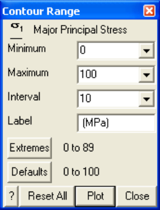

Spécifie la plage de contours (minimum, maximum, intervalle...) du contour actuellement tracé. Cette routine peut être lancée en cliquant sur le bouton ou simplement en faisant un clic droit sur n'importe quel contour.

**abe u te a**

Ci-dessus, la plage de contours est affichée en orientation horizontale. Vous pouvez passer à l'orientation verticale en cochant Plot Options > Vertical Legend.

Minimum : spécifie la valeur inférieure de la plage de contours.

Maximum : spécifie la valeur supérieure de la plage de contours.

Interval : spécifie l'intervalle des contours. L'intervalle peut être supérieur à 1/10 du maximum moins le minimum, mais pas inférieur.

Label : spécifie l'étiquette du contour.

Extremes : indique les extrêmes inférieur et supérieur détectés pour ce paramètre. Ce bouton règle la plage de contours sur ces valeurs.

Defaults : indique la plage de contours inférieure et supérieure par défaut pour ce paramètre. Ce bouton règle la plage de contours sur ces valeurs.

Reset All : rétablit les valeurs par défaut des plages de tous les paramètres de tracé.

Plot : régénère le tracé des contours.

Le minimum de la plage de contours n'a pas nécessairement à être inférieur au maximum. Par exemple, pour le tracé des facteurs de résistance, il peut être souhaitable de fixer le minimum à 2 et le maximum à 1, afin que les facteurs de résistance proches de un apparaissent en rouge.
