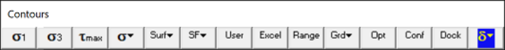
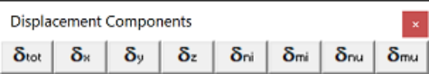
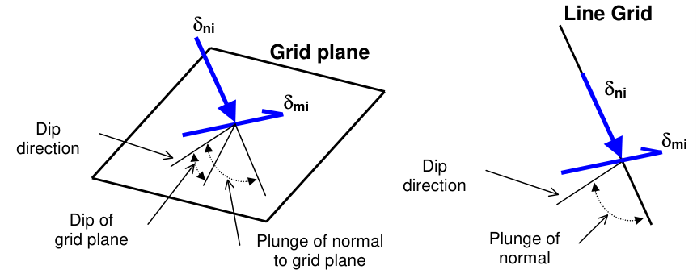
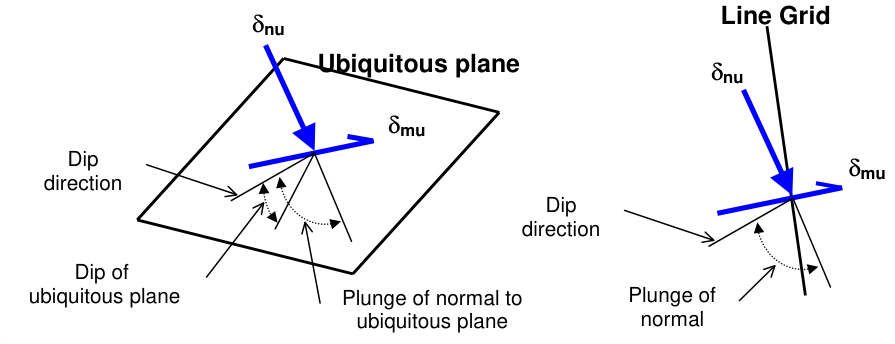

## 5.3.3.1 Déplacement total

Trace les contours des déplacements.

Ces composantes sont accessibles via la barre d'outils Displacement Components, comme suit :

Cette barre d'outils peut passer à l'orientation verticale en la faisant glisser contre le bord droit ou gauche de la fenêtre principale.

Elle peut revenir à l'orientation horizontale en la faisant glisser contre le bord supérieur ou inférieur de la fenêtre principale.

Sélectionner le bouton de la barre d'outils Contours active la barre d'outils Displacement Components. Vous pouvez ajouter ce bouton à la barre d'outils Contours avec le bouton de configuration.

Cette barre d'outils donne un accès rapide aux composantes du déplacement.

Plot > Displacement > dtotal = ( dx² + dy² + dz² )½ Déplacement total   trace les contours du déplacement total Plot > Displacement > dx Déplacement X   trace les contours de la composante x du déplacement Plot > Displacement > dy Déplacement Y   trace les contours de la composante y du déplacement Plot > Displacement > dz Déplacement Z   trace les contours de la composante z du déplacement

Pour calculer les déplacements dans le plan, l'état de déplacement en chaque point du plan de grille est réorienté afin de déterminer le déplacement maximal parallèle au plan de grille et le déplacement normal au plan. Notez que dni est orienté normalement au plan de grille et parallèlement à la direction d'une grille linéaire.

Plot > Displacement > dni Normale dans le plan   trace les contours de la composante du déplacement normale au plan de grille.

Plot > Displacement > dmi Maximum dans le plan   trace les contours du déplacement maximal tangent au plan de grille.

Pour calculer les déplacements du plan ubiquiste n° 1, l'état de déplacement en chaque point du plan de grille est réorienté afin de déterminer le déplacement maximal parallèle au plan ubiquiste n° 1 et le déplacement normal au plan. Notez que dmi n'est pas orienté normalement au plan de grille.

Plot > Displacement > dnu Normale au plan ubiquiste   trace les contours de la composante du déplacement normale au plan ubiquiste.

Plot > Displacement > dmu Maximum dans le plan ubiquiste   trace les contours du déplacement maximal tangent au plan ubiquiste.

- la direction de pendage est mesurée positivement dans le sens horaire à partir de l'axe y.

- le pendage du plan est mesuré positivement vers le bas à partir de l'horizontale (c'est-à-dire la direction de pendage).

- le plongement de la normale est mesuré positivement vers le bas (c'est-à-dire négativement vers le haut) à partir de l'horizontale.

Remarques :

La barre d'outils de déplacement ne peut être activée qu'après l'étape de construction du modèle (CAD)

Étapes d'analyse de Map3D.

L'orientation du plan de cisaillement ubiquiste se définit avec

Plot > Strength Factors > Ubiquitous Parameters

La plage de contours se définit avec

#### Plot > Range

Cette composante peut être ajoutée à la barre d'outils des contours si vous le souhaitez

Tools > Configure Contouring Toolbar > Displacement

Il peut être pratique d'ajouter le bouton

More Displacement Components

à la barre d'outils des contours pour accéder rapidement à toutes les composantes du déplacement.
