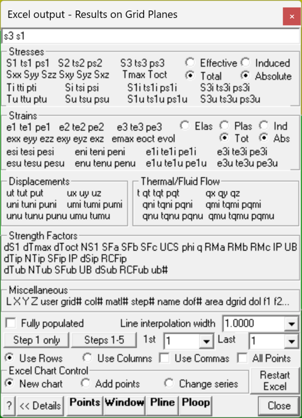

Trace dans Excel les composantes de grille spécifiées.

Vous devez tracer les contours des résultats de grille pour pouvoir les sélectionner pour le tracé Excel (p. ex. Plot > Stress > s1 Major Principal Stress).

Le premier paramètre sera utilisé comme axe x du tracé (c'est-à-dire l'abscisse). Les paramètres supplémentaires définiront les axes y du tracé (c'est-à-dire les séries ou ordonnées). Plusieurs paramètres d'axes y peuvent être spécifiés.

Deux types de tracés Excel peuvent être créés :

- des points de contour sélectionnés.

- une série de points le long d'une polyligne.

Si vous tracez « s3 s1 », « si ti » ou « su tu », Map3D fournira des informations sur la droite de meilleur ajustement (par régression linéaire), notamment :

- Ordonnée à l'origine

- Pente

- angle de frottement

- écart type

- coefficient de variation

Fully populated   Indique que tous les points de contour manquants seront générés par interpolation.

- Cette option ne s'applique qu'au tracé de points de contour sélectionnés (Points, Window et polyligne fermée).

- Cette option ne s'applique pas au tracé sur une polyligne ouverte.

- Map3D calcule les résultats sur une grille peu dense afin de gagner du temps d'analyse.

- Pour voir l'emplacement réel des points de contour, activez l'affichage des trajectoires (Plot > Options > Trajectories).

- Lorsque cette option est décochée, seuls les points de contour réels sont inclus dans le tracé.

- Lorsque cette option est cochée, tous les points de contour manquants sont inclus dans le tracé.

Line interpolation width   Spécifie l'espacement souhaité auquel les points de contour seront générés par interpolation.

- Cette option ne s'applique qu'au tracé sur une polyligne ouverte.

- Cette option ne s'applique pas au tracé de points de contour sélectionnés.

- Si Line interpolation width est réglé à zéro, seules les extrémités de la polyligne ouverte sont tracées.

- Sinon, des points sont générés le long de la polyligne par interpolation à l'espacement Line interpolation width spécifié.

Step # only   Indique que seuls les résultats de l'étape # seront exportés (# est l'étape d'exploitation chargée actuellement affichée).

Steps 1-5   Indique que les résultats de toutes les étapes seront exportés.

   - Notez que cela peut prendre beaucoup de temps pour de grands jeux de données ; vous devez donc être patient et attendre que Map3D parcoure toutes les étapes.

- 1st/Last   Indique que les résultats de toutes les étapes comprises entre la première (1st) et la dernière (Last), incluses, seront exportés.

   - Notez que cela peut prendre beaucoup de temps pour de grands jeux de données ; vous devez donc être patient et attendre que Map3D parcoure toutes les étapes.

Use Commas   Indique que les résultats exportés vers Excel utiliseront des virgules à la place des points décimaux dans le format des nombres.

Use Rows   Lors de l'exportation de plusieurs étapes d'exploitation (voir Steps 1-5 ci-dessus), les résultats apparaîtront dans des lignes cumulatives.

Use Columns   Lors de l'exportation de plusieurs étapes d'exploitation (voir Steps 1-5 ci-dessus), les résultats apparaîtront dans des colonnes cumulatives.

- Notez qu'il peut être utile de spécifier All Points afin qu'aucun point ne manque entre les lignes correspondantes.

All Points   Indique que tous les points sont exportés vers Excel, y compris les points situés à l'intérieur des excavations.

Restart Excel   Si Map3D perd la communication avec Excel, vous devez redémarrer Excel (Restart Excel) pour rétablir la communication.

Points   active la sélection graphique de points individuels.

- Le point le plus proche du point sélectionné sera tracé.

- Pour voir l'emplacement réel des points de contour, activez l'affichage des trajectoires (Plot > Options > Trajectories). Les points de contour sont situés là où les trajectoires sont dessinées.

Window   active une fenêtre de sélection rectangulaire.

- Vous serez invité à sélectionner les deux coins de la fenêtre en cliquant une fois sur chacun.

- Seuls les points de grille contenus dans la fenêtre seront inclus dans le tracé.

- Pour voir l'emplacement réel des points de contour, activez l'affichage des trajectoires (Plot > Options > Trajectories). Les points de contour sont situés là où les trajectoires sont dessinées.

Pline (open)   active un polygone de sélection graphique.

- Vous pouvez sélectionner deux points pour définir un seul segment de ligne.

- Si vous maintenez la touche Shift enfoncée, plusieurs segments de ligne peuvent être sélectionnés.

- Vous pouvez spécifier l'espacement souhaité auquel les points de contour seront générés par interpolation à l'aide du paramètre Line interpolation width.

- Il peut être utile de superposer une grille régulière aux contours (Plot > Options > Grid Lines) pour faciliter le choix de l'emplacement de la polyligne.

- Si Line interpolation width est réglé à zéro, seules les extrémités de la polyligne ouverte sont tracées.

- Si vous définissez une polyligne ouverte, une série de points le long de la polyligne sera tracée.

- Si vous définissez une forme polygonale fermée, les points de contour situés à l'intérieur du polygone seront tracés.

Pline (closed)   active un polygone de sélection graphique.

- Vous devez maintenir la touche Shift enfoncée pour pouvoir sélectionner plusieurs segments de ligne.

- Une forme polygonale fermée se définit en fermant la polyligne, c'est-à-dire en sélectionnant le point de départ.

- Si vous définissez une forme polygonale fermée, les points de contour situés à l'intérieur du polygone seront tracés.

- Si vous définissez une polyligne ouverte, une série de points le long de la polyligne sera tracée.

- Pour voir l'emplacement réel des points de contour, activez l'affichage des trajectoires (Plot > Options > Trajectories). Les points de contour sont situés là où les trajectoires sont dessinées.

Ploop (closed)   est identique à Pline (closed), sauf que la polyligne sera automatiquement fermée pour former une boucle fermée.

- Vous devez maintenir la touche Shift enfoncée pour pouvoir sélectionner plusieurs segments de ligne.

#### Excel Chart Control:

New chart - crée un nouveau graphique Excel.

Extend existing chart - ajoute des données au graphique Excel existant. Tous les paramètres de tracé doivent être identiques à ceux utilisés précédemment.

Change series - modifie ou ajoute de nouvelles séries à un graphique Excel existant. Seul le premier paramètre de tracé doit être identique. Des paramètres de tracé supplémentaires peuvent être spécifiés au besoin.

#### Stresses:

s1 ts1 ps1 contrainte principale majeure s1, sa direction et son plongement.

s2 ts2 ps2 contrainte principale intermédiaire s2, sa direction et son plongement. s3 ts3 ps3 contrainte principale mineure s3, sa direction et son plongement. sxx syy szz sxy syz sxz composantes cartésiennes de la contrainte. tmax contrainte de cisaillement maximale tmax = ½ ( s1 - s3 ) toct contrainte de cisaillement octaédrique toct = ¹/3 [( s1 - s2 )² + ( s2 - s3 )² +( s3 - s1 )²]½ smean contrainte moyenne smean = ¹/3 ( s1 + s2 + s3 ) ti tti pti contrainte de cisaillement maximale dans le plan de la grille, sa direction et son plongement. si tsi psi contrainte normale dans le plan de la grille, sa direction et son plongement. s1i ts1i ps1i contrainte maximale tangente au plan de la grille, sa direction et son plongement. s3i ts3i ps3i contrainte minimale tangente au plan de la grille, sa direction et son plongement. tu ttu ptu contrainte de cisaillement maximale dans le plan ubiquiste, sa direction et son plongement. su tsu psu contrainte normale au plan ubiquiste, sa direction et son plongement. s1u ts1u ps1u contrainte maximale tangente au plan ubiquiste, sa direction et son plongement. s3u ts3u ps3u contrainte minimale tangente au plan ubiquiste, sa direction et son plongement. L'orientation du plan ubiquiste est spécifiée dans

Plot > Strength Factors > Ubiquitous Parameters

Effective/Total composantes de la contrainte effective ou de la contrainte totale. Ces options ne sont utilisées que dans Map3D Thermal-Fluid Flow, car ce code permet de calculer les distributions de pression interstitielle en régime permanent. Induced/Absolute composantes de la contrainte induite ou de la contrainte absolue (c'est-à-dire la contrainte sans la contribution de la contrainte antérieure à l'exploitation).

#### Strains:

e1 te1 pe1 déformation principale majeure e1, sa direction et son plongement. e2 te2 pe2 déformation principale intermédiaire e2, sa direction et son plongement. e3 te3 pe3 déformation principale mineure e3, sa direction et son plongement. exx eyy ezz exy eyz exz composantes cartésiennes de la déformation. emax déformation de cisaillement maximale emax = ½ ( e1 - e3 ) eoct déformation de cisaillement octaédrique eoct = ¹/3 [( e1 - e2 )² + ( e2 - e3 )² +( e3 - e1 )²]½ evol déformation volumique evol = ( e1 + e2 + e3 ) esi tesi pesi déformation de cisaillement maximale dans le plan de la grille, sa direction et son plongement. eni teni peni déformation normale dans le plan de la grille, sa direction et son plongement. e1i te1i pe1i déformation maximale tangente au plan de la grille, sa direction et son plongement. e3i te3i pe3i déformation minimale tangente au plan de la grille, sa direction et son plongement. esu tesu pesu déformation de cisaillement maximale dans le plan ubiquiste, sa direction et son plongement. enu tenu penu déformation normale au plan ubiquiste, sa direction et son plongement. e1u te1u pe1u déformation maximale tangente au plan ubiquiste, sa direction et son plongement. e3u te3u pe3u déformation minimale tangente au plan ubiquiste, sa direction et son plongement. Elastic/Plastic/Total composantes de la déformation élastique, plastique ou totale. Ces options ne sont utilisées que dans Map3D Non-Linear, car ce code permet de calculer les déformations non linéaires. Induced/Absolute composantes de la déformation induite ou de la déformation absolue (c'est-à-dire sans la contribution de la contrainte antérieure à l'exploitation).

#### Displacements:

ut tut put déplacement total, sa direction et son plongement. ux uy uz composantes cartésiennes du déplacement. uni tuni puni déplacement normal au plan de la grille, sa direction et son plongement. umi tumi pumi déplacement maximal tangent au plan de la grille, sa direction et son plongement. unu tunu punu déplacement normal au plan ubiquiste, sa direction et son plongement. umu tumu pumu déplacement maximal tangent au plan ubiquiste, sa direction et son plongement.

#### Flow:

t température/charge hydraulique.

qt tqt pqt flux total, sa direction et son plongement. qx qy qz composantes cartésiennes du flux. qni tqni pqni déplacement normal au plan de la grille, sa direction et son plongement. qmi tqmi pqmi déplacement maximal tangent au plan de la grille, sa direction et son plongement. qnu tqnu pqnu déplacement normal au plan ubiquiste, sa direction et son plongement. qmu tqmu pqmu déplacement maximal tangent au plan ubiquiste, sa direction et son plongement.

#### Strength:

· ds1 contrainte principale majeure excédentaire Ds1 = s1 - ( _UCS_ + _q_ s3 )

- dtmax contrainte de cisaillement maximale excédentaire Dtmax = ½(s1 - s3) - [ _UCS_ + ½(s1+s3) ( _q_ -1) ]/( _q_ +1) = [s1 - ( _UCS_ + _q_ s3) ]/( _q_ +1)

- dtoct contrainte de cisaillement octaédrique excédentaire Dtoct = toct - [ _UCS_ + ( _q_ –1) smean ] Ö(2) /( _q_ +2)

- NS1 probabilité selon la loi normale N(Ds1 /std)

- SF-A Résistance/Contrainte peut être déterminé comme ( _UCS_ + _q_ s3 )/ s1

- SF-B Résistance/Contrainte peut être déterminé comme ( _UCS_ + _q_ s3 - s3 )/(s1 - s3)

- SF-C Résistance/Contrainte peut être déterminé comme [ _UCS_ + ½(s1+s3) ( _q_ -1) ]/[ ½(s1 - s3)( _q_ +1) ]

- dTip contrainte de cisaillement excédentaire dans le plan Dtip = tip - [ Cohesion + sip tan(j) ]

- NTip probabilité selon la loi normale N(Dtip /std)

- SFip Résistance/Contrainte peut être déterminé comme [ Cohesion + sip tan(j) ] / tip

- dSip contrainte excédentaire sur la paroi dans le plan Dsip = [ 3 s1i - s3i ] - UCS

- RCFip facteur d'état de la roche (Rock Condition Factor) pour la contrainte sur la paroi dans le plan RCFip = [ 3 s1i - s3i ]/UCS

- dTub contrainte de cisaillement excédentaire dans le plan ubiquiste Dtub

- NTub probabilité selon la loi normale N(Dtub /std)

- SFub Résistance/Contrainte peut être déterminé comme [ Cohesion + sub tan(j) ] / tub

- dSub contrainte excédentaire sur la paroi dans le plan ub Dsub = [ 3 s1ub - s3ub ] - UCS

- RCFub facteur d'état de la roche pour la contrainte sur la paroi dans le plan ub RCFip = [ 3 s1ub - s3ub ]/UCS

- UB# Trace le numéro du système UB (1, 2 ou 3) qui présente la plus grande valeur de Dtub

#### Miscellaneous:

L  longueur le long d'une ligne. Utilisez la commande Polyline pour sélectionner la ligne souhaitée.

X  valeur de la coordonnée. Y  valeur de la coordonnée. Z  valeur de la coordonnée. user valeur définie par l'utilisateur.

grid# le numéro de la grille où se trouve le point. col# le numéro de couleur affecté à la grille où se trouve le point.

matl# le numéro du matériau dans lequel se trouve le point. Le matériau encaissant (host) est le matériau numéro 1. Dans les problèmes où plusieurs matériaux sont utilisés, les résultats peuvent être calculés dans une zone de matériau alterné.

step# le numéro de l'étape d'exploitation. name le nom affecté à la grille où se trouve le point.

dof#   un numéro unique indiquant l'emplacement de stockage du point dans la base de données de Map3D. area l'aire du segment associé au point sélectionné sur le GPlane. dgrid distance à la surface la plus proche depuis chaque point de grille. dol distance à la grille la plus proche _Dgrid_ divisée par l'espacement de grille _Lgrid_ .

f1 f2... paramètres de matériau définis par l'utilisateur. Ils peuvent être définis avec Plot > Properties > Material Properties > User defined Parameters.
