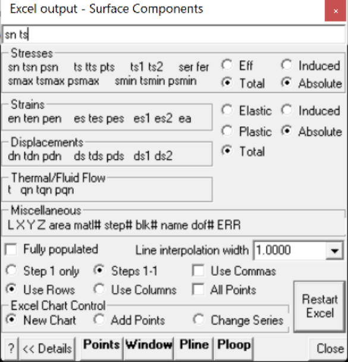

Trace dans Excel les composantes de surface spécifiées.

Vous devez tracer les contours des résultats de surface pour pouvoir les sélectionner pour le tracé Excel (p. ex. Plot > Surface Components > Ts Shear Stress).

Le premier paramètre sera utilisé comme axe x du tracé (c'est-à-dire l'abscisse). Les paramètres supplémentaires définiront les axes y du tracé (c'est-à-dire les séries ou ordonnées). Plusieurs paramètres d'axes y peuvent être spécifiés.

Deux types de tracés Excel peuvent être créés :

- des points de contour sélectionnés.

- une série de points le long d'une polyligne.

Le tracé Excel via Map3D est assuré par le complément Map3D.xla

- Cette routine est chargée automatiquement lorsque Map3D lance Excel.

- Vous devez autoriser l'exécution de cette macro pour que les routines de tracé de Map3D fonctionnent.

Fully populated   Indique que tous les points de contour manquants seront générés par interpolation.

- Cette option ne s'applique qu'au tracé de points de contour sélectionnés (Points, Window et polyligne fermée).

- Cette option ne s'applique pas au tracé sur une polyligne ouverte.

- Map3D calcule les résultats sur une grille peu dense afin de gagner du temps d'analyse.

- Pour voir l'emplacement réel des points de contour, activez l'affichage des trajectoires (Plot > Options > Trajectories).

- Lorsque cette option est décochée, seuls les points de contour réels sont inclus dans le tracé.

- Lorsque cette option est cochée, tous les points de contour manquants sont inclus dans le tracé.

Line interpolation width   Spécifie l'espacement souhaité auquel les points de contour seront générés par interpolation.

- Cette option ne s'applique qu'au tracé sur une polyligne ouverte.

- Cette option ne s'applique pas au tracé de points de contour sélectionnés.

- Si Line interpolation width est réglé à zéro, seules les extrémités de la polyligne ouverte sont tracées.

- Sinon, des points sont générés le long de la polyligne par interpolation à l'espacement Line interpolation width spécifié.

Step # only   Indique que seuls les résultats de l'étape # seront exportés (# est l'étape d'exploitation chargée actuellement affichée).

Steps 1-5   Indique que les résultats de toutes les étapes seront exportés.

- Notez que cela peut prendre beaucoup de temps pour de grands jeux de données ; vous devez donc être patient et attendre que Map3D parcoure toutes les étapes.

Use Commas   Indique que les résultats exportés vers Excel utiliseront des virgules à la place des points décimaux dans le format des nombres.

Restart Excel   Si Map3D perd la communication avec Excel, vous devez redémarrer Excel (Restart Excel) pour rétablir la communication.

Points   active la sélection graphique de points individuels.

- Le point le plus proche du point sélectionné sera tracé.

- Pour voir l'emplacement réel des points de contour, activez l'affichage des trajectoires (Plot > Options > Trajectories). Les points de contour sont situés là où les trajectoires sont dessinées.

Window   active une fenêtre de sélection rectangulaire.

- Vous serez invité à sélectionner les deux coins de la fenêtre en cliquant une fois sur chacun.

- Seuls les points de grille contenus dans la fenêtre seront inclus dans le tracé.

- Pour voir l'emplacement réel des points de contour, activez l'affichage des trajectoires (Plot > Options > Trajectories). Les points de contour sont situés là où les trajectoires sont dessinées.

Polyline (closed)   active un polygone de sélection graphique.

- Vous devez maintenir la touche Shift enfoncée pour pouvoir sélectionner plusieurs segments de ligne.

- Une forme polygonale fermée se définit en fermant la polyligne, c'est-à-dire en sélectionnant le point de départ.

- Si vous définissez une forme polygonale fermée, les points de contour situés à l'intérieur du polygone seront tracés.

- Si vous définissez une polyligne ouverte, une série de points le long de la polyligne sera tracée.

- Pour voir l'emplacement réel des points de contour, activez l'affichage des trajectoires (Plot > Options > Trajectories). Les points de contour sont situés là où les trajectoires sont dessinées.

Polyline (open)   active un polygone de sélection graphique.

- Vous pouvez sélectionner deux points pour définir un seul segment de ligne.

- Si vous maintenez la touche Shift enfoncée, plusieurs segments de ligne peuvent être sélectionnés.

- Vous pouvez spécifier l'espacement souhaité auquel les points de contour seront générés par interpolation à l'aide du paramètre Line interpolation width.

- Il peut être utile de superposer une grille régulière aux contours (View > Render > Grid Lines) pour faciliter le choix de l'emplacement de la polyligne.

- Si Line interpolation width est réglé à zéro, seules les extrémités de la polyligne ouverte sont tracées.

- Si vous définissez une polyligne ouverte, une série de points le long de la polyligne sera tracée.

- Si vous définissez une forme polygonale fermée, les points de contour situés à l'intérieur du polygone seront tracés.

#### Excel Chart Control:

New chart - crée un nouveau graphique Excel.

Extend existing chart - ajoute des données au graphique Excel existant. Tous les paramètres de tracé doivent être identiques à ceux utilisés précédemment.

Change series - modifie ou ajoute de nouvelles séries à un graphique Excel existant. Seul le premier paramètre de tracé doit être identique. Des paramètres de tracé supplémentaires peuvent être spécifiés au besoin.

#### Stresses:

sn tsn psn contrainte normale à la surface, sa direction et son plongement.

ts tts pts contrainte de cisaillement maximale dans le plan de la surface, sa direction et son plongement. ts1 ts2   composantes de la contrainte de cisaillement dans le plan de la surface. ts1 est parallèle au premier côté (c'est-à-dire le côté défini par x1 y1 z1 – x2 y2 z2). ts2 est perpendiculaire à ts1 dans la direction du second côté (c'est-à-dire le côté défini par x2 y2 z2 – x3 y3 z3).

ser erreur de contrainte de surface. Les solveurs itératifs fonctionnent en déterminant l'erreur de la solution courante de chaque équation simultanée, puis en réduisant ces erreurs par un processus d'approximations successives. Ce paramètre indique l'erreur de chacune des équations.

fer erreur du critère de rupture. Ce paramètre n'est utilisé que pour les analyses de fluage non linéaires (y compris le glissement de failles et la non-linéarité des matériaux 3D). Ce paramètre doit toujours être proche de zéro, sauf si une certaine viscosité a été spécifiée et que le problème devient non linéaire. Dans ce dernier cas, le fluage visqueux peut permettre des états de contraintes supérieurs au critère de rupture, ce qui indique un manque d'équilibre statique. Ce paramètre indique la contrainte visqueuse de chacune des équations.

smax tsmax psmax contrainte tangentielle maximale, sa direction et son plongement. smin tsmin psmin contrainte tangentielle minimale, sa direction et son plongement. Effective/Total – composantes de la contrainte effective ou de la contrainte totale. Ces options ne sont utilisées que dans Map3D Thermal-Fluid Flow, car ce code permet de calculer les distributions de pression interstitielle en régime permanent. Induced/Absolute composantes de la contrainte induite ou de la contrainte absolue (c'est-à-dire la contrainte sans la contribution de la contrainte antérieure à l'exploitation).

#### Strains:

en ten pen déformation dans la direction normale à la surface, sa direction et son plongement. Ce paramètre n'est utilisé que pour les plans DD et se calcule comme le déplacement normal (convergence) divisé par l'épaisseur. es tes pes déformation de cisaillement maximale dans le plan de la surface, sa direction et son plongement. Ce paramètre n'est utilisé que pour les plans DD et se calcule comme le déplacement de cisaillement (ride) divisé par l'épaisseur.

es1 es2   composantes de la déformation de cisaillement dans le plan de la surface. es1 est parallèle au premier côté (c'est-à-dire le côté défini par x1 y1 z1 – x2 y2 z2). es2 est perpendiculaire à es1 dans la direction du second côté (c'est-à-dire le côté défini par x2 y2 z2 – x3 y3 z3).

Elastic/Plastic/Total composantes de la déformation élastique, plastique ou totale. Ces options sont utilisées pour les plans DD dans Map3D Fault-Slip, ainsi que dans Map3D Non-Linear, car ce code permet de calculer les déformations non linéaires.

Induced/Absolute composantes de la déformation induite ou de la déformation absolue (c'est-à-dire sans la contribution de la contrainte antérieure à l'exploitation).

#### Displacements:

dn tdn pdn déplacement normal (convergence) dans la direction normale à la surface, sa direction et son plongement. Ce paramètre n'est utilisé que pour les plans DD. Notez que la valeur élastique, plastique ou totale peut être spécifiée.

ds tds pds déplacement de cisaillement maximal (ride) dans le plan de la surface, sa direction et son plongement. Ce paramètre n'est utilisé que pour les plans DD. Notez que la valeur élastique, plastique ou totale peut être spécifiée.

ds1 ds2   composantes du déplacement de cisaillement (ride) dans le plan de la surface. ds1 est parallèle au premier côté (c'est-à-dire le côté défini par x1 y1 z1 – x2 y2 z2). ds2 est perpendiculaire à ds1 dans la direction du second côté (c'est-à-dire le côté défini par x2 y2 z2 – x3 y3 z3).

#### Miscellaneous:

L  longueur le long d'une ligne. Utilisez la commande Polyline pour sélectionner la ligne souhaitée. X  valeur de la coordonnée. Y  valeur de la coordonnée. Z  valeur de la coordonnée. area   l'aire de la surface. matl# le numéro du matériau affecté à la surface. step# le numéro de l'étape d'exploitation. blk#   le numéro du bloc. name le nom du bloc. dof#   le numéro du degré de liberté. ERR   tracé du taux de libération d'énergie.
