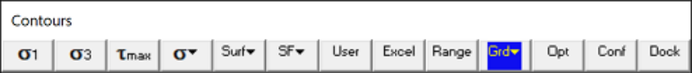
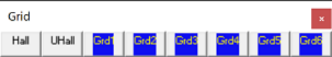

Sélectionne une grille de points de champ à afficher.

Cette routine peut être lancée en cliquant sur le bouton de la barre d'outils des contours

Cette barre d'outils peut être passée en orientation verticale en la faisant glisser contre le bord droit ou gauche de la fenêtre principale.

Elle peut revenir en orientation horizontale en la faisant glisser contre le bord supérieur ou inférieur de la fenêtre principale.

Les résultats d'analyse (contraintes, déformations et déplacements) peuvent être représentés par des contours sur les surfaces des éléments et sur les grilles de points de champ.

Avec OpenGL activé (Tools > OpenGL), toutes les grilles peuvent être affichées simultanément. Sans OpenGL, seules deux grilles peuvent l'être.

Hide All : masque toutes les grilles.

Unhide All : affiche toutes les grilles.

Vous pouvez construire plusieurs plans de grille de points de champ avec

CAD > Build > Grid Plane

CAD > Build > Grid Line

Si vous le souhaitez, des boutons de sélection de grille individuels peuvent être placés dans la barre d'outils d'affichage avec

Tools > View Toolbar Configure
