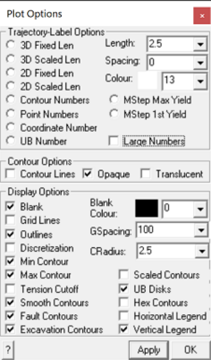

Définit les options du tracé de contours.

Cette routine peut être lancée en cliquant sur le bouton ou simplement en faisant un clic droit sur n'importe quel contour.

Cette barre d'outils peut passer à l'orientation verticale en la faisant glisser contre le bord droit ou gauche de la fenêtre principale.

Elle peut revenir à l'orientation horizontale en la faisant glisser contre le bord supérieur ou inférieur de la fenêtre principale.

#### Trajectory-Label Options:

- 3D Fixed Length – affiche des indicateurs d'orientation 3D de longueur fixe.

L'indicateur est construit comme un vecteur 3D dont l'extrémité porte une pointe de flèche qui s'éloigne de vous (c'est-à-dire vers l'intérieur de l'écran). Cela permet de déterminer si le vecteur plonge en s'éloignant ou en se rapprochant de vous. Les vecteurs qui apparaissent sous forme de points sont dirigés exactement vers l'intérieur ou l'extérieur de l'écran.

Si vous orientez la vue de façon à regarder le long du bord d'une grille, vous verrez les vecteurs dépasser de part et d'autre du plan de contours.

La longueur des vecteurs se règle avec le paramètre TLength:.

La densité des vecteurs se règle avec le paramètre TSpacing:.

- 3D Scaled Length – affiche des indicateurs d'orientation 3D de longueur proportionnelle.

L'indicateur est construit comme décrit ci-dessus.

La longueur des vecteurs est proportionnelle à la magnitude de la contrainte : si la magnitude est égale au minimum de la plage de contours, le vecteur est dessiné avec une longueur nulle. Si la magnitude est égale au maximum de la plage de contours, le vecteur est dessiné avec la longueur spécifiée par le paramètre TLength:.

- 2D Fixed Length – affiche des indicateurs d'orientation 2D de longueur fixe.

L'indicateur est construit comme une projection 2D du vrai vecteur 3D, dans le plan de la grille.

La longueur des vecteurs se règle avec le paramètre TLength:.

La densité des vecteurs se règle avec le paramètre TSpacing:.

- 2D Scaled Length – affiche des indicateurs d'orientation 2D de longueur proportionnelle.

L'indicateur est construit comme décrit ci-dessus.

L'indicateur est construit comme une projection 2D du vrai vecteur 3D, dans le plan de la grille.

La longueur des vecteurs est proportionnelle à la magnitude de la contrainte : si la magnitude est égale au minimum de la plage de contours, le vecteur est dessiné avec une longueur nulle. Si la magnitude est égale au maximum de la plage de contours, le vecteur est dessiné avec la longueur spécifiée par le paramètre TLength:.

- Contour Numbers – affiche les numéros de contours sur les contours. Le numéro correspond à la magnitude du contour en chaque point.

- Point Numbers – affiche les numéros de points sur les contours. Le numéro correspond au numéro d'enregistrement de chaque point.

- Coordinate Numbers – affiche les coordonnées sur les contours. Le numéro correspond aux coordonnées x,y,z de chaque point.

- UB Number – affiche sur les contours le numéro du système de joints ubiquistes (1, 2 ou 3) présentant la contrainte de cisaillement excédentaire maximale. Voir Ubiquitous Parameters

- MStep Max Yield – affiche l'étape à laquelle se produit la contrainte excédentaire maximale. Voir Accumulated Damage

- MStep 1st Yield – affiche l'étape à laquelle se produit la première plastification. Voir Accumulated Damage

- Large Numbers – affiche les nombres en grande ou en petite taille.

- Length – définit la longueur avec laquelle les indicateurs d'orientation seront dessinés. Si ce paramètre est trop petit, les vecteurs de trajectoire seront trop petits pour être visibles. S'il est trop grand, les vecteurs de trajectoire se chevaucheront et l'affichage deviendra confus.

- Spacing – définit l'espacement entre indicateurs d'orientation ou nombres adjacents. Si ce paramètre est nul, les trajectoires sont dessinées en tous les points de la grille. Pour les grilles finement discrétisées, les vecteurs de trajectoire peuvent être trop concentrés et difficiles à distinguer. Des valeurs plus grandes de ce paramètre réduisent le nombre de symboles de trajectoire dessinés.

- Colour – définit la couleur avec laquelle les trajectoires sont dessinées.

#### Contour Options:

- Contour Lines – trace des lignes entre les couleurs de contours. Ces lignes aident à mettre en évidence la limite entre les différents intervalles de contours et sont particulièrement utiles pour une présentation en noir et blanc.

- Opaque – dessine les contours avec des couleurs opaques. Si cette option et l'option translucide sont toutes deux décochées, seules les lignes de contours (c'est-à-dire sans contours colorés) sont dessinées.

- Translucent - dessine les contours avec des couleurs translucides. Si cette option et l'option opaque sont toutes deux décochées, seules les lignes de contours (c'est-à-dire sans contours colorés) sont dessinées.

#### Display Options:

- Blank – lorsque cette option est cochée, les contours sont masqués là où le plan de grille traverse des blocs d'excavation. C'est utile pour repérer l'étendue des excavations lorsque certaines parties du modèle ont été masquées. C'est aussi utile pour générer des coupes 2D, puisque l'emplacement des excavations est alors clairement visible.

Blank Colour: - définit la couleur utilisée pour le masquage.

Grid Lines – les contours sont dessinés avec des lignes à intervalles réguliers de la grille. L'intervalle souhaité se règle avec le paramètre Spacing:.

Outlines – des contours sont dessinés autour des bords de la grille. Avec plusieurs grilles, vous pouvez ne pas vouloir voir ces contours.

Discretization – la discrétisation de la grille est superposée aux contours.

Min Contour – lorsque cette option est décochée, les contours inférieurs au minimum de la plage de contours ne sont pas dessinés. C'est utile pour afficher des contours lorsque seule la partie supérieure de la plage est importante.

Par exemple, pour afficher des composantes de déformation non linéaire ou des contraintes excédentaires, il est souvent utile de ne rendre visibles que les parties non nulles des contours.

Si le paramètre souhaité a une valeur négative, il suffit d'intervertir le maximum et le minimum de la plage de contours ou de tracer la valeur absolue du paramètre.

Max Contour – lorsque cette option est décochée, les contours supérieurs au maximum de la plage de contours ne sont pas dessinés.

- Tension Cutoff Symbol – lorsque cette option est cochée, un symbole de traction spécial est tracé partout où l'état de contraintes est inférieur à la limite de traction spécifiée. Cette option n'est utilisée que pour les tracés de facteurs de résistance.

- Smooth Contours – si vous n'avez pas coché l'option d'analyse linéaire, les résultats ne sont calculés qu'au centre de chaque élément de frontière et les tracés de contours des valeurs de surface paraîtront très en damier. Cette option lisse ces contours pour faciliter l'interprétation.

Si vous avez coché l'option d'analyse linéaire, les résultats sont calculés aux coins des éléments. Aucun lissage n'étant nécessaire, cette option est ignorée.

Cette option n'a aucun effet sur les tracés de grilles.

Fault contours – des contours sont dessinés sur les surfaces de faille. Ce sont des surfaces DD de type de matériau fault-gouge (argile de faille).

Excavation contours – des contours sont dessinés sur les surfaces d'excavation. Ce sont des surfaces FF ou DD de type de matériau 0.

Scalled Contours – affiche les contours sous forme de surface topographique.

La hauteur normale au plan est proportionnelle à la magnitude de la contrainte : si la magnitude est égale au minimum de la plage de contours, la hauteur est dessinée avec une longueur nulle. Si la magnitude est égale au maximum de la plage de contours, le vecteur est dessiné avec la longueur spécifiée par le paramètre CRadius:.

Pour les grilles linéaires, c'est le rayon du tube qui est mis à l'échelle.

UB disks – bascule l'affichage entre le tracé de contours plan et des disques représentant l'orientation du plan UB. Pour plus d'informations, voir UB-Plane Parameters.

Hex contours – dans la version Visco-Plastic de Map3D, cette option permet d'afficher les valeurs calculées aux nœuds internes.

Horizontal Legend - oriente horizontalement la légende des intervalles de contours.

Vertical Banner - oriente verticalement la légende des intervalles de contours.

GSpacing: - définit l'intervalle de la grille.

CRadius - définit le rayon pour le tracé de contours des grilles linéaires.

#### Miscellaneous:

Apply – régénère le tracé de contours.
