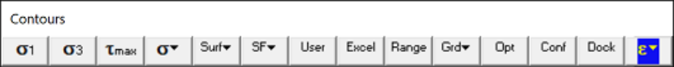
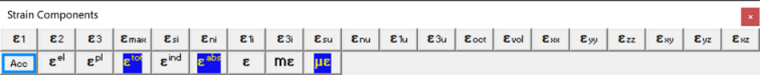
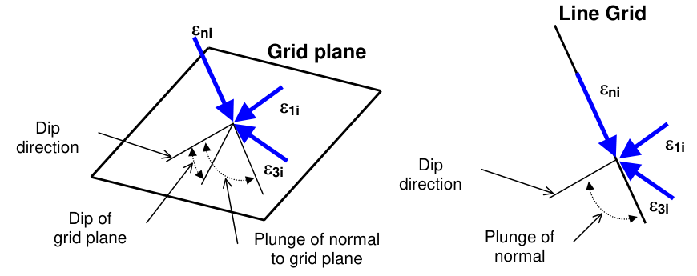
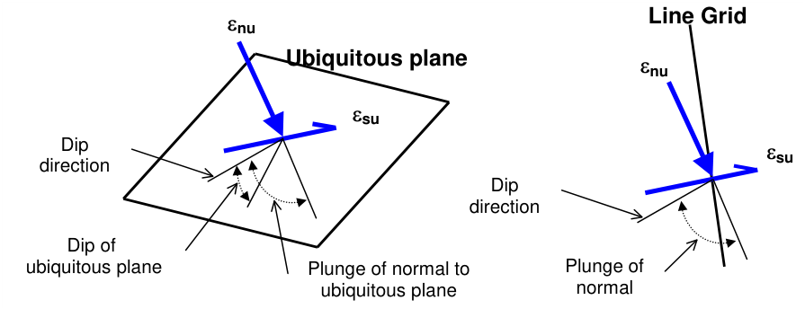
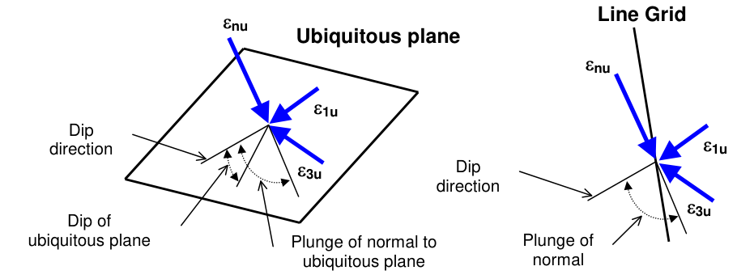

## 5.3.2.1 Déformation principale majeure

Trace les contours des déformations principales majeure, intermédiaire et mineure. Ces composantes sont accessibles via la barre d'outils Strain Components, comme suit :

Cette barre d'outils peut passer à l'orientation verticale en la faisant glisser contre le bord droit ou gauche de la fenêtre principale.

Elle peut revenir à l'orientation horizontale en la faisant glisser contre le bord supérieur ou inférieur de la fenêtre principale.

Sélectionner le bouton de la barre d'outils Contours active la barre d'outils Stress Components.

Cette barre d'outils peut passer à l'orientation verticale en la faisant glisser contre le bord droit ou gauche de la fenêtre principale.

Elle peut revenir à l'orientation horizontale en la faisant glisser contre le bord supérieur ou inférieur de la fenêtre principale.

Sélectionner le bouton de la barre d'outils Contours active la barre d'outils Strain Components.

Vous pouvez ajouter ce bouton à la barre d'outils Contours avec le bouton de configuration.

En analyse élastique, la contrainte principale majeure est normalement utilisée avec la contrainte principale mineure et le critère de résistance de Mohr-Coulomb ou de Hoek-Brown pour estimer l'ampleur de l'endommagement dû à la surcontrainte. En revanche, en analyse non linéaire, les contraintes ne peuvent jamais dépasser la résistance, sauf si un certain fluage est utilisé. Dans ce dernier cas, le fluage visqueux peut permettre des états de contraintes supérieurs au critère de rupture, ce qui indique un manque d'équilibre statique. Par conséquent, en analyse non linéaire, on considère normalement directement l'ampleur de la déformation non linéaire ou la vitesse de déformation prédite par le modèle

Mohr-Coulomb in 3D FF blocks

#### Accumulated Damage:

Dans le cas d'une analyse plastique, la fonction de dommage cumulé peut être activée. Lorsque Acc n'est pas activée, la valeur actuelle de la déformation plastique est utilisée. Lorsque Acc est activée, le dommage est suivi de l'étape 1 à l'étape actuelle sur tout l'historique de chargement du modèle ; c'est donc le pire cas (maximum) de déformation plastique qui est tracé.

Notez que l'étape à laquelle se produit la première plastification, MStep 1st Yield, et l'étape à laquelle se produit la déformation plastique maximale, MStep Max Yield, sont toutes deux suivies et peuvent être affichées sous forme d'étiquettes de trajectoire.

#### Strain Components:

Notez que trois composantes de la déformation peuvent être contourées :

Plot > Strain > Value > Elastic Plot > Strain > Value > Plastic Plot > Strain > Value > Total

Il existe aussi deux façons différentes de présenter la déformation :

Plot > Strain > Value > Induced Strain Plot > Strain > Value > Absolute Strain

La plage de contours se définit avec

#### Plot > Range

Chacune de ces composantes peut être ajoutée à la barre d'outils des contours si vous le souhaitez

Tools > Configure Contouring Toolbar > Strain

Il peut être pratique d'ajouter le bouton

#### More Strain Components

à la barre d'outils des contours pour accéder rapidement à toutes les composantes de déformation.

## 5.3.2.4 Déformation de cisaillement maximale

Trace les contours de la déformation de cisaillement maximale ½( e1 - e3 )

Cette composante est accessible via la barre d'outils Strain Components, comme suit :

Cette barre d'outils peut passer à l'orientation verticale en la faisant glisser contre le bord droit ou gauche de la fenêtre principale.

Elle peut revenir à l'orientation horizontale en la faisant glisser contre le bord supérieur ou inférieur de la fenêtre principale.

Sélectionner le bouton de la barre d'outils Contours active la barre d'outils Stress Components.

Vous pouvez ajouter ce bouton à la barre d'outils Contours avec le bouton de configuration.

En analyse élastique, la contrainte principale majeure est normalement utilisée avec la contrainte principale mineure et le critère de résistance de Mohr-Coulomb ou de Hoek-Brown pour estimer l'ampleur de l'endommagement dû à la surcontrainte. En revanche, en analyse non linéaire, les contraintes ne peuvent jamais dépasser la résistance, sauf si un certain fluage est utilisé. Dans ce dernier cas, le fluage visqueux peut permettre des états de contraintes supérieurs au critère de rupture, ce qui indique un manque d'équilibre statique. Par conséquent, en analyse non linéaire, on considère normalement directement l'ampleur de la déformation non linéaire ou la vitesse de déformation prédite par le modèle

Mohr-Coulomb in 3D FF blocks

Notez que trois composantes de la déformation peuvent être contourées :

Plot > Strain > Value > Elastic Plot > Strain > Value > Plastic Plot > Strain > Value > Total

Il existe aussi deux façons différentes de présenter la déformation :

Plot > Strain > Value > Induced Strain Plot > Strain > Value > Absolute Strain

La plage de contours se définit avec

#### Plot > Range

Chacune de ces composantes peut être ajoutée à la barre d'outils des contours si vous le souhaitez

Tools > Configure Contouring Toolbar > Strain

Il peut être pratique d'ajouter le bouton

#### More Strain Components

à la barre d'outils des contours pour accéder rapidement à toutes les composantes de déformation.

## 5.3.2.5 Déformation de cisaillement dans le plan

Trace les contours de la déformation de cisaillement maximale agissant sur le plan de grille, ainsi que de la composante de déformation normale au plan de grille ou parallèle à une grille linéaire.

Ces composantes sont accessibles via la barre d'outils Strain Components, comme suit :

Cette barre d'outils peut passer à l'orientation verticale en la faisant glisser contre le bord droit ou gauche de la fenêtre principale.

Elle peut revenir à l'orientation horizontale en la faisant glisser contre le bord supérieur ou inférieur de la fenêtre principale.

Sélectionner le bouton de la barre d'outils Contours active la barre d'outils Stress Components.

Vous pouvez ajouter ce bouton à la barre d'outils Contours avec le bouton de configuration.

#### Plot > Grid Selection

Pour calculer les déformations dans le plan, l'état de déformation en chaque point du plan de grille est réorienté afin de déterminer la déformation de cisaillement maximale parallèle au plan de grille et la déformation normale au plan. Notez que eip est orientée normalement au plan de grille et parallèlement à la direction d'une grille linéaire.

- la direction de pendage est mesurée positivement dans le sens horaire à partir de l'axe y.

- le pendage du plan est mesuré positivement vers le bas à partir de l'horizontale (c'est-à-dire la direction de pendage).

- le plongement de la normale est mesuré positivement vers le bas (c'est-à-dire négativement vers le haut) à partir de l'horizontale.

En analyse élastique, la contrainte de cisaillement maximale dans le plan est normalement utilisée avec la contrainte normale dans le plan et le critère de résistance de Mohr-Coulomb

Mohr-Coulomb in 3D FF blocks

pour estimer l'ampleur de l'endommagement dû à la surcontrainte. En revanche, en analyse non linéaire, les contraintes ne peuvent jamais dépasser la résistance, sauf si un certain fluage est utilisé. Dans ce dernier cas, le fluage visqueux peut permettre des états de contraintes supérieurs au critère de rupture, ce qui indique un manque d'équilibre statique. Par conséquent, en analyse non linéaire, on considère normalement directement l'ampleur de la déformation non linéaire ou la vitesse de déformation prédite par le modèle

Mohr-Coulomb in DD planes

pour estimer l'ampleur du glissement dû à la surcontrainte sur une faille, un système de joints ou un plan de stratification orienté de la même façon que le plan de grille. Comme ces paramètres dépendent de l'orientation, ce critère est représentatif de la stabilité d'un massif rocheux anisotrope.

Notez que trois composantes de la déformation peuvent être contourées :

Plot > Strain > Value > Elastic Plot > Strain > Value > Plastic Plot > Strain > Value > Total

Il existe aussi deux façons différentes de présenter la déformation :

Plot > Strain > Value > Induced Strain Plot > Strain > Value > Absolute Strain

La plage de contours se définit avec

#### Plot > Range

Chacune de ces composantes peut être ajoutée à la barre d'outils des contours si vous le souhaitez

Tools > Configure Contouring Toolbar > Strain

Il peut être pratique d'ajouter le bouton

#### More Strain Components

à la barre d'outils des contours pour accéder rapidement à toutes les composantes de déformation.

Sujets connexes :

Plot > Strain > e1i In-plane Maximum Plot > Strain > e3i In-plane Minimum Plot > Strain > esu Ubiquitous-plane Shear Plot > Strain > enu Ubiquitous-plane Normal

## 5.3.2.7 Déformation maximale dans le plan

Trace les contours des déformations maximale et minimale tangentes au plan de grille actuellement sélectionné ou perpendiculaires à une grille linéaire.

Ces composantes sont accessibles via la barre d'outils Strain Components, comme suit :

Cette barre d'outils peut passer à l'orientation verticale en la faisant glisser contre le bord droit ou gauche de la fenêtre principale.

Elle peut revenir à l'orientation horizontale en la faisant glisser contre le bord supérieur ou inférieur de la fenêtre principale.

Sélectionner le bouton de la barre d'outils Contours active la barre d'outils Stress Components.

Vous pouvez ajouter ce bouton à la barre d'outils Contours avec le bouton de configuration.

#### Plot > Grid Selection

Pour calculer les déformations maximale et minimale dans le plan, les déformations tangentes au plan de grille sont déterminées, puis résolues pour donner les valeurs maximale et minimale. Notez que eni est orientée normalement au plan de grille et parallèlement à la direction d'une grille linéaire. Notez également que eni, e1i et e3i sont perpendiculaires entre elles.

- la direction de pendage est mesurée positivement dans le sens horaire à partir de l'axe y.

- le pendage du plan est mesuré positivement vers le bas à partir de l'horizontale (c'est-à-dire la direction de pendage).

- le plongement de la normale est mesuré positivement vers le bas (c'est-à-dire négativement vers le haut) à partir de l'horizontale.

Notez que trois composantes de la déformation peuvent être contourées :

#### Plot > Strain > Value > Elastic

Plot > Strain > Value > Plastic Plot > Strain > Value > Total

Il existe aussi deux façons différentes de présenter la déformation :

Plot > Strain > Value > Induced Strain Plot > Strain > Value > Absolute Strain

La plage de contours se définit avec

Plot > Range

Cette composante peut être ajoutée à la barre d'outils des contours si vous le souhaitez

Tools > Configure Contouring Toolbar > Strain

Il peut être pratique d'ajouter le bouton

More Strain Components

à la barre d'outils des contours pour accéder rapidement à toutes les composantes de déformation.

Sujets connexes :

Plot > Strain > esi In-plane Shear Plot > Strain > eni In-plane Normal Plot > Strain > e1u Ubiquitous-plane Maximum. Plot > Strain > e3u Ubiquitous-plane Minimum.

## 5.3.2.9 Déformation de cisaillement dans le plan ubiquiste

Trace les contours de la déformation de cisaillement maximale agissant sur le plan ubiquiste n° 1, ainsi que de la composante de déformation normale à ce plan.

Ces composantes sont accessibles via la barre d'outils Strain Components, comme suit :

Cette barre d'outils peut passer à l'orientation verticale en la faisant glisser contre le bord droit ou gauche de la fenêtre principale.

Elle peut revenir à l'orientation horizontale en la faisant glisser contre le bord supérieur ou inférieur de la fenêtre principale.

Sélectionner le bouton de la barre d'outils Contours active la barre d'outils Stress Components.

Vous pouvez ajouter ce bouton à la barre d'outils Contours avec le bouton de configuration.

Pour calculer les déformations ubiquistes, l'état de déformation en chaque point du plan de grille est réorienté afin de déterminer la déformation de cisaillement maximale parallèle au plan ubiquiste et la déformation normale au plan ubiquiste. Notez que enu est orientée normalement au plan ubiquiste et n'est pas parallèle à la direction d'une grille linéaire.

- la direction de pendage est mesurée positivement dans le sens horaire à partir de l'axe y.

- le pendage du plan est mesuré positivement vers le bas à partir de l'horizontale (c'est-à-dire la direction de pendage).

- le plongement de la normale est mesuré positivement vers le bas (c'est-à-dire négativement vers le haut) à partir de l'horizontale.

L'orientation du plan de cisaillement ubiquiste se définit avec

#### Plot > Strength Factors > Ubiquitous Parameters

Notez que trois composantes de la déformation peuvent être contourées :

Plot > Strain > Value > Elastic Plot > Strain > Value > Plastic Plot > Strain > Value > Total

Il existe aussi deux façons différentes de présenter la déformation :

Plot > Strain > Value > Induced Strain Plot > Strain > Value > Absolute Strain

La plage de contours se définit avec

#### Plot > Range

Cette composante peut être ajoutée à la barre d'outils des contours si vous le souhaitez

Tools > Configure Contouring Toolbar > Strain

Il peut être pratique d'ajouter le bouton

#### More Strain Components

à la barre d'outils des contours pour accéder rapidement à toutes les composantes de déformation.

Sujets connexes :

Plot > Strain > e1u Ubiquitous-plane Maximum. Plot > Strain > e3u Ubiquitous-plane Minimum. Plot > Strain > esi In-plane Shear Plot > Strain > eni In-plane Normal

## 5.3.2.11 Déformation maximale dans le plan ubiquiste

Trace les contours des déformations maximale et minimale tangentes au plan ubiquiste n° 1. Ces composantes sont accessibles via la barre d'outils Strain Components, comme suit :

Cette barre d'outils peut passer à l'orientation verticale en la faisant glisser contre le bord droit ou gauche de la fenêtre principale.

Elle peut revenir à l'orientation horizontale en la faisant glisser contre le bord supérieur ou inférieur de la fenêtre principale.

Sélectionner le bouton de la barre d'outils Contours active la barre d'outils Stress Components.

Vous pouvez ajouter ce bouton à la barre d'outils Contours avec le bouton de configuration.

Pour calculer les déformations ubiquistes, l'état de déformation en chaque point du plan de grille est réorienté afin de déterminer les déformations maximale et minimale parallèles au plan ubiquiste. Notez que enu n'est pas orientée normalement au plan ubiquiste et n'est pas parallèle à la direction d'une grille linéaire.

- la direction de pendage est mesurée positivement dans le sens horaire à partir de l'axe y.

- le pendage du plan est mesuré positivement vers le bas à partir de l'horizontale (c'est-à-dire la direction de pendage).

- le plongement de la normale est mesuré positivement vers le bas (c'est-à-dire négativement vers le haut) à partir de l'horizontale.

L'orientation du plan de cisaillement ubiquiste se définit avec

#### Plot > Strength Factors > Ubiquitous Parameters

Notez que trois composantes de la déformation peuvent être contourées :

Plot > Strain > Value > Elastic Plot > Strain > Value > Plastic Plot > Strain > Value > Total

Il existe aussi deux façons différentes de présenter la déformation :

Plot > Strain > Value > Induced Strain Plot > Strain > Value > Absolute Strain

La plage de contours se définit avec

#### Plot > Range

Cette composante peut être ajoutée à la barre d'outils des contours si vous le souhaitez

Tools > Configure Contouring Toolbar > Strain

Il peut être pratique d'ajouter le bouton

#### More Strain Components

à la barre d'outils des contours pour accéder rapidement à toutes les composantes de déformation.

Sujets connexes :

Plot > Strain > esi Ubiquitous-plane Shear

Plot > Strain > eni Ubiquitous-plane Normal

Plot > Strain > e1u In-plane Maximum.

Plot > Strain > e3u In-plane Minimum.

## 5.3.2.13 Déformation de cisaillement octaédrique

Trace les contours de la déformation de cisaillement octaédrique

eoct = ¹/3 [ (e1 - e2)² + (e2 - e3)² +(e3 - e1)² ]½

et de la déformation volumique

evvol = (e1 + e2 + e3)

Ces composantes sont accessibles via la barre d'outils Strain Components, comme suit :

Cette barre d'outils peut passer à l'orientation verticale en la faisant glisser contre le bord droit ou gauche de la fenêtre principale.

Elle peut revenir à l'orientation horizontale en la faisant glisser contre le bord supérieur ou inférieur de la fenêtre principale.

Sélectionner le bouton de la barre d'outils Contours active la barre d'outils Stress Components.

Vous pouvez ajouter ce bouton à la barre d'outils Contours avec le bouton de configuration.

En analyse élastique, la contrainte principale majeure est normalement utilisée avec la contrainte principale mineure et le critère de résistance de Mohr-Coulomb ou de Hoek-Brown pour estimer l'ampleur de l'endommagement dû à la surcontrainte.

En revanche, en analyse non linéaire, les contraintes ne peuvent jamais dépasser la résistance, sauf si un certain fluage est utilisé. Dans ce dernier cas, le fluage visqueux peut permettre des états de contraintes supérieurs au critère de rupture, ce qui indique un manque d'équilibre statique. Par conséquent, en analyse non linéaire, on considère normalement directement l'ampleur de la déformation non linéaire ou la vitesse de déformation prédite par le modèle

Mohr-Coulomb in 3D FF blocks

Notez que trois composantes de la déformation peuvent être contourées :

Plot > Strain > Value > Elastic Plot > Strain > Value > Plastic Plot > Strain > Value > Total

Il existe aussi deux façons différentes de présenter la déformation :

Plot > Strain > Value > Induced Strain Plot > Strain > Value > Absolute Strain

La plage de contours se définit avec

#### Plot > Range

Cette composante peut être ajoutée à la barre d'outils des contours si vous le souhaitez

Tools > Configure Contouring Toolbar > Strain

Il peut être pratique d'ajouter le bouton

#### More Strain Components

à la barre d'outils des contours pour accéder rapidement à toutes les composantes de déformation.

## 5.3.2.15 Composante de déformation Exx

Trace les contours des composantes cartésiennes de la déformation. Ces composantes sont accessibles via la barre d'outils Strain Components, comme suit :

Cette barre d'outils peut passer à l'orientation verticale en la faisant glisser contre le bord droit ou gauche de la fenêtre principale.

Elle peut revenir à l'orientation horizontale en la faisant glisser contre le bord supérieur ou inférieur de la fenêtre principale.

Sélectionner le bouton de la barre d'outils Contours active la barre d'outils Stress Components.

Vous pouvez ajouter ce bouton à la barre d'outils Contours avec le bouton de configuration.

Plot > Strain >  exx Cartesian Strain Component   déformation normale dans la direction de l'axe x Plot > Strain >  eyy Cartesian Strain Component   déformation normale dans la direction de l'axe y Plot > Strain >  ezz Cartesian Strain Component   déformation normale dans la direction de l'axe z Plot > Strain >  exy Cartesian Strain Component   déformation normale dans la direction du plan x-y Plot > Strain >  eyz Cartesian Strain Component   déformation normale dans la direction du plan y-z Plot > Strain >  exz Cartesian Strain Component   déformation normale dans la direction du plan x-z

Notez que trois composantes de la déformation peuvent être contourées :

Plot > Strain > Value > Elastic Plot > Strain > Value > Plastic Plot > Strain > Value > Total

Il existe aussi deux façons différentes de présenter la déformation :

Plot > Strain > Value > Induced Strain Plot > Strain > Value > Absolute Strain

La plage de contours se définit avec

#### Plot > Range

Cette composante peut être ajoutée à la barre d'outils des contours si vous le souhaitez

Tools > Configure Contouring Toolbar > Strain

Il peut être pratique d'ajouter le bouton

More Strain Components

à la barre d'outils des contours pour accéder rapidement à toutes les composantes de déformation.

## 5.3.2.21 Valeur

5.3.2.21.1  Déformation élastique

Sélectionne la composante de la déformation élastique, plastique ou totale. Ces composantes sont accessibles via la barre d'outils Strain Components, comme suit :

Cette barre d'outils peut passer à l'orientation verticale en la faisant glisser contre le bord droit ou gauche de la fenêtre principale.

Elle peut revenir à l'orientation horizontale en la faisant glisser contre le bord supérieur ou inférieur de la fenêtre principale.

Sélectionner le bouton de la barre d'outils Contours active la barre d'outils Stress Components.

Vous pouvez ajouter ce bouton à la barre d'outils Contours avec le bouton de configuration.

Pour plus de détails, voir

Mohr-Coulomb in 3D FF blocks.

### 5.3.2.21.4 Déformation induite

Trace la composante de la déformation induite ou de la déformation absolue.

Cette composante est accessible via la barre d'outils Strain Components, comme suit :

Cette barre d'outils peut passer à l'orientation verticale en la faisant glisser contre le bord droit ou gauche de la fenêtre principale.

Elle peut revenir à l'orientation horizontale en la faisant glisser contre le bord supérieur ou inférieur de la fenêtre principale.

Sélectionner le bouton de la barre d'outils Contours active la barre d'outils Stress Components.

Vous pouvez ajouter ce bouton à la barre d'outils Contours avec le bouton de configuration.

La déformation induite est la déformation sans la contribution de la déformation antérieure à l'exploitation. Elle représente la variation de déformation depuis l'état antérieur à l'exploitation.

La déformation absolue est la déformation incluant la contribution de la déformation antérieure à l'exploitation.

Voir aussi :

Plot > Stress > Value > Induced Strain Plot > Stress > Value > Absolute Strain

### 5.3.2.21.6 Déformation

Trace la déformation :

- en unités non mises à l'échelle (déformation/1),

- en millidéformation (déformation/1000),

- en microdéformation (déformation/1000000).

Cette composante est accessible via la barre d'outils Strain Components, comme suit :

Cette barre d'outils peut passer à l'orientation verticale en la faisant glisser contre le bord droit ou gauche de la fenêtre principale.

Elle peut revenir à l'orientation horizontale en la faisant glisser contre le bord supérieur ou inférieur de la fenêtre principale.

Sélectionner le bouton de la barre d'outils Contours active la barre d'outils Stress Components.

Vous pouvez ajouter ce bouton à la barre d'outils Contours avec le bouton de configuration.

