## 5.3.6.1 Paramètres du massif rocheux

### 5.3.6.1.1 Paramètres de résistance du massif rocheux

Définit les paramètres de résistance servant à générer des tracés de contours de facteurs de résistance en fonction des composantes de la contrainte principale.

Ces composantes sont accessibles via la barre d'outils Strength Factor Components, comme suit :

Cette barre d'outils peut passer à l'orientation verticale en la faisant glisser contre le bord droit ou gauche de la fenêtre principale.

Elle peut revenir à l'orientation horizontale en la faisant glisser contre le bord supérieur ou inférieur de la fenêtre principale.

Sélectionner le bouton de la barre d'outils Contours active la barre d'outils Strength Factor Components.

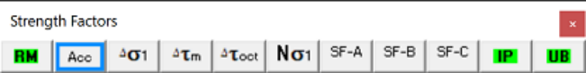

En analyse élastique, les contraintes principales majeure et mineure peuvent être utilisées avec les critères de résistance de Mohr-Coulomb, de Hoek-Brown ou de Drucker-Prager pour estimer l'ampleur de l'endommagement dû à la surcontrainte. Comme aucun de ces paramètres n'est sensible à l'orientation, ce critère est représentatif de la stabilité d'un massif rocheux homogène.

En revanche, en analyse non linéaire, les contraintes ne peuvent jamais dépasser la résistance, sauf si un certain fluage est utilisé. Dans ce dernier cas, le fluage visqueux peut permettre des états de contraintes supérieurs au critère de rupture, ce qui indique un manque d'équilibre statique. Par conséquent, en analyse non linéaire, on considère normalement directement l'ampleur de la déformation non linéaire ou la vitesse de déformation prédite par le modèle

Mohr-Coulomb in 3D FF blocks.

#### Mohr-Coulomb

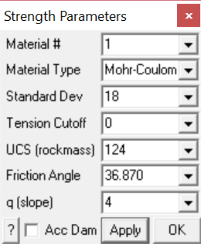

Material # spécifie le numéro de matériau. Le matériau n° 1 représente le matériau encaissant (host). Les autres numéros de matériau servent à définir des zones de matériau alterné telles que le minerai, la gouge de faille, le remblai, etc.

Standard Deviation spécifie l'incertitude du critère de rupture mesurée dans la direction s1.

Material Type spécifie le type de matériau : Mohr-Coulomb, Hoek-Brown, Drucker-Prager ou None.

Tension Cutoff, UCS, Friction Angle le critère de Mohr-Coulomb définit la résistance en fonction des contraintes principales comme suit :

#### Mohr-Coulomb

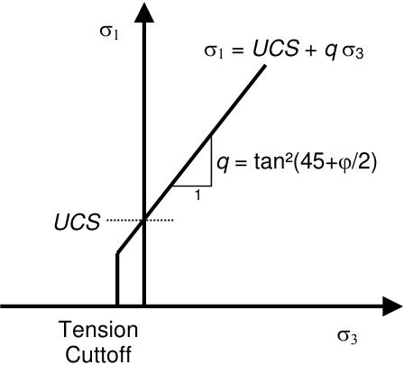

La limite de traction (tension cutoff) et l'UCS sont spécifiés en unités de contrainte (MPa ou psi). L'angle de frottement est spécifié en degrés.

Apply – régénère le tracé de contours.

Acc Dam – trace le dommage cumulé. Voir Accumulated Damage

#### Hoek-Brown

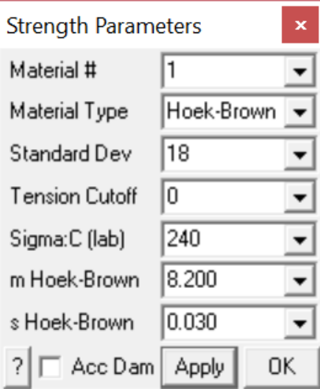

Material # spécifie le numéro de matériau. Le matériau n° 1 représente le matériau encaissant (host). Les autres numéros de matériau servent à définir des zones de matériau alterné telles que le minerai, la gouge de faille, le remblai, etc.

Material Type spécifie le type de matériau : Mohr-Coulomb, Hoek-Brown, Drucker-Prager ou None.

Standard Deviation spécifie l'incertitude du critère de rupture mesurée dans la direction s1 (spécifiée en unités de contrainte, MPa ou psi).

Tension Cutoff, Sigma:C, m and s le critère de Hoek-Brown définit la résistance en fonction des contraintes principales comme suit :

#### Hoek-Brown

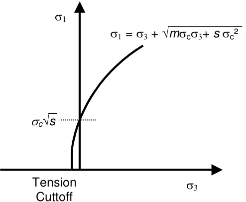

La limite de traction (tension cutoff) et Sigma:C sont spécifiés en unités de contrainte (MPa ou psi).

Apply – régénère le tracé de contours.

Acc Dam – trace le dommage cumulé. Voir Accumulated Damage

#### Drucker-Prager

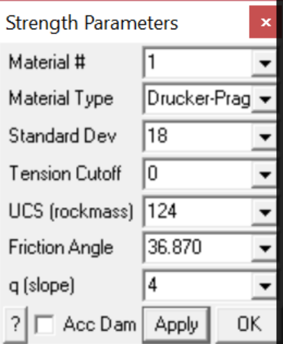

Material # spécifie le numéro de matériau. Le matériau n° 1 représente le matériau encaissant (host). Les autres numéros de matériau servent à définir des zones de matériau alterné telles que le minerai, la gouge de faille, le remblai, etc. Material Type spécifie le type de matériau : Mohr-Coulomb, Hoek-Brown, Drucker-Prager ou None.

Standard Deviation spécifie l'incertitude du critère de rupture mesurée dans la direction toct.

Tension Cutoff, UCS, Friction Angle le critère de Drucker-Prager définit la résistance en fonction des contraintes principales comme suit :

#### Drucker-Prager

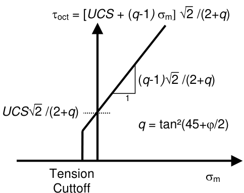

où

toct = ¹/3 [(s1 - s2)² + (s2 - s3)² +(s3 - s1)²]½

smean = ¹/3 (s1 + s2 + s3)

La limite de traction (tension cutoff) et l'UCS sont spécifiés en unités de contrainte (MPa ou psi). L'angle de frottement est spécifié en degrés.

Notez que les paramètres de résistance ont été choisis de sorte que le critère se simplifie en critère de Mohr-Coulomb lorsque s2 est égal à s3.

Apply – régénère le tracé de contours.

Acc Dam – trace le dommage cumulé. Voir Accumulated Damage

#### Sujets connexes :

Plot > Strength Factor > Probability N-distribution

Plot > Strength Factor > SF-A - Strength/Stress Plot > Strength Factor > SF-B - Strength/Stress Plot > Strength Factors > SF-C - Strength/Stress Plot > Strength Factors > dS1 - Excess Stress Plot > Strength Factors > dTmax - Excess Stress

Plot > Strength Factors > dToct - Excess Stress

Plot > Strength Factors > In-plane Parameters

Plot > Strength Factors > Ubiquitous Parameters

### 5.3.6.1.2 Dommage cumulé

Trace le dommage cumulé.

Cette composante est accessible via la barre d'outils Strength Factor Components, comme suit :

Cette barre d'outils peut passer à l'orientation verticale en la faisant glisser contre le bord droit ou gauche de la fenêtre principale.

Elle peut revenir à l'orientation horizontale en la faisant glisser contre le bord supérieur ou inférieur de la fenêtre principale.

Sélectionner le bouton de la barre d'outils Contours active la barre d'outils Strength Factor Components.

Lorsque Acc n'est pas activée, la contrainte excédentaire, la probabilité de rupture, le facteur de résistance et le RCF sont tracés pour les valeurs de contraintes actuelles.

Lorsque Acc est activée, le dommage est suivi de l'étape 1 à l'étape actuelle sur tout l'historique de chargement du modèle ; c'est donc le pire cas de la contrainte excédentaire, de la probabilité de rupture, du facteur de résistance ou du RCF qui est tracé.

Cela permet d'utiliser les résultats de l'analyse élastique des contraintes d'une façon similaire à la déformation cumulée dans un modèle de plasticité.

Le suivi du dommage est effectué séparément pour les 5 cas suivants :

1. Rupture du massif rocheux (contrainte S1 excédentaire, probabilité, facteur de résistance) 2. Rupture en cisaillement dans le plan (contrainte de cisaillement excédentaire, probabilité, facteur de résistance) 3. Rupture en cisaillement dans le plan ub (contrainte de cisaillement excédentaire, probabilité, facteur de résistance)

4. Contrainte excédentaire sur la paroi dans le plan (contrainte excédentaire, RCF)

5. Contrainte excédentaire sur la paroi dans le plan ub (contrainte excédentaire, RCF)

Notez que l'étape à laquelle se produit la première plastification, MStep 1st Yield, et l'étape à laquelle se produit la contrainte excédentaire maximale, MStep Max Yield, sont toutes deux suivies et peuvent être affichées sous forme d'étiquettes de trajectoire.

### 5.3.6.1.3 Contrainte S1 excédentaire

Trace les contours de la contrainte principale majeure excédentaire et du facteur de résistance selon la méthode « A ». Ces composantes sont accessibles via la barre d'outils Strength Factor Components, comme suit :

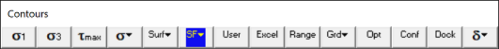

Cette barre d'outils peut passer à l'orientation verticale en la faisant glisser contre le bord droit ou gauche de la fenêtre principale.

Elle peut revenir à l'orientation horizontale en la faisant glisser contre le bord supérieur ou inférieur de la fenêtre principale.

Sélectionner le

bouton de la barre d'outils Contours active la barre d'outils Strength Factor Components.

En analyse élastique, les contraintes principales majeure et mineure peuvent être utilisées avec les critères de résistance de Mohr-Coulomb ou de Hoek-Brown

#### Plot > Strength Factors > Strength Parameters

pour estimer l'ampleur de l'endommagement dû à la surcontrainte. Comme aucun de ces paramètres n'est sensible à l'orientation, ce critère est représentatif de la stabilité d'un massif rocheux homogène.

En revanche, en analyse non linéaire, les contraintes ne peuvent jamais dépasser la résistance, sauf si un certain fluage est utilisé. Dans ce dernier cas, le fluage visqueux peut permettre des états de contraintes supérieurs au critère de rupture, ce qui indique un manque d'équilibre statique. Par conséquent, en analyse non linéaire, on considère normalement directement l'ampleur de la déformation non linéaire ou la vitesse de déformation prédite par le modèle

Mohr-Coulomb in 3D FF blocks.

La méthode « A » suppose que le chemin de contraintes jusqu'à la rupture se fait par augmentation de s1 sans perte de confinement. C'est représentatif de la rupture d'un pilier, où s1 est considérée comme la force motrice.

#### Mohr-Coulomb

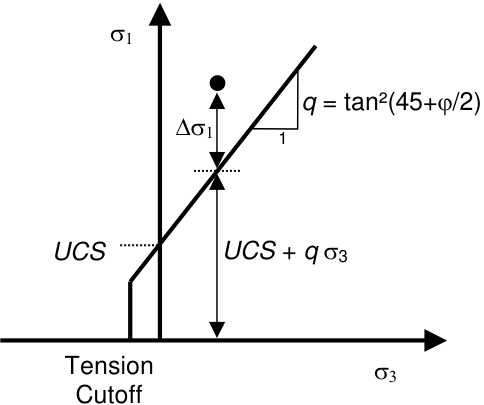

Plot > Strength Factors > SF-A   Strength/Stress peut être déterminé comme ( _UCS_ + _q_ s3 )/ s1 Plot > Strength Factors > SF/A   Stress/Strength peut être déterminé comme s1 / ( _UCS_ + _q_ s3 ) Plot > Strength Factors > Ds1   la contrainte excédentaire peut être déterminée comme Ds1 = s1 - ( _UCS_ + _q_ s3 )

Plot > Strength Factors > N(Ds1 /std)   Probabilité selon la loi normale.

identique à la méthode « B ».

#### Hoek-Brown

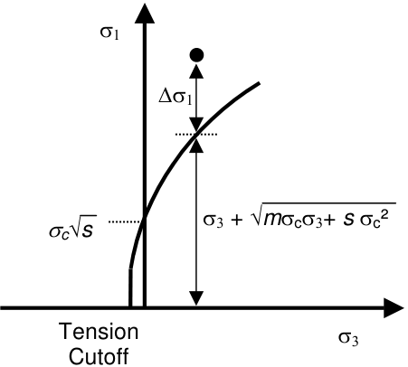

Plot > Strength Factors > SF-A   Strength/Stress peut être déterminé comme [ s3 + Ö( _m_ scs3 + _s_ sc²) ] / s1

Plot > Strength Factors > SF/A   Stress/Strength peut être déterminé comme s1 / [ s3 + Ö( _m_ scs3 + _s_ sc²) ]

Plot > Strength Factors > Ds1   la contrainte excédentaire peut être déterminée comme Ds1 = s1 - [ s3 + Ö( _m_ scs3 + _s_ sc²) ]

Plot > Strength Factors > N(Ds1 /std)   Probabilité selon la loi normale.

identique à la méthode « B ».

Drucker-Prager n'est défini que par la méthode « C ».

Les paramètres de résistance se définissent avec

Plot > Strength Factors > Strength Parameters

Sujets connexes :

Plot > Strength Factor > SF-B - Strength/Stress Plot > Strength Factors > SF-C - Strength/Stress Plot > Strength Factors > dTmax - Excess Stress Plot > Strength Factors > dToct - Excess Stress Plot > Strength Factors > In-plane Parameters Plot > Strength Factors > Ubiquitous Parameters

### 5.3.6.1.4 Contrainte Tmax excédentaire

Trace les contours de la contrainte de cisaillement excédentaire ou du facteur de résistance selon la méthode « C ». Ces composantes sont accessibles via la barre d'outils Strength Factor Components, comme suit :

Cette barre d'outils peut passer à l'orientation verticale en la faisant glisser contre le bord droit ou gauche de la fenêtre principale.

Elle peut revenir à l'orientation horizontale en la faisant glisser contre le bord supérieur ou inférieur de la fenêtre principale.

Sélectionner le bouton de la barre d'outils Contours active la barre d'outils Strength Factor Components.

En analyse élastique, les contraintes principales majeure et mineure peuvent être utilisées avec les critères de résistance de Mohr-Coulomb ou de Hoek-Brown

Plot > Strength Factors > Strength Parameters

pour estimer l'ampleur de l'endommagement dû à la surcontrainte. Comme aucun de ces paramètres n'est sensible à l'orientation, ce critère est représentatif de la stabilité d'un massif rocheux homogène.

En revanche, en analyse non linéaire, les contraintes ne peuvent jamais dépasser la résistance, sauf si un certain fluage est utilisé. Dans ce dernier cas, le fluage visqueux peut permettre des états de contraintes supérieurs au critère de rupture, ce qui indique un manque d'équilibre statique. Par conséquent, en analyse non linéaire, on considère normalement directement l'ampleur de la déformation non linéaire ou la vitesse de déformation prédite par le modèle

Mohr-Coulomb in 3D FF blocks.

La méthode « C » suppose que le chemin de contraintes jusqu'à la rupture se fait par augmentation de s1 avec perte de confinement. C'est représentatif de la rupture d'une culée (abutment), où s1 - s3 est considérée comme la force motrice.

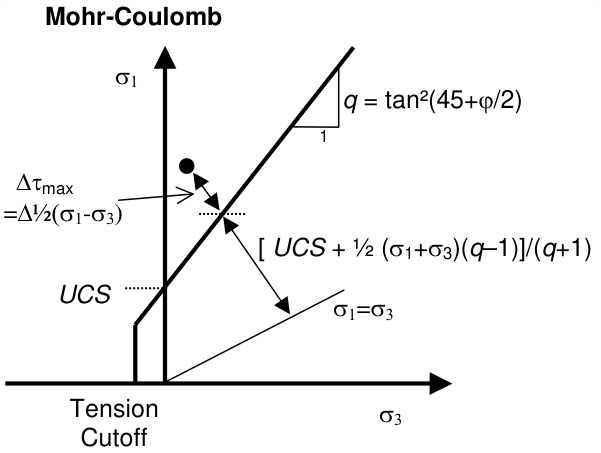

Plot > Strength Factors > SF-C   Strength/Stress peut être déterminé comme [ _UCS_ + ½(s1+s3) ( _q_ - 1) ]/[ ½(s1 - s3)( _q_ +1) ]

Plot > Strength Factors > SF/C   Stress/Strength peut être déterminé comme [ ½(s1 - s3)( _q_ +1) ]/ [ _UCS_ + ½(s1+s3) ( _q_ -1) ]

Plot > Strength Factors > Dtmax   la contrainte excédentaire peut être déterminée comme

Dtmax = ½(s1 - s3) - [ _UCS_ + ½(s1+s3) ( _q_ -1) ]/( _q_ +1)

= [s1 - ( _UCS_ + _q_ s3) ]/( _q_ +1)

#### Hoek-Brown

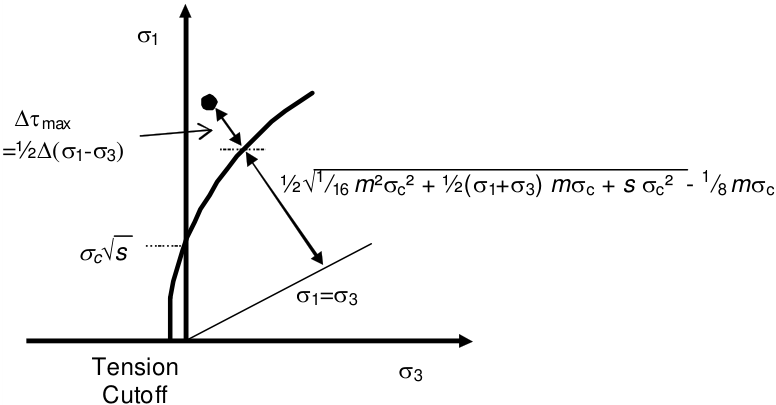

Plot > Strength Factors > SF-C   Strength/Stress peut être déterminé comme &#123; Ö[1 /16 _m_ ²sc² + ½(s1 + s3) _m_ sc + _s_ sc²] - ¼ _m_ sc&#125;/(s1 - s3)

Plot > Strength Factors > SF/C   Stress/Strength peut être déterminé comme (s1 - s3)/&#123; Ö[1 /16 _m_ ²sc² + ½(s1 + s3) _m_ sc + _s_ sc²] - ¼ _m_ sc &#125;

Plot > Strength Factors > Dtmax   la contrainte excédentaire peut être déterminée comme

Dtmax = ½(s1 - s3) - ½&#123; Ö[1 /16 _m_ ²sc² + ½(s1 + s3) _m_ sc + _s_ sc²] - ¼ _m_ sc &#125;

#### Drucker-Prager

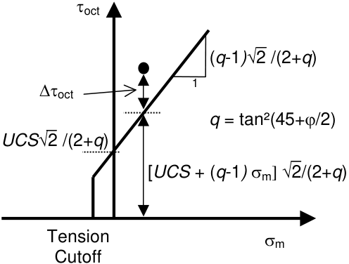

SF-C Strength/Stress   peut être déterminé comme [ _UCS_ + ( _q_ –1) smean ] Ö(2) /[ toct ( _q_ +2) ]

SF-C Stress/Strength   peut être déterminé comme toct /[ _UCS_ + ( _q_ –1) smean ] Ö(2) /( _q_ +2) Dtoct Excess   peut être déterminé comme toct - [ _UCS_ + ( _q_ –1) smean ] Ö(2) /( _q_ +2)

où

_q_ = tan²(45+j/2) toct = ¹/3 Ö[( s1 - s2 )² + ( s2 - s3 )² +( s3 - s1 )²] smean = ¹/3 ( s1 + s2 + s3 )

Notez que les paramètres de résistance ont été choisis de sorte que le critère se simplifie en critère de Mohr-Coulomb lorsque s2 est égal à s3.

Les paramètres de résistance se définissent avec

Plot > Strength Factors > Strength Parameters

Sujets connexes :

Plot > Strength Factor > SF-A - Stress/Strength Plot > Strength Factors > SF-B - Stress/Strength Plot > Strength Factors > dS1 - Excess Stress Plot > Strength Factors > In-plane Parameters Plot > Strength Factors > Ubiquitous Parameters

5.3.6.1.6  NS1 Probabilité normale

Trace les contours de la contrainte principale majeure excédentaire et du facteur de résistance selon la méthode « A ». Ces composantes sont accessibles via la barre d'outils Strength Factor Components, comme suit :

Cette barre d'outils peut passer à l'orientation verticale en la faisant glisser contre le bord droit ou gauche de la fenêtre principale.

Elle peut revenir à l'orientation horizontale en la faisant glisser contre le bord supérieur ou inférieur de la fenêtre principale.

Sélectionner le bouton de la barre d'outils Contours active la barre d'outils Strength Factor Components.

En analyse élastique, les contraintes principales majeure et mineure peuvent être utilisées avec les critères de résistance de Mohr-Coulomb ou de Hoek-Brown

Plot > Strength Factors > Strength Parameters

pour estimer l'ampleur de l'endommagement dû à la surcontrainte. Comme aucun de ces paramètres n'est sensible à l'orientation, ce critère est représentatif de la stabilité d'un massif rocheux homogène.

En revanche, en analyse non linéaire, les contraintes ne peuvent jamais dépasser la résistance, sauf si un certain fluage est utilisé. Dans ce dernier cas, le fluage visqueux peut permettre des états de contraintes supérieurs au critère de rupture, ce qui indique un manque d'équilibre statique. Par conséquent, en analyse non linéaire, on considère normalement directement l'ampleur de la déformation non linéaire ou la vitesse de déformation prédite par le modèle

Mohr-Coulomb in 3D FF blocks.

La méthode « A » suppose que le chemin de contraintes jusqu'à la rupture se fait par augmentation de s1 sans perte de confinement. C'est représentatif de la rupture d'un pilier, où s1 est considérée comme la force motrice.

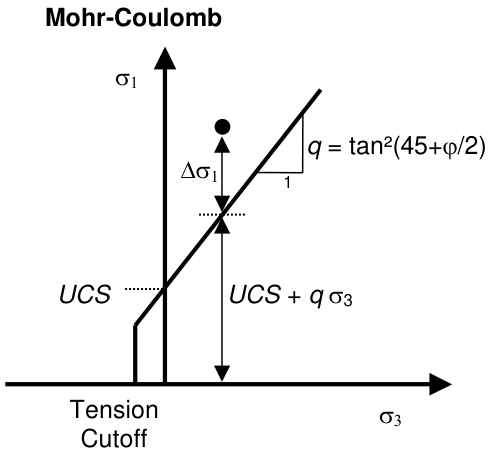

Plot > Strength Factors > SF-A   Strength/Stress peut être déterminé comme ( _UCS_ + _q_ s3 )/ s1 Plot > Strength Factors > SF/A   Stress/Strength peut être déterminé comme s1 / ( _UCS_ + _q_ s3 ) Plot > Strength Factors > Ds1   la contrainte excédentaire peut être déterminée comme Ds1 = s1 - ( _UCS_ + _q_ s3 )

Plot > Strength Factors > N(Ds1 /std)   Probabilité selon la loi normale.

identique à la méthode « B ».

#### Hoek-Brown

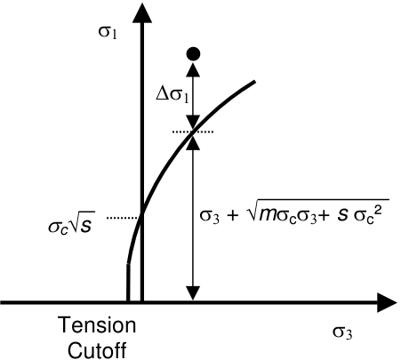

Plot > Strength Factors > SF-A   Strength/Stress peut être déterminé comme [ s3 + Ö( _m_ scs3 + _s_ sc²) ] / s1

Plot > Strength Factors > SF/A   Stress/Strength peut être déterminé comme s1 / [ s3 + Ö( _m_ scs3 + _s_ sc²) ]

Plot > Strength Factors > Ds1   la contrainte excédentaire peut être déterminée comme Ds1 = s1 - [ s3 + Ö( _m_ scs3 + _s_ sc²) ]

Plot > Strength Factors > N(Ds1 /std)   Probabilité selon la loi normale.

identique à la méthode « B ».

Drucker-Prager n'est défini que par la méthode « C ».

Les paramètres de résistance se définissent avec

Plot > Strength Factors > Strength Parameters

Sujets connexes :

Plot > Strength Factor > SF-B - Strength/Stress Plot > Strength Factors > SF-C - Strength/Stress Plot > Strength Factors > dTmax - Excess Stress Plot > Strength Factors > dToct - Excess Stress Plot > Strength Factors > In-plane Parameters Plot > Strength Factors > Ubiquitous Parameters

### 5.3.6.1.8 SF-B Résistance/Contrainte

Trace les contours de la contrainte principale majeure excédentaire et du facteur de résistance selon la méthode « B ». Ces composantes sont accessibles via la barre d'outils Strength Factor Components, comme suit :

Cette barre d'outils peut passer à l'orientation verticale en la faisant glisser contre le bord droit ou gauche de la fenêtre principale.

Elle peut revenir à l'orientation horizontale en la faisant glisser contre le bord supérieur ou inférieur de la fenêtre principale.

Sélectionner le

bouton de la barre d'outils Contours active la barre d'outils Strength Factor Components.

En analyse élastique, les contraintes principales majeure et mineure peuvent être utilisées avec les critères de résistance de Mohr-Coulomb ou de Hoek-Brown

#### Plot > Strength Factors > Strength Parameters

pour estimer l'ampleur de l'endommagement dû à la surcontrainte. Comme aucun de ces paramètres n'est sensible à l'orientation, ce critère est représentatif de la stabilité d'un massif rocheux homogène.

En revanche, en analyse non linéaire, les contraintes ne peuvent jamais dépasser la résistance, sauf si un certain fluage est utilisé. Dans ce dernier cas, le fluage visqueux peut permettre des états de contraintes supérieurs au critère de rupture, ce qui indique un manque d'équilibre statique. Par conséquent, en analyse non linéaire, on considère normalement directement l'ampleur de la déformation non linéaire ou la vitesse de déformation prédite par le modèle

Mohr-Coulomb in 3D FF blocks.

La méthode « B » suppose que le chemin de contraintes jusqu'à la rupture se fait par augmentation de s1 sans perte de confinement. C'est représentatif de la rupture d'un pilier, où s1 - s3 est considérée comme la force motrice.

#### Mohr-Coulomb

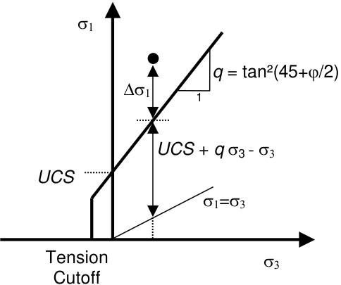

Plot > Strength Factors > SF-B   Strength/Stress peut être déterminé comme ( _UCS_ + _q_ s3 - s3 )/(s1 - s3)

Plot > Strength Factors > SF/B   Stress/Strength peut être déterminé comme (s1 - s3)/( _UCS_ + _q_ s3 - s3 )

Plot > Strength Factors > Ds1   la contrainte excédentaire peut être déterminée comme Ds1 = s1 - ( _UCS_ + _q_ s3 )

Plot > Strength Factors > N(Ds1 /std)   Probabilité selon la loi normale.

identique à la méthode « A ».

#### Hoek-Brown

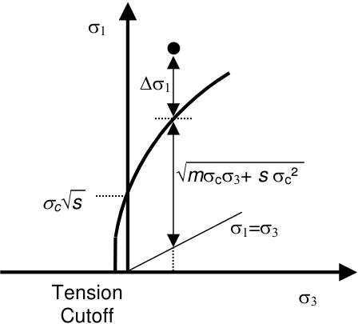

Plot > Strength Factors > SF-B   Strength/Stress peut être déterminé comme Ö( _m_ scs3 + _s_ sc²)/(s1 - s3) Plot > Strength Factors > SF/B   Stress/Strength peut être déterminé comme (s1 - s3)/Ö( _m_ scs3 + _s_ sc²) Plot > Strength Factors > Ds1   la contrainte excédentaire peut être déterminée comme Ds1 = s1 - [ s3 + Ö( _m_ scs3 + _s_ sc²) ]

Plot > Strength Factors > N(Ds1 /std)   Probabilité selon la loi normale.

identique à la méthode « A ».

Drucker-Prager n'est défini que par la méthode « C ».

Les paramètres de résistance se définissent avec

Plot > Strength Factors > Strength Parameters

Sujets connexes :

Plot > Strength Factor > SF-A - Strength/Stress Plot > Strength Factors > SF-C - Strength/Stress Plot > Strength Factors > dTmax - Excess Stress Plot > Strength Factors > dToct - Excess Stress Plot > Strength Factors > In-plane Parameters Plot > Strength Factors > Ubiquitous Parameters

### 5.3.6.1.9 SF-C Résistance/Contrainte

Trace les contours de la contrainte de cisaillement excédentaire ou du facteur de résistance selon la méthode « C ». Ces composantes sont accessibles via la barre d'outils Strength Factor Components, comme suit :

Cette barre d'outils peut passer à l'orientation verticale en la faisant glisser contre le bord droit ou gauche de la fenêtre principale.

Elle peut revenir à l'orientation horizontale en la faisant glisser contre le bord supérieur ou inférieur de la fenêtre principale.

Sélectionner le bouton de la barre d'outils Contours active la barre d'outils Strength Factor Components.

En analyse élastique, les contraintes principales majeure et mineure peuvent être utilisées avec les critères de résistance de Mohr-Coulomb ou de Hoek-Brown

#### Plot > Strength Factors > Strength Parameters

pour estimer l'ampleur de l'endommagement dû à la surcontrainte. Comme aucun de ces paramètres n'est sensible à l'orientation, ce critère est représentatif de la stabilité d'un massif rocheux homogène.

En revanche, en analyse non linéaire, les contraintes ne peuvent jamais dépasser la résistance, sauf si un certain fluage est utilisé. Dans ce dernier cas, le fluage visqueux peut permettre des états de contraintes supérieurs au critère de rupture, ce qui indique un manque d'équilibre statique. Par conséquent, en analyse non linéaire, on considère normalement directement l'ampleur de la déformation non linéaire ou la vitesse de déformation prédite par le modèle

Mohr-Coulomb in 3D FF blocks.

La méthode « C » suppose que le chemin de contraintes jusqu'à la rupture se fait par augmentation de s1 avec perte de confinement. C'est représentatif de la rupture d'une culée (abutment), où s1 - s3 est considérée comme la force motrice.

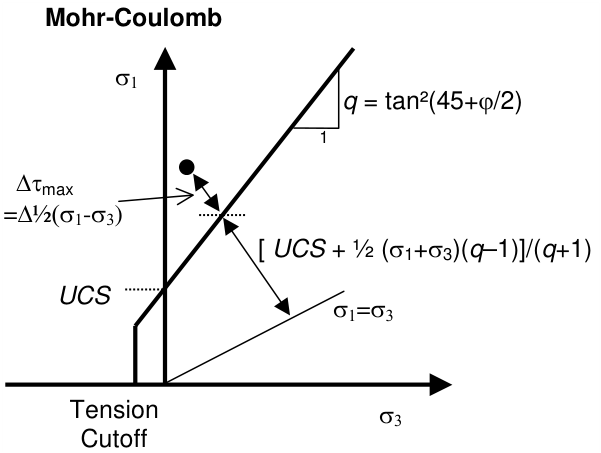

Plot > Strength Factors > SF-C   Strength/Stress peut être déterminé comme [ _UCS_ + ½(s1+s3) ( _q_ - 1) ]/[ ½(s1 - s3)( _q_ +1) ]

Plot > Strength Factors > SF/C   Stress/Strength peut être déterminé comme [ ½(s1 - s3)( _q_ +1) ]/ [ _UCS_ + ½(s1+s3) ( _q_ -1) ]

Plot > Strength Factors > Dtmax   la contrainte excédentaire peut être déterminée comme

Dtmax = ½(s1 - s3) - [ _UCS_ + ½(s1+s3) ( _q_ -1) ]/( _q_ +1)

= [s1 - ( _UCS_ + _q_ s3) ]/( _q_ +1)

#### Hoek-Brown

Plot > Strength Factors > SF-C   Strength/Stress peut être déterminé comme &#123; Ö[1 /16 _m_ ²sc² + ½(s1 + s3) _m_ sc + _s_ sc²] - ¼ _m_ sc&#125;/(s1 - s3)

Plot > Strength Factors > SF/C   Stress/Strength peut être déterminé comme (s1 - s3)/&#123; Ö[1 /16 _m_ ²sc² + ½(s1 + s3) _m_ sc + _s_ sc²] - ¼ _m_ sc &#125;

Plot > Strength Factors > Dtmax   la contrainte excédentaire peut être déterminée comme

Dtmax = ½(s1 - s3) - ½&#123; Ö[1 /16 _m_ ²sc² + ½(s1 + s3) _m_ sc + _s_ sc²] - ¼ _m_ sc &#125;

#### Drucker-Prager

SF-C Strength/Stress   peut être déterminé comme [ _UCS_ + ( _q_ –1) smean ] Ö(2) /[ toct ( _q_ +2) ]

SF-C Stress/Strength   peut être déterminé comme toct /[ _UCS_ + ( _q_ –1) smean ] Ö(2) /( _q_ +2) Dtoct Excess   peut être déterminé comme toct - [ _UCS_ + ( _q_ –1) smean ] Ö(2) /( _q_ +2)

où

_q_ = tan²(45+j/2) toct = ¹/3 Ö[( s1 - s2 )² + ( s2 - s3 )² +( s3 - s1 )²] smean = ¹/3 ( s1 + s2 + s3 )

Notez que les paramètres de résistance ont été choisis de sorte que le critère se simplifie en critère de Mohr-Coulomb lorsque s2 est égal à s3.

Les paramètres de résistance se définissent avec

Plot > Strength Factors > Strength Parameters

Sujets connexes :

Plot > Strength Factor > SF-A - Stress/Strength Plot > Strength Factors > SF-B - Stress/Strength Plot > Strength Factors > dS1 - Excess Stress Plot > Strength Factors > In-plane Parameters Plot > Strength Factors > Ubiquitous Parameters

### 5.3.6.1.10 SF/A Contrainte/Résistance

Trace les contours de la contrainte principale majeure excédentaire et du facteur de résistance selon la méthode « A ». Ces composantes sont accessibles via la barre d'outils Strength Factor Components, comme suit :

Cette barre d'outils peut passer à l'orientation verticale en la faisant glisser contre le bord droit ou gauche de la fenêtre principale.

Elle peut revenir à l'orientation horizontale en la faisant glisser contre le bord supérieur ou inférieur de la fenêtre principale.

Sélectionner le bouton de la barre d'outils Contours active la barre d'outils Strength Factor Components.

En analyse élastique, les contraintes principales majeure et mineure peuvent être utilisées avec les critères de résistance de Mohr-Coulomb ou de Hoek-Brown

Plot > Strength Factors > Strength Parameters

pour estimer l'ampleur de l'endommagement dû à la surcontrainte. Comme aucun de ces paramètres n'est sensible à l'orientation, ce critère est représentatif de la stabilité d'un massif rocheux homogène.

En revanche, en analyse non linéaire, les contraintes ne peuvent jamais dépasser la résistance, sauf si un certain fluage est utilisé. Dans ce dernier cas, le fluage visqueux peut permettre des états de contraintes supérieurs au critère de rupture, ce qui indique un manque d'équilibre statique. Par conséquent, en analyse non linéaire, on considère normalement directement l'ampleur de la déformation non linéaire ou la vitesse de déformation prédite par le modèle

Mohr-Coulomb in 3D FF blocks.

La méthode « A » suppose que le chemin de contraintes jusqu'à la rupture se fait par augmentation de s1 sans perte de confinement. C'est représentatif de la rupture d'un pilier, où s1 est considérée comme la force motrice.

Plot > Strength Factors > SF-A   Strength/Stress peut être déterminé comme ( _UCS_ + _q_ s3 )/ s1 Plot > Strength Factors > SF/A   Stress/Strength peut être déterminé comme s1 / ( _UCS_ + _q_ s3 ) Plot > Strength Factors > Ds1   la contrainte excédentaire peut être déterminée comme Ds1 = s1 - ( _UCS_ + _q_ s3 )

Plot > Strength Factors > N(Ds1 /std)   Probabilité selon la loi normale.

identique à la méthode « B ».

#### Hoek-Brown

Plot > Strength Factors > SF-A   Strength/Stress peut être déterminé comme [ s3 + Ö( _m_ scs3 + _s_ sc²) ] / s1

Plot > Strength Factors > SF/A   Stress/Strength peut être déterminé comme s1 / [ s3 + Ö( _m_ scs3 + _s_ sc²) ]

Plot > Strength Factors > Ds1   la contrainte excédentaire peut être déterminée comme Ds1 = s1 - [ s3 + Ö( _m_ scs3 + _s_ sc²) ]

Plot > Strength Factors > N(Ds1 /std)   Probabilité selon la loi normale.

identique à la méthode « B ».

Drucker-Prager n'est défini que par la méthode « C ».

Les paramètres de résistance se définissent avec

Plot > Strength Factors > Strength Parameters

Sujets connexes :

Plot > Strength Factor > SF-B - Strength/Stress Plot > Strength Factors > SF-C - Strength/Stress Plot > Strength Factors > dTmax - Excess Stress Plot > Strength Factors > dToct - Excess Stress Plot > Strength Factors > In-plane Parameters Plot > Strength Factors > Ubiquitous Parameters

### 5.3.6.1.11 SF/B Contrainte/Résistance

Trace les contours de la contrainte principale majeure excédentaire et du facteur de résistance selon la méthode « B ». Ces composantes sont accessibles via la barre d'outils Strength Factor Components, comme suit :

Cette barre d'outils peut passer à l'orientation verticale en la faisant glisser contre le bord droit ou gauche de la fenêtre principale.

Elle peut revenir à l'orientation horizontale en la faisant glisser contre le bord supérieur ou inférieur de la fenêtre principale.

Sélectionner le

bouton de la barre d'outils Contours active la barre d'outils Strength Factor Components.

En analyse élastique, les contraintes principales majeure et mineure peuvent être utilisées avec les critères de résistance de Mohr-Coulomb ou de Hoek-Brown

#### Plot > Strength Factors > Strength Parameters

pour estimer l'ampleur de l'endommagement dû à la surcontrainte. Comme aucun de ces paramètres n'est sensible à l'orientation, ce critère est représentatif de la stabilité d'un massif rocheux homogène.

En revanche, en analyse non linéaire, les contraintes ne peuvent jamais dépasser la résistance, sauf si un certain fluage est utilisé. Dans ce dernier cas, le fluage visqueux peut permettre des états de contraintes supérieurs au critère de rupture, ce qui indique un manque d'équilibre statique. Par conséquent, en analyse non linéaire, on considère normalement directement l'ampleur de la déformation non linéaire ou la vitesse de déformation prédite par le modèle

Mohr-Coulomb in 3D FF blocks.

La méthode « B » suppose que le chemin de contraintes jusqu'à la rupture se fait par augmentation de s1 sans perte de confinement. C'est représentatif de la rupture d'un pilier, où s1 - s3 est considérée comme la force motrice.

#### Mohr-Coulomb

Plot > Strength Factors > SF-B   Strength/Stress peut être déterminé comme ( _UCS_ + _q_ s3 - s3 )/(s1 - s3)

Plot > Strength Factors > SF/B   Stress/Strength peut être déterminé comme (s1 - s3)/( _UCS_ + _q_ s3 - s3 )

Plot > Strength Factors > Ds1   la contrainte excédentaire peut être déterminée comme Ds1 = s1 - ( _UCS_ + _q_ s3 )

Plot > Strength Factors > N(Ds1 /std)   Probabilité selon la loi normale.

identique à la méthode « A ».

#### Hoek-Brown

Plot > Strength Factors > SF-B   Strength/Stress peut être déterminé comme Ö( _m_ scs3 + _s_ sc²)/(s1 - s3) Plot > Strength Factors > SF/B   Stress/Strength peut être déterminé comme (s1 - s3)/Ö( _m_ scs3 + _s_ sc²) Plot > Strength Factors > Ds1   la contrainte excédentaire peut être déterminée comme Ds1 = s1 - [ s3 + Ö( _m_ scs3 + _s_ sc²) ]

Plot > Strength Factors > N(Ds1 /std)   Probabilité selon la loi normale.

identique à la méthode « A ».

Drucker-Prager n'est défini que par la méthode « C ».

Les paramètres de résistance se définissent avec

Plot > Strength Factors > Strength Parameters

Sujets connexes :

Plot > Strength Factor > SF-A - Strength/Stress Plot > Strength Factors > SF-C - Strength/Stress Plot > Strength Factors > dTmax - Excess Stress Plot > Strength Factors > dToct - Excess Stress Plot > Strength Factors > In-plane Parameters Plot > Strength Factors > Ubiquitous Parameters

### 5.3.6.1.12 SF/C Contrainte/Résistance

Trace les contours de la contrainte de cisaillement excédentaire ou du facteur de résistance selon la méthode « C ». Ces composantes sont accessibles via la barre d'outils Strength Factor Components, comme suit :

Cette barre d'outils peut passer à l'orientation verticale en la faisant glisser contre le bord droit ou gauche de la fenêtre principale.

Elle peut revenir à l'orientation horizontale en la faisant glisser contre le bord supérieur ou inférieur de la fenêtre principale.

Sélectionner le bouton de la barre d'outils Contours active la barre d'outils Strength Factor Components.

En analyse élastique, les contraintes principales majeure et mineure peuvent être utilisées avec les critères de résistance de Mohr-Coulomb ou de Hoek-Brown

#### Plot > Strength Factors > Strength Parameters

pour estimer l'ampleur de l'endommagement dû à la surcontrainte. Comme aucun de ces paramètres n'est sensible à l'orientation, ce critère est représentatif de la stabilité d'un massif rocheux homogène.

En revanche, en analyse non linéaire, les contraintes ne peuvent jamais dépasser la résistance, sauf si un certain fluage est utilisé. Dans ce dernier cas, le fluage visqueux peut permettre des états de contraintes supérieurs au critère de rupture, ce qui indique un manque d'équilibre statique. Par conséquent, en analyse non linéaire, on considère normalement directement l'ampleur de la déformation non linéaire ou la vitesse de déformation prédite par le modèle

Mohr-Coulomb in 3D FF blocks.

La méthode « C » suppose que le chemin de contraintes jusqu'à la rupture se fait par augmentation de s1 avec perte de confinement. C'est représentatif de la rupture d'une culée (abutment), où s1 - s3 est considérée comme la force motrice.

Plot > Strength Factors > SF-C   Strength/Stress peut être déterminé comme [ _UCS_ + ½(s1+s3) ( _q_ - 1) ]/[ ½(s1 - s3)( _q_ +1) ]

Plot > Strength Factors > SF/C   Stress/Strength peut être déterminé comme [ ½(s1 - s3)( _q_ +1) ]/ [ _UCS_ + ½(s1+s3) ( _q_ -1) ]

Plot > Strength Factors > Dtmax   la contrainte excédentaire peut être déterminée comme

Dtmax = ½(s1 - s3) - [ _UCS_ + ½(s1+s3) ( _q_ -1) ]/( _q_ +1)

= [s1 - ( _UCS_ + _q_ s3) ]/( _q_ +1)

#### Hoek-Brown

Plot > Strength Factors > SF-C   Strength/Stress peut être déterminé comme &#123; Ö[1 /16 _m_ ²sc² + ½(s1 + s3) _m_ sc + _s_ sc²] - ¼ _m_ sc&#125;/(s1 - s3)

Plot > Strength Factors > SF/C   Stress/Strength peut être déterminé comme (s1 - s3)/&#123; Ö[1 /16 _m_ ²sc² + ½(s1 + s3) _m_ sc + _s_ sc²] - ¼ _m_ sc &#125;

Plot > Strength Factors > Dtmax   la contrainte excédentaire peut être déterminée comme

Dtmax = ½(s1 - s3) - ½&#123; Ö[1 /16 _m_ ²sc² + ½(s1 + s3) _m_ sc + _s_ sc²] - ¼ _m_ sc &#125;

#### Drucker-Prager

SF-C Strength/Stress   peut être déterminé comme [ _UCS_ + ( _q_ –1) smean ] Ö(2) /[ toct ( _q_ +2) ]

SF-C Stress/Strength   peut être déterminé comme toct /[ _UCS_ + ( _q_ –1) smean ] Ö(2) /( _q_ +2) Dtoct Excess   peut être déterminé comme toct - [ _UCS_ + ( _q_ –1) smean ] Ö(2) /( _q_ +2)

où

_q_ = tan²(45+j/2) toct = ¹/3 Ö[( s1 - s2 )² + ( s2 - s3 )² +( s3 - s1 )²] smean = ¹/3 ( s1 + s2 + s3 )

Notez que les paramètres de résistance ont été choisis de sorte que le critère se simplifie en critère de Mohr-Coulomb lorsque s2 est égal à s3.

Les paramètres de résistance se définissent avec

Plot > Strength Factors > Strength Parameters

Sujets connexes :

Plot > Strength Factor > SF-A - Stress/Strength Plot > Strength Factors > SF-B - Stress/Strength Plot > Strength Factors > dS1 - Excess Stress Plot > Strength Factors > In-plane Parameters Plot > Strength Factors > Ubiquitous Parameters

## 5.3.6.2 Paramètres dans le plan

5.3.6.2.1  Paramètres dans le plan

Définit les paramètres de résistance servant à générer des tracés de contours de facteurs de résistance en fonction des composantes de la contrainte dans le plan.

Ces composantes sont accessibles via la barre d'outils Strength Factor Components, comme suit :

Cette barre d'outils peut passer à l'orientation verticale en la faisant glisser contre le bord droit ou gauche de la fenêtre principale.

Elle peut revenir à l'orientation horizontale en la faisant glisser contre le bord supérieur ou inférieur de la fenêtre principale.

Sélectionner le bouton de la barre d'outils Contours active la barre d'outils Strength Factor Components.

Pour calculer les contraintes de cisaillement et normale dans le plan, l'état de contraintes en chaque point du plan de grille est réorienté afin de déterminer la contrainte de cisaillement maximale parallèle au plan de grille et la contrainte normale au plan de grille.

En analyse élastique, les contraintes maximales de cisaillement et normale dans le plan peuvent être utilisées avec le critère de résistance de Mohr-Coulomb pour estimer l'ampleur du glissement dû à la surcontrainte sur une faille, un système de joints ou un plan de stratification orienté de la même façon que le plan de grille. Comme ces paramètres dépendent de l'orientation, ce critère est représentatif de la stabilité d'un massif rocheux anisotrope.

En revanche, en analyse non linéaire, les contraintes ne peuvent jamais dépasser la résistance, sauf si un certain fluage est utilisé. Dans ce dernier cas, le fluage visqueux peut permettre des états de contraintes supérieurs au critère de rupture, ce qui indique un manque d'équilibre statique. Par conséquent, en analyse non linéaire, on considère normalement directement l'ampleur de la déformation non linéaire ou la vitesse de déformation prédite par le modèle

Mohr-Coulomb in DD planes Fault-Gouge in DD planes Backfill-Hyperbolic in DD planes

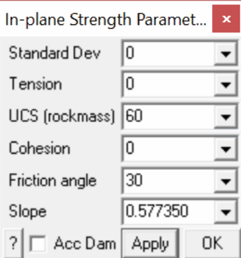

Le critère de Mohr-Coulomb définit la résistance au cisaillement en fonction de la contrainte de cisaillement et de la contrainte normale comme suit :

#### Mohr-Coulomb

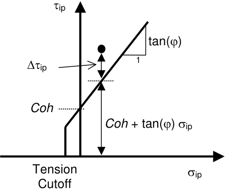

La limite de traction (tension cutoff), l'UCS et la cohésion sont spécifiés en unités de contrainte (MPa ou psi).

L'angle de frottement est spécifié en degrés.

Standard Deviation spécifie l'incertitude du critère de rupture mesurée dans la direction tip (spécifiée en unités de contrainte, MPa ou psi).

Acc Dam – trace le dommage cumulé. Voir Accumulated Damage

Apply – régénère le tracé de contours.

Sujets connexes :

Plot > Strength Factor > Probability N-distribution Plot > Strength Factor > SF-ip - Stress/Strength Plot > Strength Factors > SF-ub - Stress/Strength Plot > Strength Factors > dTip - Excess Stress Plot > Strength Factors > dTub - Excess Stress Plot > Strength Factors > Rockmass Strength Parameters Plot > Strength Factors > Ubiquitous Parameters

### 5.3.6.2.2 Dommage cumulé

Trace le dommage cumulé.

Cette composante est accessible via la barre d'outils Strength Factor Components, comme suit :

Cette barre d'outils peut passer à l'orientation verticale en la faisant glisser contre le bord droit ou gauche de la fenêtre principale.

Elle peut revenir à l'orientation horizontale en la faisant glisser contre le bord supérieur ou inférieur de la fenêtre principale.

Sélectionner le bouton de la barre d'outils Contours active la barre d'outils Strength Factor Components.

Lorsque Acc n'est pas activée, la contrainte excédentaire, la probabilité de rupture, le facteur de résistance et le RCF sont tracés pour les valeurs de contraintes actuelles.

Lorsque Acc est activée, le dommage est suivi de l'étape 1 à l'étape actuelle sur tout l'historique de chargement du modèle ; c'est donc le pire cas de la contrainte excédentaire, de la probabilité de rupture, du facteur de résistance ou du RCF qui est tracé.

Cela permet d'utiliser les résultats de l'analyse élastique des contraintes d'une façon similaire à la déformation cumulée dans un modèle de plasticité.

Le suivi du dommage est effectué séparément pour les 5 cas suivants :

1. Rupture du massif rocheux (contrainte S1 excédentaire, probabilité, facteur de résistance) 2. Rupture en cisaillement dans le plan (contrainte de cisaillement excédentaire, probabilité, facteur de résistance) 3. Rupture en cisaillement dans le plan ub (contrainte de cisaillement excédentaire, probabilité, facteur de résistance)

4. Contrainte excédentaire sur la paroi dans le plan (contrainte excédentaire, RCF)

5. Contrainte excédentaire sur la paroi dans le plan ub (contrainte excédentaire, RCF)

Notez que l'étape à laquelle se produit la première plastification, MStep 1st Yield, et l'étape à laquelle se produit la contrainte excédentaire maximale, MStep Max Yield, sont toutes deux suivies et peuvent être affichées sous forme d'étiquettes de trajectoire.

### 5.3.6.2.3 Contrainte de cisaillement excédentaire dans le plan

Trace les contours de la résistance au cisaillement dans le plan.

Ces composantes sont accessibles via la barre d'outils Strength Factor Components, comme suit :

Cette barre d'outils peut passer à l'orientation verticale en la faisant glisser contre le bord droit ou gauche de la fenêtre principale.

Elle peut revenir à l'orientation horizontale en la faisant glisser contre le bord supérieur ou inférieur de la fenêtre principale.

Sélectionner le

bouton de la barre d'outils Contours active la barre d'outils Strength Factor Components.

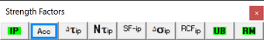

Pour calculer les contraintes de cisaillement et normale dans le plan, l'état de contraintes en chaque point du plan de grille est réorienté afin de déterminer la contrainte de cisaillement maximale parallèle au plan de grille et la contrainte normale au plan de grille.

En analyse élastique, les contraintes maximales de cisaillement et normale dans le plan peuvent être utilisées avec le critère de résistance de Mohr-Coulomb

#### Plot > Strength Factors > In-plane Parameters

pour estimer l'ampleur du glissement dû à la surcontrainte sur une faille, un système de joints ou un plan de stratification orienté de la même façon que le plan de grille. Comme ces paramètres dépendent de l'orientation, ce critère est représentatif de la stabilité d'un massif rocheux anisotrope.

En revanche, en analyse non linéaire, les contraintes ne peuvent jamais dépasser la résistance, sauf si un certain fluage est utilisé. Dans ce dernier cas, le fluage visqueux peut permettre des états de contraintes supérieurs au critère de rupture, ce qui indique un manque d'équilibre statique. Par conséquent, en analyse non linéaire, on considère normalement directement l'ampleur de la déformation non linéaire ou la vitesse de déformation prédite par le modèle

Mohr-Coulomb in DD planes

Fault-Gouge in DD planes

Backfill-Hyperbolic in DD planes

On suppose ici que le chemin de contraintes jusqu'à la rupture se fait par augmentation de tip sans perte de confinement.

#### Mohr-Coulomb

SF-ip Strength/Stress   peut être déterminé comme [ Cohesion + sip tan(j) ] / tip SF-ip Stress/Strength   peut être déterminé comme tip / [ Cohesion + sip tan(j) ] dTip Excess   peut être déterminé comme Dtip = tip - [ Cohesion + sip tan(j) ]

NTip Probability   peut être déterminé comme N(Dtip /std)

Les paramètres de résistance se définissent avec

Plot > Strength Factors > In-plane Parameters

Sujets connexes :

Plot > Stress > Tip - In-plane Shear Plot > Stress > Sip - In-plane Normal Plot > Strength Factors > SF-ub Strength/Stress Plot > Strength Factors > dTub Excess

Plot > Strength Factors > NSub Probability

### 5.3.6.2.4 Contrainte excédentaire sur la paroi dans le plan

Trace les contours de la résistance à la contrainte sur la paroi dans le plan. Ces composantes sont accessibles via la barre d'outils Strength Factor Components, comme suit :

Cette barre d'outils peut passer à l'orientation verticale en la faisant glisser contre le bord droit ou gauche de la fenêtre principale.

Elle peut revenir à l'orientation horizontale en la faisant glisser contre le bord supérieur ou inférieur de la fenêtre principale.

Sélectionner le

bouton de la barre d'outils Contours active la barre d'outils Strength Factor Components.

Pour calculer la contrainte sur la paroi dans le plan, l'état de contraintes en chaque point du plan de grille est réorienté afin de déterminer les contraintes tangentielles maximale et minimale parallèles au plan de grille.

La contrainte maximale sur la paroi d'une excavation circulaire virtuelle orientée perpendiculairement au plan de grille peut alors être déterminée comme [ 3 s1i - s3i ].

Notez que sip est orientée normalement au plan de grille et parallèlement à la direction d'une grille linéaire. Notez également que sip, s1i et s3i sont perpendiculaires entre elles.

- la direction de pendage est mesurée positivement dans le sens horaire à partir de l'axe y.

- le pendage du plan est mesuré positivement vers le bas à partir de l'horizontale (c'est-à-dire la direction de pendage).

- le plongement de la normale est mesuré positivement vers le bas (c'est-à-dire négativement vers le haut) à partir de l'horizontale.

dSip Excess   peut être déterminé comme Dsip = [ 3 s1i - s3i ] - UCS

RCFip   peut être déterminé comme RCFip = [ 3 s1i - s3i ]/UCS

Les paramètres de résistance se définissent avec

Plot > Strength Factors > In-plane Parameters

Sujets connexes :

Plot > Stress > Tip - In-plane Shear Plot > Stress > Sip - In-plane Normal Plot > Stress > S1i - In-plane Maximum Plot > Stress > S3i - In-plane Minimum Plot > Strength Factors > SF-ub Strength/Stress Plot > Strength Factors > dTub Excess Plot > Strength Factors > dSub Excess Plot > Strength Factors > NSub Probability

### 5.3.6.2.6 NTip Probabilité normale

Trace les contours de la résistance au cisaillement dans le plan. Ces composantes sont accessibles via la barre d'outils Strength Factor Components, comme suit :

Cette barre d'outils peut passer à l'orientation verticale en la faisant glisser contre le bord droit ou gauche de la fenêtre principale.

Elle peut revenir à l'orientation horizontale en la faisant glisser contre le bord supérieur ou inférieur de la fenêtre principale.

Sélectionner le bouton de la barre d'outils Contours active la barre d'outils Strength Factor Components.

Pour calculer les contraintes de cisaillement et normale dans le plan, l'état de contraintes en chaque point du plan de grille est réorienté afin de déterminer la contrainte de cisaillement maximale parallèle au plan de grille et la contrainte normale au plan de grille.

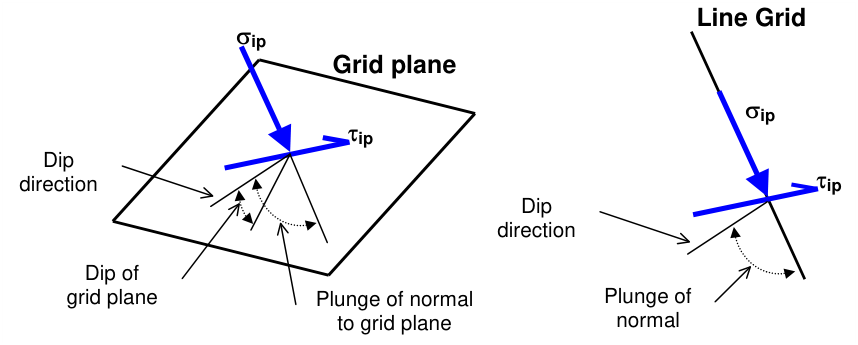

En analyse élastique, les contraintes maximales de cisaillement et normale dans le plan peuvent être utilisées avec le critère de résistance de Mohr-Coulomb

#### Plot > Strength Factors > In-plane Parameters

pour estimer l'ampleur du glissement dû à la surcontrainte sur une faille, un système de joints ou un plan de stratification orienté de la même façon que le plan de grille. Comme ces paramètres dépendent de l'orientation, ce critère est représentatif de la stabilité d'un massif rocheux anisotrope.

En revanche, en analyse non linéaire, les contraintes ne peuvent jamais dépasser la résistance, sauf si un certain fluage est utilisé. Dans ce dernier cas, le fluage visqueux peut permettre des états de contraintes supérieurs au critère de rupture, ce qui indique un manque d'équilibre statique. Par conséquent, en analyse non linéaire, on considère normalement directement l'ampleur de la déformation non linéaire ou la vitesse de déformation prédite par le modèle

Mohr-Coulomb in DD planes

Fault-Gouge in DD planes

Backfill-Hyperbolic in DD planes

On suppose ici que le chemin de contraintes jusqu'à la rupture se fait par augmentation de tip sans perte de confinement.

#### Mohr-Coulomb

SF-ip Strength/Stress   peut être déterminé comme [ Cohesion + sip tan(j) ] / tip SF-ip Stress/Strength   peut être déterminé comme tip / [ Cohesion + sip tan(j) ] dTip Excess   peut être déterminé comme Dtip = tip - [ Cohesion + sip tan(j) ]

NTip Probability   peut être déterminé comme N(Dtip /std)

Les paramètres de résistance se définissent avec

Plot > Strength Factors > In-plane Parameters

Sujets connexes :

Plot > Stress > Tip - In-plane Shear Plot > Stress > Sip - In-plane Normal Plot > Strength Factors > SF-ub Strength/Stress Plot > Strength Factors > dTub Excess

Plot > Strength Factors > NSub Probability

## 5.3.6.3 Paramètres du plan UB

5.3.6.3.1  Paramètres ubiquistes

Définit les paramètres de résistance servant à générer des tracés de contours de facteurs de résistance en fonction des composantes de la contrainte dans le plan ubiquiste.

Ces composantes sont accessibles via la barre d'outils Strength Factor Components, comme suit :

Cette barre d'outils peut passer à l'orientation verticale en la faisant glisser contre le bord droit ou gauche de la fenêtre principale.

Elle peut revenir à l'orientation horizontale en la faisant glisser contre le bord supérieur ou inférieur de la fenêtre principale.

Sélectionner le

bouton de la barre d'outils Contours active la barre d'outils Strength Factor Components.

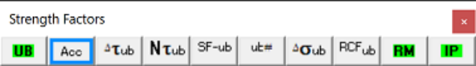

Pour calculer les contraintes de cisaillement et normale ubiquistes, l'état de contraintes en chaque point du plan de grille est réorienté afin de déterminer la contrainte de cisaillement maximale parallèle au plan de cisaillement ubiquiste et la contrainte normale au plan de cisaillement ubiquiste.

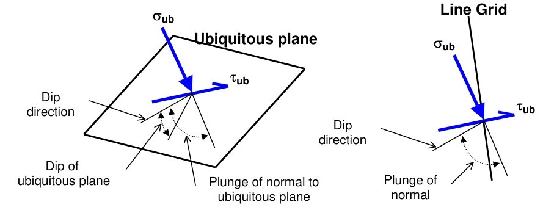

En analyse élastique, les contraintes maximales de cisaillement et normale dans le plan ubiquiste peuvent être utilisées avec le critère de résistance de Mohr-Coulomb pour estimer l'ampleur du glissement dû à la surcontrainte sur une faille, un système de joints ou un plan de stratification selon l'orientation spécifiée. Comme ces paramètres dépendent de l'orientation, ce critère est représentatif de la stabilité d'un massif rocheux anisotrope.

En revanche, en analyse non linéaire, les contraintes ne peuvent jamais dépasser la résistance, sauf si un certain fluage est utilisé. Dans ce dernier cas, le fluage visqueux peut permettre des états de contraintes supérieurs au critère de rupture, ce qui indique un manque d'équilibre statique. Par conséquent, en analyse non linéaire, on considère normalement directement l'ampleur de la déformation non linéaire ou la vitesse de déformation prédite par le modèle

Mohr-Coulomb in DD planes

Fault-Gouge in DD planes

Backfill-Hyperbolic in DD planes

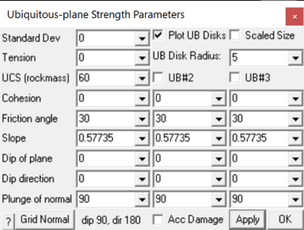

Cohesion et Friction Angle le critère de Mohr-Coulomb définit la résistance en fonction des contraintes principales comme suit :

#### Mohr-Coulomb

La limite de traction (tension cutoff), l'UCS et la cohésion sont spécifiés en unités de contrainte (MPa ou psi). L'angle de frottement est spécifié en degrés.

Standard Deviation spécifie l'incertitude du critère de rupture mesurée dans la direction tip (spécifiée en unités de contrainte, MPa ou psi).

Dip of plane – spécifie le pendage du plan ubiquiste (en degrés). Le pendage de la normale est automatiquement ajusté pour refléter les modifications de cette valeur.

Dip Direction – spécifie la direction de pendage du plan ubiquiste (en degrés).

Dip of Normal – spécifie le pendage de la normale au plan ubiquiste (en degrés). Le pendage du plan est automatiquement ajusté pour refléter les modifications de cette valeur.

Grid Normal – règle le plan ubiquiste parallèlement au plan de grille actuellement sélectionné. Dans ce cas, tous les résultats dans le plan seront identiques à ceux du plan ubiquiste.

Acc Dam – trace le dommage cumulé. Voir Accumulated Damage

Plot UB DIsks – bascule l'affichage entre le tracé de contours plan et des disques représentant l'orientation du plan UB.

Scaled Size – met à l'échelle la taille du disque UB selon la grandeur.

UB DIsk Radius – spécifie le rayon des disques UB.

Apply – régénère le tracé de contours.

UB#2 & UB#3 – active les paramètres de résistance pour le plan ubiquiste n° 2 et/ou n° 3. Lorsque cette option est cochée, le

minimum de tous les plans ubiquistes actifs est présenté pour tous les paramètres de résistance ( Plot > Strength Factor > Probability N-distribution, Plot > Strength Factors > SF-ub - Stress/Strength et Plot > Strength Factors > dTub - Excess Stress). Pour déterminer quel plan ubiquiste a la résistance minimale, vous pouvez tracer Plot > Strength Factors > UB# with minimum strength) ou faire un clic gauche sur un tracé de paramètre de résistance.

Sujets connexes :

Plot > Strength Factor > Probability N-distribution Plot > Strength Factors > SF-ub - Stress/Strength Plot > Strength Factor > SF-ip - Stress/Strength Plot > Strength Factors > dTub - Excess Stress Plot > Strength Factors > dTip - Excess Stress Plot > Strength Factors > UB# with minimum strength Plot > Strength Factors > Rockmass Strength Parameters

Plot > Strength Factors > In-plane Parameters

### 5.3.6.3.2 Dommage cumulé

Trace le dommage cumulé. Cette composante est accessible via la barre d'outils Strength Factor Components, comme suit :

Cette barre d'outils peut passer à l'orientation verticale en la faisant glisser contre le bord droit ou gauche de la fenêtre principale.

Elle peut revenir à l'orientation horizontale en la faisant glisser contre le bord supérieur ou inférieur de la fenêtre principale.

Sélectionner le bouton de la barre d'outils Contours active la barre d'outils Strength Factor Components.

Lorsque Acc n'est pas activée, la contrainte excédentaire, la probabilité de rupture, le facteur de résistance et le RCF sont tracés pour les valeurs de contraintes actuelles.

Lorsque Acc est activée, le dommage est suivi de l'étape 1 à l'étape actuelle sur tout l'historique de chargement du modèle ; c'est donc le pire cas de la contrainte excédentaire, de la probabilité de rupture, du facteur de résistance ou du RCF qui est tracé.

Cela permet d'utiliser les résultats de l'analyse élastique des contraintes d'une façon similaire à la déformation cumulée dans un modèle de plasticité.

Le suivi du dommage est effectué séparément pour les 5 cas suivants :

1. Rupture du massif rocheux (contrainte S1 excédentaire, probabilité, facteur de résistance) 2. Rupture en cisaillement dans le plan (contrainte de cisaillement excédentaire, probabilité, facteur de résistance) 3. Rupture en cisaillement dans le plan ub (contrainte de cisaillement excédentaire, probabilité, facteur de résistance)

4. Contrainte excédentaire sur la paroi dans le plan (contrainte excédentaire, RCF)

5. Contrainte excédentaire sur la paroi dans le plan ub (contrainte excédentaire, RCF)

Notez que l'étape à laquelle se produit la première plastification, MStep 1st Yield, et l'étape à laquelle se produit la contrainte excédentaire maximale, MStep Max Yield, sont toutes deux suivies et peuvent être affichées sous forme d'étiquettes de trajectoire.

- 5.3.6.3.3  Contrainte de cisaillement ubiquiste excédentaire

Trace les contours de la résistance au cisaillement dans le plan ubiquiste. Ces composantes sont accessibles via la barre d'outils Strength Factor Components, comme suit :

Cette barre d'outils peut passer à l'orientation verticale en la faisant glisser contre le bord droit ou gauche de la fenêtre principale.

Elle peut revenir à l'orientation horizontale en la faisant glisser contre le bord supérieur ou inférieur de la fenêtre principale.

Sélectionner le bouton de la barre d'outils Contours active la barre d'outils Strength Factor Components.

Pour calculer les contraintes de cisaillement et normale ubiquistes, l'état de contraintes en chaque point du plan de grille est réorienté afin de déterminer la contrainte de cisaillement maximale parallèle au plan de cisaillement ubiquiste et la contrainte normale au plan de cisaillement ubiquiste.

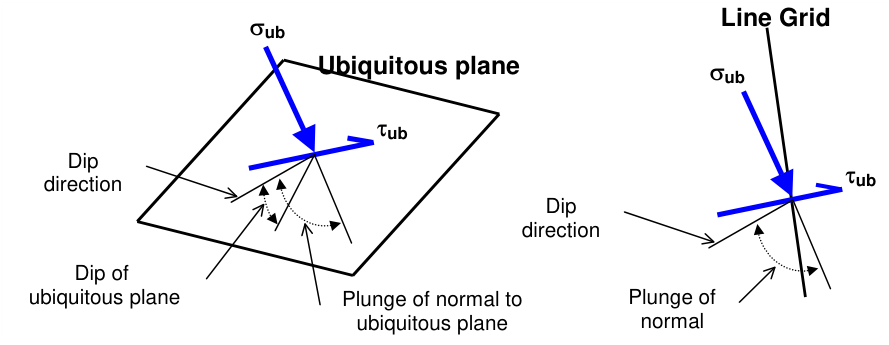

L'orientation du plan de cisaillement ubiquiste se définit avec

#### Plot > Strength Factors > Ubiquitous Parameters

En analyse élastique, les contraintes maximales de cisaillement et normale dans le plan ubiquiste peuvent être utilisées avec le critère de résistance de Mohr-Coulomb pour estimer l'ampleur du glissement dû à la surcontrainte sur une faille, un système de joints ou un plan de stratification selon l'orientation spécifiée. Comme ces paramètres dépendent de l'orientation, ce critère est représentatif de la stabilité d'un massif rocheux anisotrope.

En revanche, en analyse non linéaire, les contraintes ne peuvent jamais dépasser la résistance, sauf si un certain fluage est utilisé. Dans ce dernier cas, le fluage visqueux peut permettre des états de contraintes supérieurs au critère de rupture, ce qui indique un manque d'équilibre statique. Par conséquent, en analyse non linéaire, on considère normalement directement l'ampleur de la déformation non linéaire ou la vitesse de déformation prédite par le modèle

Mohr-Coulomb in DD planes

Fault-Gouge in DD planes

Backfill-Hyperbolic in DD planes

On suppose ici que le chemin de contraintes jusqu'à la rupture se fait par augmentation de tub sans perte de confinement.

#### Mohr-Coulomb

SF-ub Strength/Stress   peut être déterminé comme [ Cohesion + sub tan(j) ] / tub SF-ub Stress/Strength   peut être déterminé comme tub / [ Cohesion + sub tan(j) ] dTub Excess   peut être déterminé comme Dtub = tub - [ Cohesion + sub tan(j) ] NTub Probability   peut être déterminé comme N(Dtub /std)

Les paramètres de résistance se définissent avec

Plot > Strength Factors > Ubiquitous Parameters

Sujets connexes :

Plot > Stress > Tub - Ubiquitous-plane Shear Plot > Stress > Sub - Ubiquitous-plane Normal Plot > Stress > S1u - Ubiquitous-plane Maximum Plot > Stress > S3u - Ubiquitous-plane Minimum Plot > Strength Factors > SF-ub Strength/Stress Plot > Strength Factors > dTip Excess Plot > Strength Factors > dSip Excess Plot > Strength Factors > NTip Probability

UB#2 & UB#3 – active les paramètres de résistance pour le plan ubiquiste n° 2 et/ou n° 3. Lorsque cette option est cochée, le minimum de tous les plans ubiquistes actifs est présenté pour tous les paramètres de résistance ( Plot > Strength Factor > Probability N-distribution, Plot > Strength Factors > SF-ub - Stress/Strength et

Plot > Strength Factors > dTub - Excess Stress). To determine which ubiquitous plane has the minimum strength you can plot Plot > Strength Factors > UB# with minimum strength) or left click on and strength parameter plot.

### 5.3.6.3.4 Contrainte excédentaire sur la paroi du plan ubiquiste

Trace les contours de la résistance à la contrainte sur la paroi du plan ub.

Ces composantes sont accessibles via la barre d'outils Strength Factor Components, comme suit :

Cette barre d'outils peut passer à l'orientation verticale en la faisant glisser contre le bord droit ou gauche de la fenêtre principale.

Elle peut revenir à l'orientation horizontale en la faisant glisser contre le bord supérieur ou inférieur de la fenêtre principale.

Sélectionner le bouton de la barre d'outils Contours active la barre d'outils Strength Factor Components.

Pour calculer la contrainte sur la paroi du plan ub, l'état de contraintes en chaque point du plan de grille est réorienté afin de déterminer les contraintes tangentielles maximale et minimale parallèles au plan ub.

La contrainte maximale sur la paroi d'une excavation circulaire virtuelle orientée perpendiculairement au plan ub peut alors être déterminée comme [ 3 s1u - s3u ].

Notez que sub est orientée normalement au plan ub. Notez également que sub, s1 et s3u sont perpendiculaires entre elles.

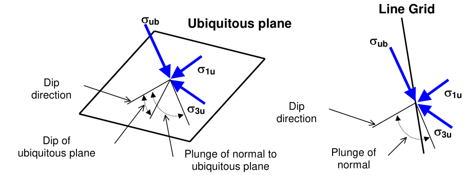

- la direction de pendage est mesurée positivement dans le sens horaire à partir de l'axe y.

- le pendage du plan est mesuré positivement vers le bas à partir de l'horizontale (c'est-à-dire la direction de pendage).

- le plongement de la normale est mesuré positivement vers le bas (c'est-à-dire négativement vers le haut) à partir de l'horizontale.

dSub Excess   peut être déterminé comme Dsub = [ 3 s1u - s3u ] - UCS

RCFub   peut être déterminé comme RCFub = [ 3 s1u - s3u ]/UCS

L'orientation du plan de cisaillement ubiquiste se définit avec

Plot > Strength Factors > Ubiquitous Parameters

Sujets connexes :

Plot > Stress > Tub - Ubiquitous-plane Shear Plot > Stress > Sub - Ubiquitous-plane Normal Plot > Stress > S1u - Ubiquitous-plane Maximum Plot > Stress > S3u - Ubiquitous-plane Minimum Plot > Strength Factors > SF-ub Strength/Stress Plot > Strength Factors > dTip Excess Plot > Strength Factors > dSip Excess Plot > Strength Factors > NTip Probability

### 5.3.6.3.6 NTub Probabilité normale

Trace les contours de la résistance au cisaillement dans le plan ubiquiste. Ces composantes sont accessibles via la barre d'outils Strength Factor Components, comme suit :

Cette barre d'outils peut passer à l'orientation verticale en la faisant glisser contre le bord droit ou gauche de la fenêtre principale.

Elle peut revenir à l'orientation horizontale en la faisant glisser contre le bord supérieur ou inférieur de la fenêtre principale.

Sélectionner le bouton de la barre d'outils Contours active la barre d'outils Strength Factor Components.

Pour calculer les contraintes de cisaillement et normale ubiquistes, l'état de contraintes en chaque point du plan de grille est réorienté afin de déterminer la contrainte de cisaillement maximale parallèle au plan de cisaillement ubiquiste et la contrainte normale au plan de cisaillement ubiquiste.

L'orientation du plan de cisaillement ubiquiste se définit avec

#### Plot > Strength Factors > Ubiquitous Parameters

En analyse élastique, les contraintes maximales de cisaillement et normale dans le plan ubiquiste peuvent être utilisées avec le critère de résistance de Mohr-Coulomb pour estimer l'ampleur du glissement dû à la surcontrainte sur une faille, un système de joints ou un plan de stratification selon l'orientation spécifiée. Comme ces paramètres dépendent de l'orientation, ce critère est représentatif de la stabilité d'un massif rocheux anisotrope.

En revanche, en analyse non linéaire, les contraintes ne peuvent jamais dépasser la résistance, sauf si un certain fluage est utilisé. Dans ce dernier cas, le fluage visqueux peut permettre des états de contraintes supérieurs au critère de rupture, ce qui indique un manque d'équilibre statique. Par conséquent, en analyse non linéaire, on considère normalement directement l'ampleur de la déformation non linéaire ou la vitesse de déformation prédite par le modèle

Mohr-Coulomb in DD planes

Fault-Gouge in DD planes

Backfill-Hyperbolic in DD planes

On suppose ici que le chemin de contraintes jusqu'à la rupture se fait par augmentation de tub sans perte de confinement.

#### Mohr-Coulomb

SF-ub Strength/Stress   peut être déterminé comme [ Cohesion + sub tan(j) ] / tub SF-ub Stress/Strength   peut être déterminé comme tub / [ Cohesion + sub tan(j) ] dTub Excess   peut être déterminé comme Dtub = tub - [ Cohesion + sub tan(j) ] NTub Probability   peut être déterminé comme N(Dtub /std)

Les paramètres de résistance se définissent avec

Plot > Strength Factors > Ubiquitous Parameters

Sujets connexes :

Plot > Stress > Tub - Ubiquitous-plane Shear Plot > Stress > Sub - Ubiquitous-plane Normal Plot > Stress > S1u - Ubiquitous-plane Maximum Plot > Stress > S3u - Ubiquitous-plane Minimum Plot > Strength Factors > SF-ub Strength/Stress Plot > Strength Factors > dTip Excess Plot > Strength Factors > dSip Excess Plot > Strength Factors > NTip Probability

UB#2 & UB#3 – active les paramètres de résistance pour le plan ubiquiste n° 2 et/ou n° 3. Lorsque cette option est cochée, le minimum de tous les plans ubiquistes actifs est présenté pour tous les paramètres de résistance ( Plot > Strength Factor > Probability N-distribution, Plot > Strength Factors > SF-ub - Stress/Strength et

Plot > Strength Factors > dTub - Excess Stress). To determine which ubiquitous plane has the minimum strength you can plot Plot > Strength Factors > UB# with minimum strength) or left click on and strength parameter plot.
