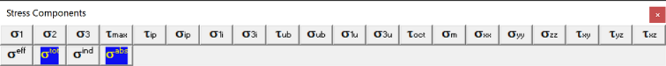
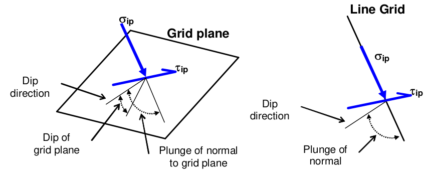
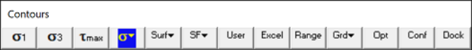
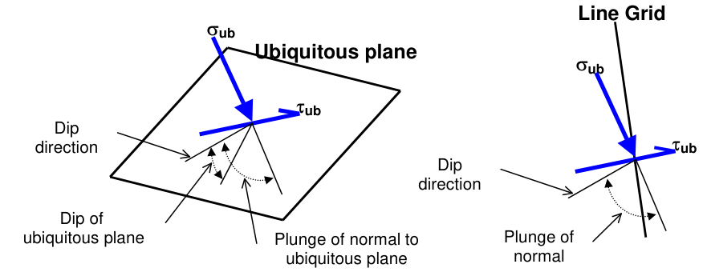
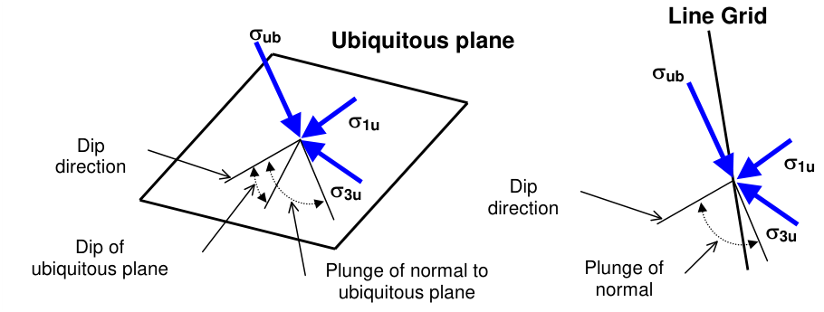

## 5.3.1.1 Contrainte principale majeure

Permet de visualiser les composantes de contrainte principale s1 s2 s3. Ces composantes sont accessibles via la barre d'outils Stress Components, comme suit :

Cette barre d'outils peut passer à l'orientation verticale en la faisant glisser contre le bord droit ou gauche de la fenêtre principale.

Elle peut revenir à l'orientation horizontale en la faisant glisser contre le bord supérieur ou inférieur de la fenêtre principale.

Sélectionner le bouton de la barre d'outils Contours active la barre d'outils Stress Components.

En analyse élastique, la contrainte principale majeure est normalement utilisée avec la contrainte principale mineure et le critère de résistance de Mohr-Coulomb ou de Hoek-Brown

#### Plot > Strength Factors > Strength Parameters

pour estimer l'ampleur de l'endommagement du massif rocheux dû à la surcontrainte. Comme aucun de ces paramètres n'est sensible à l'orientation, ce critère est représentatif de la stabilité d'un massif rocheux homogène.

En revanche, en analyse non linéaire, les contraintes ne peuvent jamais dépasser la résistance, sauf si un certain fluage est utilisé. Dans ce dernier cas, le fluage visqueux peut permettre des états de contraintes supérieurs au critère de rupture, ce qui indique un manque d'équilibre statique. Par conséquent, en analyse non linéaire, on considère normalement directement l'ampleur de la déformation non linéaire ou la vitesse de déformation prédite par le modèle

Mohr-Coulomb in 3D FF blocks.

La surcontrainte peut être présentée sous plusieurs formes, notamment :

Plot > Strength Factor > SF-A Strength/Stress Plot > Strength Factor > SF-B Strength/Stress Plot > Strength Factors > SF-C Strength/Stress Plot > Strength Factors > dS1 Excess Stress Plot > Strength Factors > dTmax Excess Stress

La plage de contours se définit avec

#### Plot > Range

Chacune de ces composantes peut être ajoutée à la barre d'outils des contours si vous le souhaitez

Tools > Configure Contouring Toolbar > Stress

Il peut être pratique d'ajouter le bouton

#### More Stress Components

à la barre d'outils des contours pour accéder rapidement à toutes les composantes de contrainte.

La contrainte principale intermédiaire est normalement utilisée dans le calcul de la contrainte de cisaillement octaédrique

Plot > Stress > Toct Octahedral shear Stress

ou de la contrainte moyenne

Plot > Stress > Smean Mean Stress.

## 5.3.1.4 Contrainte de cisaillement maximale

Permet de visualiser la composante de contrainte tmax=½(s1 - s3). Cette composante est accessible via la barre d'outils Stress Components, comme suit :

Cette barre d'outils peut passer à l'orientation verticale en la faisant glisser contre le bord droit ou gauche de la fenêtre principale.

Elle peut revenir à l'orientation horizontale en la faisant glisser contre le bord supérieur ou inférieur de la fenêtre principale.

Sélectionner le bouton de la barre d'outils Contours active la barre d'outils Stress Components.

En analyse élastique, la contrainte de cisaillement maximale est normalement utilisée avec la contrainte principale mineure et le critère de résistance de Mohr-Coulomb ou de Hoek-Brown

#### Plot > Strength Factors > Strength Parameters

pour estimer l'ampleur de l'endommagement dû à la surcontrainte. Comme aucun de ces paramètres n'est sensible à l'orientation, ce critère est représentatif de la stabilité d'un massif rocheux homogène.

En revanche, en analyse non linéaire, les contraintes ne peuvent jamais dépasser la résistance, sauf si un certain fluage est utilisé. Dans ce dernier cas, le fluage visqueux peut permettre des états de contraintes supérieurs au critère de rupture, ce qui indique un manque d'équilibre statique. Par conséquent, en analyse non linéaire, on considère normalement directement l'ampleur de la déformation non linéaire ou la vitesse de déformation prédite par le modèle

Mohr-Coulomb in 3D FF blocks.

La surcontrainte peut être présentée sous plusieurs formes, notamment :

Plot > Strength Factor > SF-A Strength/Stress Plot > Strength Factor > SF-B Strength/Stress Plot > Strength Factors > SF-C Strength/Stress Plot > Strength Factors > dS1 Excess Stress Plot > Strength Factors > dTmax Excess Stress

La plage de contours se définit avec

#### Plot > Range

Chacune de ces composantes peut être ajoutée à la barre d'outils des contours si vous le souhaitez

Tools > Configure Contouring Toolbar > Stress

Il peut être pratique d'ajouter le bouton

#### More Stress Components

à la barre d'outils des contours pour accéder rapidement à toutes les composantes de contrainte.

## 5.3.1.5 Contrainte de cisaillement dans le plan

Permet de tracer les contours de la contrainte de cisaillement maximale agissant sur le plan de grille, ainsi que de la composante de contrainte normale au plan de grille ou parallèle à une grille linéaire. Ces composantes sont accessibles via la barre d'outils Stress Components, comme suit :

Cette barre d'outils peut passer à l'orientation verticale en la faisant glisser contre le bord droit ou gauche de la fenêtre principale.

Elle peut revenir à l'orientation horizontale en la faisant glisser contre le bord supérieur ou inférieur de la fenêtre principale.

Sélectionner le bouton de la barre d'outils Contours active la barre d'outils Stress Components.

Pour calculer les contraintes dans le plan, l'état de contraintes en chaque point du plan de grille est réorienté afin de déterminer la contrainte de cisaillement maximale parallèle au plan de grille et la contrainte normale au plan. Notez que sip est orientée normalement au plan de grille et parallèlement à la direction d'une grille linéaire.

- la direction de pendage est mesurée positivement dans le sens horaire à partir de l'axe y.

- le pendage du plan est mesuré positivement vers le bas à partir de l'horizontale (c'est-à-dire la direction de pendage).

- le plongement de la normale est mesuré positivement vers le bas (c'est-à-dire négativement vers le haut) à partir de l'horizontale.

En analyse élastique, la contrainte de cisaillement maximale dans le plan est normalement utilisée avec la contrainte normale dans le plan et le critère de résistance de Mohr-Coulomb

Plot > Strength Factors > In-plane Parameters

pour estimer l'ampleur du glissement dû à la surcontrainte sur une faille, un système de joints ou un plan de stratification orienté de la même façon que le plan de grille. Comme ces paramètres dépendent de l'orientation, ce critère est représentatif de la stabilité d'un massif rocheux anisotrope.

En revanche, en analyse non linéaire, les contraintes ne peuvent jamais dépasser la résistance, sauf si un certain fluage est utilisé. Dans ce dernier cas, le fluage visqueux peut permettre des états de contraintes supérieurs au critère de rupture, ce qui indique un manque d'équilibre statique. Par conséquent, en analyse non linéaire, on considère normalement directement l'ampleur de la déformation non linéaire ou la vitesse de déformation prédite par le modèle

Mohr-Coulomb in DD planes Fault-Gouge in DD planes Backfill-Hyperbolic in DD planes.

La surcontrainte peut être présentée sous plusieurs formes, notamment :

Plot > Strength Factors > SF-ip Strength/Stress Plot > Strength Factors > dTip Excess Shear Stress

La plage de contours se définit avec

#### Plot > Range

Chacune de ces composantes peut être ajoutée à la barre d'outils des contours si vous le souhaitez

Tools > Configure Contouring Toolbar > Stress

Il peut être pratique d'ajouter le bouton

#### More Stress Components

à la barre d'outils des contours pour accéder rapidement à toutes les composantes de contrainte.

Sujets connexes :

Plot > Stress > S1i In-plane Maximum Plot > Stress > S3i In-plane Minimum Plot > Stress > Tub Ubiquitous-plane Shear Plot > Stress > Sub Ubiquitous-plane Normal

## 5.3.1.7 Contrainte maximale dans le plan

Permet de tracer les contours des contraintes maximale et minimale tangentes au plan de grille actuellement sélectionné ou perpendiculaires à une grille linéaire. Ces composantes sont accessibles via la barre d'outils Stress Components, comme suit :

Cette barre d'outils peut passer à l'orientation verticale en la faisant glisser contre le bord droit ou gauche de la fenêtre principale.

Elle peut revenir à l'orientation horizontale en la faisant glisser contre le bord supérieur ou inférieur de la fenêtre principale.

Sélectionner le bouton de la barre d'outils Contours active la barre d'outils Stress Components.

Pour calculer les contraintes maximale et minimale dans le plan, les contraintes tangentes au plan de grille sont déterminées, puis résolues pour donner les valeurs maximale et minimale. Notez que sip est orientée normalement au plan de grille et parallèlement à la direction d'une grille linéaire. Notez également que sip, s1i et s3i sont perpendiculaires entre elles.

- la direction de pendage est mesurée positivement dans le sens horaire à partir de l'axe y.

- le pendage du plan est mesuré positivement vers le bas à partir de l'horizontale (c'est-à-dire la direction de pendage).

- le plongement de la normale est mesuré positivement vers le bas (c'est-à-dire négativement vers le haut) à partir de l'horizontale.

La plage de contours se définit avec

#### Plot > Range

Cette composante peut être ajoutée à la barre d'outils des contours si vous le souhaitez

#### Tools > Configure Contouring Toolbar > Stress

Il peut être pratique d'ajouter le bouton

#### More Stress Components

à la barre d'outils des contours pour accéder rapidement à toutes les composantes de contrainte.

Sujets connexes :

Plot > Stress > Tip In-plane Shear Plot > Stress > Sip In-plane Normal Plot > Stress > S1u Ubiquitous-plane Maximum. Plot > Stress > S3u Ubiquitous-plane Minimum.

## 5.3.1.9 Contrainte de cisaillement dans le plan ubiquiste

Permet de tracer les contours de la contrainte de cisaillement maximale agissant sur le plan ubiquiste n° 1, ainsi que de la composante de contrainte normale à ce plan. Ces composantes sont accessibles via la barre d'outils Stress Components, comme suit :

Cette barre d'outils peut passer à l'orientation verticale en la faisant glisser contre le bord droit ou gauche de la fenêtre principale.

Elle peut revenir à l'orientation horizontale en la faisant glisser contre le bord supérieur ou inférieur de la fenêtre principale.

Sélectionner le bouton de la barre d'outils Contours active la barre d'outils Stress Components.

Pour calculer les contraintes ubiquistes, l'état de contraintes en chaque point du plan de grille est réorienté afin de déterminer la contrainte de cisaillement maximale parallèle au plan ubiquiste et la contrainte normale au plan ubiquiste. Notez que sub est orientée normalement au plan ubiquiste et n'est pas parallèle à la direction d'une grille linéaire.

- la direction de pendage est mesurée positivement dans le sens horaire à partir de l'axe y.

- le pendage du plan est mesuré positivement vers le bas à partir de l'horizontale (c'est-à-dire la direction de pendage).

- le plongement de la normale est mesuré positivement vers le bas (c'est-à-dire négativement vers le haut) à partir de l'horizontale.

L'orientation du plan de cisaillement ubiquiste se définit avec

#### Plot > Strength Factors > Ubiquitous Parameters

En analyse élastique, la contrainte de cisaillement maximale dans le plan ubiquiste est normalement utilisée avec la contrainte normale au plan ubiquiste et le critère de résistance de Mohr-Coulomb

#### Plot > Strength Factors > Ubiquitous Parameters

pour estimer l'ampleur du glissement dû à la surcontrainte sur une faille, un système de joints ou un plan de stratification selon l'orientation spécifiée. Comme ces paramètres dépendent de l'orientation, ce critère est représentatif de la stabilité d'un massif rocheux anisotrope.

En revanche, en analyse non linéaire, les contraintes ne peuvent jamais dépasser la résistance, sauf si un certain fluage est utilisé. Dans ce dernier cas, le fluage visqueux peut permettre des états de contraintes supérieurs au critère de rupture, ce qui indique un manque d'équilibre statique. Par conséquent, en analyse non linéaire, on considère normalement directement l'ampleur de la déformation non linéaire ou la vitesse de déformation prédite par le modèle

Mohr-Coulomb in DD planes Fault-Gouge in DD planes Backfill-Hyperbolic in DD planes.

La surcontrainte peut être présentée sous plusieurs formes, notamment :

Plot > Strength Factors > SF-ub Strength/Stress. Plot > Strength Factors > dTub Excess Shear Stress.

La plage de contours se définit avec

#### Plot > Range

Cette composante peut être ajoutée à la barre d'outils des contours si vous le souhaitez

Tools > Configure Contouring Toolbar > Stress

Il peut être pratique d'ajouter le bouton

#### More Stress Components

à la barre d'outils des contours pour accéder rapidement à toutes les composantes de contrainte.

Sujets connexes :

Plot > Stress > S1u Ubiquitous-plane Maximum Plot > Stress > S3u Ubiquitous-plane Minimum Plot > Stress > Tip In-plane Shear Plot > Stress > Sip In-plane Normal

L'orientation du plan ubiquiste est spécifiée dans

Plot > Strength Factors > Ubiquitous Parameters

## 5.3.1.11 Contrainte maximale dans le plan ubiquiste

Permet de tracer les contours des contraintes maximale et minimale tangentes au plan ubiquiste n° 1. Ces composantes sont accessibles via la barre d'outils Stress Components, comme suit :

Cette barre d'outils peut passer à l'orientation verticale en la faisant glisser contre le bord droit ou gauche de la fenêtre principale.

Elle peut revenir à l'orientation horizontale en la faisant glisser contre le bord supérieur ou inférieur de la fenêtre principale.

Sélectionner le bouton de la barre d'outils Contours active la barre d'outils Stress Components.

Pour calculer les contraintes maximale et minimale dans le plan ubiquiste, les contraintes tangentes au plan sont déterminées, puis résolues pour donner les valeurs maximale et minimale. Notez que sub est orientée normalement au plan ubiquiste et n'est pas parallèle à la direction d'une grille linéaire. Notez également que sub, s1u et s3u sont perpendiculaires entre elles.

- la direction de pendage est mesurée positivement dans le sens horaire à partir de l'axe y.

- le pendage du plan est mesuré positivement vers le bas à partir de l'horizontale (c'est-à-dire la direction de pendage).

- le plongement de la normale est mesuré positivement vers le bas (c'est-à-dire négativement vers le haut) à partir de l'horizontale.

L'orientation du plan de cisaillement ubiquiste se définit avec

Plot > Strength Factors > Ubiquitous Parameters

La plage de contours se définit avec

#### Plot > Range

Cette composante peut être ajoutée à la barre d'outils des contours si vous le souhaitez

#### Tools > Configure Contouring Toolbar > Stress

Il peut être pratique d'ajouter le bouton

#### More Stress Components

à la barre d'outils des contours pour accéder rapidement à toutes les composantes de contrainte.

Sujets connexes :

Plot > Stress > Tub In-plane Shear Plot > Stress > Sub In-plane Normal Plot > Stress > S1i In-plane Maximum. Plot > Stress > S3i In-plane Minimum.

## 5.3.1.13 Contrainte de cisaillement octaédrique

Trace les contours de la contrainte de cisaillement octaédrique

toct = ¹/3 [ (s1 - s2)² + (s2 - s3)² +(s3 - s1)² ]½

et de la contrainte moyenne

smean = ¹/3 (s1 + s2 + s3)

Ces composantes sont accessibles via la barre d'outils Stress Components, comme suit :

Cette barre d'outils peut passer à l'orientation verticale en la faisant glisser contre le bord droit ou gauche de la fenêtre principale.

Elle peut revenir à l'orientation horizontale en la faisant glisser contre le bord supérieur ou inférieur de la fenêtre principale.

Sélectionner le bouton de la barre d'outils Contours active la barre d'outils Stress Components.

En analyse élastique, la contrainte de cisaillement octaédrique est normalement utilisée avec la contrainte moyenne et le critère de résistance de Drucker-Prager

#### Plot > Strength Factors > Strength Parameters

pour estimer l'ampleur de l'endommagement dû à la surcontrainte. Comme aucun de ces paramètres n'est sensible à l'orientation, ce critère est représentatif de la stabilité d'un massif rocheux homogène.

En revanche, en analyse non linéaire, les contraintes ne peuvent jamais dépasser la résistance, sauf si un certain fluage est utilisé. Dans ce dernier cas, le fluage visqueux peut permettre des états de contraintes supérieurs au critère de rupture, ce qui indique un manque d'équilibre statique. Par conséquent, en analyse non linéaire, on considère normalement directement l'ampleur de la déformation non linéaire ou la vitesse de déformation prédite par le modèle

Mohr-Coulomb in 3D FF blocks.

La surcontrainte peut être présentée sous plusieurs formes, notamment :

Plot > Strength Factors > SF-C Strength/Stress Plot > Strength Factors > dToct Excess Stress Plot > Strength Factors > dS1 Excess Stress Plot > Strength Factors > dTmax Excess Stress

La plage de contours se définit avec

#### Plot > Range

Chacune de ces composantes peut être ajoutée à la barre d'outils des contours si vous le souhaitez

Tools > Configure Contouring Toolbar > Stress

Il peut être pratique d'ajouter le bouton

#### More Stress Components

à la barre d'outils des contours pour accéder rapidement à toutes les composantes de contrainte.

## 5.3.1.15 Contrainte cartésienne Sxx

Trace les contours des composantes cartésiennes de la contrainte. Ces composantes sont accessibles via la barre d'outils Stress Components, comme suit :

Cette barre d'outils peut passer à l'orientation verticale en la faisant glisser contre le bord droit ou gauche de la fenêtre principale.

Elle peut revenir à l'orientation horizontale en la faisant glisser contre le bord supérieur ou inférieur de la fenêtre principale.

Sélectionner le bouton de la barre d'outils Contours active la barre d'outils Stress Components.

Plot > Stress > sxx Cartesian Stress Component   contrainte normale dans la direction de l'axe x. Plot > Stress > syy Cartesian Stress Component   contrainte normale dans la direction de l'axe y. Plot > Stress > szz Cartesian Stress Component   contrainte normale dans la direction de l'axe z. Plot > Stress > txy Cartesian Stress Component   contrainte de cisaillement dans le plan x-y. Plot > Stress > tyz Cartesian Stress Component   contrainte de cisaillement dans le plan y-z. Plot > Stress > tzx Cartesian Stress Component   contrainte de cisaillement dans le plan x-z.

La plage de contours se définit avec

#### Plot > Range

Chacune de ces composantes peut être ajoutée à la barre d'outils des contours si vous le souhaitez

Tools > Configure Contouring Toolbar > Stress

Il peut être pratique d'ajouter le bouton

#### More Stress Components

à la barre d'outils des contours pour accéder rapidement à toutes les composantes de contrainte.

## 5.3.1.21 Valeur

### 5.3.1.21.1 Contrainte effective

Sélectionne la composante de la contrainte effective ou de la contrainte totale. Ces composantes sont accessibles via la barre d'outils Stress Components, comme suit :

Cette barre d'outils peut passer à l'orientation verticale en la faisant glisser contre le bord droit ou gauche de la fenêtre principale.

Elle peut revenir à l'orientation horizontale en la faisant glisser contre le bord supérieur ou inférieur de la fenêtre principale.

Sélectionner le bouton de la barre d'outils Contours active la barre d'outils Stress Components.

La contrainte effective est la contrainte du squelette solide (c'est-à-dire sans la composante de pression interstitielle). La contrainte totale est la contrainte du squelette solide plus la pression interstitielle (ou la composante thermique).

Cette option n'est utilisée qu'avec Map3D Thermal-Fluid Flow, la version de Map3D dédiée à l'analyse des contraintes thermiques/de l'écoulement de fluides.

Pour plus de détails, voir Expansion Coefficient et Conductivity.

### 5.3.1.21.3 Contrainte induite

Trace la composante de la contrainte induite ou de la contrainte absolue. Ces composantes sont accessibles via la barre d'outils Stress Components, comme suit :

Cette barre d'outils peut passer à l'orientation verticale en la faisant glisser contre le bord droit ou gauche de la fenêtre principale.

Elle peut revenir à l'orientation horizontale en la faisant glisser contre le bord supérieur ou inférieur de la fenêtre principale.

Sélectionner le bouton de la barre d'outils Contours active la barre d'outils Stress Components.

La contrainte induite est la contrainte sans la contribution de la contrainte antérieure à l'exploitation. Elle représente la variation de contrainte depuis l'état antérieur à l'exploitation.

La contrainte absolue est la contrainte incluant la contribution de la contrainte antérieure à l'exploitation.

Voir aussi :

Plot > Strain > Value > Induced Strain

Plot > Strain > Value > Absolute Strain
