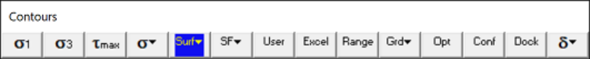
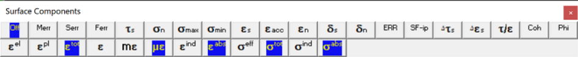
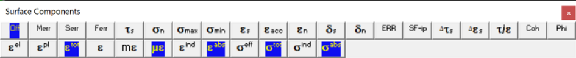
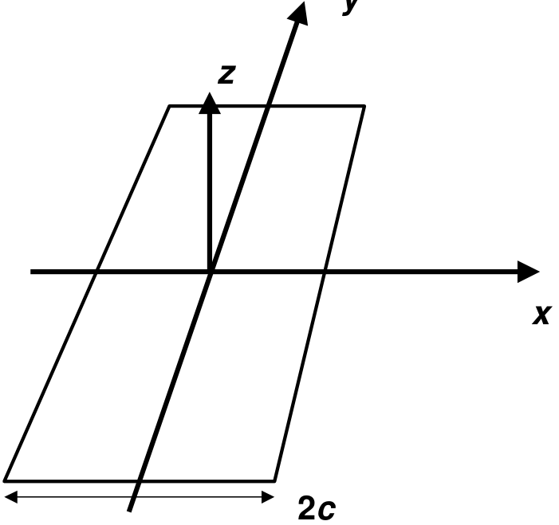
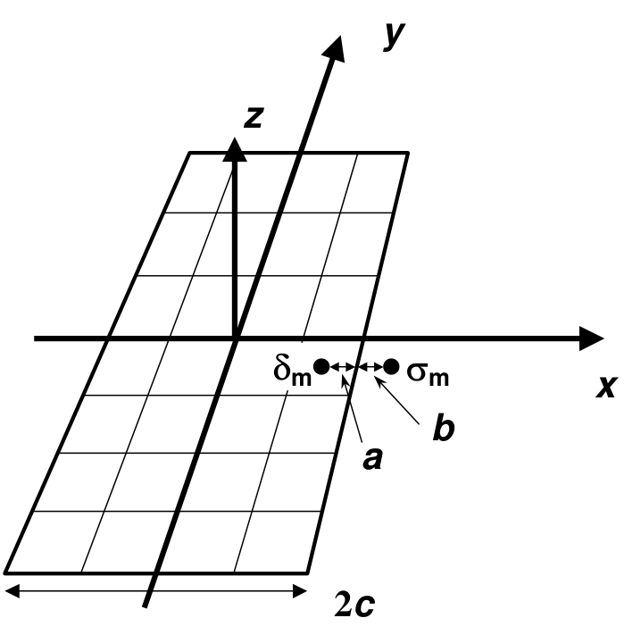
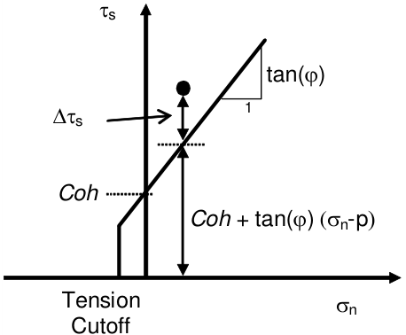
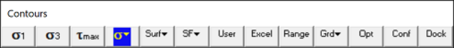

## 5.3.7.1 Contours de surface désactivés

Désactive les contours.

Cette composante est accessible via la barre d'outils Strength Factor Components, comme suit :

Cette barre d'outils peut passer à l'orientation verticale en la faisant glisser contre le bord droit ou gauche de la fenêtre principale.

Elle peut revenir à l'orientation horizontale en la faisant glisser contre le bord supérieur ou inférieur de la fenêtre principale.

Sélectionner le bouton de la barre d'outils Contours active la barre d'outils Surface Components.

## 5.3.7.2 Serr Erreur de contrainte

Trace les contours de l'erreur de contrainte de surface.

Ces composantes sont accessibles via la barre d'outils Strength Factor Components, comme suit :

Cette barre d'outils peut passer à l'orientation verticale en la faisant glisser contre le bord droit ou gauche de la fenêtre principale.

Elle peut revenir à l'orientation horizontale en la faisant glisser contre le bord supérieur ou inférieur de la fenêtre principale.

Sélectionner le bouton de la barre d'outils Contours active la barre d'outils Surface Components.

Pendant la résolution de la matrice, Map3D tente de résoudre progressivement les équations simultanées enregistrées dans la matrice des coefficients, ainsi que toute autre équation décrivant les zones de matériau alterné, le glissement de failles, le fluage, etc. Le solveur itératif fonctionne en déterminant l'erreur de la solution courante de chaque équation simultanée (l'erreur de contrainte de surface), puis en réduisant ces erreurs par un processus d'approximations successives.

Le Stress Error trace les contours de l'erreur de contrainte actuelle sur toutes les surfaces.

Le Maximum Stress Error trace les contours des emplacements où se produisent les erreurs de contrainte maximales.

On considère qu'une solution convergée a été obtenue lorsque l'erreur maximale de contrainte de surface et l'erreur maximale du critère de rupture sont ramenées en dessous de la tolérance de contrainte STOL spécifiée par l'utilisateur

Analysis > CParams

#### Related Topics:

Plot > Surface Components > Ferr - Failure Error

Analysis Dialog

## 5.3.7.3 Ferr Erreur de rupture

Trace les contours de l'erreur du critère de rupture de surface.

Cette composante est accessible via la barre d'outils Strength Factor Components, comme suit :

Cette barre d'outils peut passer à l'orientation verticale en la faisant glisser contre le bord droit ou gauche de la fenêtre principale.

Elle peut revenir à l'orientation horizontale en la faisant glisser contre le bord supérieur ou inférieur de la fenêtre principale.

Sélectionner le bouton de la barre d'outils Contours active la barre d'outils Surface Components.

Pendant la résolution de la matrice, Map3D tente de résoudre progressivement les équations simultanées enregistrées dans la matrice des coefficients, ainsi que toute autre équation décrivant les zones de matériau alterné, le glissement de failles, le fluage, etc. Le solveur itératif fonctionne en déterminant l'erreur de la solution courante de chaque équation simultanée (l'erreur de contrainte de surface), puis en réduisant ces erreurs par un processus d'approximations successives.

On considère qu'une solution convergée a été obtenue lorsque l'erreur maximale de contrainte de surface et l'erreur maximale du critère de rupture sont ramenées en dessous de la tolérance de contrainte STOL spécifiée par l'utilisateur

Analysis > CParams

L'erreur du critère de rupture n'est utilisée que pour les analyses de fluage non linéaires (y compris le glissement de failles et la non-linéarité des matériaux 3D). Ce paramètre doit toujours être proche de zéro, sauf si une certaine viscosité a été spécifiée et que le problème devient non linéaire. Dans ce dernier cas, le fluage visqueux peut permettre des états de contraintes supérieurs au critère de rupture, ce qui indique un manque d'équilibre statique.

#### Related Topics:

Plot > Surface Components > Serr - Stress Error

Analysis > Options > Creep Analysis Dialog

## 5.3.7.4 Contrainte de cisaillement

Trace les contours de la contrainte de cisaillement maximale dans le plan de la surface. Cette composante est accessible via la barre d'outils Strength Factor Components, comme suit :

Cette barre d'outils peut passer à l'orientation verticale en la faisant glisser contre le bord droit ou gauche de la fenêtre principale.

Elle peut revenir à l'orientation horizontale en la faisant glisser contre le bord supérieur ou inférieur de la fenêtre principale.

Sélectionner le bouton de la barre d'outils Contours active la barre d'outils Surface Components.

En analyse élastique, la contrainte de cisaillement maximale dans le plan est normalement utilisée avec la contrainte normale dans le plan et le critère de résistance de Mohr-Coulomb pour estimer l'ampleur du glissement dû à la surcontrainte sur une faille, un système de joints ou un plan de stratification.

En revanche, en analyse non linéaire, la contrainte de cisaillement maximale dans le plan ne peut jamais dépasser la résistance, sauf si un certain fluage est utilisé. Dans ce dernier cas, le fluage visqueux peut permettre des états de contraintes supérieurs au critère de rupture, ce qui indique un manque d'équilibre statique. Par conséquent, en analyse non linéaire, on considère normalement directement l'ampleur du glissement prédite par le modèle

Mohr-Coulomb in DD planes

Fault-Gouge in DD planes

Backfill-Hyperbolic in DD planes

La plage de contours se définit avec

Plot > Range

Cette composante peut être ajoutée à la barre d'outils des contours si vous le souhaitez

Tools > Configure Contouring Toolbar

#### Related Topics:

Plot > Surface Components > Sn Normal Stress Plot > Surface Components > dTs - Excess Shear Stress Plot > Surface Components > dEs - Incremental Shear Strain Plot > Surface Components > Es - Shear Strain Plot > Surface Components > ds - Shear Displacement (Ride)

## 5.3.7.5 Contrainte normale

Trace les contours de la contrainte normale à la surface.

Cette composante est accessible via la barre d'outils Strength Factor Components, comme suit :

Cette barre d'outils peut passer à l'orientation verticale en la faisant glisser contre le bord droit ou gauche de la fenêtre principale.

Elle peut revenir à l'orientation horizontale en la faisant glisser contre le bord supérieur ou inférieur de la fenêtre principale.

Sélectionner le bouton de la barre d'outils Contours active la barre d'outils Surface Components.

En analyse élastique, la contrainte de cisaillement maximale dans le plan est normalement utilisée avec la contrainte normale dans le plan et le critère de résistance de Mohr-Coulomb pour estimer l'ampleur du glissement dû à la surcontrainte sur une faille, un système de joints ou un plan de stratification.

En revanche, en analyse non linéaire, la contrainte de cisaillement maximale dans le plan ne peut jamais dépasser la résistance, sauf si un certain fluage est utilisé. Dans ce dernier cas, le fluage visqueux peut permettre des états de contraintes supérieurs au critère de rupture, ce qui indique un manque d'équilibre statique. Par conséquent, en analyse non linéaire, on considère normalement directement l'ampleur du glissement prédite par le modèle

Mohr-Coulomb in DD planes

Fault-Gouge in DD planes

Backfill-Hyperbolic in DD planes

La plage de contours se définit avec

Plot > Range

Cette composante peut être ajoutée à la barre d'outils des contours si vous le souhaitez

Tools > Configure Contouring Toolbar

#### Related Topics:

Plot > Surface Components > Ts Shear Stress

Plot > Surface Components > dTs - Excess Shear Stress

Plot > Surface Components > dEs - Incremental Shear Strain

Plot > Surface Components > Es - Shear Strain

Plot > Surface Components > ds - Shear Displacement (Ride)

## 5.3.7.6 Contrainte tangentielle maximale

Trace les contours des contraintes tangentes à la surface. Ces composantes sont accessibles via la barre d'outils Strength Factor Components, comme suit :

Cette barre d'outils peut passer à l'orientation verticale en la faisant glisser contre le bord droit ou gauche de la fenêtre principale.

Elle peut revenir à l'orientation horizontale en la faisant glisser contre le bord supérieur ou inférieur de la fenêtre principale.

Sélectionner le bouton de la barre d'outils Contours active la barre d'outils Surface Components.

Dans les analyses élastiques, les contraintes tangentielles ne sont pas calculées sauf demande explicite. En effet, elles ne sont pas nécessaires au processus de résolution et demandent un temps d'analyse supplémentaire. Ce calcul se demande en cochant Analysis > Options > Calculate Tangential Stress Components.

Ces valeurs sont calculées par défaut lors d'une analyse plastique.

En analyse élastique, la contrainte tangentielle maximale est souvent appelée contrainte en fibre extrême. C'est utile pour repérer les endroits où les contraintes dépassent la résistance à la compression simple ou la résistance à la traction du massif rocheux.

La plage de contours se définit avec

Plot > Range

Cette composante peut être ajoutée à la barre d'outils des contours si vous le souhaitez

Tools > Configure Contouring Toolbar

## 5.3.7.8 Déformation de cisaillement

Trace les contours de la déformation de cisaillement qui se produit dans le matériau de remplissage des éléments DD. Cette composante est accessible via la barre d'outils Strength Factor Components, comme suit :

Cette barre d'outils peut passer à l'orientation verticale en la faisant glisser contre le bord droit ou gauche de la fenêtre principale.

Elle peut revenir à l'orientation horizontale en la faisant glisser contre le bord supérieur ou inférieur de la fenêtre principale.

Sélectionner le bouton de la barre d'outils Contours active la barre d'outils Surface Components.

La déformation de cisaillement est déterminée en divisant le déplacement de cisaillement (ride) par l'épaisseur du plan DD.

CAD > Edit > Entity Properties > DDplane Thickess

Notez que trois composantes de la déformation peuvent être contourées :

Plot > Surface Components > Value > Elastic Plot > Surface Components > Value > Plastic Plot > Surface Components > Value > Total

Il existe aussi deux façons différentes de présenter la déformation :

Plot > Strain > Value > Induced Strain Plot > Strain > Value > Absolute Strain

Notez qu'il s'agit du niveau actuel de déformation de cisaillement agissant sur les surfaces DD.

Comme le déplacement peut changer de direction et même s'inverser pendant le glissement, la déformation de cisaillement totale cumulée peut donner des valeurs différentes.

La plage de contours se définit avec

Plot > Range

Cette composante peut être ajoutée à la barre d'outils des contours si vous le souhaitez

Tools > Configure Contouring Toolbar

#### Related Topics:

Plot > Surface Components > dEs - Incremental Shear Strain

Plot > Surface Components > ds - Shear Displacement (Ride)

## 5.3.7.10 Déformation normale

Trace les contours de la déformation normale qui se produit dans le matériau de remplissage des éléments DD. Cette composante est accessible via la barre d'outils Strength Factor Components, comme suit :

Cette barre d'outils peut passer à l'orientation verticale en la faisant glisser contre le bord droit ou gauche de la fenêtre principale.

Elle peut revenir à l'orientation horizontale en la faisant glisser contre le bord supérieur ou inférieur de la fenêtre principale.

Sélectionner le bouton de la barre d'outils Contours active la barre d'outils Surface Components.

La déformation normale est déterminée en divisant le déplacement normal (convergence) par l'épaisseur du plan DD

#### CAD > Edit > Entity Properties > DDplane Thickess

Notez que trois composantes de la déformation peuvent être contourées :

Plot > Surface Components > Value > Elastic Plot > Surface Components > Value > Plastic Plot > Surface Components > Value > Total

La plage de contours se définit avec

Plot > Range

Cette composante peut être ajoutée à la barre d'outils des contours si vous le souhaitez

Tools > Configure Contouring Toolbar

#### Related Topics:

Plot > Surface Components > dn - Normal Displacement (Closure)

## 5.3.7.11 Déplacement de cisaillement (Ride)

Trace les contours du ride ou déplacement de cisaillement qui se produit sur les éléments DD. Cette composante est accessible via la barre d'outils Strength Factor Components, comme suit :

Cette barre d'outils peut passer à l'orientation verticale en la faisant glisser contre le bord droit ou gauche de la fenêtre principale.

Elle peut revenir à l'orientation horizontale en la faisant glisser contre le bord supérieur ou inférieur de la fenêtre principale.

Sélectionner le bouton de la barre d'outils Contours active la barre d'outils Surface Components.

Notez que trois composantes du déplacement de cisaillement peuvent être contourées :

Plot > Surface Components > Value > Elastic Plot > Surface Components > Value > Plastic Plot > Surface Components > Value > Total

Il existe aussi deux façons différentes de présenter le déplacement :

Plot > Strain > Value > Induced Strain Plot > Strain > Value > Absolute Strain

La plage de contours se définit avec

Plot > Range

Cette composante peut être ajoutée à la barre d'outils des contours si vous le souhaitez

Tools > Configure Contouring Toolbar

#### Related Topics:

Plot > Surface Components > dEs - Incremental Shear Strain Plot > Surface Components > Es - Shear Strain

## 5.3.7.12 Déplacement normal (convergence)

Trace les contours de la convergence ou déplacement normal qui se produit sur les éléments DD. Cette composante est accessible via la barre d'outils Strength Factor Components, comme suit :

Cette barre d'outils peut passer à l'orientation verticale en la faisant glisser contre le bord droit ou gauche de la fenêtre principale.

Elle peut revenir à l'orientation horizontale en la faisant glisser contre le bord supérieur ou inférieur de la fenêtre principale.

Sélectionner le bouton de la barre d'outils Contours active la barre d'outils Surface Components.

Notez que trois composantes de la convergence peuvent être contourées :

Plot > Surface Components > Value > Elastic Plot > Surface Components > Value > Plastic Plot > Surface Components > Value > Total

La plage de contours se définit avec

Plot > Range

Cette composante peut être ajoutée à la barre d'outils des contours si vous le souhaitez

Tools > Configure Contouring Toolbar

#### Related Topics:

Plot > Surface Components > ds - Shear Displacement (Ride)

## 5.3.7.13 ERR

Calcule le taux de libération d'énergie.

Cette composante est accessible via la barre d'outils Strength Factor Components, comme suit :

Cette barre d'outils peut passer à l'orientation verticale en la faisant glisser contre le bord droit ou gauche de la fenêtre principale.

Elle peut revenir à l'orientation horizontale en la faisant glisser contre le bord supérieur ou inférieur de la fenêtre principale.

Sélectionner le bouton de la barre d'outils Contours active la barre d'outils Surface Components.

Cette routine permet à l'utilisateur de calculer le taux de libération d'énergie ( _ERR_ ) en avant d'un front d'excavation. Une autre méthode permet de calculer _ERR_ à n'importe quel emplacement souhaité : Analysis > Options > LERD/LSS

#### Crack-tip Formulation

Considérons une fissure plane dans un milieu élastique homogène infini. Il est bien connu qu'à proximité de la pointe de la fissure, l'ouverture d présente une réponse en Ö _r_ près du front

et la contrainte s présente une réponse en 1/Ö _r_

où _r_ représente la distance à la pointe de la fissure.

L'énergie totale libérée peut être déterminée pour un petit incrément d'avancement du front a en superposant le déplacement normal (convergence) à la contrainte sur la région a. Cela exige de décaler le système de coordonnées de d de la distance a, ce qui donne

L'énergie totale libérée peut alors être calculée à partir de (l'intégrale est prise de 0 à a)

- _W_ = ½ ò s d _dr_

[4] = ½ _p_ d _p_ s ò Ö(a- _r_ )/Ö _r dr_ = ¼ p a _p_ d _p_ s

Le taux de libération d'énergie peut maintenant être déterminé en dérivant par rapport à a pour aboutir à

Cette expression ne suppose que le fait que d présente une réponse en Ö _r_ près du front et que s présente une réponse en 1/Ö _r_ près du front. Aucune hypothèse sur la géométrie n'a été faite. Il n'est pas nécessaire que _p_ d soit lié à _p_ s de quelque manière que ce soit. Notez que ces hypothèses ne sont vraies que dans un milieu élastique homogène infini. Près d'interfaces bi-matériaux ou d'autres surfaces d'excavation, ces hypothèses ne tiennent plus.

#### Analytical Solution for a Planar Crack

Considérons une fissure plane de largeur 2 _c_ et de longueur égale à huit fois la largeur.

Pour une telle forme, l'ouverture (déplacement normal ou convergence) peut être déterminée analytiquement comme (à la section médiane)

#### d = 4(1-n²)/ _E p_ Ö( _c_ ²- _x_ ²) [6]

où _E_ et n représentent respectivement le module de Young (à l'échelle du massif rocheux, de déformation) et le coefficient de Poisson, et _p_ représente l'état de contraintes homogène antérieur à l'exploitation. La contrainte en avant de la pointe de la fissure peut aussi être déterminée analytiquement comme

Le travail effectué pour déformer les surfaces de la fissure est équivalent à l'énergie totale libérée et peut être déterminé comme suit (l'intégrale est prise de - _c_ à + _c_ )

- _W_ = ½ ò _p_ d _dx_

[8] = 2p (1-n²) _p_ ²/ _E_ ò Ö( _c_ ²- _x_ ²) _dx_

- = p (1-n²) _p_ ² _c_ ²/ _E_

À mesure que la longueur de la fissure augmente, l'énergie libérée par unité de longueur d'extension de la fissure peut être déterminée par dérivation comme

Pour l'extension d'une seule extrémité de la fissure, on obtient le taux de libération d'énergie égal à la moitié de cette valeur

_ERR_ = p (1-n²) _p_ ² _c_ / _E_ [10]

#### Comparison with Planar Crack Solution

Si l'on compare maintenant la géométrie de fissure plane avec la formulation de pointe de fissure, on observe que, pour la fissure plane (en comparant les équations [1] et [2] avec [6] et [7])

_p_ d = 4(1-n²)/ _E p_ Ö(2 _c_ ) [11] _p_ s = _p_ Ö(c/2) [12]

L'observation de ces équations montre que ces deux paramètres peuvent être reliés, dans le cas d'une géométrie de fissure plane, par

_p_ d = 8(1-n²)/ _E p_ s [13]

En les substituant dans l'équation [5] pour _ERR_ , on obtient

_ERR_ = p (1-n²) _p_ ² _c_ / _E_ [14]

soit le même résultat que celui déterminé pour la fissure plane (équation [10]).

Diverses substitutions de _p_ d et _p_ s permettent de déterminer

_ERR_ = 2p (1-n²) p _p_ s²/ _E_ [15] et _ERR_ = 1/32 p _p_ d² _E_ /(1-n²) [16]

Cette dernière équation est la même expression que celle établie par Ryder et Jager (leur équation [11], p. 236, Rock Mechanics for Tabular Hard Rock Mines, 2002). Ils indiquent que cette équation est utilisée pour calculer _ERR_ dans MINSIM. Une forme de correction d'arête a (Ryder et Napier, Numerical Methods in Geomechanics, Nagoya, 1985) est apparemment aussi mise en œuvre, mais les détails de sa réalisation ne sont pas clairs.

#### _ERR_ Calculation in Map3D

_p_ d et _p_ s peuvent tous deux être déterminés par modélisation numérique.

Par exemple, étant donné le déplacement normal (convergence) dm déterminé à une distance _a_ derrière le front en avancement, _p_ d peut être déterminé à l'aide de l'équation [1] comme

De même, étant donné la contrainte sm à une distance _b_ en avant du front en avancement, _p_ s peut être déterminé à l'aide de l'équation [2] comme

Notez qu'il n'y a aucune raison pour que _a_ soit égal à _b_ ; il n'est donc pas nécessaire d'avoir des tailles uniformes d'éléments de frontière.

Une fois que l'un des deux, _p_ d ou _p_ s, ou les deux, sont déterminés, _ERR_ se calcule facilement à partir de l'équation [5], [15] ou [16].

Des études détaillées des distributions de contraintes et de déplacements près de la pointe de la fissure révèlent que, pour des éléments DD constants, l'ouverture comme la contrainte sont systématiquement surestimées. Heureusement, le degré de surestimation est étroitement lié à la taille de l'élément, et l'on constate qu'en multipliant _a_ par 3/2 et _b_ par 2/3, on obtient des résultats beaucoup plus précis. Avec ces substitutions, et en utilisant les équations [17] et [18], _ERR_ peut être déterminé à partir de

- _ERR_ = 1/6 p dm sm Ö(2/3 _b)_ / Ö(3/2 _a)_

- = 1/6 p dm sm Ö( _b_ / _a)_ [19]

Cette équation est utilisée pour calculer _ERR_ dans Map3D.

#### An Example

Avec _E_ de 60000 MPa, n de 0,25, _p_ de 100 MPa et _c_ de 100 m, on calcule des valeurs théoriques de _p_ s de 707,11, de _p_ d de 0,088388 et de 49,1 MN/m pour _ERR_

Cela peut être modélisé avec Map3D en utilisant des éléments uniformes de largeur _w_, pour obtenir les résultats suivants :

|_w_(m)|_b_=_a_(m)|sm (MPa)|dm (m)|_ERR _(MN/m)|error|
|---|---|---|---|---|---|
|50|25|197.567|0.5209|53.9|+9.8%|
|25|12.5|262.669|0.3754|51.6|+5.2%|
|12.5|6.25|358.943|0.2679|50.3|+2.5%|
|10|5|398.56|0.2402|50.1|+2.1%|
|6.25|3.125|498.323|0.1903|49.6|+1.0%|
|5|2.5|554.58|0.1705|49.5|+0.9%|
|3.125|1.5625|697.764|0.1349|49.3|+0.4%|

Notez que la contrainte sm et le déplacement normal (convergence) dm sont déterminés aux centres des éléments. Comme des largeurs d'éléments uniformes ont été utilisées, _a_ est égal à _b_ et égal à ½ _w_

## 5.3.7.14 SF-D Résistance/Contrainte

Trace les contours du rapport résistance/contrainte sur les éléments DD. Cette composante est accessible via la barre d'outils Strength Factor Components, comme suit :

Cette barre d'outils peut passer à l'orientation verticale en la faisant glisser contre le bord droit ou gauche de la fenêtre principale.

Elle peut revenir à l'orientation horizontale en la faisant glisser contre le bord supérieur ou inférieur de la fenêtre principale.

Sélectionner le bouton de la barre d'outils Contours active la barre d'outils Surface Components.

En analyse élastique, la contrainte de cisaillement maximale dans le plan est normalement utilisée avec la contrainte normale dans le plan et le critère de résistance de Mohr-Coulomb pour estimer l'ampleur du glissement dû à la surcontrainte sur une faille, un système de joints ou un plan de stratification.

En revanche, en analyse non linéaire, la contrainte de cisaillement maximale dans le plan ne peut jamais dépasser la résistance, sauf si un certain fluage est utilisé. Dans ce dernier cas, le fluage visqueux peut permettre des états de contraintes supérieurs au critère de rupture, ce qui indique un manque d'équilibre statique. Par conséquent, en analyse non linéaire, on considère normalement directement l'ampleur du glissement prédite par le modèle

Mohr-Coulomb in DD planes

Fault-Gouge in DD planes

Backfill-Hyperbolic in DD planes

#### Mohr-Coulomb

Strength/Stress   peut être déterminé comme  [ Cohesion + (sn-p) tan(j) ] / ts

dTs   Excess Shear Stress  peut être déterminé comme Dts = ts - [ Cohesion + (sn-p) tan(j) ]

Si la pression de fluide est spécifiée dans le cadre du Stress State, la contrainte normale effective (sn-p) est utilisée (ici p est la pression de fluide).

La plage de contours se définit avec

Plot > Range

Cette composante peut être ajoutée à la barre d'outils des contours si vous le souhaitez

Tools > Configure Contouring Toolbar

#### Related Topics:

Plot > Surface Components > dTs - Excess Shear Stress

## 5.3.7.15 Contrainte de cisaillement excédentaire

Trace les contours de la contrainte excédentaire Dts sur les éléments DD.

Cette composante est accessible via la barre d'outils Strength Factor Components, comme suit :

Cette barre d'outils peut passer à l'orientation verticale en la faisant glisser contre le bord droit ou gauche de la fenêtre principale.

Elle peut revenir à l'orientation horizontale en la faisant glisser contre le bord supérieur ou inférieur de la fenêtre principale.

Sélectionner le bouton de la barre d'outils Contours active la barre d'outils Surface Components.

Cette fonction n'est utilisée que dans les analyses non linéaires (blocs FF 3D dans Map3D Non-Linear et plans DD dans Map3D Fault-Slip). Pour plus de détails, voir

CAD > Properties > Material Properties

À chaque pas de fluage, l'état de contraintes de tous les éléments en plastification (éléments où la contrainte dépasse la résistance) est calculé comme la résistance plus la résistance au fluage. Cela limite la taille de l'incrément de fluage plastique Deplastic sur chaque élément en plastification

- ts = Strength + _C_ Deplastic /D _t_

- _C_ = _G_ D _t_

où la résistance au fluage est déterminée comme le coefficient de fluage _C_ multiplié par la vitesse de déformation plastique. Notez que l'utilisateur doit choisir à la fois le coefficient de fluage _C_ et la taille du pas de temps D _t_, puis spécifier leur quotient comme module visqueux _G_ . La contribution à la contrainte ts apportée par l'incrément de fluage est la contrainte excédentaire donnée par

Dts   = _C_ Deplastic /D _t_

La déformation plastique cumulée eplastic est déterminée comme la somme des incréments de fluage plastique Deplastic de tous les pas de fluage.

#### Related Topics:

Plot > Surface Components > dEs - Incremental Shear Strain Plot > Surface Components > Ts - Shear Stress Plot > Surface Components > Es - Shear Strain

Analysis > Options > Creep

## 5.3.7.16 Déformation de cisaillement incrémentale

Trace les contours de l'incrément de fluage plastique Deplastic sur les éléments DD.

Cette composante est accessible via la barre d'outils Strength Factor Components, comme suit :

Cette barre d'outils peut passer à l'orientation verticale en la faisant glisser contre le bord droit ou gauche de la fenêtre principale.

Elle peut revenir à l'orientation horizontale en la faisant glisser contre le bord supérieur ou inférieur de la fenêtre principale.

Sélectionner le bouton de la barre d'outils Contours active la barre d'outils Surface Components.

Cette fonction n'est utilisée que dans les analyses non linéaires (blocs FF 3D dans Map3D Non-Linear et plans DD dans Map3D Fault-Slip). Pour plus de détails, voir

CAD > Properties > Material Properties

À chaque pas de fluage, l'état de contraintes de tous les éléments en plastification (éléments où la contrainte dépasse la résistance) est calculé comme la résistance plus la résistance au fluage. Cela limite la taille de l'incrément de fluage plastique Deplastic sur chaque élément en plastification

- ts = Strength + _C_ Deplastic /D _t_

- _C_ = _G_ D _t_

où la résistance au fluage est déterminée comme le coefficient de fluage _C_ multiplié par la vitesse de déformation plastique. Notez que l'utilisateur doit choisir à la fois le coefficient de fluage _C_ et la taille du pas de temps D _t_, puis spécifier leur quotient comme module visqueux _G_ . La contribution à la contrainte ts apportée par l'incrément de fluage est la contrainte excédentaire donnée par

Dts   = _C_ Deplastic /D _t_

La déformation plastique cumulée eplastic est déterminée comme la somme des incréments de fluage plastique Deplastic de tous les pas de fluage.

Notez que, comme l'utilisateur doit choisir la taille du pas de temps D _t_ pour définir le module visqueux _G_ , la vitesse de déformation de cisaillement se détermine facilement à partir de la déformation de cisaillement incrémentale Deplastic, simplement en divisant par la taille du pas de temps.

#### Related Topics:

Plot > Surface Components > dTs - Excess Shear Stress

Plot > Surface Components > Ts - Shear Stress

Plot > Surface Components > Es - Shear Strain

Analysis > Options > Creep

## 5.3.7.17 Rapport contrainte/vitesse de déformation

Trace les contours de la contrainte excédentaire divisée par l'incrément de fluage plastique Dts / Deplastic sur les éléments DD. Cette composante est accessible via la barre d'outils Strength Factor Components, comme suit :

Cette barre d'outils peut passer à l'orientation verticale en la faisant glisser contre le bord droit ou gauche de la fenêtre principale.

Elle peut revenir à l'orientation horizontale en la faisant glisser contre le bord supérieur ou inférieur de la fenêtre principale.

Sélectionner le bouton de la barre d'outils Contours active la barre d'outils Surface Components.

Cette fonction n'est utilisée que dans les analyses non linéaires (blocs FF 3D dans Map3D Non-Linear et plans DD dans Map3D Fault-Slip). Pour plus de détails, voir

CAD > Properties > Material Properties

À chaque pas de fluage, l'état de contraintes de tous les éléments en plastification (éléments où la contrainte dépasse la résistance) est calculé comme la résistance plus la résistance au fluage. Cela limite la taille de l'incrément de fluage plastique Deplastic sur chaque élément en plastification

- ts = Strength + _C_ Deplastic /D _t_

- _C_ = _G_ D _t_

où la résistance au fluage est déterminée comme le coefficient de fluage _C_ multiplié par la vitesse de déformation plastique. Notez que l'utilisateur doit choisir à la fois le coefficient de fluage _C_ et la taille du pas de temps D _t_, puis spécifier leur quotient comme module visqueux _G_ . La contribution à la contrainte ts apportée par l'incrément de fluage est la contrainte excédentaire donnée par

Dts   = _C_ Deplastic /D _t_

La déformation plastique cumulée eplastic est déterminée comme la somme des incréments de fluage plastique Deplastic de tous les pas de fluage.

#### Related Topics:

Plot > Surface Components > dTs - Excess Shear Stress Plot > Surface Components > dEs - Incremental Shear Strain Plot > Surface Components > Ts - Shear Stress Plot > Surface Components > Es - Shear Strain

#### Analysis > Options > Creep

## 5.3.7.18 Cohésion

Trace les contours de la cohésion et de l'angle de frottement du matériau de gouge. Ces composantes sont accessibles via la barre d'outils Strength Factor Components, comme suit :

Cette barre d'outils peut passer à l'orientation verticale en la faisant glisser contre le bord droit ou gauche de la fenêtre principale.

Elle peut revenir à l'orientation horizontale en la faisant glisser contre le bord supérieur ou inférieur de la fenêtre principale.

Sélectionner le bouton de la barre d'outils Contours active la barre d'outils Surface Components.

Cela présente un intérêt particulier lorsque vous utilisez le type de matériau Equilibrated-Gouge, puisque la cohésion et l'angle de frottement peuvent varier d'un endroit à l'autre.

## 5.3.7.20 Température/Charge hydraulique

Trace les contours de la température ou de la charge hydraulique.

Map3D Thermal-Fluid Flow peut servir à résoudre simultanément l'écoulement permanent de chaleur/de fluide couplé à l'analyse des contraintes. Le programme est conçu de sorte que l'utilisateur n'ait qu'à spécifier les conditions aux limites de température/charge hydraulique ; le problème couplé de contraintes et d'écoulement thermique/de fluide est ensuite résolu simultanément. Cette fonction est utile pour simuler des effets de chauffage ou de refroidissement et la réponse drainée ou non drainée des sols.

Pour plus de détails, voir

#### Expansion Coefficient and Conductivity

La plage de contours se définit avec

Plot > Range

Cette composante peut être ajoutée à la barre d'outils des contours si vous le souhaitez

Tools > Configure Contouring Toolbar

## 5.3.7.21 Flux normal

Trace les contours du débit normal à la surface.

Map3D Thermal-Fluid Flow peut servir à résoudre simultanément l'écoulement permanent de chaleur/de fluide couplé à l'analyse des contraintes. Le programme est conçu de sorte que l'utilisateur n'ait qu'à spécifier les conditions aux limites de température/charge hydraulique ; le problème couplé de contraintes et d'écoulement thermique/de fluide est ensuite résolu simultanément. Cette fonction est utile pour simuler des effets de chauffage ou de refroidissement et la réponse drainée ou non drainée des sols.

Pour plus de détails, voir

Expansion Coefficient and Conductivity

La plage de contours se définit avec

Plot > Range

Cette composante peut être ajoutée à la barre d'outils des contours si vous le souhaitez

Tools > Configure Contouring Toolbar

## 5.3.7.22 Valeur

5.3.7.22.1  Déformation élastique

Sélectionne la composante de la déformation élastique, plastique ou totale. Ces composantes sont accessibles via la barre d'outils Strain Components, comme suit :

Cette barre d'outils peut passer à l'orientation verticale en la faisant glisser contre le bord droit ou gauche de la fenêtre principale.

Elle peut revenir à l'orientation horizontale en la faisant glisser contre le bord supérieur ou inférieur de la fenêtre principale.

Sélectionner le bouton de la barre d'outils Contours active la barre d'outils Stress Components.

Vous pouvez ajouter ce bouton à la barre d'outils Contours avec le bouton de configuration.

Pour plus de détails, voir

Mohr-Coulomb in 3D FF blocks.

### 5.3.7.22.4 Déformation absolue

Trace la composante de la déformation induite ou de la déformation absolue.

Cette composante est accessible via la barre d'outils Strain Components, comme suit :

Cette barre d'outils peut passer à l'orientation verticale en la faisant glisser contre le bord droit ou gauche de la fenêtre principale.

Elle peut revenir à l'orientation horizontale en la faisant glisser contre le bord supérieur ou inférieur de la fenêtre principale.

Sélectionner le bouton de la barre d'outils Contours active la barre d'outils Stress Components.

Vous pouvez ajouter ce bouton à la barre d'outils Contours avec le bouton de configuration.

La déformation induite est la déformation sans la contribution de la déformation antérieure à l'exploitation. Elle représente la variation de déformation depuis l'état antérieur à l'exploitation.

La déformation absolue est la déformation incluant la contribution de la déformation antérieure à l'exploitation.

Voir aussi :

Plot > Stress > Value > Induced Strain Plot > Stress > Value > Absolute Strain

### 5.3.7.22.6 Contrainte induite

Trace la composante de la contrainte induite ou de la contrainte absolue. Ces composantes sont accessibles via la barre d'outils Stress Components, comme suit :

Cette barre d'outils peut passer à l'orientation verticale en la faisant glisser contre le bord droit ou gauche de la fenêtre principale.

Elle peut revenir à l'orientation horizontale en la faisant glisser contre le bord supérieur ou inférieur de la fenêtre principale.

Sélectionner le bouton de la barre d'outils Contours active la barre d'outils Stress Components.

La contrainte induite est la contrainte sans la contribution de la contrainte antérieure à l'exploitation. Elle représente la variation de contrainte depuis l'état antérieur à l'exploitation.

La contrainte absolue est la contrainte incluant la contribution de la contrainte antérieure à l'exploitation.

Voir aussi :

Plot > Strain > Value > Induced Strain

Plot > Strain > Value > Absolute Strain
