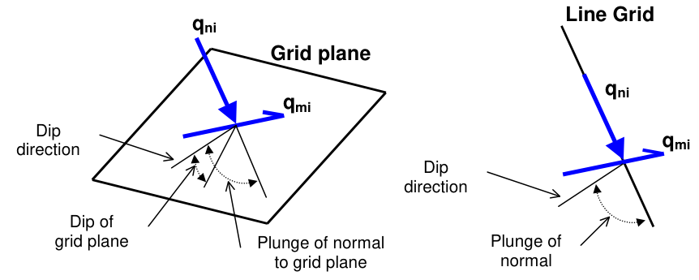
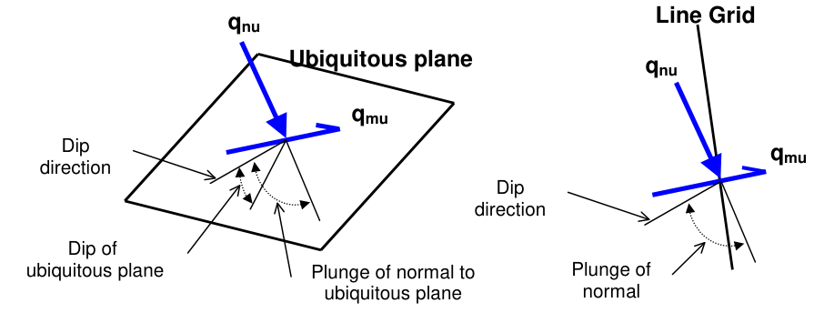

## 5.3.5.1 Plot > Thermal/Flux

Active la barre d'outils Thermal/Flux, après une analyse BEM d'écoulement thermo-fluide de Map3D.

Les paramètres de l'analyse thermique/de flux sont décrits dans Expansion Coefficient et Conductivity.

Cette barre d'outils donne un accès rapide aux composantes thermiques et de flux.

Plot > Flux > t/h   Température/Charge hydraulique

Plot > Flux > qtotal = ( qx² + qy² + qz² )½ Flux total   trace les contours du flux total

Plot > Flux > qx Flux X   trace les contours de la composante x du flux

Plot > Flux > qy Flux Y   trace les contours de la composante y du flux

Plot > Flux > qz Flux Z   trace les contours de la composante z du flux

Pour calculer le flux dans le plan, l'état de flux en chaque point du plan de grille est réorienté afin de déterminer le flux maximal parallèle au plan de grille et le flux normal au plan. Notez que qni est orienté normalement au plan de grille et parallèlement à la direction d'une grille linéaire.

Plot > Flux > qni Normale dans le plan   trace les contours de la composante du flux normale au plan de grille.

Plot > Flux > qmi Maximum dans le plan   trace les contours du flux maximal tangent au plan de grille.

Pour calculer le flux du plan ubiquiste n° 1, l'état de flux en chaque point du plan de grille est réorienté afin de déterminer le flux maximal parallèle au plan ubiquiste n° 1 et le flux normal au plan. Notez que dmi n'est pas orienté normalement au plan de grille.

Plot > Flux > qnu Normale au plan ubiquiste   trace les contours de la composante du flux normale au plan ubiquiste.

Plot > Flux > qmu Maximum dans le plan ubiquiste   trace les contours du flux maximal tangent au plan ubiquiste.

- la direction de pendage est mesurée positivement dans le sens horaire à partir de l'axe y.

- le pendage du plan est mesuré positivement vers le bas à partir de l'horizontale (c'est-à-dire la direction de pendage).

- le plongement de la normale est mesuré positivement vers le bas (c'est-à-dire négativement vers le haut) à partir de l'horizontale.

#### Remarques :

La barre d'outils de flux ne peut être activée qu'après l'étape de construction du modèle (CAD)

#### Étapes d'analyse de Map3D.

L'orientation du plan de cisaillement ubiquiste se définit avec

Plot > Strength Factors > Ubiquitous Parameters

La plage de contours se définit avec

#### Plot > Range

Cette composante peut être ajoutée à la barre d'outils des contours si vous le souhaitez

Tools > Configure Contouring Toolbar > Displacement

Il peut être pratique d'ajouter le bouton

#### More Flow Components

à la barre d'outils des contours pour accéder rapidement à toutes les composantes d'écoulement.
