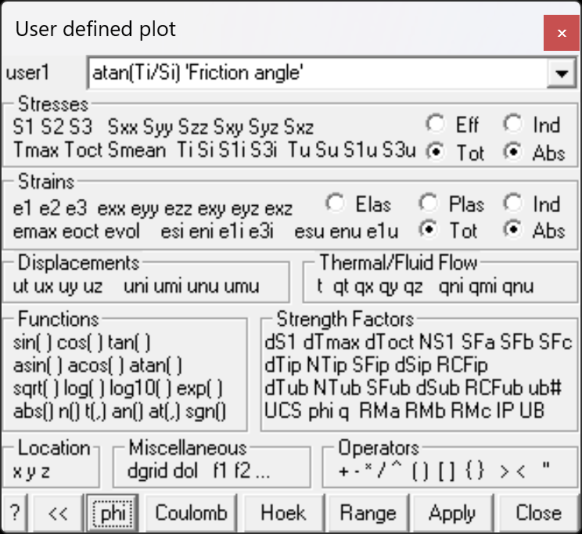

Trace les contours d'une composante de contrainte définie par l'utilisateur.

#### Stresses:

- S1 S2 S3 composantes de contrainte principale s1 s2 s3

- Sxx Syy Szz Sxy Syz Sxz composantes cartésiennes de la contrainte sxx syy szz txy tyz tzx

- Tmax contrainte de cisaillement maximale ½(s1 - s3)

- Toct contrainte de cisaillement octaédrique toct = ¹/3 [(s1 - s2)² + (s2 - s3)² +(s3 - s1)²]½

- Smean contrainte moyenne smean = ¹/3 (s1 + s2 + s3)

- Ti Si contrainte de cisaillement maximale et contrainte normale dans le plan de la grille tip sip

- S1i S3i contraintes maximale et minimale tangentes au plan de la grille s1i s3i

- Tu Su contrainte de cisaillement maximale et contrainte normale dans le plan ubiquiste tub sub. L'orientation du plan de cisaillement ubiquiste se définit avec

- S1u S3u contraintes maximale et minimale tangentes au plan ubiquiste s1u s3u \]

- Effective/Total composantes de la contrainte effective ou de la contrainte totale. Ces options ne sont utilisées que dans Map3D Thermal-Fluid Flow, car ce code permet de calculer les distributions de pression interstitielle en régime permanent.

- Induced/Absolute composantes de la contrainte induite ou de la contrainte absolue (c'est-à-dire la contrainte sans la contribution de la contrainte antérieure à l'exploitation).

#### Strains:

- e1 e2 e3 déformation principale majeure e1 e2 e3

- exx eyy ezz exy eyz exz composantes cartésiennes de la déformation exx eyy ezz exy eyz ezx

- emax déformation de cisaillement maximale ½(e1 - e3)

- eoct déformation de cisaillement octaédrique eoct = ¹/3 [(e1 - e2)² + (e2 - e3)² +(e3 - e1)²]½

- evol déformation volumique evol = (e1 + e2 + e3)

- esi eni déformation de cisaillement maximale et déformation normale dans le plan de la grille esi eni

- e1i e3i déformations maximale et minimale tangentes au plan de la grille e1i e3i

- esu enu déformation de cisaillement maximale et déformation normale dans le plan ubiquiste esu enu

- e1u e3u déformations maximale et minimale tangentes au plan ubiquiste e1u e3u

- Elastic/Plastic/Total composantes de la déformation élastique, plastique ou totale. Ces options ne sont utilisées que dans Map3D Non-Linear, car ce code permet de calculer les déformations non linéaires.

- Induced/Absolute composantes de la déformation induite ou de la déformation absolue (c'est-à-dire sans la contribution de la contrainte antérieure à l'exploitation).

#### Displacements:

- ut déplacement total, sa direction et son plongement dt

- · ux uy uz composantes cartésiennes du déplacement dx dy dz

- uni déplacement normal au plan de la grille dni

- umi déplacement maximal tangent au plan de la grille dmi

- unu déplacement normal au plan ubiquiste dnu

- umu déplacement maximal tangent au plan ubiquiste dmu

#### Thermal/Fluid Flow:

- t température/charge hydraulique

- qt flux total, sa direction et son plongement.

- qx qy qz composantes cartésiennes du flux.

- qni déplacement normal au plan de la grille.

- qmi déplacement maximal tangent au plan de la grille.

- qnu déplacement normal au plan ubiquiste.

- qmu déplacement maximal tangent au plan ubiquiste.

#### Functions:

- sin() cos() tan()   fonctions trigonométriques sinus, cosinus et tangente.

- asin() acos() atan()   fonctions trigonométriques inverses.

- sqrt()   fonction racine carrée.

- log()   fonction logarithme népérien.

- log10()   fonction logarithme décimal.

- exp()   fonction exponentielle (antilogarithme).

- abs()   valeur absolue.

- n() an()   loi de probabilité normale et normale inverse. L'argument utilisé avec la loi normale est (Ds1/ _s_ ), qui représente la contrainte principale majeure excédentaire divisée par l'écart type (voir ).

- t(,) at(,)   loi de probabilité de Student et son inverse. L'argument utilisé avec la loi de Student est (Ds1/ ( _sg),n_ -2), où Ds1 représente la contrainte principale majeure excédentaire, _s_ représente l'écart type, _n_ représente le nombre de données et _g_ représente le facteur  [1 + 1/ _n_ + (s3 - sm) ²/s3²/( _n_ -1)]½, où sm représente la valeur moyenne de s3 et s3 représente l'écart type de s3.

- sgn()   fonction signe : renvoie +1 pour les valeurs positives, -1 pour les valeurs négatives et 0 pour les valeurs de module inférieur à 10-12 .

#### Strength:

- ds1 contrainte principale majeure excédentaire Ds1 = s1 - ( _UCS_ + _q_ s3 )

- dtmax contrainte de cisaillement maximale excédentaire Dtmax = ½(s1 - s3) - [ _UCS_ + ½(s1+s3) ( _q_ -1) ]/( _q_ +1) = [s1 - ( _UCS_ + _q_ s3) ]/( _q_ +1)

- dtoct contrainte de cisaillement octaédrique excédentaire Dtoct = toct - [ _UCS_ + ( _q_ –1) smean ] Ö(2) /( _q_ +2)

- NS1 probabilité selon la loi normale N(Ds1 /std)

- SFA Résistance/Contrainte peut être déterminé pour Mohr-Coulomb comme ( _UCS_ + _q_ s3 )/ s1

- ou pour Hoek-Brown comme [ s3 + Ö( _m_ scs3 + _s_ sc²) ] / s1

- SFB Résistance/Contrainte peut être déterminé pour Mohr-Coulomb comme ( _UCS_ + _q_ s3 - s3 )/(s1 - s3) ou pour Hoek-Brown comme [ s3 + Ö( _m_ scs3 + _s_ sc²) ] / (s1 - s3)

- SFC Résistance/Contrainte peut être déterminé pour Mohr-Coulomb comme [ _UCS_ + ½(s1+s3) ( _q_ -1) ]/[ ½(s1 - s3)( _q_ +1) ]

ou pour Hoek-Brown comme &#123;Ö[1 /16 _m_ ²sc² + ½(s1 + s3) _m_ sc + _s_ sc²] - ¼ _m_ sc&#125;/(s1 - s3)

- dTip contrainte de cisaillement excédentaire dans le plan Dtip = tip - [ Cohesion + sip tan(j) ]

- NTip probabilité selon la loi normale N(Dtip /std)

- SFip Résistance/Contrainte peut être déterminé comme [ Cohesion + sip tan(j) ] / tip

- dSip contrainte excédentaire sur la paroi dans le plan Dsip = [ 3 s1i - s3i ] - UCS

- RCFip facteur d'état de la roche (Rock Condition Factor) pour la contrainte sur la paroi dans le plan RCFip = [ 3 s1i - s3i ]/UCS

- dTub contrainte de cisaillement excédentaire dans le plan ubiquiste Dtub

- NTub probabilité selon la loi normale N(Dtub /std)

- SFub Résistance/Contrainte peut être déterminé comme [ Cohesion + sub tan(j) ] / tub

- dSub contrainte excédentaire sur la paroi dans le plan ub Dsub = [ 3 s1ub - s3ub ] - UCS

- RCFub facteur d'état de la roche pour la contrainte sur la paroi dans le plan ub RCFip = [ 3 s1ub - s3ub ]/UCS

- UB# Trace le numéro du système UB (1, 2 ou 3) qui présente la plus grande valeur de Dtub

- _UCS phi q_ Paramètres de résistance de Mohr-Coulomb définis avec Plot > Strength Factors > Rockmass Strength Parameters ; notez que ces paramètres ne sont définis que si vous avez spécifié le critère de résistance de Mohr-Coulomb ou de Drucker-Prager

- _RMa_ Résistance du massif rocheux définie pour Mohr-Coulomb comme ( _UCS_ + _q_ s3 )

ou pour Hoek-Brown comme [ s3 + Ö( _m_ scs3 + _s_ sc²) ]

- _RMb_ Résistance du massif rocheux définie pour Mohr-Coulomb comme ( _UCS_ + _q_ s3 - s3 )

- ou pour Hoek-Brown comme [ Ö( _m_ scs3 + _s_ sc²) ]

- _RMc_ Résistance du massif rocheux définie pour Mohr-Coulomb comme [ _UCS_ + ½(s1+s3) ( _q_ -1) ]/( _q_ +1) ou pour Hoek-Brown comme &#123;Ö[1 /16 _m_ ²sc² + ½(s1 + s3) _m_ sc + _s_ sc²] - ¼ _m_ sc&#125;/2

- _IP_ Résistance dans le plan définie avec Mohr-Coulomb comme [ Cohesion + sip tan(j) ]

- _UB_ Résistance ubiquiste définie avec Mohr-Coulomb comme [ Cohesion + sub tan(j) ]

- _sc_ Paramètre de résistance de Hoek-Brown défini avec Plot > Strength Factors > Rockmass Strength Parameters ; notez que ce paramètre n'est défini que si vous avez spécifié le critère de résistance de Hoek-Brown

#### Location:

- x y z   coordonnées du point de grille.

#### Miscellaneous:

- Dgrid distance à la surface la plus proche depuis chaque point de grille.

- Dol distance à la grille la plus proche _Dgrid_ divisée par l'espacement de grille _Lgrid_ .

- f1 f2... paramètres de matériau définis par l'utilisateur. Ils peuvent être définis avec Plot > Properties > Material Properties > User defined Parameters.

#### Operators:

- + - * / ^   opérateurs d'addition, de soustraction, de multiplication, de division et d'exponentiation. Notez que les exponentielles sont calculées en premier, suivies des multiplications et divisions, puis des additions et soustractions.

- () [] &#123;&#125;   types de parenthèses. Les paires de parenthèses doivent correspondre.

- >   valeur maximale. Par exemple, si l'équation de tracé est spécifiée comme s1 > 10, la plus grande des valeurs s1 et 10 sera tracée.

- &lt;   valeur minimale. Par exemple, si l'équation de tracé est spécifiée comme s1 &lt; 10, la plus petite des valeurs s1 et 10 sera tracée.

- " "   commentaire.

#### Other:

- phi:   atan(Ti/Si) trace l'angle de frottement nécessaire pour résister au glissement sur une faille, un système de joints ou un plan de stratification orienté de la même façon que le plan de la grille.

- Mohr-Coulomb:   60 + S3*tan(45+30/2)^2   trace la résistance pour un critère de Mohr-Coulomb avec un UCS de 60 et un angle de frottement de 30°. L'équation _UCS_ + S3* _q_ ou, alternativement, _UCS_ +S3*tan(45+ _phi_ /2)^2 peut aussi être utilisée ici si les paramètres de résistance ont été préalablement

- définis avec Plot > Strength Factors > Rockmass Strength Parameters.

- Hoek:     S3 + sqrt( 0.1*60*S3 + 0.005*60^2 )   trace la résistance pour un critère de Hoek-Brown avec sc de 60, m de 0.1 et s de 0.005.

- Range – définit la plage de contours.

- Plot – régénère le tracé de contours.

La liste déroulante permet de mémoriser jusqu'à 20 équations différentes. Elles sont conservées d'une session Map3D à l'autre dans le fichier map3d.ini.
