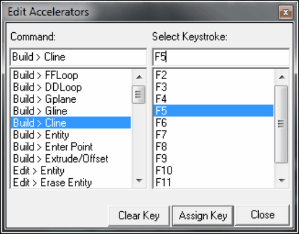

Permet de définir des raccourcis clavier personnalisés.

Par exemple, pour attribuer la touche F5 à la fonction Build > Cline, attribuez la touche de fonction comme suit :

- Notez que les attributions de touches de fonction sont conservées d'une session à l'autre dans le fichier Map3D.cfg.
