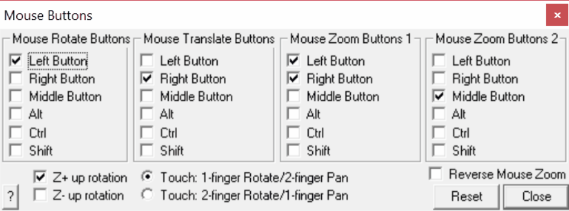

## 5.6.1.1 Boutons de la souris

Permet de définir des fonctions personnalisées de rotation, de translation et de zoom à la souris.

Notez que deux boutons au maximum peuvent être définis pour chaque fonction. Ces boutons sont conservés d'une session à l'autre.

Z+ up rotation : indique que l'axe Z+ est contraint à pointer verticalement, de sorte que lorsque l'axe Z+ pointe vers le haut, faire glisser la souris vers la gauche fait pivoter le modèle vers la gauche.

Z- up rotation : inverse l'hypothèse précédente. Dans ce cas, l'axe Z+ est contraint à pointer verticalement, de sorte que lorsque l'axe Z+ pointe vers le haut, faire glisser la souris vers la gauche fait pivoter le modèle vers la droite.

Touch: 1-finger Rotate/2-finger Pan : commandes tactiles réglées pour qu'un glissement à 1 doigt fasse pivoter le modèle et qu'un glissement à 2 doigts le déplace.

Touch: 2-finger Rotate/1-finger Pan : commandes tactiles réglées pour qu'un glissement à 2 doigts fasse pivoter le modèle et qu'un glissement à 1 doigt le déplace.

Touch Zoom : un pincement à deux doigts zoome sur le modèle.

Reverse Mouse Wheel : inverse l'action de la molette, de sorte qu'une rotation vers l'avant agrandit le modèle au lieu de le réduire.

## 5.6.1.2 Délai du double-clic

Spécifie le délai (en millisecondes) entre les deux clics d'un double-clic.

Les doubles-clics servent à activer les fonctions de modification

CAD > Edit

## 5.6.1.3 Délai avant glissement

Spécifie la durée (en millisecondes) pendant laquelle vous devez maintenir un bouton de la souris enfoncé avant que le pointeur de glissement n'apparaisse.

Le pointeur de glissement sert à faire pivoter, translater et zoomer le modèle.
