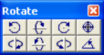
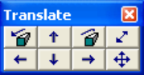
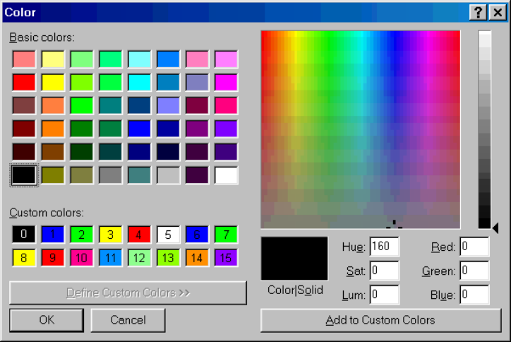

## 5.6.2.1 Barre d'outils de rotation

Active la barre d'outils de rotation.

Le modèle peut être pivoté à l'aide de ces boutons ou en faisant glisser l'icône d'orientation jusqu'à la position souhaitée.

Rotate Counter clockwise (touche Insert)

Rotate Up (touche Home ou shift+flèche haut)

Rotate Clockwise (touche Page Up)

Rotate Left (touche Delete ou shift+flèche gauche)

Rotate Down (touche End ou shift+flèche bas)

Rotate Right (touche Page Down ou shift+flèche droite)

View > Centre of Rotation

View > Rotation Increment

Remarques :

Si la barre d'outils de rotation n'est pas visible, elle peut être activée avec

Tools > Rotation Toolbar

Avant de faire pivoter le modèle, vous devez définir le centre de rotation souhaité

View > Centre of Rotation

## 5.6.2.2 Barre d'outils de translation

Active la barre d'outils de translation.

Le modèle peut être translaté à l'aide de ces boutons ou en le faisant glisser jusqu'à la position souhaitée.

Zoom In (touche Entrée ou « + ») Translate Up (flèche haut) Zoom Out (Ctrl+Entrée ou touche « - ») Translate Left (flèche gauche) Translate Down (flèche bas) Translate Right (flèche droite) View > Zoom Factor

View > Translation Increment

Remarques :

Si la barre d'outils de translation n'est pas visible, elle peut être activée avec

Tools > Translation Toolbar

Avant d'effectuer un zoom avant

Zoom In

vous devez définir le centre de rotation souhaité

View > Centre of Rotation

## 5.6.2.3 Barre d'outils des contours

Active la barre d'outils des contours, après une analyse BEM de Map3D.

La configuration par défaut de cette barre d'outils est la suivante :

Cette barre d'outils donne un accès rapide aux paramètres de contrainte les plus utilisés.

Plot > Stress > S1 Major Principal Stress

Plot > Stress > S3 Minor Principal Stress

Plot > Stress > Tmax Maximum Shear Stress

Plot > Stress active la barre d'outils des contraintes. Cette barre contient toutes les composantes de contrainte.

Plot > Surface Components active la barre d'outils de surface. Cette barre contient toutes les composantes de surface.

Plot > Strength Factors active la barre d'outils des facteurs de résistance. Cette barre contient toutes les composantes de paramètres de résistance.

Plot > Stress > User Tracé de contraintes défini par l'utilisateur.

Plot > Range définit la plage de contours (minimum, maximum, intervalle...) du contour actuellement tracé.

Plot > Grid Selection Active la barre d'outils de sélection de grille.

Plot > Surface Components > Options définit les options du tracé de contours (trajectoires, lignes de contours...).

Tools > Contouring Toolbar Configure ajoute ou retire des boutons de la barre d'outils des contours.

Remarques :

Vous pouvez déplacer les boutons sur la barre d'outils simplement en maintenant le bouton gauche de la souris enfoncé et en faisant glisser le bouton à l'emplacement souhaité.

La barre d'outils des contours ne peut être activée qu'après l'étape de construction du modèle (CAD)

Étapes d'analyse de Map3D.

## 5.6.2.4 Configurer la barre d'outils des contours

Ajoute ou retire des boutons de la barre d'outils des contours.

Cochez ou décochez simplement l'élément souhaité pour l'ajouter à la barre d'outils ou le retirer.

Remarques :

La barre d'outils des contours ne peut être activée

#### Tools > Contouring toolbar

qu'après l'étape de construction du modèle (CAD)

Étapes d'analyse de Map3D.

Vous pouvez déplacer les boutons sur la barre d'outils simplement en maintenant le bouton gauche de la souris enfoncé et en faisant glisser le bouton à l'emplacement souhaité.

La configuration de la barre d'outils est conservée d'une analyse à l'autre dans le fichier map3d.ini.

## 5.6.2.5 Barre d'outils de résolution

Active la barre d'outils de résolution, pendant l'analyse BEM de Map3D.

La configuration par défaut de cette barre d'outils est la suivante :

Cette barre d'outils donne un accès rapide aux paramètres importants pendant l'étape de résolution de l'analyse BEM de Map3D

#### Analysis > BEM Analysis

Plot > Surface Components > Serr Stress Error Plot > Surface Components > Ferr Failure Error Plot > Surface Components > Shear Stress Plot > Surface Components > Normal Stress Plot > Surface Components > Shear Displacement (Ride)

Plot > Surface Components active la barre d'outils de surface contenant toutes les composantes de surface. Plot > Range définit la plage de contours (minimum, maximum, intervalle...) du contour actuellement tracé.

Plot > Surface Components > Options définit les options du tracé de contours (trajectoires, lignes de contours...).

Tools > Solve Toolbar Configure ajoute ou retire des boutons de la barre d'outils de résolution.

Remarques :

Pendant l'analyse, la barre d'outils de résolution s'affiche lorsque vous suspendez l'analyse

#### Analysis > Suspend.

Si cette option n'est pas cochée, la barre d'outils de résolution ne sera pas activée lorsque vous suspendez l'analyse BEM de Map3D.

Vous pouvez déplacer les boutons sur la barre d'outils simplement en maintenant le bouton gauche de la souris enfoncé et en faisant glisser le bouton à l'emplacement souhaité.

La barre d'outils de résolution ne peut être activée qu'après l'étape de construction du modèle (CAD)

#### Étapes d'analyse de Map3D.

Sujets connexes :

Analysis > Auto Plot.

Analysis > Auto Range.

## 5.6.2.6 Configurer la barre d'outils de résolution

Ajoute ou retire des boutons de la barre d'outils de résolution.

Cochez ou décochez simplement l'élément souhaité pour l'ajouter à la barre d'outils ou le retirer.

Remarques :

La barre d'outils de résolution ne peut être activée

#### Tools > Solve toolbar

qu'après l'étape de construction du modèle (CAD)

#### Étapes d'analyse de Map3D

Pendant l'analyse, la barre d'outils de résolution s'affiche lorsque vous suspendez l'analyse

#### Analysis > Suspend

Vous pouvez déplacer les boutons sur la barre d'outils simplement en maintenant le bouton gauche de la souris enfoncé et en faisant glisser le bouton à l'emplacement souhaité.

La configuration de la barre d'outils est conservée d'une analyse à l'autre dans le fichier map3d.ini.

## 5.6.2.7 Barre d'outils de vue

Active la barre d'outils de vue.

La configuration par défaut de cette barre d'outils est la suivante

Cette barre d'outils donne un accès rapide à diverses fonctions d'affichage.

View > Centre of Rotation   Définit le centre de rotation. Ce point reste fixe pendant que vous faites pivoter et zoomer l'affichage.

View > Zoom   active une fenêtre de zoom graphique. Vous serez invité à sélectionner les deux coins de la fenêtre en cliquant une fois sur chacun.

View > Pan   active un panoramique graphique. Vous serez invité à sélectionner les deux extrémités du vecteur de déplacement en cliquant une fois sur chacune.

View > Length   active un outil graphique de mesure des longueurs. Vous serez invité à sélectionner les deux extrémités du vecteur de longueur en cliquant une fois sur chacune. Ces points doivent être sélectionnés sur le modèle ou sur un contour. La longueur, le pendage et la direction de pendage du vecteur sélectionné sont indiqués. Si vous maintenez la touche Shift enfoncée en sélectionnant les points, vous pouvez définir une ligne composée de plusieurs segments et obtenir la longueur totale. Si vous définissez une forme polygonale fermée (en maintenant la touche Shift enfoncée en sélectionnant les points) sur un tracé de contours, la valeur moyenne du contour à l'intérieur du polygone est indiquée (voir Plot > Polygon Box). Des fenêtres rectangulaires simples peuvent être définies en maintenant la touche Shift enfoncée et en faisant glisser pour ouvrir une fenêtre.

View > Hide active la barre d'outils de masquage.

View > Hide Block Colours active la barre d'outils de masquage des couleurs de blocs.

View > Hide CLine Colours active la barre d'outils de masquage des couleurs de lignes de construction.

File > Mining Step active la barre d'outils de sélection de l'étape d'exploitation.

Tools > View Toolbar Configure ajoute ou retire des boutons de la barre d'outils de vue.

Remarques :

Vous pouvez déplacer les boutons sur la barre d'outils simplement en maintenant le bouton gauche de la souris enfoncé et en faisant glisser le bouton à l'emplacement souhaité.

## 5.6.2.8 Configurer la barre d'outils de vue

Ajoute ou retire des boutons de la barre d'outils de vue.

Cochez ou décochez simplement l'élément souhaité pour l'ajouter à la barre d'outils ou le retirer.

Remarques :

Vous pouvez déplacer les boutons sur la barre d'outils simplement en maintenant le bouton gauche de la souris enfoncé et en faisant glisser le bouton à l'emplacement souhaité.

La configuration de la barre d'outils est conservée d'une analyse à l'autre dans le fichier map3d.ini.

## 5.6.2.9 Barre d'outils CAD

Active la barre d'outils CAD.

La configuration par défaut de cette barre d'outils est la suivante :

Cette barre d'outils donne un accès rapide aux fonctions CAD utilisées à l'étape de construction et de modification du modèle de l'analyse BEM de Map3D

#### Analysis > Go to CAD

CAD > Build Active la barre d'outils de construction pour créer de nouvelles entités du modèle.

CAD > Snap Active la barre d'outils d'accrochage (snap) pour définir le mode d'accrochage. CAD > Edit Active la barre d'outils de modification pour modifier les entités du modèle. CAD > Grid Selection Active la barre d'outils de sélection de grille pour afficher les grilles. Tools > CAD Toolbar > Configure Ajoute ou retire des boutons.

Remarques :

La barre d'outils CAD n'est affichée que pendant l'étape de construction et de modification du modèle de l'analyse

#### Analysis > Go to CAD

Si cette option n'est pas cochée, la barre d'outils CAD ne sera pas activée pendant l'étape de construction et de modification du modèle.

Vous pouvez déplacer les boutons sur la barre d'outils simplement en maintenant le bouton gauche de la souris enfoncé et en faisant glisser le bouton à l'emplacement souhaité.

Sujets connexes :

Map3D Analysis Stages

## 5.6.2.10 Configurer la barre d'outils CAD

Ajoute ou retire des boutons de la barre d'outils CAD.

Cochez ou décochez simplement l'élément souhaité pour l'ajouter à la barre d'outils ou le retirer.

Remarques :

La barre d'outils CAD ne peut être activée

#### Tools > CAD toolbar

que pendant l'étape de construction du modèle (CAD)

#### Étapes d'analyse de Map3D

Vous pouvez déplacer les boutons sur la barre d'outils simplement en maintenant le bouton gauche de la souris enfoncé et en faisant glisser le bouton à l'emplacement souhaité.

La configuration de la barre d'outils est conservée d'une analyse à l'autre dans le fichier map3d.ini.

## 5.6.2.11 Couleurs des blocs

Attribue des couleurs personnalisées pour le rendu des blocs.

Map3D utilise 16 couleurs de base pour le rendu.

L'utilisateur peut attribuer n'importe quelle couleur aux couleurs de base, et Map3D en génère automatiquement des nuances pour le rendu.

Les couleurs sont utilisées comme suit :

- Colour 0 - couleur d'arrière-plan de l'écran.

- Colour 1-4 – couleurs de l'élastique de sélection et des marqueurs.

- Colour 5 – couleur de premier plan, utilisée pour le texte, les contours de blocs, les symboles de trajectoires et les lignes de grille.

- Colour 6 – blocs de numéro de couleur 1, 11, 21, 31, ...

- Colour 7 - blocs de numéro de couleur 2, 12, 22, 32, ...

- Colour 8 - blocs de numéro de couleur 3, 13, 23, 33, ...

- Colour 9 - blocs de numéro de couleur 4, 14, 24, 34, ...

- Colour 10 - blocs de numéro de couleur 5, 15, 25, 35, ...

- Colour 11 - blocs de numéro de couleur 6, 16, 26, 36, ...

- Colour 12 - blocs de numéro de couleur 7, 17, 27, 37, ...

- Colour 13 - blocs de numéro de couleur 8, 18, 28, 38, ...

- Colour 14 - blocs de numéro de couleur 9, 19, 29, 39, ...

- Colour 15 - blocs de numéro de couleur 10, 20, 30, 40, ...

La réaffectation d'une couleur se fait en trois étapes :

1. Choisissez la couleur à redéfinir parmi les « Custom Colors: ».

2. Définissez la nouvelle couleur souhaitée en la choisissant dans les « Basic Colors: », dans la « Color Matrix » ou en réglant « Hue: Sat: Lum: Red: Green: Blue: ».

3. Cliquez sur le bouton « Add to Custom Colors ».

Toutes les couleurs peuvent être rétablies aux valeurs par défaut d'origine de Map3D en sélectionnant

#### Tools > Set Default Block Colours

Les couleurs personnalisées sont conservées d'une analyse à l'autre dans le fichier map3d.ini.

## 5.6.2.12 Couleurs des contours

Attribue des couleurs personnalisées pour le rendu des contours.

Map3D utilise 16 couleurs de base pour le tracé des contours.

Les couleurs sont utilisées comme suit :

- Colour 0 - couleur d'arrière-plan de l'écran.

- Colour 1 – couleur de contour inférieure à la plage.

- Colour 2 à 11 – couleurs de contours.

- Colour 12 couleur de contour supérieure à la plage.

- Colour 13 – couleur de la limite de traction.

- Colour 15 – couleur de premier plan, utilisée pour le texte, les contours de blocs, les symboles de trajectoires et les lignes de grille.

La réaffectation d'une couleur se fait en trois étapes :

1. Choisissez la couleur à redéfinir parmi les « Custom Colors: ».

2. Définissez la nouvelle couleur souhaitée en la choisissant dans les « Basic Colors: », dans la « Color Matrix » ou en réglant « Hue: Sat: Lum: Red: Green: Blue: ».

3. Cliquez sur le bouton « Add to Custom Colors ».

Les couleurs personnalisées sont conservées d'une analyse à l'autre dans le fichier map3d.ini.

Les couleurs de contours peuvent être rétablies aux valeurs par défaut de Map3D en sélectionnant

Tools > Set Contour Colours

## 5.6.2.13 Rétablir les couleurs de blocs par défaut

Rétablit toutes les couleurs aux valeurs par défaut d'origine de Map3D.

Les couleurs personnalisées peuvent être définies avec

Tools > Custom Colours

## 5.6.2.14 Rétablir les couleurs de contours 1

Rétablit toutes les couleurs aux valeurs par défaut d'origine de Map3D.

Les couleurs personnalisées peuvent être définies avec

#### Tools > Contour Colours

## 5.6.2.18 Configurer la police des boutons

Attribue une police, une taille, une couleur, etc. personnalisées aux boutons.

Map3D utilise la « Windows System Font » pour dessiner tous les boutons.

L'utilisateur peut redéfinir cette police et ses caractéristiques d'affichage.

La police peut être rétablie à la valeur par défaut d'origine de Map3D en sélectionnant

#### Tools > Reset Default Font

La police personnalisée est conservée d'une analyse à l'autre dans le fichier map3d.ini.

## 5.6.2.19 Rétablir la police par défaut

Rétablit la police des boutons à la valeur par défaut d'origine de Map3D.

Une police personnalisée peut être définie avec

Tools > Configure Button Font

## 5.6.2.20 Boutons de petite taille

Permet de définir la taille des boutons de la barre d'outils.
