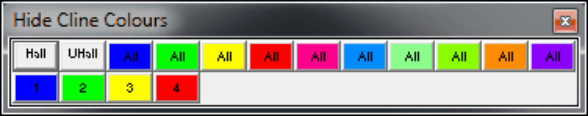

## 5.2.4.1 Tout masquer

Permet de masquer toutes les lignes de construction de la couleur sélectionnée.

Cette barre d'outils peut être passée en orientation verticale en la faisant glisser contre le bord droit ou gauche de la fenêtre principale.

Elle peut revenir en orientation horizontale en la faisant glisser contre le bord supérieur ou inférieur de la fenêtre principale.

Le bouton de la barre d'outils d'affichage active la barre d'outils Hide Cline Colours.

View > Hide Cline Colours > Hide All   Masque toutes les lignes de construction.

View > Hide Cline Colours > Unhide All   Affiche toutes les lignes de construction masquées.

La première rangée masque et affiche toutes les lignes de construction de la couleur associée.

Les autres boutons portent le numéro de couleur de ligne de construction associé et servent à masquer celles-ci.

Notez que la barre d'outils peut défiler et être redimensionnée.

Pour la redimensionner, saisissez un bord ou un coin et faites-le glisser jusqu'à la taille et la forme voulues. Les barres de défilement n'apparaissent que si les boutons sont trop nombreux pour la taille et la forme actuelles.
