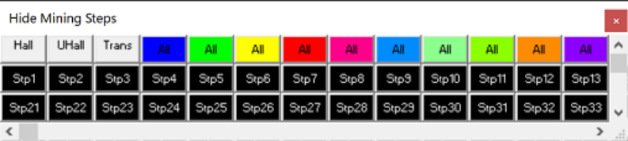

## 5.2.3.1 Tout masquer

Permet de masquer tous les blocs excavés à l'étape indiquée.

Cette barre d'outils peut être passée en orientation verticale en la faisant glisser contre le bord droit ou gauche de la fenêtre principale.

Elle peut revenir en orientation horizontale en la faisant glisser contre le bord supérieur ou inférieur de la fenêtre principale.

#### Le

bouton de la barre d'outils d'affichage active la barre d'outils Hide Excavation Steps.

View > Hide Block Colours > Hide All   Masque toutes les surfaces de blocs.

View > Hide Block Colours > Unhide All   Affiche toutes les surfaces masquées.

La première rangée masque et affiche tous les blocs de la couleur associée.

Les autres boutons portent des numéros d'étape d'excavation et servent à masquer ces étapes.

Notez que la barre d'outils peut défiler et être redimensionnée.

Pour la redimensionner, saisissez un bord ou un coin et faites-le glisser jusqu'à la taille et la forme voulues. Les barres de défilement n'apparaissent que si les boutons sont trop nombreux pour la taille et la forme actuelles.
