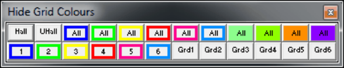

## 5.2.5.1 Tout masquer

Permet de masquer toutes les grilles de la couleur sélectionnée.

Cette barre d'outils peut être passée en orientation verticale en la faisant glisser contre le bord droit ou gauche de la fenêtre principale.

Elle peut revenir en orientation horizontale en la faisant glisser contre le bord supérieur ou inférieur de la fenêtre principale.

Ce bouton active la barre d'outils Hide Grid Colours.

View > Hide Grid Colours > Hide All   Masque toutes les grilles.

View > Hide Grid Colours > Unhide All   Affiche toutes les grilles masquées.

La première rangée masque et affiche toutes les grilles de la couleur associée.

Les boutons portant le numéro de couleur de grille associé servent à masquer ces grilles. Le nom de grille associé à chaque numéro de couleur s'affiche dans l'info-bulle et dans la liste du menu.

Les autres boutons servent à masquer des grilles individuelles, comme dans Grid Selection.

Notez que la barre d'outils peut défiler et être redimensionnée.

Pour la redimensionner, saisissez un bord ou un coin et faites-le glisser jusqu'à la taille et la forme voulues. Les barres de défilement n'apparaissent que si les boutons sont trop nombreux pour la taille et la forme actuelles.
