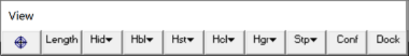
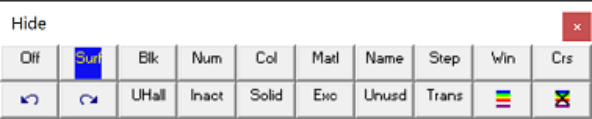

- **5.2.1.1** **Off**

Ces outils permettent de masquer facilement différentes parties de la géométrie.

Sélectionner le bouton de la barre d'outils View active la barre d'outils Hide

Notez que si le bouton ne figure pas dans la barre d'outils View, vous pouvez l'y ajouter à l'aide du bouton, puis en sélectionnant Hide > Hide More.

View > Hide > Off   Désactive la fonction de masquage.

View > Hide > Surfaces   Masque les surfaces en les sélectionnant une à une.

View > Hide > Blocks   Masque toutes les surfaces qui composent le bloc sélectionné.

View > Hide > Numbers   Masque toutes les surfaces portant le numéro de couleur de bloc sélectionné.

View > Hide > Colour   Masque toutes les surfaces de la couleur sélectionnée.

View > Hide > Materials   Masque toutes les surfaces portant le numéro de matériau sélectionné. Un même bloc peut contenir différents matériaux selon l'étape d'exploitation actuellement active.

Lorsque vous utilisez cette dernière fonction, veillez à sélectionner l'étape d'exploitation appropriée

File > Mining Step

View > Hide > Names   Masque toutes les surfaces portant le nom de bloc sélectionné.

View > Hide > Steps   Masque toutes les surfaces exploitées à l'étape sélectionnée.

View > Hide > Window   Masque toutes les surfaces situées dans la fenêtre sélectionnée. Les entités ne sont sélectionnées que si elles sont entièrement contenues dans la fenêtre.

View > Hide > Crossing   Masque toutes les surfaces situées dans la fenêtre de sélection par intersection. Les entités sont sélectionnées même si une partie seulement de l'entité se trouve dans la fenêtre.

View > Hide > Undo last Hide   Annule la dernière opération de masquage (10 au maximum sont actuellement conservées).

View > Hide > Redo last Hide   Rétablit l'opération de masquage précédente (10 au maximum sont actuellement conservées).

View > Hide > Unhide All   Réaffiche toutes les surfaces actuellement masquées.

View > Hide > Inactive   Lorsque cette option est activée, les éléments inactifs sont affichés. Les surfaces inactives servent à afficher des éléments inclus uniquement à des fins de visualisation et qui ne doivent pas être utilisés dans l'analyse des contraintes proprement dite

#### CAD > Edit > Entity Properties

View > Hide > Solids   Lorsque cette option est activée, les solides sont masqués. Les solides sont des blocs 3D ou des plans DD qui ne sont pas excavés.

Au fil de la séquence d'exploitation

#### File > Mining Step

différents blocs seront excavés. Pour n'afficher que les excavations, activez cette option.

View > Hide > Excavations   Lorsque cette option est activée, les excavations sont masquées.

View > Hide > Unused   Lorsque cette option est activée, les éléments inutilisés sont masqués. Les éléments inutilisés sont des surfaces de blocs 3D ou des plans DD qui ne sont pas utilisés dans l'analyse. De tels éléments existent là où une faille traverse une excavation, ou là où un matériau de numéro inférieur se trouve dans une zone de numéro supérieur (p. ex. un dyke traversant une zone minéralisée).

Au fil de la séquence d'exploitation

#### File > Mining Step

cela peut changer. Pour masquer les surfaces inutilisées, activez cette option. Pour plus de détails, voir

Analysis > Options > Closure

#### Constructing Alternate Material Zones

View > Hide > Translucent   Lorsque cette option est activée, les surfaces masquées sont affichées en translucide.

View > Hide > Show Errors   Masque/affiche les erreurs (lorsque cette option est activée, seules les erreurs d'éléments sont affichées). Notez que cette option peut être utilisée avec l'option View > Hide > Translucent.

View > Hide > Hide Errors   Masque/affiche les erreurs (lorsque cette option est activée, les

#### erreurs d'éléments ne sont pas affichées).

À l'étape CAD, les différentes couleurs indiquent les problèmes suivants :

- Violet : des vides ont été trouvés et comblés, ce qui a résolu le problème. Ce message n'indique pas d'erreur et est fourni à titre d'information.

- Vert : des blocs en double ont été trouvés et supprimés, ce qui a résolu le problème. Ce message n'indique pas d'erreur et est fourni à titre d'information.

- Bleu : des vides étroits ont été détectés. Ces vides n'indiquent pas d'erreur et ne constituent pas nécessairement un problème ; toutefois, si des problèmes surviennent lors de l'analyse des intersections ou de l'analyse BEM, ces emplacements en sont les causes les plus probables. Ce message n'indique pas d'erreur et est fourni à titre d'avertissement.

- Blanc : des arêtes qui se relient dans le mauvais sens ont été détectées. Les blocs fermés doivent avoir toutes leurs arêtes reliées de façon cohérente afin que l'intérieur et l'extérieur d'un bloc puissent être déterminés sans ambiguïté. Les arêtes blanches ne satisfont pas cette exigence. Ce message indique bien une erreur, qui doit être corrigée avant de poursuivre l'analyse.

- Orange : des arêtes qui ne se relient pas à d'autres arêtes ont été détectées. Les blocs fermés doivent avoir toutes leurs arêtes reliées à une autre arête pour former un bloc fermé. Les arêtes orange ne satisfont pas cette exigence. Ce message indique bien une erreur, qui doit être corrigée avant de poursuivre l'analyse.

- Jaune : des arêtes qui se relient à plus d'une autre arête ont été détectées. Les blocs fermés doivent avoir toutes leurs arêtes reliées à une seule autre arête pour former un bloc fermé. Les arêtes jaunes ne satisfont pas cette exigence. Ce message indique bien une erreur, qui doit être corrigée avant de poursuivre l'analyse.

- Rouge : met en évidence les zones visco-plastiques ayant des formes hexaédriques non valides. Dans Map3D Visco-Plastic, les zones plastiques ne peuvent avoir que des formes d'hexaèdre (4 coins en haut et 4 coins en bas) ou une dégénérescence de cette forme, comme un tétraèdre.

À l'étape INTERSECTION, les différentes couleurs indiquent les problèmes suivants :

- Violet : une surface a été désactivée en raison d'un contact non résolvable. Lors de l'analyse des contacts entre les différentes surfaces de blocs, la façon dont cette surface s'articule avec une autre surface n'a pas pu être résolue ; la surface a donc été désactivée et ne sera pas utilisée dans l'analyse des contraintes BEM. La cause la plus probable de ce problème est une forme très étrange, comme un triangle extrêmement étroit. Bien qu'il s'agisse d'une erreur, on peut normalement l'ignorer, car les formes extrêmement étroites contribuent très peu aux résultats de l'analyse.

- Vert : une surface a été désactivée en raison d'une fermeture non résolvable. Lors de l'analyse de la fermeture d'un bloc, la façon dont cette surface s'articule avec le bloc n'a pas pu être résolue ; la surface a donc été désactivée et ne sera pas utilisée dans l'analyse des contraintes BEM. La cause la plus probable de ce problème est une forme très étrange, comme un triangle extrêmement étroit. Bien qu'il s'agisse d'une erreur, on peut normalement l'ignorer, car les formes extrêmement étroites contribuent très peu aux résultats de l'analyse.

- Bleu : des vides étroits ont été détectés. Ces vides n'indiquent pas d'erreur et ne constituent pas nécessairement un problème ; toutefois, si des problèmes surviennent lors de l'analyse des intersections ou de l'analyse BEM, ces emplacements en sont les causes les plus probables. Ce message n'indique pas d'erreur et est fourni à titre d'avertissement.

- Blanc : des surfaces non fermées ont été détectées. Lors de l'analyse de la fermeture d'un bloc, il s'est avéré impossible de déterminer de façon cohérente l'intérieur et l'extérieur du bloc. Ce message indique bien une erreur, qui doit être corrigée avant de poursuivre l'analyse.

- Orange : des arêtes qui ne se relient pas à d'autres arêtes ont été détectées. Les blocs fermés doivent avoir toutes leurs arêtes reliées à une autre arête pour former un bloc fermé. Les arêtes orange ne satisfont pas cette exigence. Ce message indique bien une erreur, qui doit être corrigée avant de poursuivre l'analyse.

- Jaune : une surface a été désactivée en raison d'une forme non résolvable. La cause la plus probable de ce problème est une forme très étrange, comme un triangle extrêmement étroit. Bien qu'il s'agisse d'une erreur, on peut normalement l'ignorer, car les formes extrêmement étroites contribuent très peu aux résultats de l'analyse.
