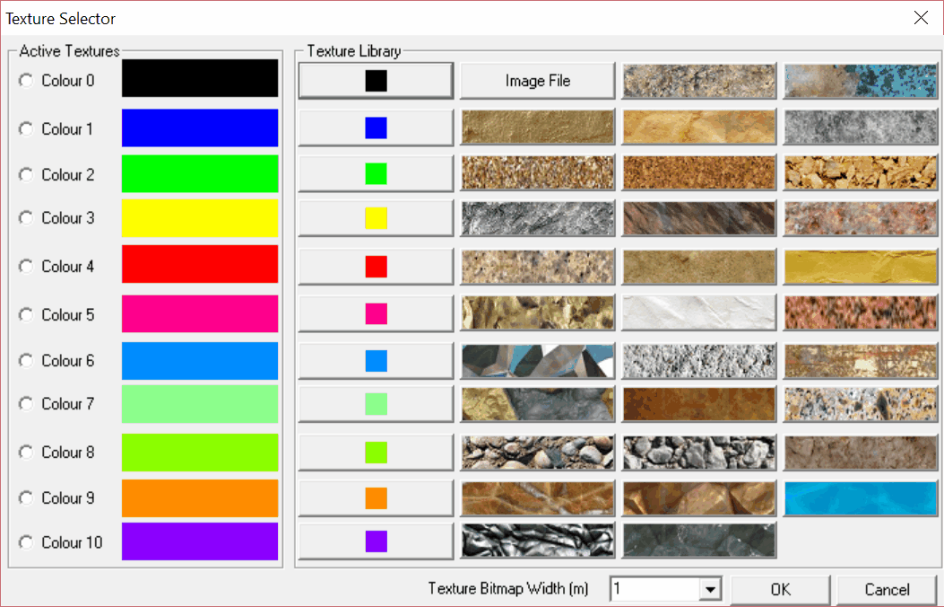

## 5.2.6.1 Block Outlines

Définit les options de rendu du modèle.

View > Render > Block Outlines - les blocs sont dessinés avec des contours montrant leurs arêtes.

View > Render > Grid Lines - les blocs sont dessinés avec des lignes à intervalles réguliers de la grille. L'intervalle de la grille vous est demandé lorsque vous activez cette fonction.

View > Render > Block Colours - les blocs sont dessinés avec un ombrage de couleur. Désactivez cette fonction pour obtenir une vue filaire.

View > Render > Material Numbers - les blocs sont colorés selon la propriété de matériau affectée au bloc. Un même bloc peut contenir différents matériaux selon l'étape d'exploitation actuellement active.

Lorsque vous utilisez cette fonction, veillez à sélectionner l'étape d'exploitation appropriée

#### File > Mining Step

View > Render > Mining Step Numbers - les blocs sont colorés selon l'étape d'exploitation à laquelle ils sont excavés.

View > Render > Dark Shading - les blocs sont dessinés avec un modèle d'ombrage à source lumineuse sombre. Un rayon d'arête vous est demandé lorsque vous activez cette fonction. Le rayon d'arête sert à ombrer les arêtes et les coins pour leur donner un aspect arrondi. Le rayon d'arête doit être spécifié comme une fraction de l'épaisseur du bloc. L'ombrage peut ralentir considérablement la fréquence de rafraîchissement.

View > Render > Bright Shading - les blocs sont dessinés avec un modèle d'ombrage à source lumineuse vive. Un rayon d'arête vous est demandé lorsque vous activez cette fonction. Le rayon d'arête sert à ombrer les arêtes et les coins pour leur donner un aspect arrondi. Le rayon d'arête doit être spécifié comme une fraction de l'épaisseur du bloc. L'ombrage peut ralentir considérablement la fréquence de rafraîchissement.

View > Render > Texture Rendering - active ou désactive le rendu de textures. Le rendu de textures permet de colorer les surfaces avec une image bitmap plutôt qu'avec une couleur unie. Voir Assign Bock Textures

View > Render > Block Numbers - les blocs sont dessinés avec des numéros sur leurs surfaces. Ces numéros correspondent au mode de rendu actuellement sélectionné : Block Colours, Material Numbers ou Mining Step Numbers.

View > Render > Block Names - les blocs sont dessinés avec leurs noms sur leurs surfaces.

View > Render > Coordinate Numbers - les blocs sont dessinés avec leurs noms sur leurs surfaces.

View > Render > Backfacing Surfaces - lorsque cette option est activée, les faces arrière des blocs FF 3D sont dessinées. En général, l'utilisateur n'a ni besoin ni envie de voir ces surfaces.

View > Render > Fixed With Spacing - lorsque cette option est activée, les surfaces dont la discrétisation à largeur fixe est spécifiée sont rendues en montrant la discrétisation.

View > Render > Discretize - bascule l'affichage entre les vues discrétisée et non discrétisée du modèle. View > Render > Perspective - bascule entre l'affichage en perspective et l'affichage orthogonal. En mode orthogonal, toutes les dimensions sont dessinées à l'échelle réelle. En vue en perspective, les entités plus éloignées de l'observateur sont dessinées plus petites.

View > Render > Clines Dot Radius - spécifie le rayon des points qui seront dessinés à tous les sommets des lignes de construction. Cela ralentit sensiblement le dessin et ne doit être utilisé qu'en cas de besoin. Une valeur nulle indique qu'aucun point ne sera dessiné.

View > Render > Point Size - spécifie le rayon des points qui seront dessinés à tous les sommets lors de la sélection.

View > Render > Line Width - spécifie l'épaisseur des contours de blocs et des lignes de contours.

## 5.2.6.9 Assign Block Textures

Le rendu de textures permet de colorer les surfaces avec une image bitmap plutôt qu'avec une couleur unie. Pour cela, procédez comme suit :

1. sélectionnez le numéro de couleur auquel vous voulez affecter la texture (p. ex. Colour 0, Colour 1 ...)

2. sélectionnez l'un des bitmaps prédéfinis, ou choisissez votre propre bitmap avec « Image File ».

3. Pour plaquer l'image bitmap sur chaque surface, vous devez spécifier le « Texture Bitmap With ». Le « Texture Bitmap With » met à l'échelle le bitmap spécifié de sorte que le motif se répète selon la largeur géométrique indiquée.

Par exemple, si vous spécifiez 1 m comme largeur, le bitmap sera mis à l'échelle de façon à être dessiné avec une largeur de 1 m sur les surfaces de vos blocs.

## 5.2.6.10 Small Block Numbers

Définit les options de rendu du modèle.

View > Render > Block Outlines - les blocs sont dessinés avec des contours montrant leurs arêtes.

View > Render > Grid Lines - les blocs sont dessinés avec des lignes à intervalles réguliers de la grille. L'intervalle de la grille vous est demandé lorsque vous activez cette fonction.

View > Render > Block Colours - les blocs sont dessinés avec un ombrage de couleur. Désactivez cette fonction pour obtenir une vue filaire.

View > Render > Material Numbers - les blocs sont colorés selon la propriété de matériau affectée au bloc. Un même bloc peut contenir différents matériaux selon l'étape d'exploitation actuellement active.

Lorsque vous utilisez cette fonction, veillez à sélectionner l'étape d'exploitation appropriée

#### File > Mining Step

View > Render > Mining Step Numbers - les blocs sont colorés selon l'étape d'exploitation à laquelle ils sont excavés.

View > Render > Dark Shading - les blocs sont dessinés avec un modèle d'ombrage à source lumineuse sombre. Un rayon d'arête vous est demandé lorsque vous activez cette fonction. Le rayon d'arête sert à ombrer les arêtes et les coins pour leur donner un aspect arrondi. Le rayon d'arête doit être spécifié comme une fraction de l'épaisseur du bloc. L'ombrage peut ralentir considérablement la fréquence de rafraîchissement.

View > Render > Bright Shading - les blocs sont dessinés avec un modèle d'ombrage à source lumineuse vive. Un rayon d'arête vous est demandé lorsque vous activez cette fonction. Le rayon d'arête sert à ombrer les arêtes et les coins pour leur donner un aspect arrondi. Le rayon d'arête doit être spécifié comme une fraction de l'épaisseur du bloc. L'ombrage peut ralentir considérablement la fréquence de rafraîchissement.

View > Render > Texture Rendering - active ou désactive le rendu de textures. Le rendu de textures permet de colorer les surfaces avec une image bitmap plutôt qu'avec une couleur unie. Voir Assign Bock Textures

View > Render > Block Numbers - les blocs sont dessinés avec des numéros sur leurs surfaces. Ces numéros correspondent au mode de rendu actuellement sélectionné : Block Colours, Material Numbers ou Mining Step Numbers.

View > Render > Block Names - les blocs sont dessinés avec leurs noms sur leurs surfaces.

View > Render > Coordinate Numbers - les blocs sont dessinés avec leurs noms sur leurs surfaces.

View > Render > Backfacing Surfaces - lorsque cette option est activée, les faces arrière des blocs FF 3D sont dessinées. En général, l'utilisateur n'a ni besoin ni envie de voir ces surfaces.

View > Render > Fixed With Spacing - lorsque cette option est activée, les surfaces dont la discrétisation à largeur fixe est spécifiée sont rendues en montrant la discrétisation.

View > Render > Discretize - bascule l'affichage entre les vues discrétisée et non discrétisée du modèle. View > Render > Perspective - bascule entre l'affichage en perspective et l'affichage orthogonal. En mode orthogonal, toutes les dimensions sont dessinées à l'échelle réelle. En vue en perspective, les entités plus éloignées de l'observateur sont dessinées plus petites.

View > Render > Clines Dot Radius - spécifie le rayon des points qui seront dessinés à tous les sommets des lignes de construction. Cela ralentit sensiblement le dessin et ne doit être utilisé qu'en cas de besoin. Une valeur nulle indique qu'aucun point ne sera dessiné.

View > Render > Point Size - spécifie le rayon des points qui seront dessinés à tous les sommets lors de la sélection.

View > Render > Line Width - spécifie l'épaisseur des contours de blocs et des lignes de contours.
