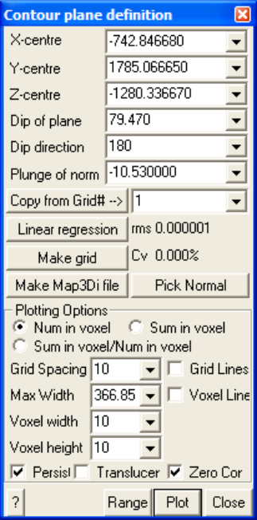
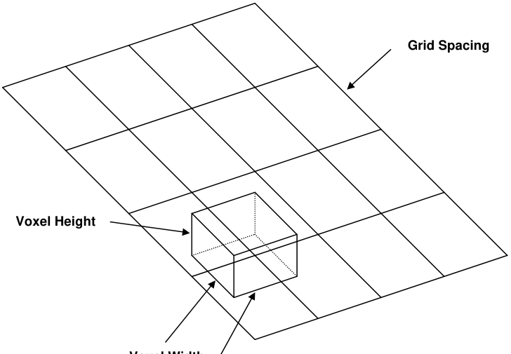
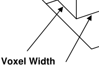

Permet de configurer le plan utilisé pour tracer les contours des données de points de visualisation (voir Visualization).

**X-centre** – la valeur de la coordonnée x du centre du plan de contours.

**Y-centre** – la valeur de la coordonnée y du centre du plan de contours. **Z-centre** – la valeur de la coordonnée z du centre du plan de contours. **Dip of plane** – le pendage du plan de contours.

**Dip direction** – la direction de pendage du plan de contours.

**Dip of normal** – le pendage de la normale au plan de contours (cette valeur est à 90° du pendage du plan).

**Pick Normal** - active le curseur pour sélectionner une surface de façon interactive. Le centre, le pendage et la direction de pendage du plan de contours seront réglés parallèlement à la surface sélectionnée.

**Copy from Grid#** – copie les paramètres de position et d'orientation depuis un plan de grille du modèle. **Linear regression** – trouve le plan de meilleur ajustement à travers les données sismiques en minimisant la distance normale

de tous les points au plan.

**Make Grid** – crée un plan de grille du modèle à partir du plan de contours.

**Make Map3Di file** – génère, à partir des données contourées, un fichier de données destiné au chargement sismique dans une analyse **Map3Di** (plus de détails ci-dessous).

#### Contour Plane Options:

**Num in voxel** – le nombre de points dans chaque voxel est contouré. **Sum in voxel** – la somme des valeurs de l'équation de tracé pour tous les points situés dans le voxel est contourée.

**Sum/Num in voxel** – le quotient des deux valeurs est contouré.

- **Grid spacing** – l'espacement de grille utilisé pour contourer les données sismiques. Comme le voxel est centré sur chaque coin de la grille, ce paramètre contrôle la densité des voxels. Notez que si l'espacement de la grille est inférieur à la largeur du voxel, les voxels adjacents se chevaucheront.

**Voxel width** – la largeur du voxel est mesurée parallèlement aux bords du plan de grille.

**Voxel height** – la hauteur du voxel est mesurée perpendiculairement au plan de grille. Cela permet à l'utilisateur de

limiter la distance au plan de grille dans laquelle les données seront incluses dans le tracé des contours.

**Outlines** – dessine les contours réels des voxels.

- **Persist** – lorsque cette option est cochée, les points sont retracés chaque fois que le modèle est réorienté, translaté ou zoomé. Comme cela peut être long pour les gros modèles, cette option n'est pas toujours souhaitable.

**Translucent** - dessine les points sous forme de sphères translucides.

**Zero Contour** - lorsque cette option est décochée, les contours inférieurs au minimum de la plage de contours ne sont pas dessinés. Cela

est utile pour afficher des contours lorsque seule la partie supérieure de la plage est importante. **Range** – spécifie le minimum, le maximum et l'intervalle pour la mise à l'échelle du rayon et les contours.

- Plot régénère le tracé. Ce bouton peut être placé soit dans la barre d'outils de vue (Tools >

- View Toolbar Configure), soit dans la barre d'outils des contours (Tools > Contour Toolbar Configure).

#### Linear Regression:

La régression linéaire est effectuée en cherchant le plan ayant la valeur **_rms_** minimale (la moyenne quadratique, ou distance moyenne de tous les points au plan ajusté).

La théorie standard du coefficient de corrélation ne convient pas comme mesure de la qualité de l'ajustement dans ce cas. En effet, nous ne cherchons pas la « mesure du degré d'association entre variables », mais plutôt une mesure de la façon dont le plan ajusté représente nos données. Notez que si toutes les données se trouvent dans un même plan horizontal, l'ajustement du plan est parfait. Pourtant, par définition, la corrélation est nulle

(et le coefficient de corrélation est donc égal à zéro), car la valeur de z ne dépend pas des valeurs de x ou de y. Ce n'est pas ce que nous voulons.

On définit ici un paramètre semblable à un coefficient de variation (une mesure de la variabilité divisée par la grandeur). **_Cv_** est simplement défini comme la valeur **_rms_** (la distance moyenne de tous les points au plan ajusté) divisée par la distance moyenne de tous les points au centroïde. Cela mesure dans quelle mesure le plan représente les données. Ce rapport est généralement exprimé en pourcentage. Ainsi défini, des données aléatoires donnent un **Cv** =100 % (100 % de variabilité). Un ajustement parfait donne un **_Cv_** =0 (0 % de variabilité). Notez qu'il est possible que **_Cv_** dépasse 100 %. Ce paramètre peut être vu comme le rapport entre la variabilité autour du plan et la largeur physique du jeu de données.

C'est très proche de la définition formelle du coefficient de variation, qui est l'écart type divisé par la moyenne. La plupart des matériaux géologiques ont des propriétés dont le **_Cv_** est de l'ordre de 20 à 30 %. **_Cv_** pourrait être converti en un coefficient de corrélation équivalent à l'aide de

**_r_ = (1-** **_Cv_ ²)****½**

mais ce n'est pas vraiment le paramètre approprié, et sa définition pose problème lorsque **_Cv_** dépasse 1.

**rms** et **_Cv_** sont tous deux affichés pour le plan courant chaque fois que des données sont tracées.

#### Make Map3Di file:

Pour créer un fichier de chargement Map3Di, il faut déterminer la distribution du déplacement de cisaillement (ride) indiquée par la sismicité. Cela nécessite plusieurs hypothèses (voir A. McGarr, « Some Applications of Seismic Source Mechanism Studies to Assessing Underground Hazard », Proc. 1st International Symposium on Rockbursts and Seismicity in Mines, SAIMM, Johannesburg, 1984, pp. 199-208, et Hoffman, G, R. Sewjee and G. van Aswegan, « First steps in the integration of numerical modelling and seismic monitoring », 5th International Symposium on Rockburst and Seismicity in Mines, SAIMM, Johannesburg, 2000, pp. 397-404.), résumées ici :

1) Supposer un modèle de glissement. On peut envisager ici un modèle de fissure elliptique (Brune) ou un modèle d'aspérité à bords mous dus au fluage (Walsh, J.J. and J. Waterson, « Distribution of cumulative displacements and seismic slip on a single normal fault surface », J. Struct. Geol., V. 9, 1987, pp. 1039-1046). En général, une forme circulaire (en pièce de monnaie) sera utilisée, sauf si l'utilisateur dispose d'un moyen de définir une autre forme.

2) La valeur moyenne du glissement peut être déterminée à partir du moment sismique **_Mo_ =** m **_AD_**, où m est le module de rigidité, **_A_** est l'aire de la source (déterminée à partir du rayon de la source) et **_D_** est le glissement moyen sur la faille. Elle peut aussi être déterminée à partir de la « chute de déformation sismique » (Seismic Strain Drop).

3) Le rayon de la surface de glissement peut être estimé à partir du rayon de Brune, où b est la vitesse des ondes de cisaillement et **_fo_** la fréquence de coin. Pour un modèle d'aspérité, le rayon **_a_ = 2.34** b **/(2** p **_fo_ )**, où b est déterminé à partir du rayon du « volume apparent » (Apparent Volume), est probablement plus approprié.

4) L'orientation du glissement peut être déterminée à partir du tenseur du moment sismique, s'il est disponible, ou à partir de l'état de contraintes issu de la modélisation.

À partir de ces 4 éléments, on peut déterminer le profil de glissement indiqué par l'événement sismique.

Pour un profil elliptique, la distribution du déplacement de cisaillement (ride) est donnée par

**1.50** **_D_ (1-** **_r_ ²/** **_a_ ²)****½**

Pour un profil d'aspérité, la distribution du déplacement de cisaillement (ride) est donnée par

#### 2.89 _D_ (1- _r_ / _a_ )(1+2 _r_ / _a_ -3 _r_ ²/ _a_ ²)½

Un fichier de chargement sismique pour Map3Di peut être généré comme suit :

- 1) Construisez un fichier de données sismiques sous forme d'une série de points :

**x1 y1 z1 f1 f2 … x2 y2 z2 f1 f2 … x3 y3 z3 f1 f2 … ...**

où **xi yi zi** représentent les coordonnées de chaque point,

**f1** indique le glissement moyen **_D_** et **f2** indique le rayon de la source **_a_** .

- 2) Dans la routine Visualization, pour un profil elliptique, spécifiez l'équation de tracé comme

   - **1.50*f1*sqrt(1-rip^2/f2^2)**

Pour un profil d'aspérité, utilisez

#### 2.89*f1*(1-rip/f2)*sqrt(1+2*rip/f2-3*rip^2/f2^2)

3) Choisissez le plan souhaité et l'espacement de grille, puis réglez la hauteur et la largeur de voxel souhaitées. La hauteur du voxel peut servir à écarter les événements hors du plan. Il est important de choisir une largeur de voxel égale au plus grand rayon d'événement souhaité afin de répartir le déplacement de cisaillement (ride) sur tous les voxels concernés.

- 4) Réglez les options de tracé sur « Sum in Voxel » et tracez (Plot).

- 5) Make Map3Di file.

- 6) Visualisez le fichier Map3Di avec CAD > Properties > Map3Di Setup et consultez le paramètre f2.

Pour plus de détails sur le format des données, voir **CAD > Properties > Map3Di**.
