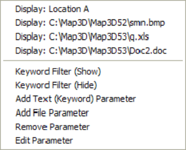

Cette fonction permet d'afficher une base de données d'informations géologiques utiles, telles que la teneur, la qualité du massif rocheux, etc.

Chaque point peut être étiqueté avec une série de :

- valeurs numériques (p. ex. couleur, magnitude, orientation, etc.)

- mots-clés

- messages texte

- noms de fichiers (p. ex. fichiers graphiques, documents, tableurs, etc.)

Pour activer cette fonction, faites un clic droit sur un point de données de visualisation (voir Visualization).

S'il n'y a aucun point de visualisation, vous pouvez en créer un avec Make Point, qui ajoute un nouveau point.

Le clic droit affiche un menu contextuel comportant les options suivantes :

Les éléments « Display » de la section supérieure de ce menu sont des données rattachées au point de données (respectivement une chaîne de texte, une image bitmap, un tableur et un document). Sélectionner l'un d'eux affiche cet élément.

Les éléments de la section inférieure du menu sont des fonctions qui accèdent à la base de données :

- **Keyword Filter (Show)** – sert à spécifier une série de filtres de mots-clés d'affichage. Seules les données de points associées à l'un de ces mots-clés seront visibles, toutes les autres seront masquées. Cela permet de filtrer l'affichage des entrées de la base de données souhaitées.

- **Keyword Filter (Hide)** – sert à spécifier une série de filtres de mots-clés de masquage. Les données de points associées à l'un de ces mots-clés seront masquées, toutes les autres seront visibles. Cela permet de filtrer l'affichage des entrées de la base de données non souhaitées.

- **Add Text (Keyword) Parameter** - sert à ajouter une chaîne de texte à un point de données. Ce texte sert au filtrage par mots-clés et sera ajouté à la liste d'affichage.

- **Add File Parameter** - sert à ajouter un paramètre de fichier à un point de données. Le nom du fichier sert au filtrage par mots-clés et ce fichier sera ajouté à la liste d'affichage. Tout nom de fichier peut être indiqué ici (p. ex. fichiers graphiques, tableurs, documents, etc.). Si le type de fichier est associé à une application, celle-ci est lancée automatiquement pour afficher le fichier indiqué.

**Remove Parameter** - sert à supprimer un paramètre du point de données.

**Edit Parameter** - sert à modifier un paramètre.
