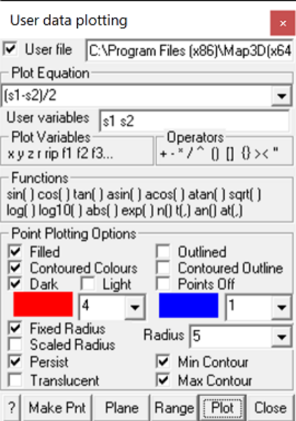

Cette option permet de visualiser des données de points au format de fichier texte. Les points peuvent être affichés sous forme de sphères ombrées par une source lumineuse, dont le diamètre et/ou la couleur varient selon la magnitude, et contourés sur un plan pour afficher la densité, etc.

Map3D prend aussi en charge la visualisation de fichiers au format EVP.

Chaque point peut être étiqueté avec une série de :

- valeurs numériques (p. ex. couleur, magnitude, orientation, etc.)

- messages texte

- noms de fichiers (p. ex. fichiers graphiques, documents, tableurs, etc.)

Un clic gauche sur un point affiche son emplacement, sa magnitude et son message texte dans la barre d'état.

Un clic droit sur un point active la base de données visuelle (Visual Database). Cette fonction permet d'afficher une base de données d'informations géologiques utiles, telles que la teneur, la qualité du massif rocheux, etc. Chaque point peut être étiqueté avec une série de :

- valeurs numériques (p. ex. couleur, magnitude, orientation, etc.)

- messages texte

- noms de fichiers (p. ex. fichiers graphiques, documents, tableurs, etc.)

#### Event File:

Le fichier d'événements est simplement un fichier texte (*.txt).

Ce format est utile pour échanger des données brutes de modèle avec d'autres logiciels de CAO.

Les lignes de commentaire doivent commencer par un astérisque « * » ou un dièse « # ».

Les données sismiques sont stockées sous forme d'une série de points, comme suit :

**x1 y1 z1 f1 f2 f3 … "text message" "file name"... x2 y2 z2 f1 f2 f3 … "text message" "file name"... x3 y3 z3 f1 f2 f3 … "text message" "file name"...**

où **xi yi zi** représentent les coordonnées de chaque point,

**f1 f2 f3…** indique une série facultative de valeurs numériques (p. ex. couleur, magnitude, orientation, etc.), **text message** indique une série facultative de chaînes de texte qui doivent être placées entre guillemets doubles. **file name** indique une série facultative de noms de fichiers qui doivent être placés entre guillemets doubles.

- Le message texte et le nom de fichier s'affichent dans la barre d'état en bas de l'écran lorsque vous sélectionnez un événement avec le bouton gauche de la souris.

- Ils peuvent aussi être modifiés en sélectionnant un événement avec le bouton droit de la souris.

- La sélection avec le bouton droit de la souris permet aussi d'afficher le fichier si son nom est associé à une application (voir la documentation de Windows sur la façon d'« associer un fichier à un programme »).

#### Fusionner plusieurs fichiers en une seule base de données

Vous pouvez sélectionner plusieurs fichiers à la fois en maintenant les touches Windows standard « shift » ou « ctrl » enfoncées pour une sélection multiple.

Ces fichiers seront fusionnés en une seule base de données.

Cela vous permet de conserver des parties distinctes de vos données de visualisation dans des fichiers différents, puis de les fusionner facilement en une seule base de données.

#### Plot Equation:

Définit le paramètre qui sera tracé, p. ex. **(f1-f2)/2** ou, de manière équivalente, **(sig1-sig3)/2**

- La liste déroulante permet de mémoriser jusqu'à 20 équations différentes. Elles sont conservées d'une session Map3D à l'autre dans le fichier map3d.ini.

#### Plot Variables:

**f1 f2 f3…** champs de données du fichier d'événements.

Des variables définies par l'utilisateur (par exemple **sig1 sig3 …** ) peuvent être définies pour indiquer les en-têtes de colonnes correspondant à **f1 f2 f3…**

Elles peuvent être définies dans la ligne de commentaire, c'est-à-dire toute ligne commençant par « * » ou « # » **.** Il suffit d'indiquer les variables de tracé définies par l'utilisateur, par exemple comme suit :

*** x y z sig1 sig2 ...**

#### Functions:

**sin() cos() tan()** fonctions trigonométriques sinus, cosinus et tangente **asin() acos() atan()** fonctions trigonométriques inverses **sqrt()** fonction racine carrée **log()** fonction logarithme népérien **log10()** fonction logarithme décimal **abs()** valeur absolue **exp()** fonction exponentielle (antilogarithme) **n() t(,)** loi normale et loi de Student **an() at(,)** loi normale inverse et loi de Student inverse

#### Location:

**x y z** coordonnées du point de grille.

#### Operators:

- **+ - * /** ^   opérateurs d'addition, de soustraction, de multiplication, de division et d'exponentiation. Notez que les exponentielles sont calculées en premier, suivies des multiplications et divisions, puis des additions et soustractions.

- **() [] &#123;&#125;** types de parenthèses. Les paires de parenthèses doivent correspondre.

- valeur maximale. Par exemple, si l'équation de tracé est spécifiée comme f1 > 10, la plus grande des valeurs f1 et 10 sera tracée.

- **&lt;** valeur minimale. Par exemple, si l'équation de tracé est spécifiée comme f1 &lt; 10, la plus petite des valeurs f1 et 10 sera tracée.

#### Point Plotting Options:

**Filled** – les points sont remplis avec la couleur spécifiée, une couleur de contour et/ou un ombrage.

**Contoured Colours** – la couleur de remplissage est ajustée selon la magnitude déterminée à partir de **Plot Equation** .

**Dark** – la couleur de remplissage est ombrée pour donner l'apparence de sphères éclairées par une source lumineuse, avec une palette de couleurs sombres et riches.

**Light** – la couleur de remplissage est ombrée pour donner l'apparence de sphères éclairées par une source lumineuse, avec une palette de couleurs vives et brillantes.

**Outlined** – les points sont cerclés avec la couleur spécifiée ou une couleur de contour.

**Contoured Outline** – les points sont dessinés avec des couleurs de contour ajustées selon la magnitude déterminée à partir de **Plot Equation** .

**Contour Plane** – active ou désactive l'affichage d'un plan de contours (voir **Plane** ).

**Fixed Radius** – les points seront tracés sous forme de sphères avec le paramètre **Radius:** spécifié.

**Scaled Radius** – les points seront tracés sous forme de sphères dont le rayon est proportionnel à la magnitude (déterminée

à partir de **Plot Equation** ), de sorte que si la magnitude est inférieure au minimum de la plage de contours, la sphère est dessinée avec un rayon nul. Si la magnitude est égale au maximum de la plage de contours, le vecteur est dessiné avec le rayon spécifié par le paramètre **Radius:**.

#### Other:

**Persist** – lorsque cette option est cochée, les points sont retracés chaque fois que le modèle est réorienté, translaté ou zoomé. Comme cela peut être long pour les gros modèles, cette option n'est pas toujours souhaitable.

**Translucent** - dessine les points sous forme de sphères translucides.

**Zero Contour** - lorsque cette option est décochée, les contours inférieurs au minimum de la plage de contours ne sont pas dessinés. Cela

est utile pour afficher des contours lorsque seule la partie supérieure de la plage est importante.

**Make Point** - ajoute un nouveau point.

**Plane** – permet de configurer le plan de contours.

**Range** – spécifie le minimum, le maximum et l'intervalle pour la mise à l'échelle du rayon et les contours.

Plot régénère le tracé. Ce bouton peut être placé soit dans la barre d'outils de vue (Tools > View Toolbar Configure), soit dans la barre d'outils des contours (Tools > Contour Toolbar Configure).
