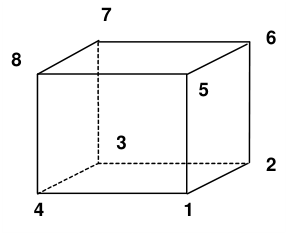
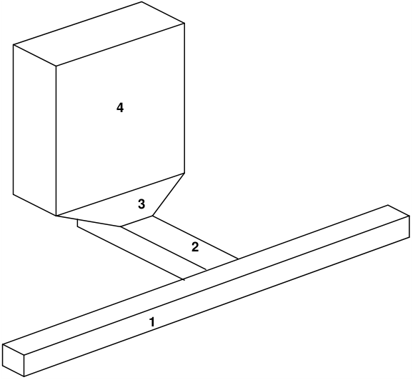

Pour de nombreux problèmes, la forme exacte des surfaces d'excavation importe peu, car on recherche une évaluation plus globale de la stabilité, par exemple l'état des piliers, des appuis ou de l'éponte supérieure. Comme il est très fastidieux de décrire l'emplacement et les connexions de chaque surface, Map3D permet aussi d'assembler les modèles à partir de blocs tridimensionnels.

CAD > Build > Block

CAD > Build > DD Loop CAD > Build > FF Loop

#### CAD > Build > Tunnel

Ces blocs servent à construire des excavations tridimensionnelles, des zones de matériaux alternatifs et des zones remblayées. Ils sont définis par une face supérieure et une face inférieure comportant chacune 4 sommets. Les sommets peuvent être saisis dans le sens horaire ou antihoraire, à condition que les faces supérieure et inférieure soient alignées l'une sur l'autre (le sommet 5 doit être en face du sommet 1, le 2 en face du 6, etc.). Les côtés n'ont pas besoin d'être parallèles ni plans, et n'importe quel sommet peut être répété pour définir des formes à 3 côtés et des coins.

Ces blocs peuvent être empilés pour créer des formes d'excavation complexes ou des limites de zones minéralisées. Ils sont reliés entre eux soit par des sommets communs, soit du fait qu'ils se recoupent. Les côtés communs à plusieurs blocs ou qui pénètrent dans d'autres blocs sont automatiquement coupés et supprimés. Le volume contenu dans la structure de blocs définit une excavation, une zone minéralisée, une zone plastifiante, des zones remblayées, etc.

Pour illustrer ce point, prenons une configuration simple de point de soutirage assemblée à partir de 4 blocs. Le bloc 1 représente la galerie de soutirage, le bloc 2 le recoupe, le bloc 3 le point de soutirage et le bloc 4 le chantier. Le préprocesseur de Map3D identifie les connexions entre ces blocs, les découpe et supprime les surfaces communes aux blocs adjacents.
