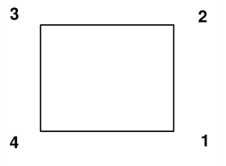
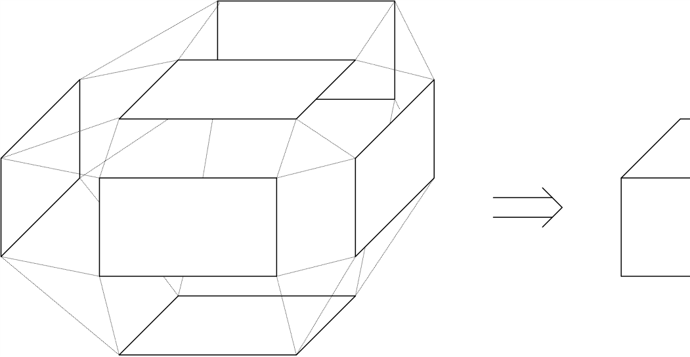
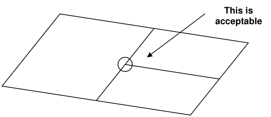

Les modèles peuvent être construits à partir de facettes de surface individuelles.

CAD > Build > Block

#### CAD > Build > DD Loop

Celles-ci sont définies par des polygones à 3 ou 4 côtés qui n'ont pas besoin d'être plans. Les sommets peuvent être saisis dans le sens horaire ou antihoraire. N'importe quel sommet peut être répété pour définir des formes à 3 côtés et des coins.

Les facettes de surface peuvent aussi servir à construire des surfaces d'excavation et des contours de minerai complexes. La routine

#### CAD > Build > FF Loop

vous aide à construire facilement des agencements complexes tels que construits. Elle fonctionne en suivant le contour de plusieurs plans de niveau ou coupes, puis en les reliant automatiquement.

C'est souvent la meilleure approche, en particulier pour construire des modèles tels que construits d'ouvrages dont la forme exacte est bien connue. Elle est utile pour l'analyse très détaillée de nombreux ouvrages de génie civil, où les concentrations de contraintes et l'évaluation des instabilités locales sont la préoccupation principale.

Ces formes peuvent être construites avec les fonctions de CAO intégrées à Map3D ou importées depuis d'autres logiciels de CAO dans l'un des formats suivants :

- Format AutoCAD-DXF. Il s'agit d'un format d'échange de dessins courant, d'extension « .DXF ».

- Le format de fichier de points est un fichier de données ASCII universel d'extension « .PNT ».

Même pour des formes simples, cette méthode de construction peut vite devenir ingérable. Comme il faut créer une série de facettes de surface qui forment ensemble une enveloppe continue, sans raccord ni chevauchement, aucun espace ni trou ne doit subsister.

Lorsque les modèles sont construits de cette manière, Map3D vérifie que des surfaces fermées sont formées

#### Analysis > Options > Closure

De plus, toutes les surfaces sont renumérotées de manière cohérente afin de garantir qu'elles créent des volumes positifs

#### Analysis > Options > Renumber

Cette renumérotation peut échouer si les surfaces ne sont pas fermées, c'est-à-dire si l'excavation présente des trous dus à des parties manquantes.

Contrairement à d'autres programmes d'analyse (méthodes isoparamétriques des éléments de frontière et méthodes des éléments finis ou des différences finies), ces plaques n'ont pas besoin de partager des sommets communs. Vous pouvez définir des éléments subdivisés au milieu de leurs arêtes, à condition qu'il n'y ait aucun espace. Bien que les modèles puissent être construits par cette technique de modélisation surfacique, la modélisation volumique est plus simple et plus fiable

Construire des modèles à partir de blocs
